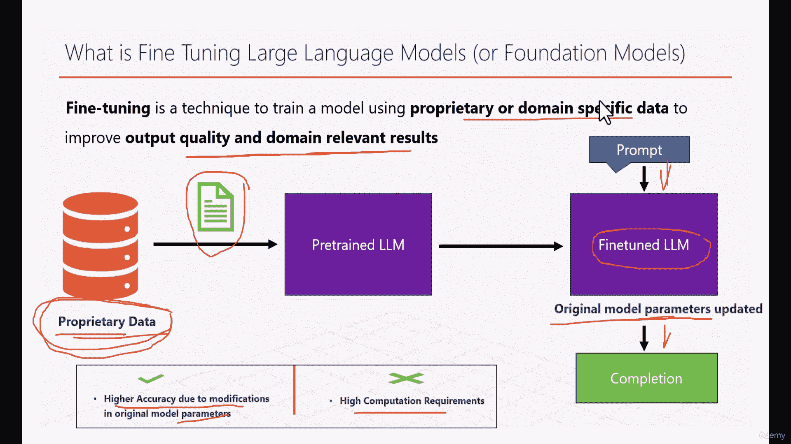
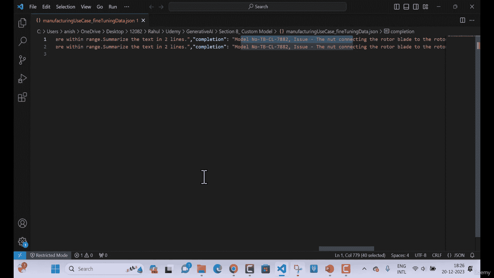

# AWS 生成式 AI 实战：第92-94节：基础模型微调概览 🎓

在本节课中，我们将要学习大语言模型的微调是什么，以及它为什么能帮助企业得到更贴近业务领域的结果。在前面一些章节中，我们已经接触过基础模型，也了解了它们通常会用大量通用互联网数据做训练。本节会把“预训练模型”和“微调模型”之间的关系讲清楚，并用大白话解释微调的基本流程、作用、优缺点和一个数据示例。

上一节我们介绍了基础模型依赖大规模数据训练这一背景，本节中我们来看看当基础模型直接用于具体业务时，可能会遇到什么问题，以及微调如何解决这些问题。

## 🧠 为什么需要微调

基础模型是在大量数据上训练出来的，这些数据可以是通用互联网数据。问题在于，这些基础模型虽然见得多，但如果我们把它们直接用到自己的业务场景里，它们不一定能给出与特定领域相关的结果。于是问题变成：我们怎样进一步训练基础模型，让它提供领域相关的结果。做法是用专有数据或领域特定数据继续训练模型，这样可以帮助提升输出质量，并让模型给出更贴近领域的结果。

上一段说明了微调的必要性，接下来我们用一个更直白的流程来理解“微调”到底在做什么。

## 🔧 微调的基本过程

我们有一个预训练的大语言模型或基础模型，它已经在通用互联网数据上训练过。我们可以把专有数据或领域特定数据放到这个预训练模型上继续训练，从而得到一个微调后的大语言模型或基础模型。这个过程之所以有用，是因为把专有数据跑在预训练基础模型上时，可以增强原始模型的参数。如果回忆起第一部分里的人工神经网络，我们说过：把一些专有数据传给人工神经网络，如果输出有误差，就用反向传播来调整权重。模型会根据生成的输出与我们提供的完成结果之间的偏差来确定误差，并据此调整权重。换句话说，模型会根据专有数据和完成结果来调整原始模型参数。

为了更直观地描述这个过程，可以用下面的公式表示核心思想。下面这个公式表达了微调时模型参数会根据损失函数进行更新：

\[
\theta_{\text{fine-tuned}} = \theta_{\text{pre-trained}} - \eta \nabla_\theta L(\text{output}, \text{completion})
\]

这里的核心意思是，预训练模型已经有一套参数，微调时我们不是从零开始，而是在原有参数基础上，根据专有数据和目标完成结果继续调整。这样模型就能把通用能力和领域知识结合起来。

上面解释了微调的参数更新思路，接下来我们看看一个常见疑问：既然还要用专有数据训练，为什么不能只用基础模型本身。

## ❓ 为什么还需要基础模型

你可能会问：如果我们后面还要用专有数据来训练基础模型，那为什么还需要大语言模型本身。原因在于，用于进一步微调基础模型的数据可能只有几千条记录，最多大约一万条记录；而训练基础模型时使用的数据量非常庞大。也就是说，基础模型已经吸收了大量通用知识，微调只是在它的基础上做领域适配。一旦得到微调模型，我们再发送提示，就能得到明显改进的完成结果。

理解了数据量差异后，我们再来看看微调带来的好处和需要付出的代价。

## ⚖️ 微调的优点和缺点

微调可以通过修改原始模型参数来提高准确性，这是它最直接的价值。不过，微调也有一个明显的缺点，就是它对计算资源的要求很高，因此会花费更多成本。换句话说，准确性的提升不是免费的，背后需要更多算力和费用支撑。

为了更清楚地对比，以下是微调的主要优点和缺点：

- 优点：通过修改原始模型参数，可以提高模型在目标任务上的准确性。
- 缺点：微调有较高的计算资源需求，因此会产生更高的费用。

这些优缺点说明，微调适合那些确实需要领域适配、并且愿意承担计算成本的场景。



前面我们从概念和优缺点上理解了微调，最后我们来看一个专有数据可能长什么样的例子。

## 📝 微调数据示例

最后展示一个例子，看看专有数据可能是什么样子。之前我们看过制造业中的摘要生成示例，这里展示的是用于微调的数据可能长什么样。这里给出几个例子：数据中会有一个提示，比如询问电子制动系统这里的问题是什么；同时还会提供对应的完成结果，也就是如何对这个问题进行总结。如果把几千条这种“提示加完成结果”格式的记录提供给模型，就能让基础模型生成更好的结果。

下面用一个简化的伪代码说明这种数据格式的组织方式：

```text
prompt: "电子制动系统这里的问题是什么？"
completion: "这里应给出对该问题的总结或答案。"

# 重复几千条类似记录
# 用这些记录继续训练预训练基础模型
```

在这个讲座中，基础模型和大语言模型这两个说法是互换使用的。希望这节课对你有帮助，下节课再见。



本节课中我们一起学习了基础模型微调的概念：微调用专有数据或领域特定数据继续训练预训练模型，从而增强原始参数并提升领域相关性；同时也了解了微调的数据量通常远小于基础模型训练数据、微调能提高准确性但需要更高计算成本，以及微调数据通常由提示和完成结果成对组成。希望这些内容能帮助初学者建立对基础模型微调的直观认识。
