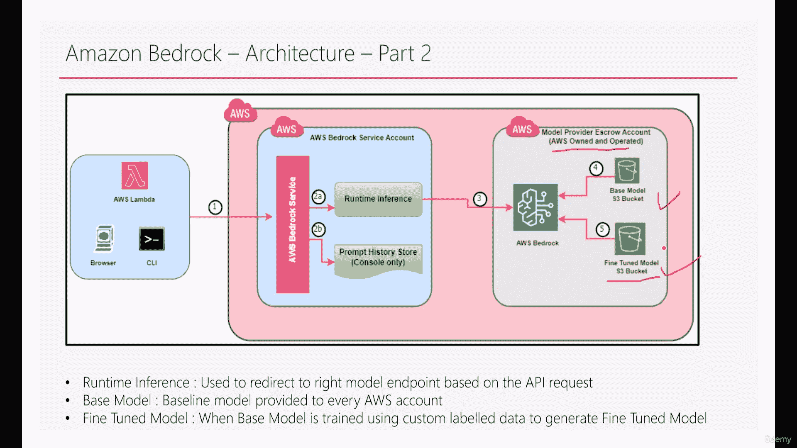
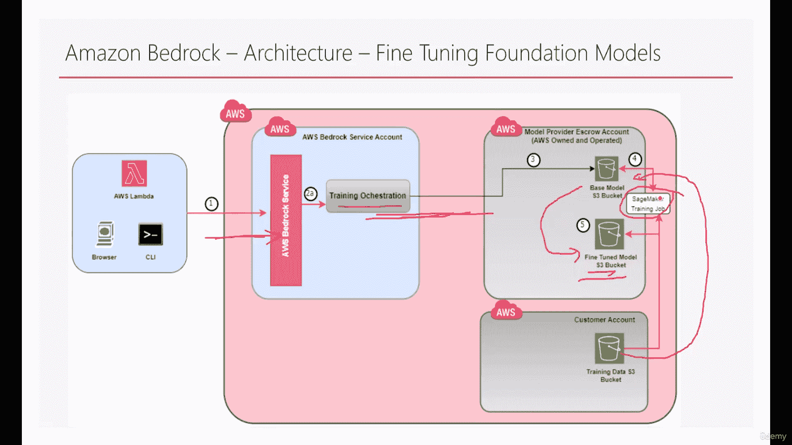
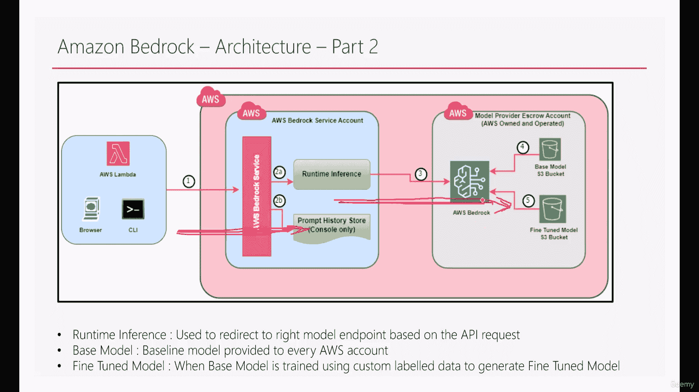
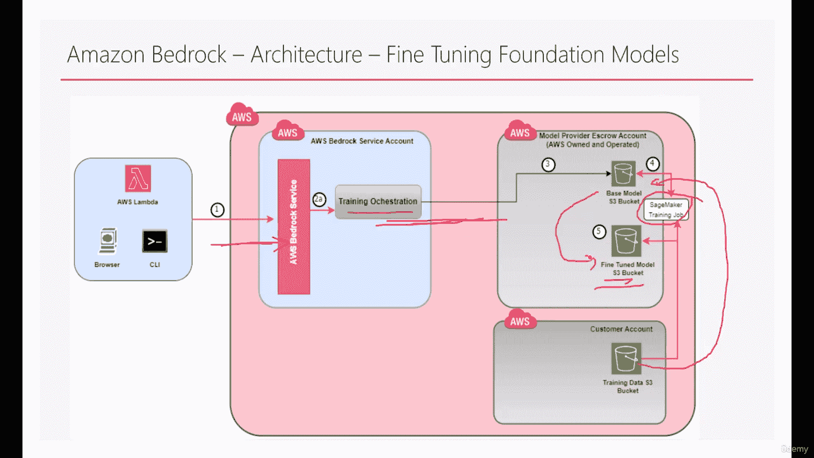

# 🚀 生成式AI on AWS：第93-95节：基础模型架构的微调

在本节课中我们将要学习 Amazon Bedrock 中基础模型微调的架构流程。内容对应原文 Part 1 的 p93 到 p95，主要包括：回顾 Bedrock 的请求链路、创建微调作业需要哪些参数、训练数据为什么可以放在客户账户的 S3 桶、Training Orchestration 如何生成 SageMaker 训练作业，以及微调完成后 API 请求如何路由到微调模型实例。整体思路是把“请求进来、模型路由、提交微调、训练产出、再次调用”这一条链路串起来，让初学者能够用大白话理解每一步在做什么。下面先从之前讲过的 Bedrock 请求链路开始回顾，再逐步进入微调作业的细节。

## 🧭 生成式AI on AWS：93.1：回顾 Amazon Bedrock 的请求链路

在之前某一节中，我们讨论了 Amazon Bedrock 架构的第一部分，当时说到 API 请求会通过某一个 AWS 服务、浏览器或 AWS CLI 进来，然后这个请求会进入 Amazon Bedrock 服务。这里顺便纠正一个口误：原文说成了 As Brock，实际应为 Amazon Bedrock 服务，后面都按正确名称来说明。理解这个请求入口很重要，因为后面无论是调用基础模型还是调用微调后的模型，请求都会沿着类似的链路进入 Bedrock，再由 Bedrock 内部完成模型定位和转发。

为了直观看到请求怎么走，可以先看下面这个简化流程。Runtime Inference 可以理解成“运行时推理调度员”，它会查看请求里的 modelId，也就是模型 ID，然后把请求路由到托管该模型的正确 AWS 账户。你选择的基础模型会在对应账户中有运行实例，这个运行实例负责生成响应。modelId 就像模型的身份证，填哪个模型，请求就去找哪个模型。

```text
API 请求（AWS 服务 / 浏览器 / AWS CLI）
        -> Amazon Bedrock 服务
        -> Runtime Inference 查看 modelId
        -> 路由到托管所选基础模型的正确 AWS 账户
        -> 基础模型运行实例生成响应
```

以下是这条请求链路中的关键点，按顺序列出来便于建立整体印象。

- API 请求会通过某一个 AWS 服务、浏览器或 AWS CLI 进入。
- 请求会进入 Amazon Bedrock 服务。
- 原文中的 As Brock 是口误，实际是 Amazon Bedrock 服务。
- Runtime Inference 会查看 modelId。
- 请求会被路由到托管所选基础模型的正确 AWS 账户。
- 该账户中有基础模型的运行实例，由它返回响应。
- 当时我们只讨论了基础基础模型，还没有展开微调模型。

理解基础模型的请求链路后，就能接着理解微调后的变化。正如上一讲讨论的，一旦对基础模型做微调，我们会得到一个微调基础模型，这个微调模型会再次托管在另一个 S3 桶中，位于 AWS 拥有和运营的账户内。基于 API 请求中的模型选择，Bedrock 可以返回基础模型的响应，也可以返回微调模型的响应。下一节我们来看看 AWS 是如何允许你对某个基础模型发起微调的。

## 🛠️ 生成式AI on AWS：94.1：创建微调作业与所需参数

上一节回顾了 Bedrock 的请求链路和基础模型、微调模型的区别，本节中我们来看看创建微调作业需要准备哪些信息。AWS 允许你创建一个微调作业，整体架构和前面的请求链路很相似，可以把它理解成填一张“训练任务申请表”：你告诉 Bedrock 用哪个基础模型、微调后的模型叫什么名字、训练数据放在哪个 S3 桶里，然后提交训练作业。参数看起来不多，但每一个都对应后续训练流程中的关键环节，所以初学者最好先把这几个字段分清楚。

以下是创建微调作业时需要提供的主要信息。

- 指定基础模型 ID，也就是你要微调的那个基础基础模型。
- 提供微调模型的名称，这个名字可以自己起，没有固定限制。
- 提供存储训练数据的 S3 桶名称。
- 训练数据应当以 JSON 对象的形式存放。

把这些信息组织成代码形式，可以更清楚地看到微调作业的输入结构。下面的字段只是示意，实际使用时需要替换成你自己的模型 ID、模型名称和 S3 地址。

```text
FineTuningJob {
  baseModelId: "基础基础模型ID",
  fineTunedModelName: "你给微调模型起的名字",
  trainingDataS3Uri: "s3://桶名/训练数据.json"
}
```

填好这些信息之后，就可以运行这个训练作业。这里需要特别注意的是训练数据到底放在哪里，因为很多初学者会误以为数据必须放到 AWS 内部账户中。下一节我们重点看 S3 桶和训练数据的存放位置。

## 🗂️ 生成式AI on AWS：94.2：训练数据可以放在客户账户的 S3 桶

上一节介绍了创建微调作业需要的基础模型 ID、微调模型名称和 S3 桶位置，本节中我们重点说明训练数据存放在哪里。一个关键点是：这个 S3 桶和里面的训练数据可以存放在客户账户中，你不需要把它们放到 AWS 托管和拥有的账户里。换句话说，训练数据可以留在客户自己的账户中，这一点对很多企业来说很重要，因为数据位置往往涉及权限、合规和管理边界。

以下是关于训练数据存放位置的关键点。



- 训练数据所在的 S3 桶可以由客户账户持有。
- 训练数据本身可以存放在客户账户中。
- 不需要把训练数据放到 AWS 托管和拥有的账户。
- 数据会存储在客户账户本身，而不是强制迁移到 AWS 内部账户。
- 训练数据需要以 JSON 对象形式组织。

所以，当你设定好源基础模型、给定微调模型名称、提供 S3 桶位置之后，就可以运行这个训练作业。作业运行后并不是直接在客户账户里“凭空训练”，而是会把请求交给 Amazon Bedrock 服务，由其中的训练编排机制继续处理。下一节我们来看看 Training Orchestration 和 SageMaker 训练作业是如何衔接的。

## ⚙️ 生成式AI on AWS：95.1：Training Orchestration 与 SageMaker 训练作业

上一节说明了训练数据可以放在客户账户的 S3 桶中，本节中我们来看看运行微调作业后，Bedrock 内部发生了什么。运行训练作业后，请求会进入 Amazon Bedrock 服务，服务中有一个机制叫 Training Orchestration，也就是训练编排。训练编排可以理解成“项目经理”，它自己不直接做全部训练，而是负责生成一个 SageMaker 训练作业，让 SageMaker 去执行实际训练任务。

以下是微调作业从提交到产出模型的主要流程。

- 运行微调作业后，请求进入 Amazon Bedrock 服务。
- Bedrock 服务中的 Training Orchestration 负责训练编排。
- 训练编排会生成一个 SageMaker 训练作业。
- SageMaker 训练作业会从客户账户中的 S3 桶读取训练数据。
- 训练作业会在你选择的基础基础模型上运行训练。
- 训练结束后会生成一个微调模型。
- 生成的微调模型会存储到 S3 桶中。

把这条流程写成代码化的步骤，会更容易记住各个组件的先后关系。这里要区分两个角色：Training Orchestration 负责组织和触发训练，SageMaker 训练作业负责实际执行训练，S3 桶负责存放训练数据和产出的微调模型。

```text
运行微调作业
  -> Amazon Bedrock 服务
  -> Training Orchestration（训练编排）
  -> 生成 SageMaker Training Job
  -> 从客户账户 S3 桶读取训练数据
  -> 在所选基础基础模型上训练
  -> 产出微调模型
  -> 将微调模型存入 S3 桶
```

训练完成并生成微调模型后，下一步就是如何在 API 请求中使用它。下一节我们来看看微调模型 ID 如何影响请求路由。

## 🎯 生成式AI on AWS：95.2：微调完成后如何路由 API 请求

上一节介绍了训练编排会生成 SageMaker 训练作业，并最终产出微调模型，本节中我们来看看微调完成后如何调用这个模型。微调完成之后，下一次发送 API 请求时，把 modelId 设置为你的微调模型 ID，这个请求就会进入微调基础模型的运行实例，由该实例返回响应。也就是说，Bedrock 会根据 API 请求中的模型选择，决定是返回基础模型的响应，还是返回微调模型的响应。

这个路由逻辑可以用下面的公式来描述。公式表达的意思很直白：如果 modelId 是基础模型，就返回基础模型响应；如果 modelId 是微调模型，就返回微调模型响应。

$$
\text{response} =
\begin{cases}
\text{base\_model\_response}, & \text{modelId} = \text{baseModelId}\\
\text{fine\_tuned\_model\_response}, & \text{modelId} = \text{fineTunedModelId}
\end{cases}
$$

以下是微调完成后请求路由的几个要点。

- 微调完成后，下一次 API 请求可以把 modelId 设置为微调模型 ID。
- 请求会进入微调基础模型的运行实例。
- 如果请求选择基础模型，就返回基础模型的响应。
- 如果请求选择微调模型，就返回微调模型的响应。
- Bedrock 根据 API 请求中的模型选择完成分流。

到这里，基础模型请求、微调作业创建、训练数据存放、训练编排和微调后请求路由就串成了一条完整链路。下一节我们对本节内容做一个总结。

## ✅ 生成式AI on AWS：95.3：本节总结





本节课中我们一起学习了 Amazon Bedrock 中基础模型微调的架构流程。我们首先回顾了 Bedrock 的请求链路：API 请求可以通过 AWS 服务、浏览器或 AWS CLI 进入 Amazon Bedrock 服务，Runtime Inference 会根据 modelId 把请求路由到托管所选基础模型的正确 AWS 账户，并由运行实例返回响应。原文中 As Brock 是口误，实际是 Amazon Bedrock 服务。之前只讨论了基础基础模型，而在微调基础模型之后，会得到一个微调基础模型，并托管在另一个 S3 桶中，位于 AWS 拥有和运营的账户内；API 请求可以根据模型选择返回基础模型或微调模型的响应。



接着我们学习了如何创建微调作业：指定基础模型 ID、提供微调模型名称、提供训练数据所在的 S3 桶名称，并确保训练数据是 JSON 对象形式。关键点是训练数据可以存放在客户账户的 S3 桶中，不需要放到 AWS 托管和拥有的账户，数据可以留在客户账户本身。设定好这些信息后运行训练作业，请求进入 Amazon Bedrock 服务，由 Training Orchestration 生成 SageMaker 训练作业，从客户账户的 S3 桶读取数据，在所选基础基础模型上训练，最终生成微调模型并存储到 S3 桶中。微调完成后，下次 API 请求把 modelId 设置为微调模型 ID，请求就会进入微调基础模型的实例。希望本讲内容对你有用，我们下一讲再见，谢谢。

