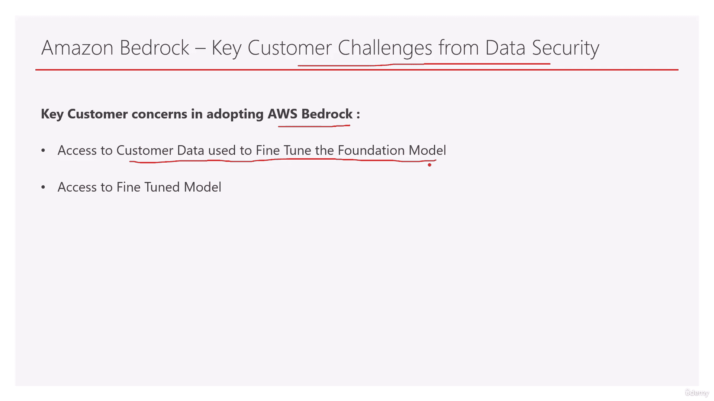
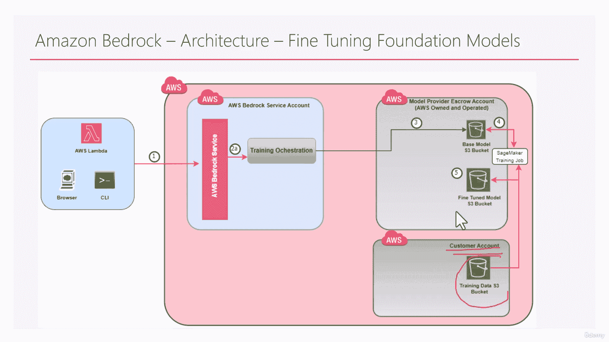
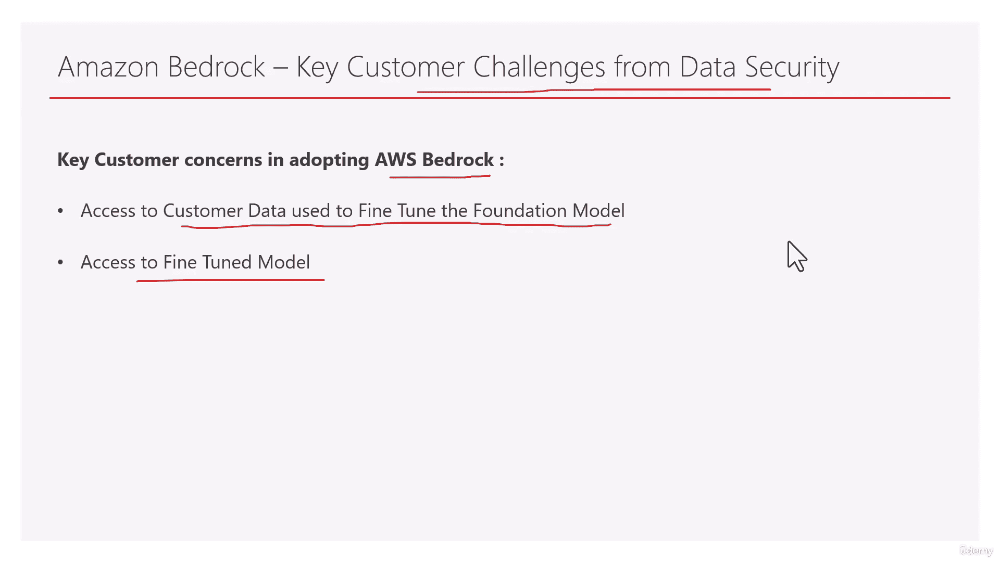
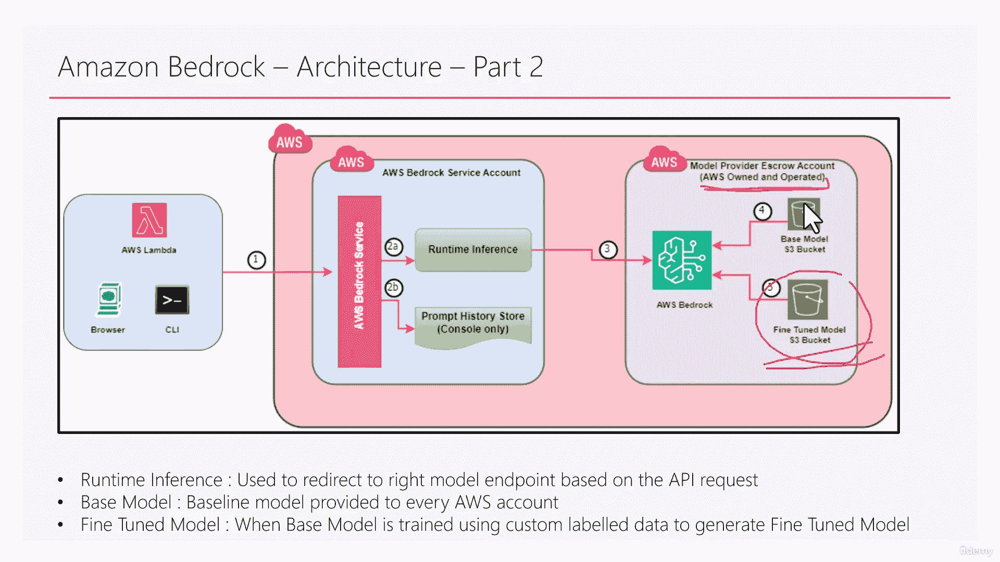

# 🎓 AWS上的生成式AI（Amazon Bedrock、RAG与KIRO [2026]）：第94-96节：Amazon Bedrock数据隐私挑战

在本节课中我们将要学习客户在采用AWS等服务时，从数据安全角度看会遇到哪些挑战，重点放在Amazon Bedrock相关场景。本节内容不长，但问题很关键，因为它直接关系到客户数据能不能放心交给云上服务处理。下面会围绕两个核心担忧展开：训练数据的安全，以及微调模型的访问权限。理解这两点后，再看Amazon Bedrock的设计，就会更容易明白它为什么这样安排。

以下是本节两个核心挑战的快速对照，先帮助初学者建立整体印象。

- 挑战一：训练数据访问控制，解决方式是客户账户内S3桶。
- 挑战二：微调模型访问控制，解决方式是Amazon Bedrock专属团队拥有和运营。

## 🧭 第一个挑战：训练数据如何隔离

上一部分我们说了本节要讨论数据安全挑战，本节中我们来看看第一个挑战。第一个挑战发生在使用客户数据微调基础模型的时候，客户会问：怎样才能确保任何人都不能访问这些数据，甚至AWS也不能访问。这个问题很实际，因为训练数据往往包含企业的业务信息或敏感内容，一旦被不该看到的人拿到，风险很高。原文也明确说，这正是AWS设计该服务时要解决的核心问题。

为了避免这个问题，AWS把服务设计成：客户可以把训练数据存放在自己AWS账户内的S3桶中。用代码描述就是：

```text
训练数据存储位置 = 客户自己的 S3 桶
S3 桶所在账户 = 客户 AWS 账户
```

这样一来，数据留在客户自己的账户边界内，AWS通过这种方式来应对“微调基础模型时如何保护客户数据”的挑战。换句话说，训练数据不是被搬到客户无法控制的地方，而是放在客户能管理和控制的位置。原文还强调“you can see that's why”，也就是可以看到AWS这样设计的原因就在这里。



## 🔐 第二个挑战：谁能访问微调后的模型



上一节我们介绍了训练数据存放位置的挑战，本节中我们来看看第二个关键客户担忧。第二个担忧是：谁有权限访问微调后的模型。客户会担心AWS是否能访问自己创建的微调专有模型，也会担心拥有该基础模型的公司是否能访问这个微调模型。这个担忧很自然，因为微调模型可能包含企业投入的数据和业务逻辑，属于 proprietary model，也就是专有模型。

原文举了一个例子：假设你使用的是Cohere提供的Command基础模型，那么Cohere能不能访问你创建的微调模型。这个问题就是客户关心的访问边界问题。用公式可以写成：

```text
Access(客户微调模型) = Amazon Bedrock 专属团队
Access(AWS 其他团队) = 否
Access(基础模型提供商，如 Cohere) = 否
```

AWS克服这个挑战的方式，是使用一个由AWS拥有并运营的账户来管理这件事。AWS的说法是：无论是AWS还是任何其他基础模型提供商组织，都不会访问这个微调模型。该模型将由AWS内部一个独立团队拥有和运营，这个团队就是Amazon Bedrock团队。这里要直白理解：基础模型提供商不能碰你的微调模型，AWS其他部分也不能随便碰，模型归Bedrock专属团队管理。

> AWS的设计目标可以概括为：训练数据留在客户账户内，微调模型由Amazon Bedrock专属团队拥有和运营，基础模型提供商不获得访问权。



## 📝 本节总结



前面已经把两个挑战和对应解法分别说明，下面把本节内容收束一下。本节课中我们一起学习了Amazon Bedrock数据隐私中的两个客户挑战。第一个挑战是微调基础模型时，如何保证训练数据不被他人访问，甚至AWS也不能访问，解决办法是把训练数据放在客户自己账户内的S3桶中。第二个挑战是谁能访问微调后的模型，尤其是基础模型提供商是否能访问，AWS的解决办法是由AWS拥有和运营的账户来管理，并由Amazon Bedrock专属团队拥有和运营，AWS和其他基础模型提供商组织都不访问。希望这些内容已经讲清楚，本节内容到这里，下一讲再见，谢谢。

