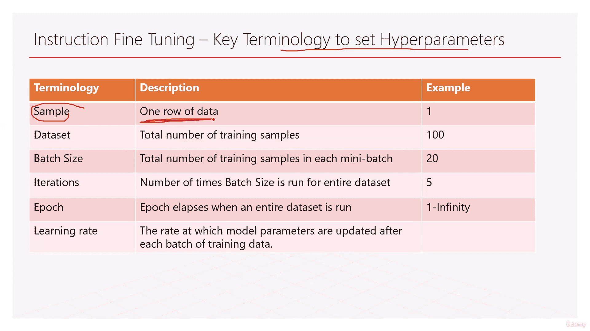
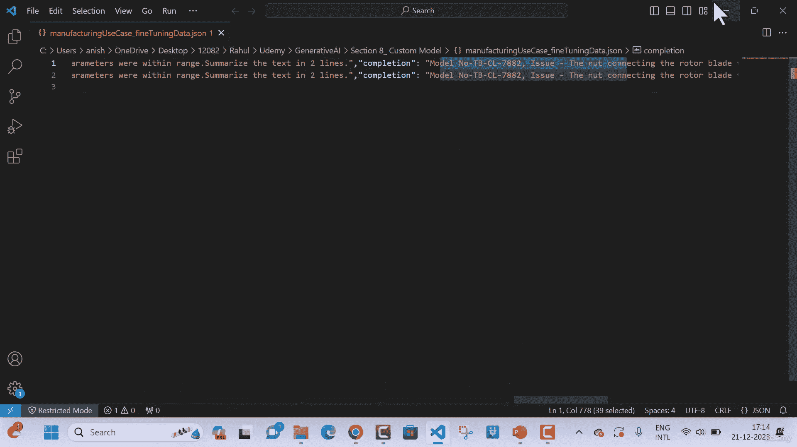
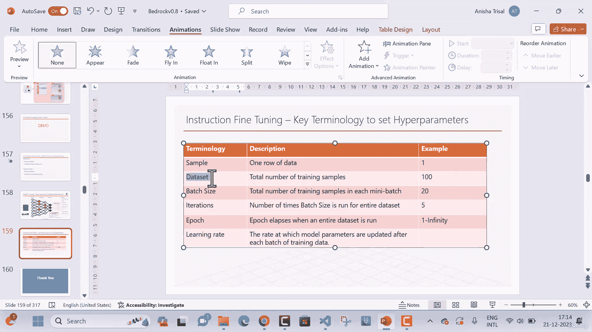
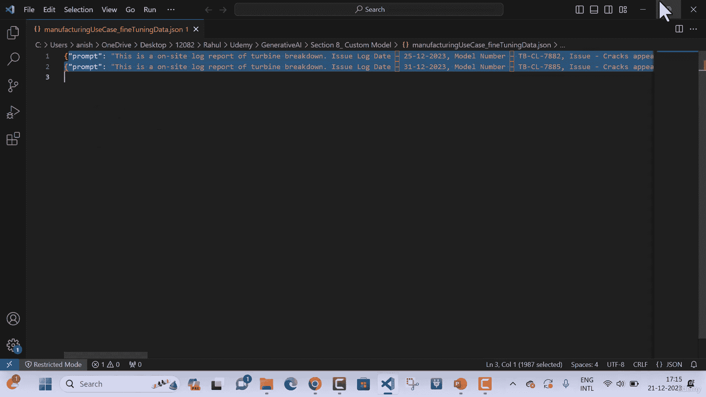
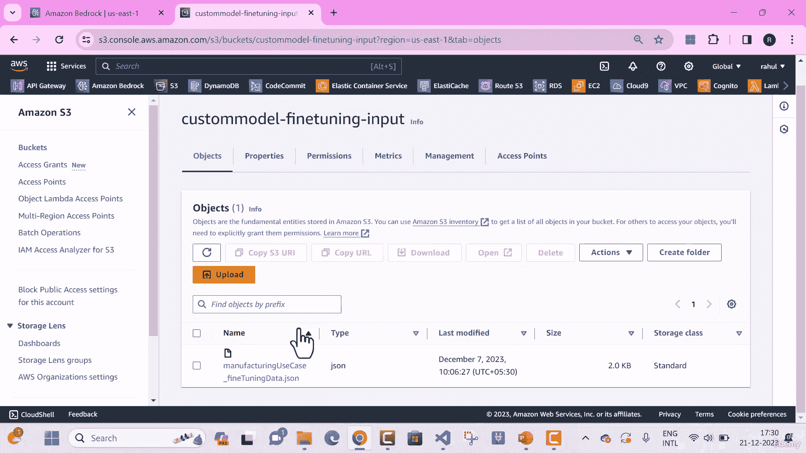
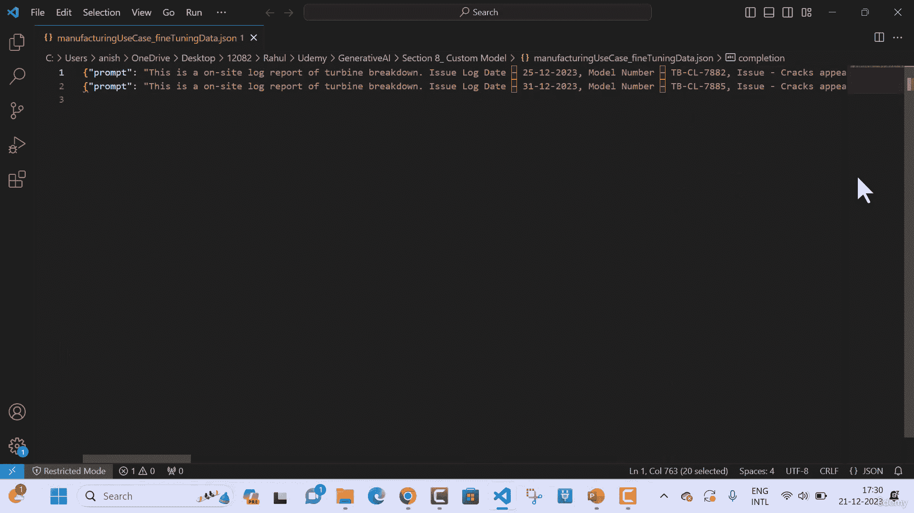
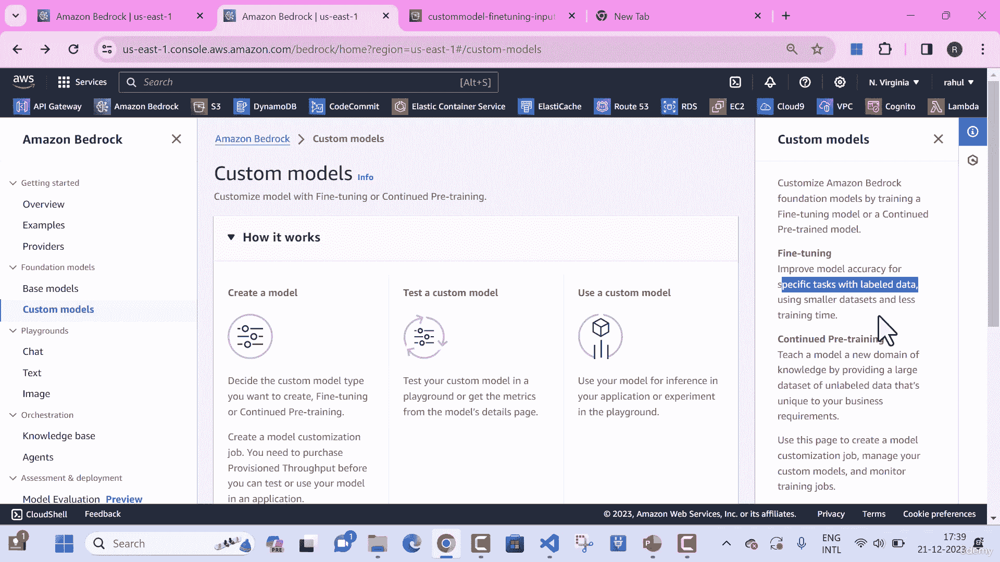
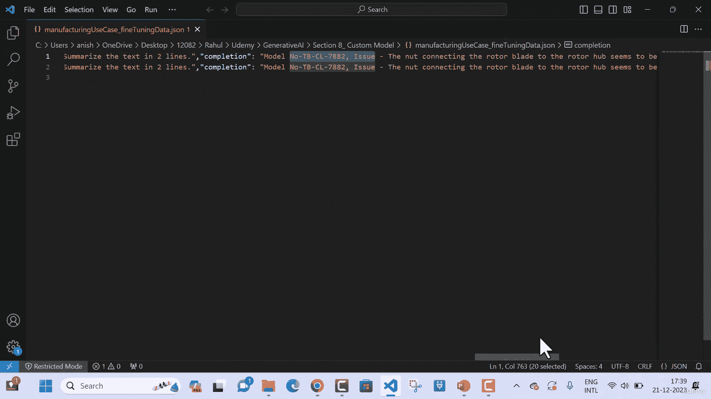
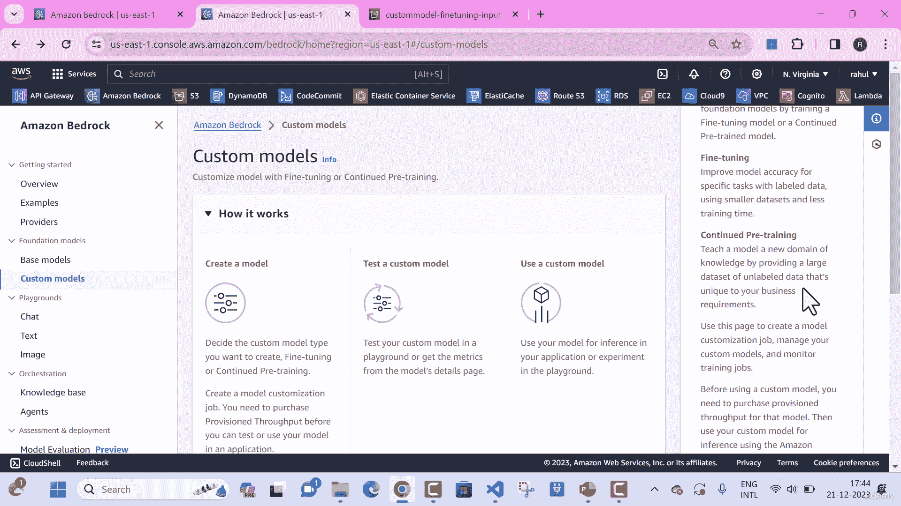

# 🤖 AWS生成式AI实战：第95-97讲：基础模型微调动手实践

在本节课中，我们将通过动手演示来学习如何对基础模型进行微调。不过在正式开始演示之前，我们需要先掌握几个核心概念，否则后面的操作会看得一头雾水。这些概念包括模型参数、模型超参数，以及和超参数相关的几个关键术语。等把这些基础内容都理清楚之后，我们再一起到 Amazon Bedrock 服务上实际操作一遍，看看整个微调流程到底是怎么走的。

## 🧠 模型参数：藏在模型内部的“记忆” 

首先，我们来看第一个概念：模型参数。模型参数从本质上来说，是基础模型内部的东西，而且它们只在训练过程中才会被更新。这是什么意思呢？其实很简单。我们在前面讲解人工神经网络的时候，看到神经网络里有各种各样的层，同时这些层与层之间的连接上会被赋予一些权重。这些权重有时候就被称为参数。任何一个模型一开始都会有一些默认的参数值，然后用数据去训练它的时候，这些模型权重就会不断地被更新。

换句话说，当我们每次喂给模型新的数据集时，模型内部的参数就会发生一次变化。需要特别注意的是，这些参数全部是基础模型内部的东西，它们只能通过数据集来更新。也就是说，你没有办法直接手动去改这些参数，只能靠训练数据来“教”模型调整自己。



## 🎛️ 模型超参数：由人定好的“旋钮” 

第二个需要了解的概念是模型超参数。超参数是模型外部的参数，通常由开发者或者科学家来指定。它们的作用是什么呢？简单来说，就是由人来设定一些外部参数，比如数据集的大小、Epoch 值、学习率等等。这些参数不会随着训练自动变化，而是需要我们提前决定好。这里我们稍微展开一下，接下来我们会逐个讨论这些超参数到底是什么意思。

在动手做演示之前，我们先要把和超参数相关的几个核心术语搞清楚，不然在界面上看到一堆英文单词会不知道该怎么填。下面我们一个一个来看。







### 🔢 样本、数据集、批次大小、迭代、Epoch 和学习率 

**样本**：样本就是我们用来训练模型的一行数据。举个例子，下面这就是一行可以用来训练模型的数据。在这行数据里，你可以看到它有一个“提示”（Prompt），然后还附带了一些细节信息。如果往右滚动一下，就能看到对应的“补全”（Completion）。这样一整行内容，就叫做一个样本，或者叫样本数据。

**数据集**：数据集是什么意思呢？假设我们想要用 100 行数据来重新训练模型，那么我们大概会有 100 行这样的记录，这 100 行记录放在一起，就叫做一个数据集。数据集就是一堆样本的集合，它构成了训练模型时输入的主体。

**批次大小**：对于这 100 条记录，我们可以选择在一个周期里全部跑完，也就是一次性把 100 条记录全部处理掉。另一种选择是，每次只跑 20 条记录，那么就需要跑 5 个周期；或者每次跑 50 条记录，那就要跑 2 个周期。这里每次处理的数据量，就叫做批次大小。如果说批次大小是 20，那么我们就需要运行 5 次才能跑完整个数据集。

**迭代**：迭代就是批次大小跑完整个数据集所需要的运行次数。按照刚才的例子，如果数据集有 100 条记录，批次大小是 20，那么迭代次数就是 5。这里有一点需要记住：每跑完一个批次，模型内部的权重就会更新一次。所以如果我们有 5 次迭代，那么模型的权重就会总共被更新 5 次。

**Epoch**：接下来还有一个概念叫 Epoch。Epoch 的意思就是完整地跑完整个数据集。当你把这 100 条记录全部跑完一遍的时候，我们就说完成了一个 Epoch。这个 Epoch 可以重复多次，也就是说我们可以把整个数据集反复训练多遍。Epoch 的取值可以从 1 到无穷大，具体取多少，要根据最终的结果和训练效果来决定。你可以通过观察模型的收敛情况，来判断合适的 Epoch 值到底是多少。

**学习率**：还有一个概念叫学习率。学习率就是每跑完一个批次的训练数据之后，模型参数被更新的速率。之前我们说过，每跑完一个批次，模型参数就会被更新一次，而这个更新的幅度或者说快慢，就是由学习率来决定的。学习率如果太大，模型可能会震荡；如果太小，训练又会很慢，所以这是一个非常重要的超参数。

为了更直观地理解这些概念之间的关系，我们可以把关键术语用公式和代码表示出来：

```text
样本 = 数据集中的一行记录
数据集 = 所有样本的集合
批次大小 = 每次权重更新前处理的样本数
迭代次数 = 数据集大小 ÷ 批次大小
Epoch = 完整遍历一次整个数据集的次数
```

权重更新的基本逻辑可以写成：





```text
W_new = W_old - 学习率 × 梯度
```

这里的梯度是损失函数对权重的偏导数，而学习率就决定了每一步更新迈多大步子。掌握这些之后，我们已经准备好了，现在可以正式进入动手演示环节。

## 🛠️ Amazon Bedrock 上微调基础模型的操作 

现在，我们打开 Amazon Bedrock 服务。在页面的左侧，点击“自定义模型”（Custom models）这个选项。在这个功能里，基本上有三个步骤。第一步，你需要在基础模型上运行训练数据集，从而创建出自定义模型。第二步，创建好的模型会被部署到 Playground 里面，然后你就可以在 Playground 中测试这个模型。第三步，如果你对测试效果满意，就可以正式使用这个自定义模型了。

不过有一件事你必须记住：一旦你创建了自定义模型，就不能再使用按需付费的定价模式了，你必须购买预置吞吐量模式。预置吞吐量模式会要求你对使用时长做出一定的承诺，而且它还会按小时来收费。这意味着你一旦决定部署自定义模型，就要准备好长期付费，而不是像以前那样用多少付多少。

接下来，我向下滚动页面，点击“创建微调任务”（Create fine tune job）。你可以看到旁边还有一个“创建继续预训练任务”（Create continued pretraining job），这个任务和微调任务看起来很像，但两者有区别。关于区别，我稍后会专门说明。现在我们先点击“创建微调任务”。点击之后，需要选择一个基础模型，我这里选择的是 Command Light。然后我们要给这个微调模型起个名字，我打算把它叫做“manufacturing model”，也就是“制造业模型”。

在这个页面里，你还可以对数据进行加密。页面上显示，你的数据默认会使用一把由 AWS 托管管理的密钥进行加密。不过我这里为了演示方便，暂时不选择这个选项。接下来是任务配置部分。你需要为任务起一个名字，比如“manufacturing job”。然后你需要提供输入数据。这里需要你创建一个 S3 存储桶，用来存放训练数据集。我已经提前创建好了 S3 存储桶，这里快速展示一下。我一共创建了两个存储桶，一个是自定义模型的输入桶，另一个是输出桶。你需要把训练数据集上传到这个输入桶里面，我已经提前上传好了，数据格式是 JSON 格式。这就是我上传的训练数据集，里面目前只有两条记录。每条记录里都有“提示”（Prompt）和“补全”（Completion）两个字段。一条记录是一组，第二条记录是另一组，内容都是这种“提示-补全”的结构。

现在，我回到页面，选择刚才创建好的 S3 存储桶，然后选择训练数据集。接着是验证数据集的 S3 位置。如果你点击这里，页面会提示你指定训练输入和验证数据的 Amazon S3 位置。验证数据集的作用是，在微调任务期间以及微调任务结束时，定期检查模型的性能。你可以看到这里标注为“可选”，所以我打算直接跳过这一步。简单来说，有了验证数据集，系统就会时不时地用这个数据集来验证一下模型的表现，没有的话也可以。

接下来我们来看页面上的超参数设置，这些超参数就是我们前面讨论过的那些概念。第一个是 Epoch，它表示你想把整个数据集运行多少遍，我这里就先保持为 1。第二个是批次大小，它指的是在模型权重更新之前处理的样本数量。第三个是学习率，前面已经说过，它是每跑完一批训练数据之后模型参数更新的速率，我这里也保持默认值。第四个是“提前停止阈值”（Early stopping threshold）。这个参数是什么意思呢？有时候你在运行训练数据集的时候，可能会发现模型性能没有任何提升，甚至可能会看到模型性能下降。这种情况下，你就想提前停止训练。这个参数就是用来定义什么时候触发提前停止的。第五个是“提前停止耐心值”（Early stopping patience）。这个参数和提前停止非常相似，也是当模型性能不再提升或者出现下降时，你可以停止训练。但它是在每个 Epoch 结束时判断的，并且你可以输入一个 0 到 10 之间的整数。这里默认给的是 6。第六个是“评估百分比”（Evaluation percentage）。如果没有单独提供验证数据，这个参数表示分配给模型评估的数据比例。你可以输入 5% 到 50% 之间的值，我这里设置为 20%。第七个是输出数据。你需要选择一个 S3 位置，用来存储模型的验证输出。我点击一下，选择之前创建好的输出存储桶，这个桶是空的文件夹，我选择它，输出数据就会存储在这里。

接下来，你需要创建一个 IAM 角色，授权 Amazon Bedrock 代表你访问 S3。这里页面上还会提示，自定义模型创建之后，你需要购买预置吞吐量才能使用这个模型。我来演示一下。如果点击左侧的“预置吞吐量”标签页，然后点击“购买预置吞吐量”，我们需要给这个吞吐量起个名字，比如叫“demo”。然后选择模型，我们之前已经选择了 Cohere 的 Command Light。接着你需要承诺一些模型单元，我这里选择 1 个单元。然后是承诺期限，最短是 1 个月。你可以看到，预估每小时成本是 6.85 美元，这仅仅是一个单元一个月的价格。预估每日成本是 164.4 美元，预估每月成本是 5000 美元。也就是说，如果我们要部署这个自定义模型，就必须花费这么多钱来购买预置吞吐量。我决定不实际运行这个微调任务，因为我不想产生任何费用。我也强烈建议，如果你使用的是个人账户，最好不要运行这个微调模型，也不要购买预置吞吐量，因为这会让你花掉一大笔钱。

## 🔄 微调与继续预训练的区别 

到这里，这节课的主要内容就差不多了。不过还有最后一点我想讲一下，就是前面我们看到的“微调”和“继续预训练”之间的区别。



在微调中，我们使用带标签的数据来提高模型在特定任务上的准确率。所谓的带标签数据，就是我们在数据中既提供了“提示”，也提供了“补全”，这样模型就能学着从提示去生成对应的补全。而在继续预训练中，我们做的事情是通过提供大规模无标签数据集，教给模型一个新的领域知识，这些数据往往是你业务中独有的。那么关键区别就很明显了：微调使用的是较小规模的带标签数据集，继续预训练使用的是大规模无标签数据集；微调用于提高特定任务的准确率，继续预训练用于教模型一个新领域的知识。继续预训练试图提高基础模型的领域知识，但不会特别专注于某一个特定任务。也就是说，微调像是“专项训练”，继续预训练像是“通识教育”。

## 📝 总结





本节课中我们一起学习了模型参数和模型超参数的定义，明白了模型参数是在训练过程中由数据自动更新的，而超参数是由人来预先设定的。然后我们详细了解了样本、数据集、批次大小、迭代、Epoch、学习率这些超参数的具体含义，并用公式和代码把它们之间的关系整理了出来。接着，我们动手在 Amazon Bedrock 上走了一遍创建微调任务的流程，包括选择基础模型、上传训练数据、配置超参数以及购买预置吞吐量等环节。最后我们还区分了微调与继续预训练之间的不同：微调靠小块带标签数据提升特定任务表现，继续预训练靠大块无标签数据扩展模型领域知识。希望这节课对你有所帮助。
