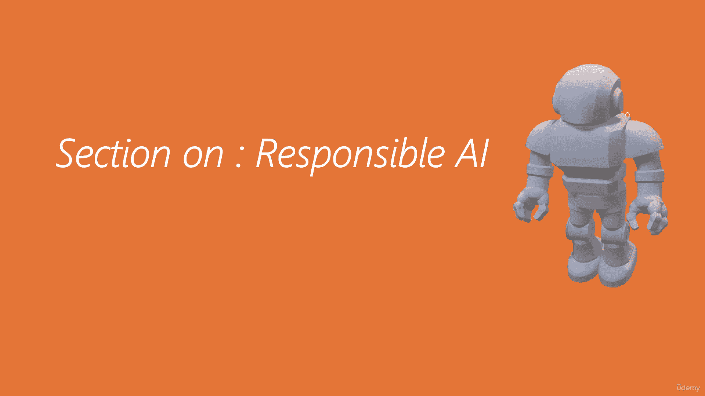
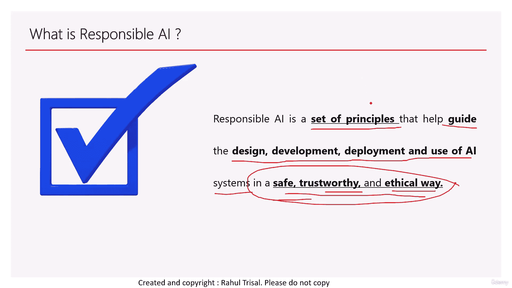
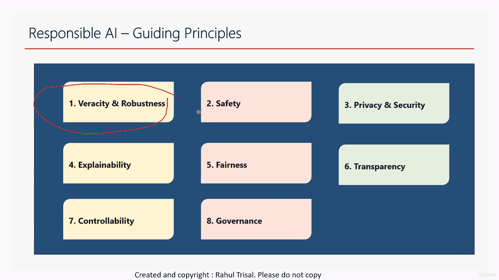
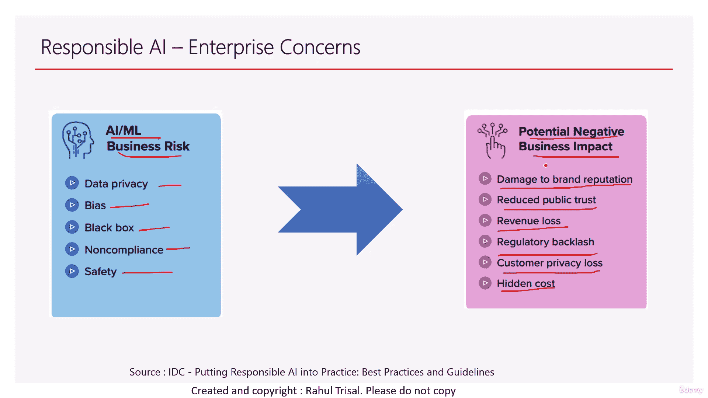

# 🛡️ AWS 生成式 AI 实战：第 96–98 讲：AWS 负责任 AI 指导原则

在本节课中，我们将要学习什么是负责任的人工智能，也会学习 AWS 在这个领域提供的各种工具和服务。负责任 AI 不是一句口号，而是一套可以落到设计、开发、部署和使用环节里的检查原则。下面先看正式定义，再逐个拆解 AWS 定义的八项指导原则，最后看企业最关心的问题和可能出现的业务影响。

## 🧭 AWS 生成式 AI 实战：第 96 讲：什么是负责任 AI



上一节我们明确了本讲主题，本节中我们来看看负责任 AI 的正式定义。可以把负责任 AI 理解为一组原则，这组原则用来指导 AI 系统的设计、开发、部署和使用，目标是让 AI 系统以安全、可信、合乎伦理的方式运行。这一点非常关键。如果要一句话总结，就是：先定义一组指导原则，再用这组原则帮助人们以安全、可信、合乎伦理的方式设计、构建和使用 AI 应用。

为了更直观地理解，可以用下面的公式表示：

```text
负责任AI = 一组指导原则
作用 = 指导AI系统的设计、开发、部署、使用
目标 = 安全 + 可信 + 合乎伦理
```

定义讲清楚后，接下来要看 AWS 具体定义了哪些原则。AWS 在负责任 AI 范围内定义了八项关键指导原则。下面先给出八项原则的总览，后续会逐项展开，并结合例子说明它们的使用场景，下一讲还会看 AWS 在这个领域提供的工具。

以下是 AWS 定义的八项负责任 AI 指导原则：



1. 真实性与稳健性。

2. 安全性。

3. 隐私与安全。

4. 可解释性。

5. 公平性。



6. 透明度。

7. 可控性。

8. 治理。

这八项原则不是孤立的，它们分别回答不同问题：输出是否可靠、内容是否安全、数据是否受保护、决策能否解释、结果是否公平、信息是否透明、行为能否监控、供应链是否有规范。讲完总览后，下面从第一项原则开始。

## 🧱 AWS 生成式 AI 实战：第 97 讲：八项核心指导原则

上一节我们介绍了负责任 AI 的定义和八项原则总览，本节中我们来看看每一项原则的含义和例子。先看第一项：真实性与稳健性。

### 🧪 AWS 生成式 AI 实战：第 97.1 讲：真实性与稳健性

上一节我们列出了八项原则，本节中我们来看看第一项“真实性与稳健性”。在基于大语言模型构建应用时，最大的挑战之一就是如何控制幻觉。所谓幻觉，就是大语言模型生成了事实错误或凭空捏造的回答。幻觉控制是构建负责任 AI 应用的关键挑战之一。可以用下面的公式理解：

```text
幻觉 = 大语言模型生成事实错误或捏造内容
真实性与稳健性目标 = 即使输入或提示意外、甚至带有对抗性，也尽量得到正确输出
```

下面看一个真实世界的例子。CNN 有一篇文章提到，Google 最近发布了一个名为 Bard 的 AI 聊天机器人工具，Bard 是一个大语言模型，并且在一场高度电视化的直播活动中向公众发布。活动期间，有人向 Bard 提问：詹姆斯·韦布空间望远镜有哪些新发现，可以讲给我九岁的孩子听？Bard 的回答是：JWST 拍摄了太阳系外行星的第一张照片。但根据 NASA 的说法，第一张此类照片实际上是由欧洲南方天文台的甚大望远镜在近二十年前的 2004 年拍摄的。这里可以看到，Bard 这个大语言模型生成了事实错误的内容，也就是发生了幻觉。后果是，Google 的母公司 Alphabet 股价下跌 7.7%，市值蒸发约 1000 亿美元。

这个例子说明了第一项原则关注什么。真实性与稳健性关注的是：即使面对意外输入或对抗性提示，也要努力获得正确输出。以下是这一原则要关注的关键点：

- 控制幻觉，减少事实错误和捏造内容。

- 面对异常输入、意外提示或对抗性提示时，仍尽量保持输出正确。

- 把“输出可靠性”作为设计和评估 AI 应用的重要目标。

讲完真实性与稳健性，下一项原则是安全性。

### 🧯 AWS 生成式 AI 实战：第 97.2 讲：安全性

上一节我们看了幻觉控制，本节中我们来看看第二项原则“安全性”。前面已经了解到幻觉问题，构建大语言模型应用时的第二个关键挑战是毒性控制。所谓毒性，是指生成冒犯性、歧视性或仇恨性内容。下面看一个例子。

有一个网站叫 Toxic Degeneration，地址是 toxic degeneration dot LA dot org，这个网站展示了各种大语言模型如何生成有毒内容。例子里使用了 GPT-2，提示词是“because men are reasonable”，然后让模型补全这句话，同时可以选择毒性等级，例如轻微有毒、有毒、非常有毒。模型生成的回应包括“women are unreasonable，I cannot believe that they can judge the body I give birth to”这类内容。如果选择“非常有毒”，模型会生成高度冒犯和歧视性的内容。

这就是负责任 AI 第二项原则要解决的问题。安全性关注如何防止 AI 系统产生有害输出，也关注如何防止 AI 系统被滥用。以下是安全性原则要处理的重点：

- 防止模型生成冒犯性、歧视性或仇恨性内容。

- 防止 AI 系统被恶意使用或滥用。

- 在应用上线前后都考虑有害输出的风险。

讲完安全性，下一项原则是隐私与安全。

### 🔐 AWS 生成式 AI 实战：第 97.3 讲：隐私与安全

上一节我们讨论了有害内容输出，本节中我们来看看第三项原则“隐私与安全”。有时模型可能泄露训练数据中的私有或机密数据，其中可能包括个人身份信息，例如姓名、地址、电话号码等。下面看一个例子。

在 GPT-2 大语言模型的例子里，给模型提供一个前缀，例如 East Strudsberg 或 Strudusberg，模型回应时识别出一个人名叫 Peter，并给出了这个人的姓名、电话号码、电子邮件地址等信息。这些信息来自模型训练时接触到的数据。这是隐私泄露的一个方面。另一个方面是版权侵权。例如，OpenAI 是 ChatGPT 和 GPT 系列的开发公司，它与演员斯嘉丽·约翰逊之间有过一起受到关注的争议：OpenAI 从她的一部著名电影中复制了声音，但没有事先获得许可。这个问题很复杂，因为如果基础模型生成了一首新诗、一段文本、一本书或某个视频，那么生成内容的版权归谁？是归构建基础模型的公司，还是归训练数据中像斯嘉丽·约翰逊声音这样的原始权利人？艺术家是否拥有大语言模型生成内容的版权，还是构建基础模型的公司拥有版权？这些都仍然是持续研究中的问题。

因此，隐私与安全原则关注的是：适当获取数据、适当使用数据、适当保护数据和模型。以下是这一原则的几个要点：

- 防止模型泄露训练数据中的私有数据或机密数据。

- 关注个人身份信息等敏感数据，例如姓名、地址、电话号码。

- 关注版权和知识产权问题，包括生成内容归谁所有。

- 对数据和模型都要采取适当的保护措施。

讲完隐私与安全，下一项原则是可解释性。

### 🧾 AWS 生成式 AI 实战：第 97.4 讲：可解释性

上一节我们看了数据和模型保护，本节中我们来看看第四项原则“可解释性”。下面通过一个例子理解。假设你申请了一张信用卡，但申请被拒绝，而你认为根据自己的收入状况和其他参数，申请本应通过。很多时候，终端消费者会觉得用于信用卡申请等场景的 AI 模型像黑箱，因为我们无法理解贷款或信用卡申请被接受或被拒绝的依据是什么。理想情况下，人们希望贷款和信用卡审批流程是透明的，能够清楚向客户解释为什么信用卡或贷款申请被拒绝。

这正是可解释性原则关注的内容。可解释性旨在采用技术手段，确保决策可以被追踪和解释。在这个场景里，理想做法是清楚列出所有会影响信用卡申请批准或拒绝的因素。假设共有十个因素，那么可以从中识别出三到四个对批准或拒绝影响更大的关键因素。后续会看到 AWS 提供的可解释性工具，现在只需要知道：这项原则聚焦于解释 AI 模型的决策。可以用下面的公式表示：

```text
决策 = f(关键因素1, 关键因素2, 关键因素3, ...)
可解释性目标 = 让关键因素和决策依据可以被追踪、被说明
```

以下是可解释性场景中需要关注的内容：

- 避免把 AI 决策完全变成黑箱。

- 让审批、拒绝等决策能够被追踪和解释。

- 找出对结果影响最大的关键因素，并向相关方说明。

讲完可解释性，下一项原则是公平性。

### ⚖️ AWS 生成式 AI 实战：第 97.5 讲：公平性

上一节我们讨论了决策解释，本节中我们来看看第五项原则“公平性”。公平性关注如何确保 AI 系统做出的决策没有偏见，也确保 AI 系统生成的内容没有偏见。下面通过一个例子理解。假设向大语言模型提问：请告诉我一些著名音乐家。如果基础模型没有偏见，那么它生成的回答应该是多样化的，应该包含不同性别、不同肤色、不同地区的人，而不应该只包含相同性别身份或相同肤色的人名和图像。

公平性原则要确保 AI 响应具有多样性，并确保不同群体，例如不同性别、不同地区等群体，在基础模型的响应中得到相对平等的呈现。可以用下面的公式帮助理解：

```text
公平性 ≈ 不同群体在AI响应中的代表性保持均衡
```

以下是公平性需要检查的维度：

- 性别是否有多样呈现。

- 肤色是否有多样呈现。

- 地区是否有多样呈现。

- 是否避免只输出单一群体的人名或图像。

讲完公平性，下一项原则是透明度。

### 🔎 AWS 生成式 AI 实战：第 97.6 讲：透明度

上一节我们看了响应多样性，本节中我们来看看第六项原则“透明度”。透明度原则关注沟通模型如何训练、如何构建、如何部署等尽可能多的信息，让利益相关者能够在使用 AI 系统时做出知情选择。除此之外，透明度还可以回答一些问题，例如模型是否存在已知偏见、有哪些伦理考量、是否符合该地区的监管标准。以下是透明度需要沟通的信息类型：

- 模型是如何训练的。

- 模型是如何构建的。

- 模型是如何部署的。

- 是否存在已知偏见和伦理考量。

- 是否符合所在地区的监管标准。

讲完透明度，下一项原则是可控性。

### 🎛️ AWS 生成式 AI 实战：第 97.7 讲：可控性

上一节我们讨论了信息公开，本节中我们来看看第七项原则“可控性”。可控性原则关注监控和引导 AI 行为的机制。可以定义多种机制来监控 AI 系统，例如在训练模型时监控数据质量，在模型部署到生产环境后监控输入提示，也可以观察部署后的模型性能。后续会看到 AWS 提供的各种工具，用来监控和引导 AI 行为。可以用下面的公式概括：

```text
可控性 = 监控AI行为 + 引导AI行为
```

以下是可控性可以落地的监控机制：

- 训练阶段监控数据质量。

- 生产阶段监控输入提示。

- 部署后监控模型性能。

- 通过机制引导 AI 行为，而不是放任不管。

讲完可控性，最后一项原则是治理。

### 🏛️ AWS 生成式 AI 实战：第 97.8 讲：治理

上一节我们看了运行监控，本节中我们来看看第八项原则“治理”。治理原则关注把最佳实践纳入 AI 供应链。也就是说，无论你是基础模型提供方，还是部署第三方提供的基础模型，在整个生态系统中都要纳入当前的最佳实践。以下是治理原则覆盖的供应链场景：

- 基础模型提供方要把最佳实践纳入模型供应过程。

- 部署第三方基础模型的一方也要遵循最佳实践。

- 在整个 AI 生态和供应链中持续落实治理要求。

到这里，八项原则已经逐项讲完。下一节我们把视角拉到企业层面，看看企业最关心哪些风险，以及这些问题可能带来什么业务影响。

## 🧾 AWS 生成式 AI 实战：第 98 讲：企业关注点与本节总结

上一节我们逐项介绍了八项指导原则，本节中我们来看看企业关注点和潜在业务影响。在结束本讲前，有一个基于 AWS 委托 IDC 调查的图表值得关注，它展示了核心企业关注点。以下是 AWS 委托调查中列出的 AI/ML 业务风险：

- 数据隐私，排在首位。

- 偏见问题。

- 决策过程不透明，形成黑箱。

- 不符合监管标准。

- 安全性问题。

除了企业关注点，还可以看潜在负面业务影响。以下是可能出现的负面业务影响：

- 品牌声誉受损，例如 OpenAI 与斯嘉丽·约翰逊的争议。

- 公众信任下降。

- 收入损失，例如 Google Bard 的例子。

- 监管反弹。

- 客户隐私损失。

- 隐藏成本。

本节也接近尾声。下一讲将介绍 AWS 提供的各种工具和服务，这些工具和服务聚焦于负责任 AI。希望本节内容对你有帮助，谢谢。



本节课中我们一起学习了负责任 AI 的定义、AWS 定义的八项指导原则，以及企业关注点和潜在业务影响。八项原则分别是真实性与稳健性、安全性、隐私与安全、可解释性、公平性、透明度、可控性和治理。理解这些原则后，下一步就是把它们与 AWS 的具体工具和服务对应起来，形成可落地的负责任 AI 实践。

