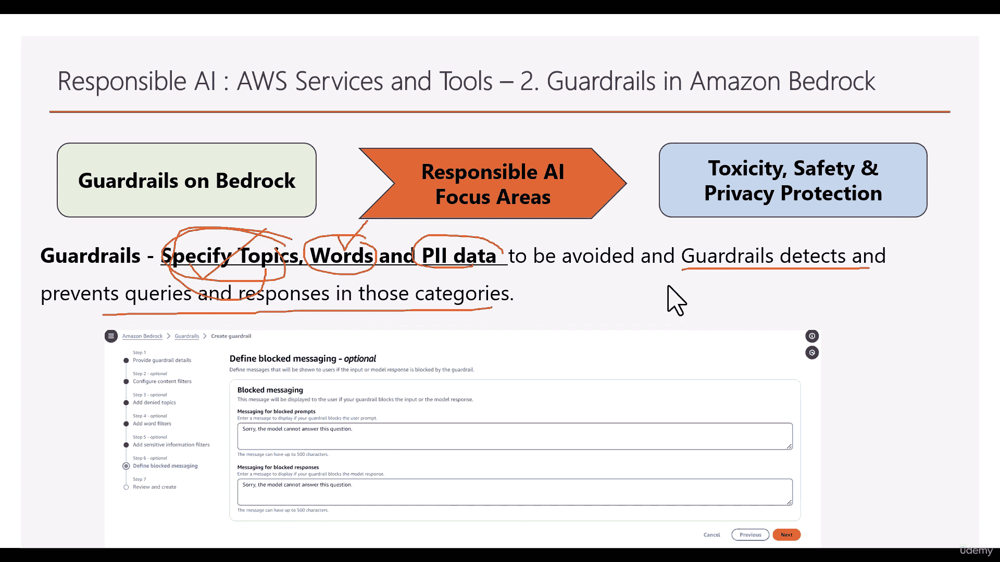
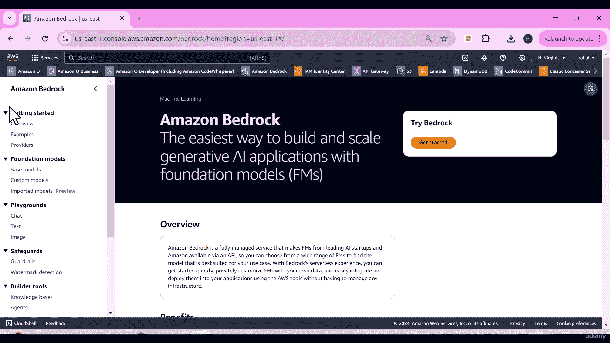
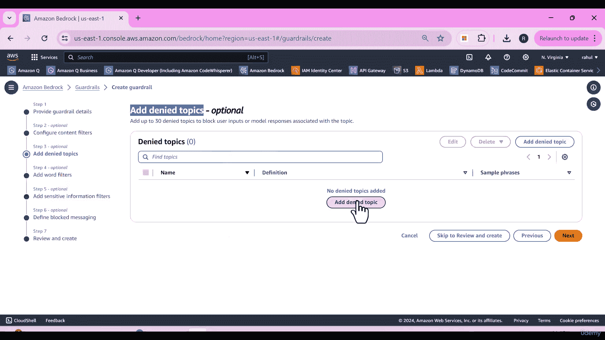
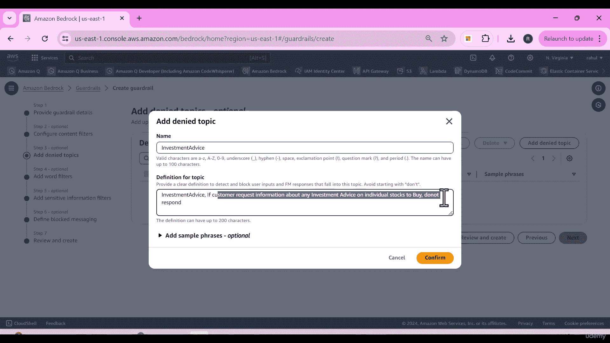
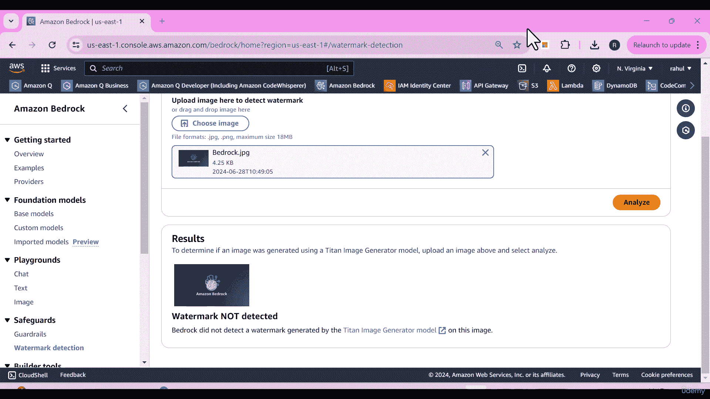

# 🛡️ Amazon Bedrock 生成式AI实战：p97-99：Amazon Bedrock Guardrails

## 🧭 Amazon Bedrock 生成式AI实战：p97-99：课程概述

在本节课中，我们将要学习 Amazon Bedrock 中的 Guardrails。上一节我们介绍了 Bedrock 上的基础模型评估器，本节我们来看看第二个与负责任 AI 相关的能力：Guardrails，它重点关注毒性、安全性和隐私保护。换句话说，Guardrails 是一套提前写好的规则，用来约束大模型能接收什么、能输出什么，以及在遇到敏感内容时应该怎么处理。本教程会先讲清楚它的核心概念，再通过一个银行财富管理的例子说明规则如何落地，随后进入控制台完成创建、配置和测试，最后补充水印检测的内容。对于初学者来说，可以把它理解成给模型加装一层“安全检查站”，请求和响应都要经过检查。

从实际使用角度看，Guardrails 的价值在于把业务不能碰的话题、不能出现的词、不能泄露的个人信息提前定义清楚。这样模型并不是完全自由地回答所有问题，而是在规则范围内工作。下面我们来看 Guardrails 的定位和核心机制。

## 🧱 Amazon Bedrock 生成式AI实战：p97-99：Guardrails的定位与核心机制

上一节我们提到基础模型评估器，本节我们来看看 Guardrails 在负责任 AI 中的定位。Guardrails 位于 Bedrock 中，属于负责任 AI 的关注范围，前面已经说明它聚焦毒性、安全性和隐私保护。使用 Guardrails 时，可以指定需要阻止的特定主题、单词或关键词，以及需要阻止的 PII 数据。Guardrails 会检测并阻止这些类别中的查询和响应。

核心判断逻辑可以用下面的代码描述：

```text
GuardrailDecision =
  BLOCK, 当输入或输出命中 DeniedTopics、WordFilters 或 PII 规则
  ALLOW, 当输入或输出没有命中这些规则
```

这里的关键点是“输入”和“输出”都要检查。用户发来的提示词要检查，基础模型或大语言模型返回的响应也要检查。下面通过一个银行案例来看规则如何应用。

## 🏦 Amazon Bedrock 生成式AI实战：p97-99：银行财富管理案例

理解了核心机制后，本节用一个银行案例说明 Guardrails 的用法。假设我们是一家大型银行，为财富管理客户构建了一个聊天机器人。我们不希望这个聊天机器人回答任何与个股建议或一般投资建议相关的问题。因此，可以在 Amazon Guardrails 中定义特定主题。当出现与投资建议相关的查询时，可以设置一条预定义响应，例如告知用户无法回答该主题相关的问题。这样终端用户提出投资建议相关问题时，就会收到这条预定义消息。

同样的方式也可以定义关键词。例如不希望出现围绕宗教的对话，就可以提供“宗教”这个关键词，Guardrails 会阻止围绕宗教的对话。第三点是定义 PII 数据，以及 PII 数据中的特定参数，例如姓名、地址、年龄、电话号码等。如果用户上传的文档包含 PII 数据，或者用户提问时包含 PII 数据，Guardrails 可以采取定义好的适当动作，例如阻止、删除等。

这个案例说明 Guardrails 不是只靠模型“自觉”，而是把业务规则显式写进配置。完成案例说明后，下面进入控制台查看具体如何创建 Guardrails。



## 🖥️ Amazon Bedrock 生成式AI实战：p97-99：控制台创建Guardrail



案例说明后，本节进入 Bedrock 控制台创建 Guardrail。进入 Bedrock 服务后，在 Safeguards 下点击 Guardrails，然后点击创建 Guardrail。需要给 Guardrail 命名，例如命名为“investment advice”。描述是可选属性，可以跳过。下面是在控制台创建 Guardrail 的主要步骤：

1. 在 Bedrock 服务中进入 Safeguards。
2. 点击 Guardrails，再点击创建 Guardrail。
3. 输入 Guardrail 名称，例如“investment advice”。
4. 描述为可选项，可以跳过。
5. 点击下一步，进入具体规则配置。

完成命名和进入下一步后，下面先配置内容过滤器。

## 🧹 Amazon Bedrock 生成式AI实战：p97-99：内容过滤器配置

创建 Guardrail 后，本节先看内容过滤器。点击相应位置后，可以看到不同的过滤器类别。下面是内容过滤器中可以配置的主要类别：

- 仇恨。
- 侮辱。
- 性内容。
- 不当行为。
- 提示攻击。

每个类别都可以设置容忍限度，容忍限度可以是低、中、高。例如把某个话题的容忍限度设得很低时，该话题会更容易被拦截。可以看到过滤器强度为低时的说明是：被分类为有害且置信度高的内容会被过滤。这里还要注意，一类配置用于提示词或输入，另一类配置用于基础模型或大语言模型返回的响应。完成内容过滤器后，点击下一步，下面看拒绝主题。

## 🚫 Amazon Bedrock 生成式AI实战：p97-99：拒绝主题配置

内容过滤器之后，本节看拒绝主题。点击添加拒绝主题，填写“投资建议”。可以补充细节，例如：如果客户请求关于买入哪些个股的投资建议信息，则不回应。点击确认后，可以看到这个拒绝主题已经添加。接下来继续并稍后测试。下面是拒绝主题配置中的关键点：



- 主题名称可以写“投资建议”。
- 描述可以写清楚触发条件，例如客户请求个股买入建议时不回应。
- 确认后该拒绝主题会加入 Guardrail。

完成拒绝主题后，点击下一步，下面看词过滤器。

## 🔤 Amazon Bedrock 生成式AI实战：p97-99：词过滤器配置

拒绝主题之后，本节看词过滤器。这里可以过滤脏话，也可以手动添加单词，例如“宗教”，或者不希望讨论种族时添加相关词。还可以从 S3 存储桶上传单词列表。添加单词或短语时，可以填写“宗教”。这样无论提示词还是响应中出现“宗教”这个词，都会被阻止。下面是词过滤器可以采用的配置方式：

- 使用内置的脏话过滤。
- 手动添加单词或短语，例如“宗教”或与种族相关的词。
- 从 S3 存储桶上传单词列表。

完成词过滤器后，点击下一步，下面看 PII 类型保护。



## 🕵️ Amazon Bedrock 生成式AI实战：p97-99：PII保护配置

词过滤之后，本节看 PII 保护。这里可以点击添加所有 PII 类型，可以看到 Bedrock 定义的全部 PII 类型。下面是 Bedrock 中可识别的部分 PII 类型示例：

- 姓名。
- 地址。
- 年龄。
- 电话号码。
- 其他 PII 属性。

如果用户提供的提示词包含这些 PII 属性，或者用户上传的文档包含这些 PII 属性，就需要选择响应动作。动作可以是阻止数据，也可以是遮蔽数据。需要为每个 PII 类型选择处理动作。演示中先对所有类型选择删除。PII 动作可以用下面的代码表示：

```text
PIIAction ∈ {BLOCK, MASK, DELETE}
```

完成 PII 配置后，点击下一步，下面定义拦截消息并测试 Guardrail。

## 💬 Amazon Bedrock 生成式AI实战：p97-99：拦截消息与测试

PII 配置之后，本节看拦截消息与测试。接下来需要定义：当请求落入已定义的拒绝主题或词过滤器范围时，返回给用户的消息是什么。默认消息类似下面这样：

> 抱歉，模型无法回答这个问题。

也可以自定义这条消息。点击下一步，滚动到底部并创建 Guardrail。创建完成后点击该 Guardrail，在右侧可以测试。下面是测试 Guardrail 的主要步骤：

1. 在右侧测试区域输入问题，例如“我可以买哪些股票”。
2. 先选择模型，例如 Amazon。
3. 应用配置后运行。
4. 查看返回的响应。

此时用户会收到“抱歉，模型无法回答这个问题”，因为该问题命中了拒绝主题。完成 Guardrail 测试后，下面看 Safeguards 下的水印检测。

## 🖼️ Amazon Bedrock 生成式AI实战：p97-99：水印检测

Guardrail 测试之后，本节看水印检测。返回后可以看到 Safeguards 下还有一项“水印检测”。点击后，它会检测图像是否由 Bedrock 上的 Titan Image Generator 模型生成。点击选择图像，这里使用一张从互联网下载的 Bedrock 图片，打开后点击分析。返回结果类似下面这样：

> 未检测到水印，Bedrock 未检测到由 Titan Image Generator 模型生成的水印。

背后的思路是：任何由 Titan Image Generator 模型生成的图像都会带有水印，因此可以检测这张图像是否由该模型生成，还是由其他工具创建。水印检测可以简单表示为：

```text
WatermarkDetected = TitanImageWatermark(Image) ? YES : NO
```

本节内容到此结束，下一节继续。

## 📌 Amazon Bedrock 生成式AI实战：p97-99：课程总结



前面我们依次学习了 Guardrails 的定位、银行案例、控制台创建、内容过滤器、拒绝主题、词过滤器、PII 保护、拦截消息、测试和水印检测。本节课中我们一起学习了 Amazon Bedrock Guardrails 如何围绕毒性、安全性和隐私保护来检测并阻止特定主题、关键词和 PII 数据，也学习了如何在控制台创建 Guardrail、配置规则、测试预定义响应，以及如何使用 Titan Image Generator 的水印检测能力。掌握这些内容后，就可以把业务规则提前写进 Guardrails，让模型在更可控的范围内工作。

