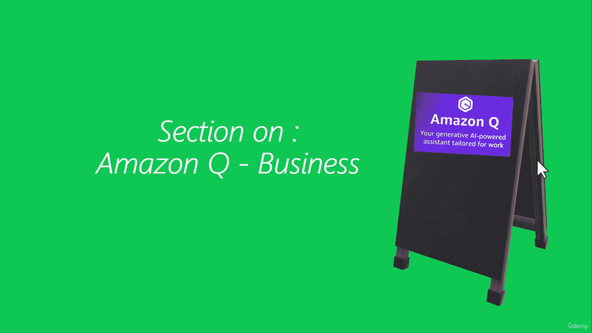
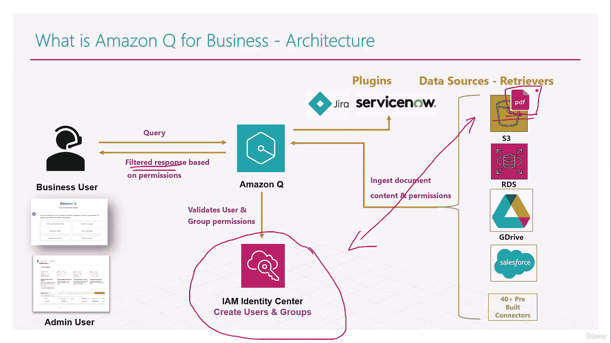

# 📚 Udemy - Generative AI on AWS - Amazon Bedrock, RAG & KIRO [2026]：第98-100讲：Amazon Q Business 概览与架构

## 🎯 本节概述

在本节课中，我们将学习 Amazon Q Business。课程会先说明 Amazon Q Business 是什么，再通过一个营销经理的典型工作日，解释它如何提升员工生产力，最后介绍 Amazon Q Business 的整体架构、用户类型、数据源连接、插件、认证授权以及一次查询的处理流程。内容会尽量用直白的大白话展开，帮助初学者建立完整认识。

## 🧩 什么是 Amazon Q Business

上一节我们明确了本节课的学习目标，本节来看看 Amazon Q Business 的定义和核心价值。Amazon Q Business 是一个全托管的、由生成式 AI 驱动的助手。它的核心目标是提升员工的生产力。

具体来看，Amazon Q 通过帮助生成内容来提升员工生产力，这些内容可以作为业务用户继续工作的基线材料。它还可以汇总数据。多数员工需要浏览大量文档、报告等内容，因此 Amazon Q 可以为员工汇总这些数据，从而提升生产力。

为了更直观地理解，可以考虑一个常见场景。很多时候，假设你是营销经理或销售经理，你需要浏览大量不同的组织数据源，以便提出方案或品牌活动等内容。于是你不得不查看所有不同的数据源，其中一些数据可能在 Salesforce，一些在数据库，一些在 Google Drive。

Amazon Q 允许你与企业数据聊天。它提供基于聊天的界面，你可以提交查询，而不论数据位于 Google Drive、S3、Salesforce 等哪里。它会给出与你相关的响应。

此外，它还有插件，例如 Jira、ServiceNow 等。你可以在其中用自然语言给出命令，比如说为这个任务创建工单，它会自动去 Jira 或 ServiceNow 中为你创建任务。你可以把 Amazon Q 看作带有企业控制的 ChatGPT。

下面的公式可以帮助记忆它的核心定位。

```text
Amazon Q Business =
  全托管生成式 AI 助手
  + 企业数据源连接
  + 插件（Jira / ServiceNow 等）
  + 企业级身份认证与权限控制
```

## 👩‍💼 营销经理的一天：四个关键任务

我们理解了 Amazon Q Business 的定位后，本节通过一个大型财富 500 强公司营销经理的典型一天，来看它如何提升生产力。假设这位营销经理叫 Anisha。组织目标是用 Amazon Q 提升 Anisha 的生产力。

接下来看看 Anisha 一天中的四个关键任务，以及 Amazon Q 可以如何帮助。以下是四个任务的逐一说明。

1. 第一个任务是阅读一份关于营销活动影响的反馈报告，这份报告大约有 20 页。团队在几周前推出了一个营销活动，现在收到了反馈报告。Amazon Q 可以帮助把这份 20 页报告汇总成也许几页内容，从而在一定程度上提升 Anisha 的生产力。

2. 第二个任务是向一位潜在客户发送邮件，说明为果汁产品启动营销活动的步骤，原文中写作 juice trick。Amazon Q 可以帮助为她生成草稿内容。

3. 第三个任务是想了解组织内部的品牌指南，因为她刚加入组织，而这些品牌指南分散在大量企业数据源中，可能一些在 SharePoint，一些在 Salesforce 等。Amazon Q 有聊天界面，你可以通过它向 Amazon Q 提问，它会搜索所有企业数据源并返回响应。

4. 最后一个任务是给直接下属分配一些任务。Amazon Q 提供一个插件，你可以在聊天界面中用自然语言写任务，它会在 Jira 中创建工单。

## 🏗️ Amazon Q Business 的整体架构

上一节我们通过营销经理的一天看到了具体使用场景，本节快速看一下 Amazon Q for Business 的架构。Amazon Q 有两类用户。

第一类是管理员用户。管理员管理应用，允许应用连接企业内不同数据源，向应用添加用户和组，删除用户和组等。第二类是最终用户。

下面的关系可以概括这两类用户。

```text
Amazon Q 用户 = 管理员用户 + 最终用户
```

Amazon Q 应用可以连接大量不同的企业数据源，这些数据源有时称为检索器。它有 40 多个预构建连接器，包括 S3、RDS、Google Drive、Salesforce 等，演示中会看到很多连接器。

在 Amazon Q 上绑定应用时，首先要识别数据源，然后 Amazon Q 会摄取文档内容，以及关于谁有权访问这些文档的权限信息。

Amazon Q 还支持大量插件，例如 Jira 和 ServiceNow，你可以与 Jira 和 ServiceNow 建立连接。完成将 Amazon Q 与数据源和插件连接后，下一步需要将其与某种形式的认证和授权连接。这通过 IAM Identity Center 完成，管理员会在其中创建有权从最终用户视角访问 Amazon Q 的用户和组。

## 🔐 一次查询如何被处理

我们介绍了架构和数据源连接后，本节来看一次真实查询如何被处理。假设已经创建了用户和组。现在有一位业务用户 Anisha，她是营销经理，她有一个关于组织内部品牌指南的查询。假设这些品牌指南位于 S3 存储桶中的 PDF 文件里。

一旦她向 Amazon Q 发送查询，Amazon Q 会验证她的认证凭据和组权限。然后它会查看这份文档中标注的权限要求，确认她请求访问的内容对应哪些权限。如果权限匹配，她就会得到响应。如果她的 IAM Identity Center 中定义的权限与访问该文档所需权限不匹配，那么她得到的响应可能是经过过滤的响应。

下面的代码块概括了这条查询链路。

```text
用户查询
  -> 身份认证
  -> 组权限校验
  -> 检索文档权限
  -> 权限匹配则返回答案
  -> 权限不匹配则返回过滤后的响应
```

> 核心理解：Amazon Q Business 不只是聊天助手，它还把企业数据源、插件、身份认证和文档权限串成了一条可管理的企业问答链路。

## ✅ 本节总结



本节课中我们一起学习了 Amazon Q Business 的概览与架构。我们明白了 Amazon Q Business 是一个全托管、由生成式 AI 驱动的助手，核心目标是提升员工生产力；它可以帮助生成内容、汇总数据、连接企业数据源进行聊天问答，并通过插件执行创建工单等任务。我们还通过营销经理 Anisha 的一天看到了四类典型任务，并梳理了管理员用户、最终用户、数据源连接器、插件、IAM Identity Center 认证授权以及查询权限校验流程。希望你现在清楚 Amazon Q 的业务架构，下一讲见，谢谢。

