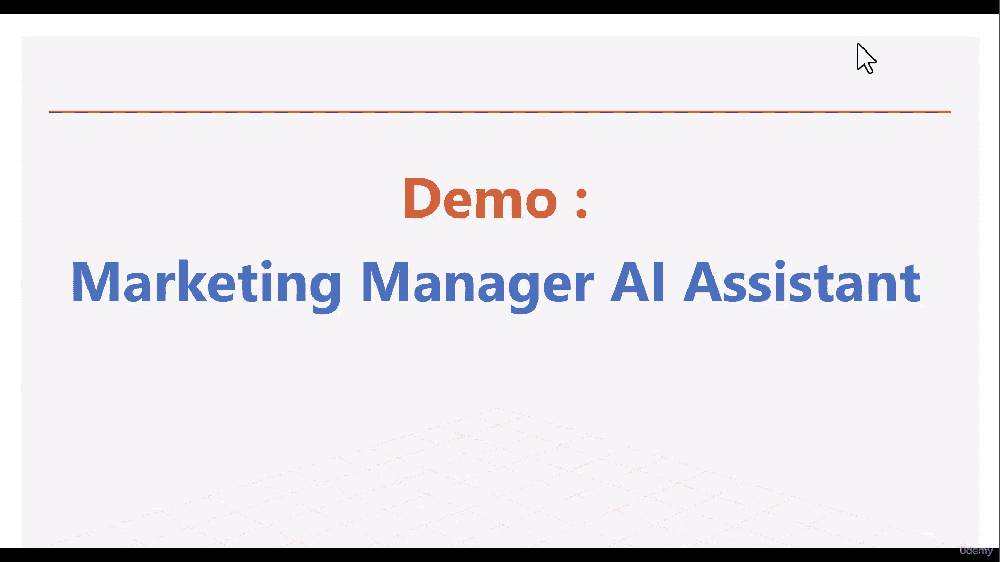
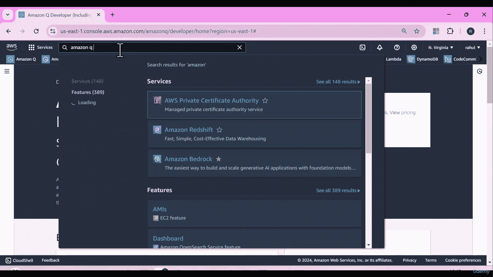
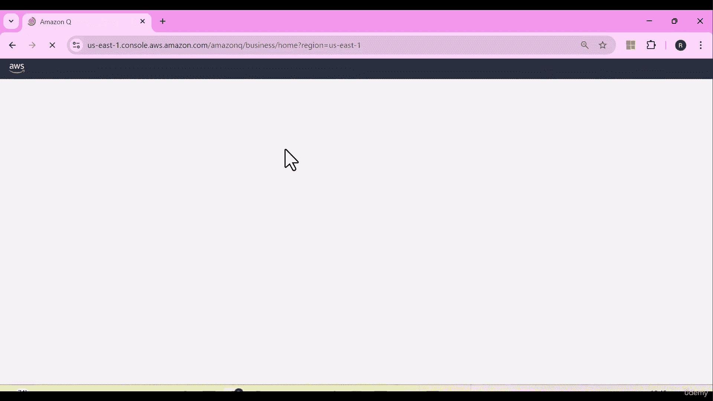
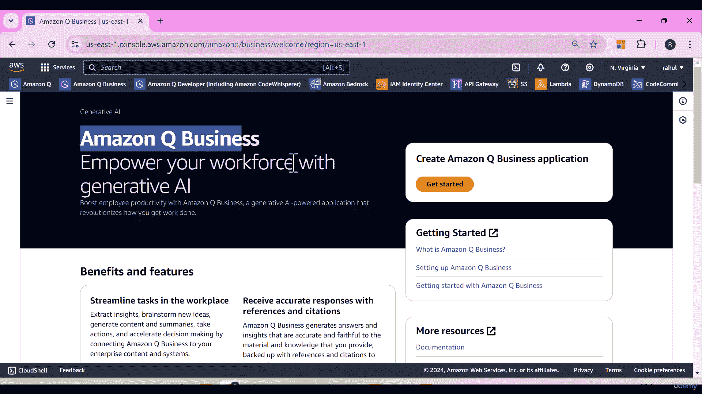
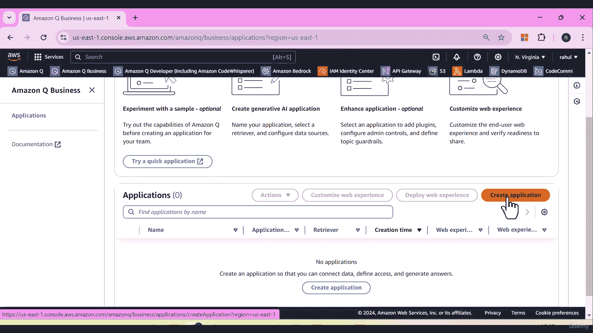
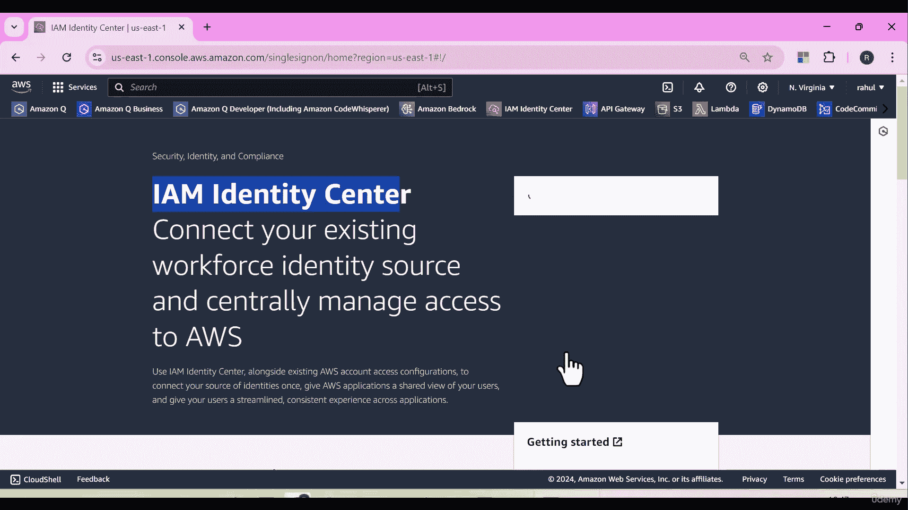
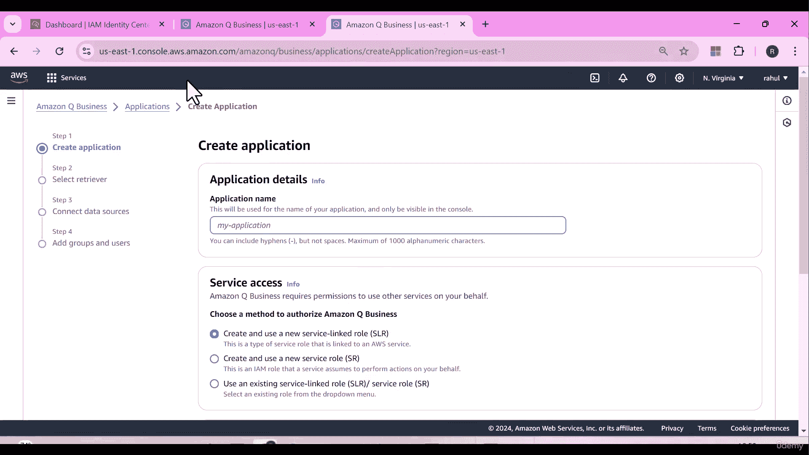
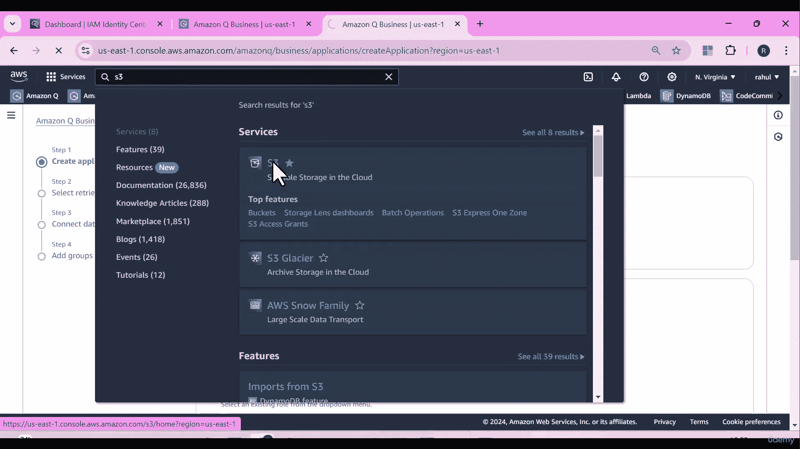
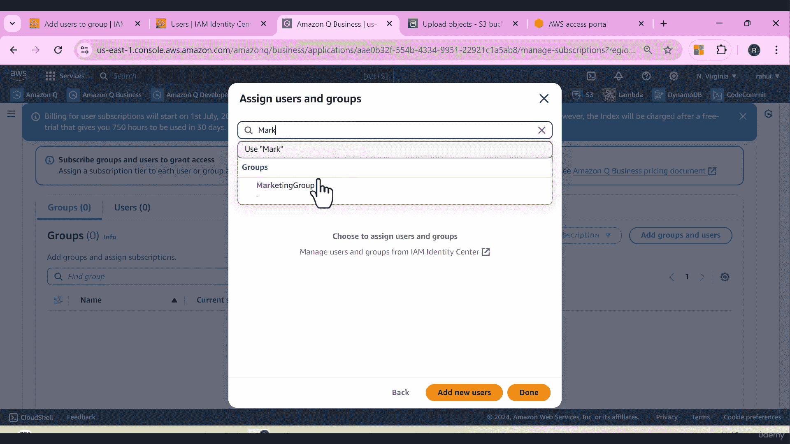
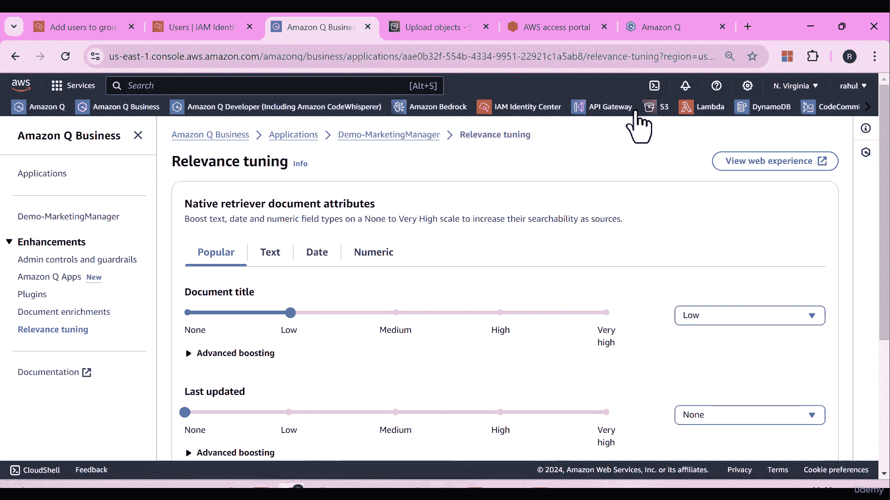

# AWS生成式AI实战：99-101-00：课程概述与目标 🎯




在本节课中我们将要学习如何从零构建一个营销经理AI助手。整套流程会从AWS控制台开始，先认识Amazon Q Business，再启用IAM Identity Center，创建应用，选择检索器，准备S3数据源，上传营销文档，配置用户和组，分配订阅，访问并自定义Web体验，设置回复策略，最后演示文档总结、营销活动生成、企业知识问答、Amazon Q Apps以及增强控制和插件。为了让初学者更容易理解，可以先把RAG理解成下面这个公式：


```text
RAG = 检索企业文档 + 大模型生成回答
```


这个公式说明，Amazon Q Business不是单纯让大模型自由发挥，而是先把企业数据做成可检索的索引，再让大模型基于检索结果回答。下面我们按实际操作顺序展开，每一步都尽量用大白话说明。接下来先认识Amazon Q Business以及创建应用前必须准备的服务。


# AWS生成式AI实战：99-101-01：认识Amazon Q Business与前置条件 🧭


上一节我们介绍了整体目标，本节中我们来看看Amazon Q Business的位置和前置条件。先进入AWS控制台，在控制台里搜索Amazon Q Business。原文提醒，Amazon Q有不同服务，包括Amazon Q Developer、Amazon Q和Amazon Q Business，这里要选的是Amazon Q Business。进入后点击开始使用，就可以进入创建营销AI助手应用的入口。

创建应用前有一个要求：进入IAM Identity Center。IAM Identity Center是AWS的一项服务，以前叫AWS SSO单点登录，现在叫IAM Identity Center。它会作为目录，用来给应用添加用户和组。需要点击启用并启用该服务。启用后会提示成功创建IAM Identity Center组织实例。原文还提醒，跟着操作时IAM Identity Center和Amazon Q都可能产生费用，所以练习时要留意成本。


```text
IAM Identity Center = 用户目录 + 单点登录 + 应用认证/授权
```






这个公式说明，IAM Identity Center不是可选装饰，而是后面用户登录应用的基础。了解前置条件后，下一节进入创建应用和选择检索器的步骤。


# AWS生成式AI实战：99-101-02：创建应用与选择检索器 🧱


上一节我们启用了IAM Identity Center，本节中我们来看看如何创建Amazon Q Business应用并选择检索器。回到Amazon Q Business，点击开始使用，再点击创建应用。应用名称填写Marketing manager。接着选择服务访问权限，意思是Amazon Q需要代表你使用AWS服务的权限。后端可能连接S3、Glue等各种数据源，所以需要相应权限。让Amazon Q创建服务关联角色，它会自动生成连接这些服务所需的权限。如果需要加密，可以点击加密选项。应用会连接IAM Identity Center，这是强制项，IAM Identity Center会作为用户认证和授权器。点击创建后需要等待几分钟，视频会暂停等待创建完成。

创建后需要选择检索器。Amazon Q的核心是一个RAG应用，它会使用基础模型和数据源，做向量化等工作，但这些都由AWS在后台完成。这里要选择原生检索器。原生检索器是一个索引，可以从里面实时获取数据；分块、转换、向量化、存入向量数据库、建立索引等都由AWS完成。原生检索器支持40多种数据源，包括Alfresco、Adobe Experience Manager、Microsoft OneDrive、Google Drive、GitHub，甚至RDS等。也可以使用现有检索器，例如已经使用Amazon Kendra，就可以选择现有检索器。本演示选择原生检索器。

索引有两个版本：企业版和starter版。企业版可以做多AZ部署，增强容错，最多扩展到100万份文档，但成本更高。starter版用于非生产POC，只在一个AZ可用，最多支持10万份文档。容量按单元计算，一个单元最多2万份文档；如果文档超过2万份，就需要第二个单元。本演示只需要一个单元，点击下一步继续。应用创建完成后，下一步就是准备企业数据，所以下面进入S3数据源的准备。


# AWS生成式AI实战：99-101-03：准备S3数据源 🗂️


上一节我们选好了检索器，本节中我们来看看如何准备S3数据源。先定义应用要连接的数据源。数据源有很多种，本演示连接S3，但在连接前要先创建S3桶。复制并搜索S3，进入S3服务，创建桶。桶要创建在Amazon Q Business同一区域。名称需要小写，并且全局唯一，不只是账户内唯一，而是所有AWS账户中唯一。原文先尝试类似“yume domo”的小写名称，但提示名称已存在；名称还必须避免无效字符。最终改用类似“Udemy demo Rahul 123”的唯一名称创建桶。创建后点击查看详情，可以看到桶是空的。

创建S3桶是为了上传企业营销经理常用文档。示例上传三份文档：marketing transcript、marketing campaign report、how much does branding cost。这样营销经理就可以通过用户界面与这些文档聊天。上传需要几分钟。原文展示了“how much does branding cost”这份PDF，它来自互联网，包含Pithy Studios的位置、平均时薪、专长，例如品牌、平面设计、标志设计等。这些内容就是后面的企业数据源。S3桶准备好后，下一节把S3接入Amazon Q Business并进行同步。


# AWS生成式AI实战：99-101-04：接入S3并同步数据 🔄


上一节我们上传了营销文档，本节中我们来看看如何把S3接入Amazon Q Business。回到Amazon Q Business创建数据源，选择Amazon S3，数据源名称写Demo Q，描述可以跳过。如果出于数据隐私和安全需要，可以选择VPC；本演示不选VPC，使用组织内的VPC。然后选择IAM角色。Amazon Q需要IAM角色访问仓库凭证和应用内容，内容可能在S3桶或任何数据源中，所以需要IAM角色。本演示让Amazon Q创建服务角色；也可以自己创建角色后添加，但这里让Amazon Q自动创建。

输入数据源位置，点击浏览S3，选择刚创建的桶。设置最大文件大小，并选择同步模式：全量同步、新增/修改/删除同步。本演示选择全量同步。以后如果只是添加更多文档，可以只用修改同步。同步运行计划方面，如果持续添加文档，可以设置同步频率；本演示选择按需运行，也可以设成每日、每月、每周等。点击添加数据源，创建需要时间，大约5分钟；可以先点击下一步继续。

应用创建也需要时间，等待后得到Demo marketing manager应用和Web体验URL，通过URL可以访问应用。点击应用，进入数据源，看到已经连接但尚未同步。点击立即同步，让它与S3桶中的文档同步。同步可能耗时30到40分钟，甚至1小时，取决于S3桶里的文档数量。同步开始后，下一节利用等待时间配置IAM Identity Center用户和组。


# AWS生成式AI实战：99-101-05：配置IAM Identity Center用户与组 👥


上一节我们启动了数据同步，本节中我们来看看如何创建用户和组。回到IAM Identity Center，点击组，创建组，名称写marketing，然后创建组。点击marketing组，进入用户，添加用户。用户名写Anishsha，选择生成一次性密码，这个密码可以分享给用户，也可以通过邮件收到密码。填写邮箱、名Anishsha、姓T、显示名Anishsha T，点击下一步，把用户加入marketing组，再点击添加用户。系统会给出用户名、密码和访问应用URL，复制并保存这些信息。

访问该URL，输入用户名和一次性密码登录。系统会要求修改密码，并需要移动设备上的认证器应用做双因素认证。使用Google Authenticator：在Android或Apple应用商店搜索Google Authenticator，打开应用，显示二维码，扫描二维码，输入手机上得到的6位代码，分配MFA。然后设置新密码并确认。之后重新登录，输入MFA代码，进入门户。此时门户没有应用，因为还没有把应用添加到Amazon Q Business。用户创建完成后，下一节分配订阅并访问应用。


# AWS生成式AI实战：99-101-06：分配订阅并访问应用 💳


上一节我们创建了用户和组，本节中我们来看看如何分配订阅。回到Amazon Q Business，进入组和用户，此时同步也已完成。点击管理访问和订阅，向下滚动，添加组和用户，分配现有用户和组，点击下一步，搜索marketing manager，系统会自动填充，然后点击分配。当前显示无订阅，需要提供订阅。点击更改订阅或更新订阅，注意提供订阅可能产生费用。选择Business Pro并确认。确认后，界面会显示marketing组的当前订阅为Q Business Pro，随后按页面提示完成收尾。



回到同一个URL刷新，应该显示刚创建的Demo marketing manager应用。点击应用登录，可以看到Amazon Q生成式AI助手。到这里，应用已经能被用户访问。接下来可以自定义Web体验和回复策略，让应用更符合营销场景。


# AWS生成式AI实战：99-101-07：自定义Web体验与回复策略 🎨


上一节我们让用户成功访问了应用，本节中我们来看看如何自定义界面和回答方式。点击自定义Web体验，把标题改成Marketing Manager Assistant，也可以创建副标题。点击示例提示，设置示例提示并保存。保存时提示超出字符限制5个字符，于是去掉“marketing manager assistant”，改为“Marketing AI assistant”，再次保存。回到Amazon Q刷新，可以看到“marketing AI assistant made by Udemy”的新标题。助手可以起草邮件、总结、头脑风暴、生成标语、写博客文章等。

默认显示“仅从批准的数据源回答”，意思是只回答文档中有的问题。如果希望在大模型知识上回退，需要改设置。回到Amazon Q Business应用，进入Demo marketing manager，点击管理控制和全局控制，点击编辑。响应设置有三个选项，可以用代码表示：


```text
回复策略：
1. 仅从批准数据源回答（例如S3桶中的文档）
2. 允许用户直接向大模型LLM发送查询
3. 先查批准数据源；无法回答时，回退到LLM知识
```


还可以设置阻止词，例如不想讨论宗教、种族、地区等，可以阻止这些词并保存。回到Amazon Q刷新，看到“从批准源回答”选项；取消该选项后，就可以回退到大模型知识。设置好策略后，下一节演示文档总结和营销活动生成。


# AWS生成式AI实战：99-101-08：演示文档总结与营销活动生成 ✍️


上一节我们配置了回复策略，本节中我们来看看实际任务演示。假设Anishsha是营销经理，收到下属的详细活动报告，想总结。点击营销活动报告，输入提示“用五行总结这个文档”，发送请求。这份营销活动报告约8页。等待后得到五行摘要，内容包括广告活动目标：建立品牌认知、提升网站流量等。

第二个任务是创建果汁品牌活动。关闭“仅从批准源回答”，让助手可用大模型知识，然后输入“为一个果汁品牌创建品牌活动”。助手给出建议，例如100%果汁、无添加糖等。这个演示说明助手既能处理企业文档，也能在允许时利用大模型生成创意。完成这两个任务后，下一节看基于企业知识的问答与引用。


# AWS生成式AI实战：99-101-09：基于企业知识问答与引用 🔍


上一节我们演示了总结和生成，本节中我们来看看如何与企业数据对话。S3中已上传三份文档。打开“how much does branding cost”PDF，看到Pithy Studios相关内容。提问“Pithy Studios的主要客户是谁”。因为该文档在S3桶中，且开启了仅从批准源回答，点击发送。助手回答：根据数据源，Pithy Studios的客户包括Google Cloud、JCB等。它还给出引用；点击引用可看到文档上传在S3桶中以及文档名称。Pithy Studios专注于品牌和创意社交媒体内容，主要客户就是这些。这个演示说明Amazon Q会基于企业知识回答并附引用。问答演示完成后，下一节看Amazon Q Apps。


# AWS生成式AI实战：99-101-10：创建和发布Amazon Q Apps 🧩


上一节我们验证了企业知识问答，本节中我们来看看Amazon Q Apps。点击Apps，输入指令“创建会议总结应用”，点击生成。系统会根据提示生成会议总结应用。复制会议记录，粘贴到应用中，点击运行。等待几分钟，应用基于会议记录生成会议总结和行动项，例如为每个人列出关键行动项，包括品牌、Miguel等，并给出引用。应用创建后可以发布到IT、HR、销售等部门；组织内有权限且觉得有用的人可以访问。应用发布后，下一节看增强控制和插件。


# AWS生成式AI实战：99-101-11：增强控制、插件与课程总结 🚀


上一节我们创建并发布了Q Apps，本节中我们来看看增强控制、插件和整体总结。左侧有增强功能，管理控制只有管理应用的管理员能访问。全局控制可设置用户是否能向LLM发送查询，或只允许访问批准的企业数据源；可阻止关键词；可定义组织内不希望讨论的主题；可构建Amazon Q Apps并共享；还可添加插件。点击添加插件，目前有四五个插件，包括自定义插件、Jira、Salesforce、Zendesk。通过插件，可以用自然语言写用户故事，系统会在Jira或ServiceNow中创建工单。还可通过文档丰富和相关度调优提升文档质量和检索效果。

本节课中我们一起学习了从零构建营销经理AI助手：认识Amazon Q Business，启用IAM Identity Center，创建应用，选择原生检索器，准备S3数据源并同步，配置用户组和订阅，访问和自定义Web体验，设置三种回复策略，演示文档总结、营销活动生成、企业知识问答与引用，创建和发布Q Apps，最后了解增强控制与插件。整个流程可以概括为：


```text
S3文档 -> 原生检索器索引 -> Amazon Q Business应用 -> IAM Identity Center用户/组 -> 订阅 -> Web体验 -> 问答/总结/生成/Q Apps
```




这套流程的重点是：企业数据先进入S3，Amazon Q在后台完成分块、向量化和索引，用户通过IAM Identity Center认证后访问应用，并通过回复策略控制回答是只用企业数据，还是允许大模型回退。原文最后说明演示到此结束，并希望内容有用，下一讲再见。希望这套教程能帮助初学者按步骤完成自己的营销助手。

