# AWS上的生成式AI：第103节：Amazon Q 实操演示 🛠️

在本节课中，我们将通过一个实际的库存管理用例，看看 Amazon Q Developer 到底怎么帮助开发者提升效率。我们不仅会讲理论，还会一步步演示从下载工具、配置环境，到让 AI 帮你生成架构、写代码、改代码、跑测试、做安全扫描的完整流程。学完之后，你就会明白 Amazon Q 在整个软件开发生命周期里能扮演哪些角色，以及你自己怎么上手用它。

## 🎯 业务场景：库存管理

我们先设定一个具体的业务需求。假设我们要为一家零售店构建一个库存管理应用。这个应用的业务需求文档（BRD）里写着：作为商店的库存管理员，我应该能够查看店里某个商品的库存详细信息，并且在收到新商品时更新这些信息。这个需求听起来很简单，但真正落地成软件，需要经过好几个阶段。我们先看看传统的开发流程，然后再看 Amazon Q 如何介入。

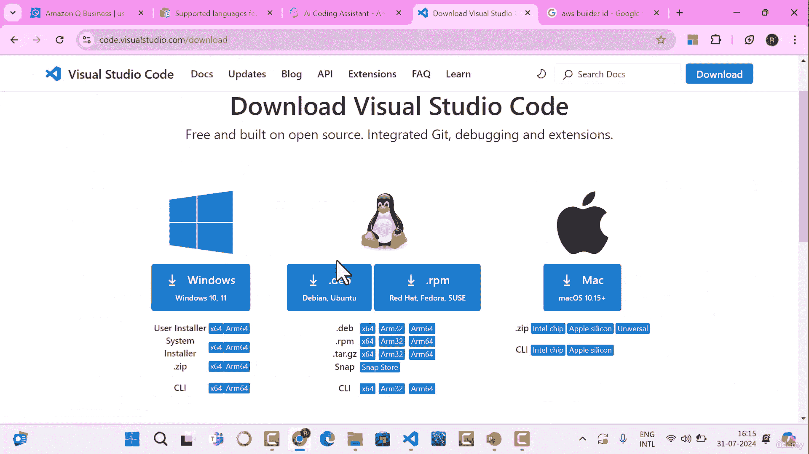

开发一个软件，第一阶段通常是规划阶段。在规划阶段，我们会拿业务需求文档作为输入，然后从中生成功能列表和用户故事。也就是说，我们把那段“库存管理员要能查看和更新库存”的需求，拆分成一个个具体的功能点，比如“查看商品详情”、“更新库存数量”等等。这其实就是典型的敏捷开发流程。

## 🧩 规划阶段：使用 Amazon Q Business

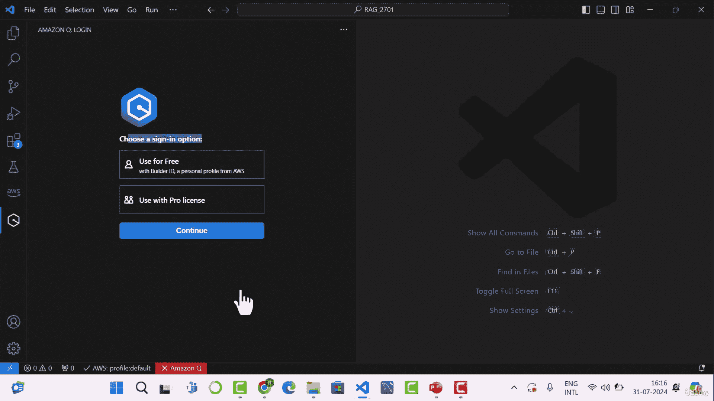

在规划阶段，我们可以用 Amazon Q Business 来生成功能列表和用户故事。回顾上一节课我们讲到过，Amazon Q Business 有一个 Jira 插件，你可以在聊天界面里用自然语言输入你的需求，它就能自动在 Jira 中创建对应的功能项和用户故事。所以，规划阶段的活儿，交给 Amazon Q Business 就搞定了。

我们再看下一个阶段：设计阶段。设计阶段里，Amazon Q Developer 可以帮你生成用例的架构方案。下面我们具体看看怎么操作。

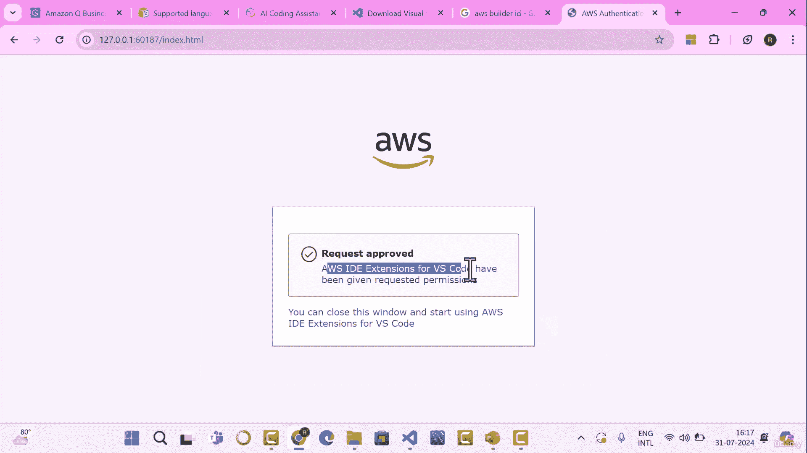

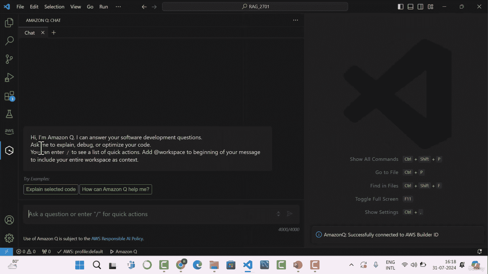

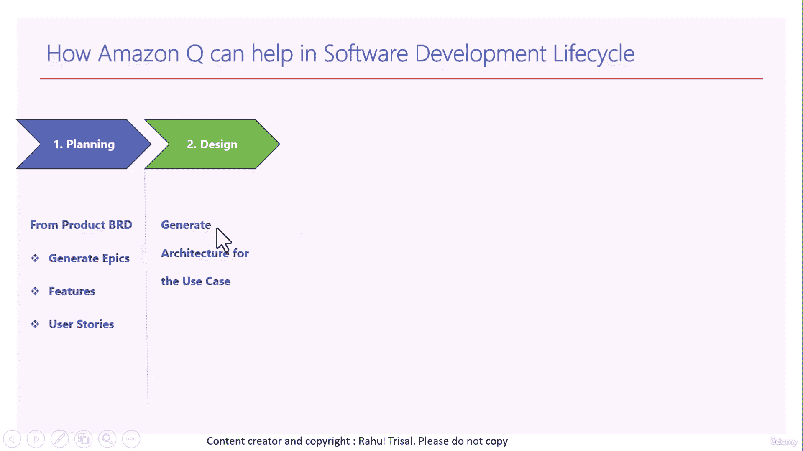

## 🛠️ 环境准备：安装 VS Code 和 Amazon Q 扩展

第一步，你需要下载 Visual Studio Code 编辑器。不管你用的是什么操作系统，直接搜索“download Visual Studio Code”然后点击进入官网，下载对应你操作系统的版本就行。下载安装完成后，你会看到 VS Code 的界面。接着，点击左侧的扩展图标，搜索“Amazon Q”。搜索出来后，会出现 Amazon Q 的扩展页面。如果你还没安装，会看到一个“安装”按钮，点击安装即可。我已经安装过了，所以界面显示的是“重新加载扩展”。安装完成后，左侧边栏会出现一个 Amazon Q 的图标，点击它。

点击图标后，系统会提示你选择登录方式。你可以使用 Pro 许可证，也可以使用 Builder ID。Builder ID 是免费的。如果登录方式选择界面没有正常弹出，你可以看看窗口底部，也有一个 Amazon Q 的入口，点击后选择“免费使用”，然后继续。我已经有 Builder ID 了，所以点击后它会跳转到网页，询问是否允许 Builder ID 授权访问。如果你还没有 Builder ID，就去搜索“Builder ID”，然后点击“创建你的 Builder ID”，这个过程是免费的，只需要提供一个邮箱地址即可。获得 Builder ID 后，在 VS Code 里填进去。如果你是第一次操作，界面可能会不一样，它会要求你提供 Builder ID，提供后点击“允许访问”。然后你会看到一条提示，说 AWS 扩展已经获得请求的权限。这时回到 VS Code，你会看到欢迎界面，上面写着“Hi Amazon Q，我可以回答软件开发问题，问我解释、调试和优化你的代码吧”。至此，环境就准备好了。

## 🏗️ 用 Amazon Q 生成架构建议

现在，假设我们已经创建好了需求，想让 Amazon Q 为这个库存管理用例生成架构方案。我们向它提问。我输入一个问题：“你能为现代 Web 应用建议一些 AWS 架构吗？”然后发送。你可以看到它正在生成答案，按层级给出架构。滚动上去看，它说在计算层，你可以使用 Elastic Beanstalk，或者利用 Lambda 作为无服务器函数来处理特定任务或微服务。它还给出了一些存储、网络方面的例子。假设我们决定采用微服务架构，这是一个非常流行的架构，于是我想让它进一步解释微服务架构。我问它：“在 AWS 中，微服务架构可以使用哪些服务？”它第一次回答时出现了一个错误，提示“处理请求时发生错误，此错误已自动报告给团队”。那我就再试一次，看看这次是否成功。这一次它给出了答案：可以使用 AWS Lambda、API Gateway、SQS、SNS、Step Functions、ELB、CloudMap 和 X-Ray，然后你可以用 CloudFormation 或 CDK 进行部署。这个答案看起来不错。

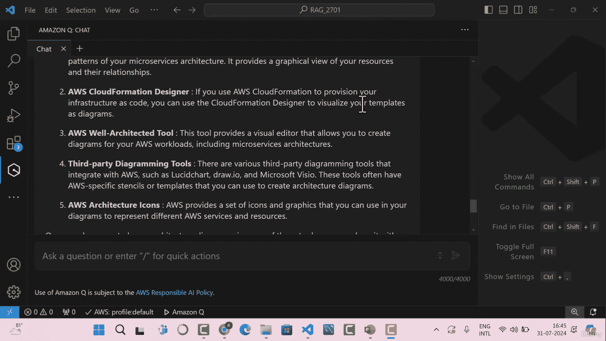

我接着要求它：“请为 AWS 微服务生成架构图。”它回复说：“我无法直接生成或创建架构图，作为 AI 语言模型，我无法生成图像。不过我可以为你提供微服务架构的详细描述。”虽然它不能生成图片，但它给我推荐了一些可以用来画图的工具，比如 Lucidchart、Draw.io 等等。Amazon Q Developer 不能生成架构图是可以理解的，因为它是一个大语言模型，不具备生成图像的能力。但我们知道典型的微服务架构长什么样：全球用户通过 Amazon CloudFront 访问，CloudFront 指向 S3 桶来托管静态内容，动态内容的请求则发送到 Amazon API Gateway，然后转发到 AWS Lambda 函数。Lambda 函数再调用数据存储，比如 Amazon DynamoDB 或 Amazon Aurora。假设我们的业务流程是这样的：客户端发送请求到 API Gateway，API Gateway 调用 Lambda 函数，Lambda 函数查询 DynamoDB。接下来，我们就让 Amazon Q 为这个架构生成代码。

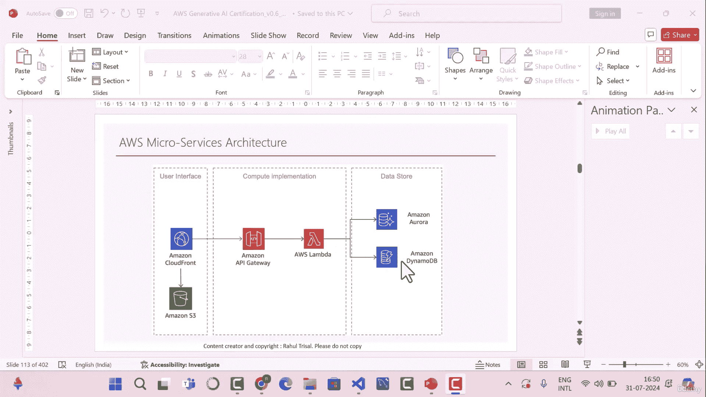

## 💻 用 Amazon Q 生成 Lambda 代码

假设我们现在开始写代码。我们需要写一个 Lambda 函数，用来查询 DynamoDB。我们打算用 Python 的 SDK，也就是 Boto3 来实现。所以，我们向 Amazon Q Developer 提问：“使用 Boto3 编写 AWS Lambda 代码来查询 DynamoDB。”然后发送。它开始生成代码。可以看到，它给出了完整的代码示例。代码首先导入 `json` 和 `os` 模块，然后导入 `boto3`。接着初始化 DynamoDB 客户端。代码里定义了一个 DynamoDB 表名变量，并给出了注释，告诉你只需要替换成你自己的表名即可。然后定义了 Lambda 处理器函数，解析查询参数，并处理分区键和排序键——这些是创建 DynamoDB 表时通常需要定义的。它给出了完整代码，并且解释了代码的工作原理。它说：“首先，导入 Boto3 库，并在指定区域初始化 DynamoDB 客户端。DynamoDB 表名在环境中定义。”我可以在 VS Code 里新建一个 Python 文件，然后复制这段代码粘贴进去。现在整个代码就都在我们手上了。这就是 Amazon Q 如何为你生成代码。

接下来，我有一段自己写的代码，这段代码是构建一个使用 Amazon Bedrock 和 Cohere 的无服务器文本摘要应用程序。我把这段代码复制粘贴到 VS Code 中，后面我们会用它来演示 Amazon Q 的其他功能。

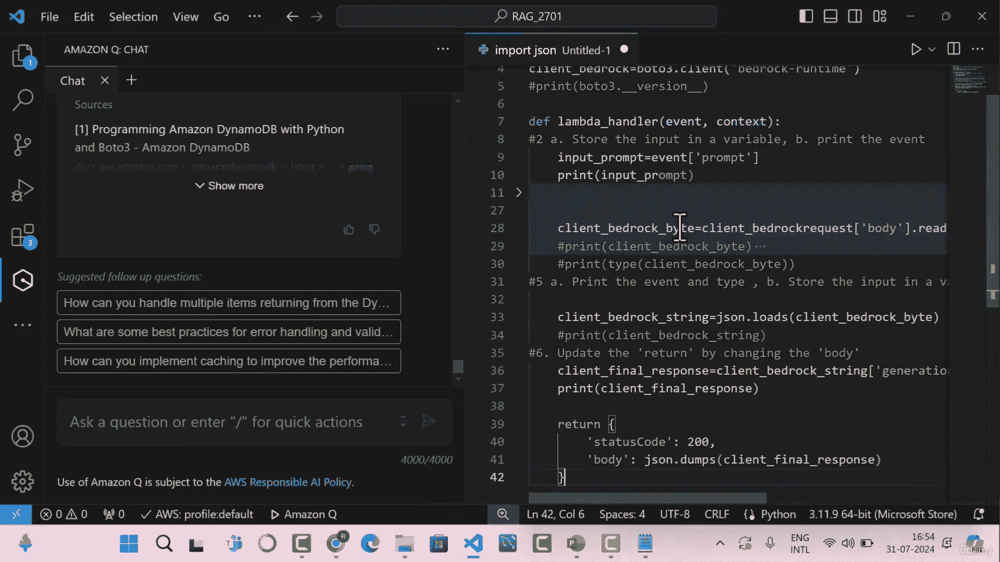

## 🔍 理解与改进代码

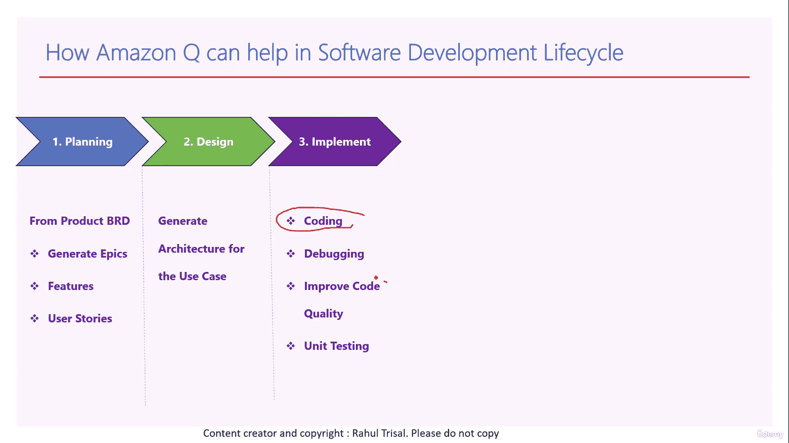

我们已经看到了 Amazon Q 如何生成新代码。现在我们想理解一段已有代码，或者提高代码质量。怎么做呢？我选中这段代码，然后右键点击，在菜单中可以看到 Amazon Q 的选项。里面有“解释代码”、“重构代码以改进质量”、“修复问题”等选项。我先点击“解释”按钮。这时 Amazon Q 会读取我选中的代码并给出解释。它说：“提供的代码片段是一个 Python 脚本，与 Amazon Bedrock 服务交互，Bedrock 是一个用于构建生成式 AI 应用的完全托管服务。下面是代码的逐行解析。”它先说明脚本导入了 `json` 模块用于处理 JSON 数据，以及 `boto3` 库用于与 AWS 服务交互，然后逐段解释每几行代码的目标。这样我们就能快速理解这段代码是干什么的了。

接下来，我们试试另一个功能：重构。我再次打开 Amazon Q，选择“重构”选项。我选择这段代码，并让它重构。Amazon Q 会提出改进建议，比如我没有包含一些错误处理逻辑，看看它是否能帮我补上。它给出了重构后的版本，并说：“这里是重构后的代码，改进了可读性、可维护性，并遵循了最佳实践。”然后它总结了关键改动：使用环境变量。因为我们之前硬编码了一些值，比如模型 ID、生成参数等，现在代码改为从环境变量中获取；它还改进了错误处理、优化了变量命名、调整了响应结构等等。

类似地，如果你有任何问题（issues），也可以用 Amazon Q 来修复或优化代码。除了这些，Amazon Q 还能用于单元测试。在测试阶段，它可以支持并提升安全测试、功能测试和缺陷处理的效率。最后，在部署阶段，它还能帮助进行基础设施设置和代码部署。

## 🔒 安全扫描与版本升级

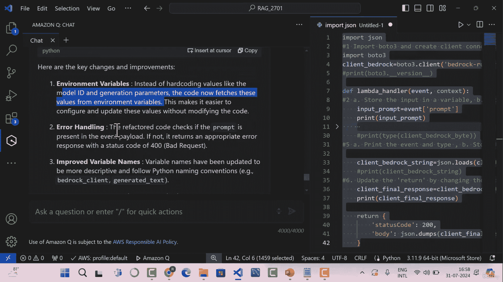

Amazon Q 还可以帮助评估安全漏洞或升级遗留代码。在 Amazon Q 面板的顶部，有一个“运行项目扫描”的功能。点击它就会执行安全扫描。目前我这里没有完整的项目，所以暂时跑不了完整扫描。但如果你有一个项目并且想运行安全扫描，就可以使用这个功能。此外，正如我前面提到的，它还能帮你将 Java 版本从 Java 8 升级到 Java 17 之类的更高版本。这些功能都可以在 Amazon Q 的界面上找到。

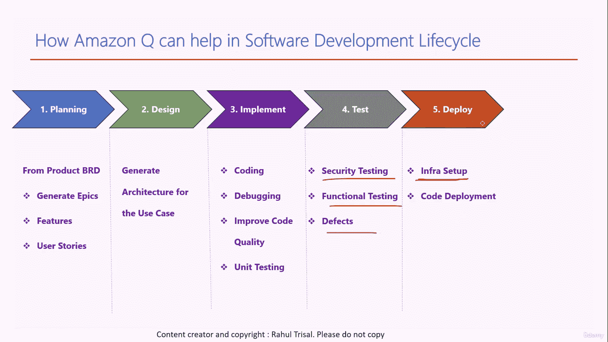

## ✅ 总结

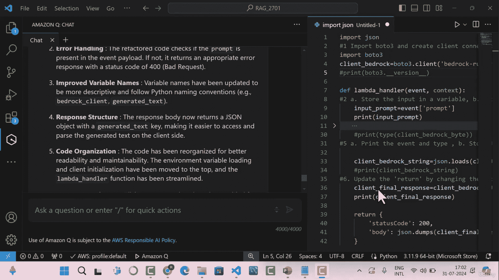

本节课我们一起学习了 Amazon Q Developer 在软件开发生命周期中的多个实际应用场景。我们首先通过一个零售库存管理的业务需求，了解了规划阶段如何使用 Amazon Q Business 生成功能列表和用户故事。然后，我们安装了 VS Code 和 Amazon Q 扩展，配置了免费的 Builder ID。接着，我们演示了如何用 Amazon Q 生成架构建议，虽然它不能绘制架构图，但能够给出服务和工具推荐。我们还让它生成了查询 DynamoDB 的 Lambda 代码。之后，我们通过右键菜单中的“解释”和“重构”功能，快速理解了已有代码并改进了代码质量。最后，我们了解了安全扫描和 Java 版本升级等辅助功能。可以看到，Amazon Q Developer 在开发流程的各个环节都能提供帮助，从规划、设计、编码、测试到部署和安全，它是开发者提升生产力的得力助手。
