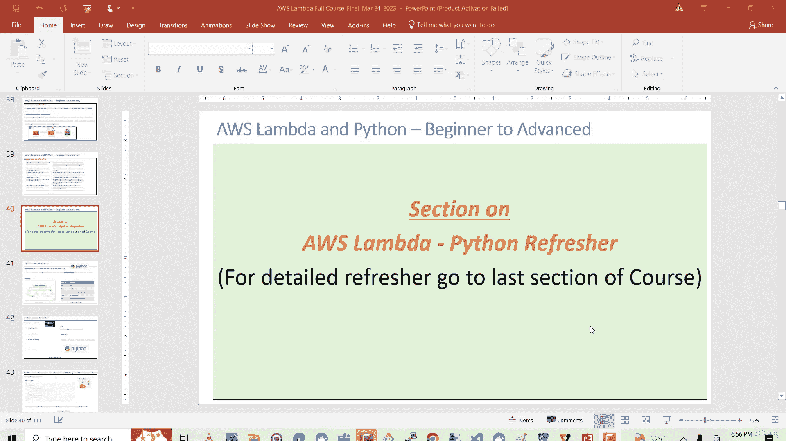
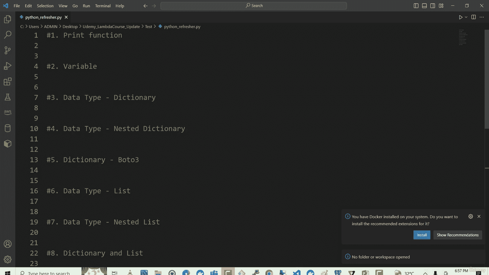
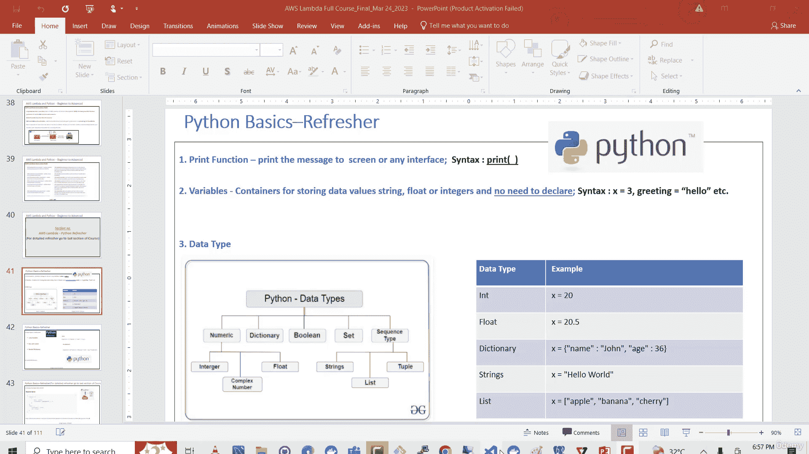
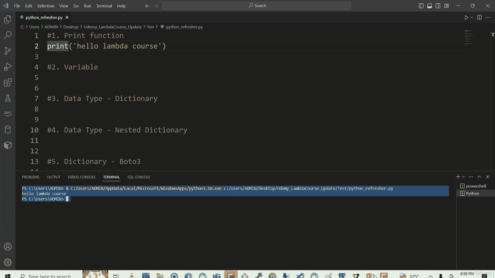
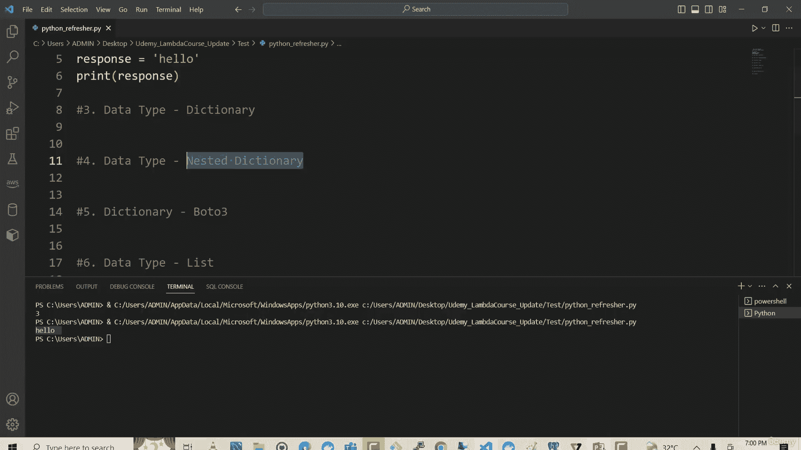
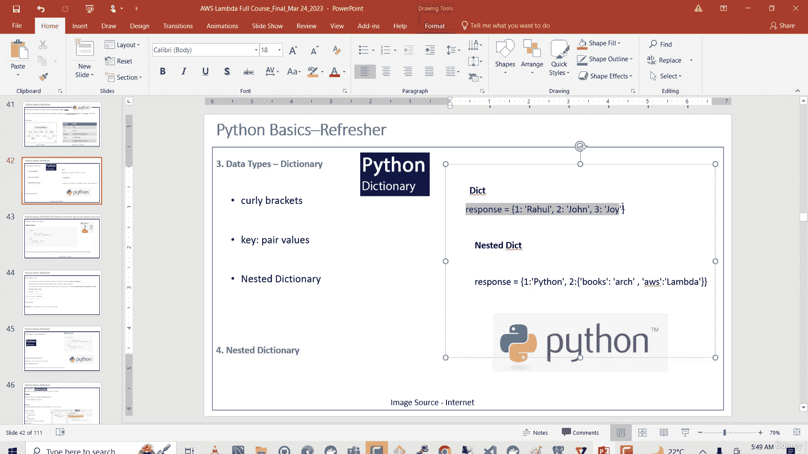
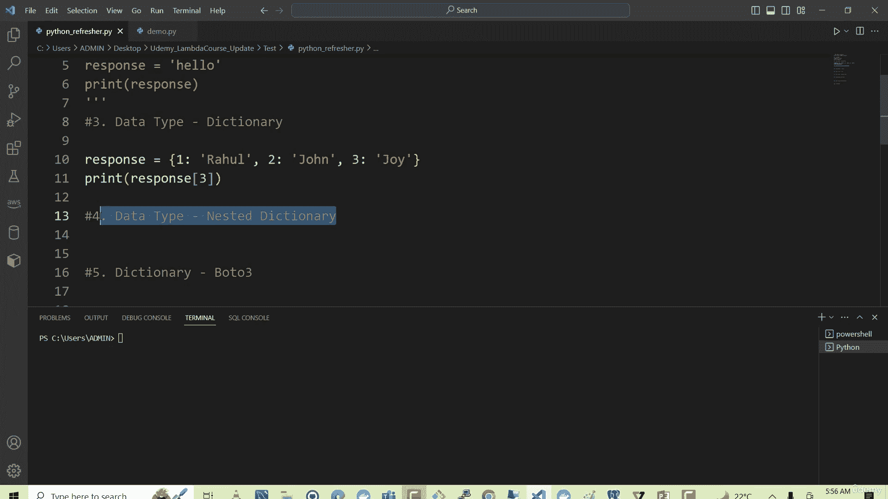
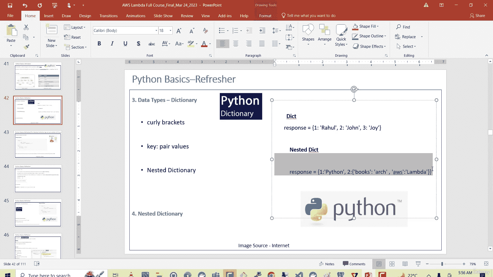
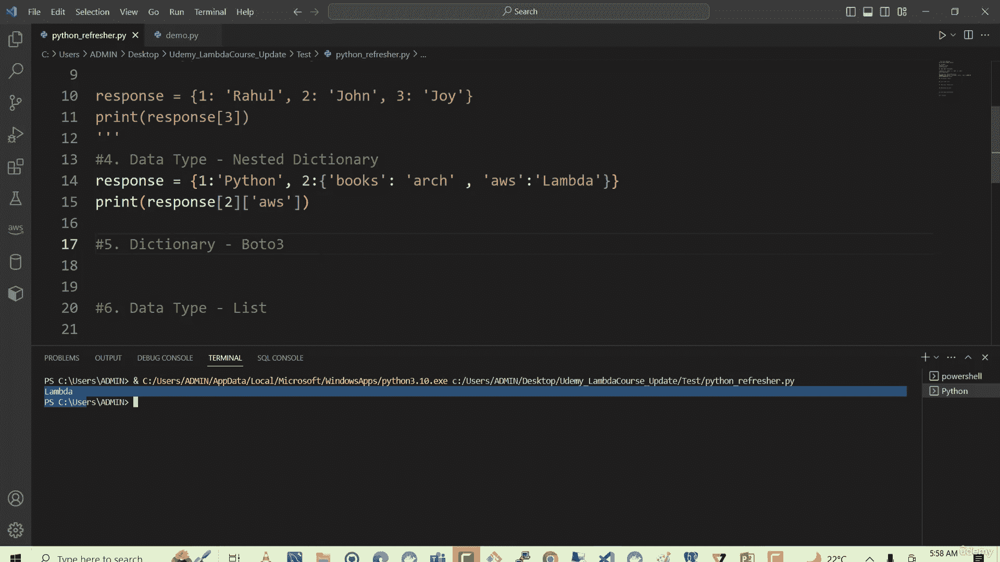

# 🚀 Udemy - AWS上的生成式AI - Amazon Bedrock、RAG与KIRO [2026]：第2部分 第2章：🐍 Python编程基础复习（一）

本节课是一个 AWS Lambda Python 基础复习部分。我们将会讨论一些和 Python 编程语言相关的关键概念，这些概念在创建 AWS 服务、编写 Python Lambda 函数时经常会用到。如果你已经拥有丰富的编程经验，或者已经熟练使用 Python，那么你可以跳过这一节，直接进入下一节；但如果你刚开始接触 Python，那么这一节内容值得你认真过一遍。

另外，如果这里的讲解还不够深入，课程的最后还有一个更详细的复习模块，会以更慢的速度和更多细节重新讲一遍同样的概念。在后面动手实践之前，先花点时间把基础打牢会很有帮助。

我们会在 VS Code 编辑器中动手演示这些概念。所以第一步，打开你的 VS Code 编辑器，新建一个文本文件，然后把它另存为 Python 文件（例如 `refresher.py`）。文件建好之后，我们会把本次要讨论的 10 个关键概念先列出来，然后为每个概念写对应的代码。



## 🖨️ 1. 打印函数：print

不管学什么编程语言，打印输出都是最基本、最常用的调试手段之一。Python 里的 `print` 函数尤其简单，它的作用就是把一条消息输出到屏幕上，或者输出到任何程序连接的接口。

所以，第一个关键概念就是 `print` 函数。它的基本语法可以写成下面这种形式：



```python
print("要打印的内容")
```



我们来实际运行一下。在编辑器里写上 `print("Hello, Lambda course")`，然后运行，终端就会把括号里写的字符串原样打印出来。运行结果如下：

```text
Hello, Lambda course
```

整个过程非常直接，没有什么额外步骤。你只要保证括号里的内容是一个合法的字符串，程序就能正常输出。




## 📦 2. 变量

看完了 `print`，接下来我们看看第二个概念：变量。你可以把变量想象成一个贴了标签的储物箱，标签就是变量名，箱子里面装的就是数据。Python 里的变量不需要提前声明类型，你想存什么就存什么。

变量本质上就是用来存储数据值的容器，它可以存储字符串、浮点数或者整数等类型的数据。使用方式很简单：先写变量名，然后用等号给它赋值。语法如下：

```python
x = 3
greeting = "hello"
```

这里，`x` 就是一个变量，它的值是整数 `3`；`greeting` 也是一个变量，它的值是字符串 `"hello"`。我们用一个更贴近后面场景的例子来演示。先定义一个变量 `response`，给它一个字符串值，然后用 `print` 把它打印出来。接着，把 `response` 重新赋值为数字 `3`，再打印一次。最后，再改成字符串 `"hello"`，看看结果有什么不同。

```python
response = "Hello, Lambda course"
print(response)  # 输出 Hello, Lambda course

response = 3
print(response)  # 输出 3

response = "hello"
print(response)  # 输出 hello
```

可以看到，`print` 打印的是变量此时保存的内容。变量被重新赋值之后，再打印就会得到新的值。这就是变量的基本用法。

## 🗂️ 3. 数据类型



讲完了变量，接下来我们要聊一聊数据类型。Python 自带的数据类型很丰富，不需要额外安装库就能直接使用。很多人一看到数据类型列表就会被吓到，其实完全不用，你只需要知道每种类型大概存的是什么数据就行。

下面这个列表列出了 Python 中最常见的几种数据类型，可以先混个脸熟：

- **数值型（numeric）**：包括整数（integer）、复数（complex number）和浮点数（float）。整数就是普通的数字，比如 `3`；浮点数就是小数，比如 `3.14`；复数在一般业务代码里用得很少，了解即可。
- **字典（dictionary）**：用花括号 `{}` 表示，里面保存的是键和值。例如 `{"age": 36}`，键是 `"age"`，值是 `36`。
- **布尔型（boolean）**：只有两个取值：`True`（真）和 `False`（假），通常用来表示条件是否成立。
- **集合（set）**：用来保存多个元素，并且这些元素不会重复。
- **序列类型（sequence type）**：包括字符串（string）和列表（list）。字符串是一组字符的集合，比如 `"hello world"`；列表用方括号 `[]` 定义，里面可以按顺序保存多个值。

在这些类型中，字典和列表是你后面会频繁用到的两个重点。尤其是字典和列表，你需要知道的核心操作就是怎么从里面取出某一个特定的值。这一节我们先集中看字典，列表的取值方式以后用到的时候可以类比着理解。

## 🔑 4. 字典与嵌套字典

前面说到字典很重要，那字典到底长什么样？字典使用花括号 `{}` 来定义，里面是一组一组的键值对。每个元素先写键，再写冒号，再写值。比如 `{"age": 36}`，键是 `"age"`，值是 `36`。下面是一个更完整的字典变量 `response` 的定义：

```python
response = {
    1: "Josh",
    2: "John",
    3: "Joy"
}
```



在这个字典里，键是 `1`、`2`、`3`，对应的值是 `"Josh"`、`"John"`、`"Joy"`。如果你想取出某个键对应的值，写法就是：变量名后面跟方括号，方括号里放键名。

在使用 Boto3 创建 AWS 服务时，一个非常常见的场景就是从返回的字典里取出某个键对应的值。Boto3 是 AWS 提供的 Python 开发工具包，以后你会经常见到它返回类似字典的数据结构。比如在上面的 `response` 里，执行 `response[2]`，得到的就是 `"John"`；执行 `response[3]`，得到的就是 `"Joy"`。我们用代码来演示：

```python
response = {
    1: "Josh",
    2: "John",
    3: "Joy"
}

print(response[2])  # 输出 John
print(response[3])  # 输出 Joy
```

把方括号里的数字从 `2` 改成 `3`，输出的结果就会从 `John` 变成 `Joy`。这就是普通字典取值。

除了普通字典，还有嵌套字典。所谓嵌套字典，就是字典里面还套着另一个字典。下面这个例子中，键 `2` 对应的值又是一个字典，而这个内部字典里又有 `"books"` 和 `"AWS"` 两个键：





```python
response = {
    1: "John",
    2: {
        "books": "Arch",
        "AWS": "Lambda"
    }
}
```

对于这种嵌套结构，取值方式是一层一层往下走。比如我们想取内部字典里 `"AWS"` 对应的值，应该怎么写？首先，`response[2]` 拿到的是第二个键对应的整个内部字典；接着，再写一组方括号，在方括号里写上 `"AWS"` 这个键名，就能精确取出 `"Lambda"`。完整写法如下：

```python
response = {
    1: "John",
    2: {
        "books": "Arch",
        "AWS": "Lambda"
    }
}

print(response[2])          # 输出 {'books': 'Arch', 'AWS': 'Lambda'}
print(response[2]["AWS"])   # 输出 Lambda
```

第一种打印输出了整个内部字典，第二种打印则精确拿到了 `"Lambda"`。这种嵌套取值很重要，因为后面写 Lambda 函数时会大量遇到类似的返回结构。只要你能熟练使用 `response[key]` 和 `response[key1][key2]`，大部分数据读取场景都能应付。

## 📝 总结



本节课我们学习了 AWS Lambda Python 基础复习中的几个核心概念。我们首先看了 `print` 函数，知道了它能把消息打印到屏幕或接口；接着学习了变量，明白了变量就是用来存储数据的容器，可以随时重新赋值；然后我们梳理了 Python 的常见数据类型，包括数值、字典、布尔、集合、字符串和列表；最后重点研究了字典和嵌套字典的取值方式。通过 `变量名[键]` 可以取出普通字典中的值，通过 `变量名[外键][内键]` 可以取出嵌套字典中的值。这些看起来很简单，但却是后面编写 Lambda 函数、解析 AWS 服务返回结果时最常用的基本功。希望你动手把每个代码示例都敲一遍，真正把这些基础记牢。
