# 🐍 生成式AI on AWS：第03章：Python基础复习第二部分

在本节课中我们将要学习Python里最常见、也最实用的几个基础概念，包括字典取值、列表索引与切片、嵌套列表、列表和字典组合取值、用`type()`判断数据类型，以及Python函数和Lambda函数的基本写法。这些内容看起来零散，但它们在后面编写Lambda函数、处理AWS返回值时会反复出现，所以先打好基础很重要。下面从Boto3返回的S3响应开始，一步一步把这些概念讲清楚。

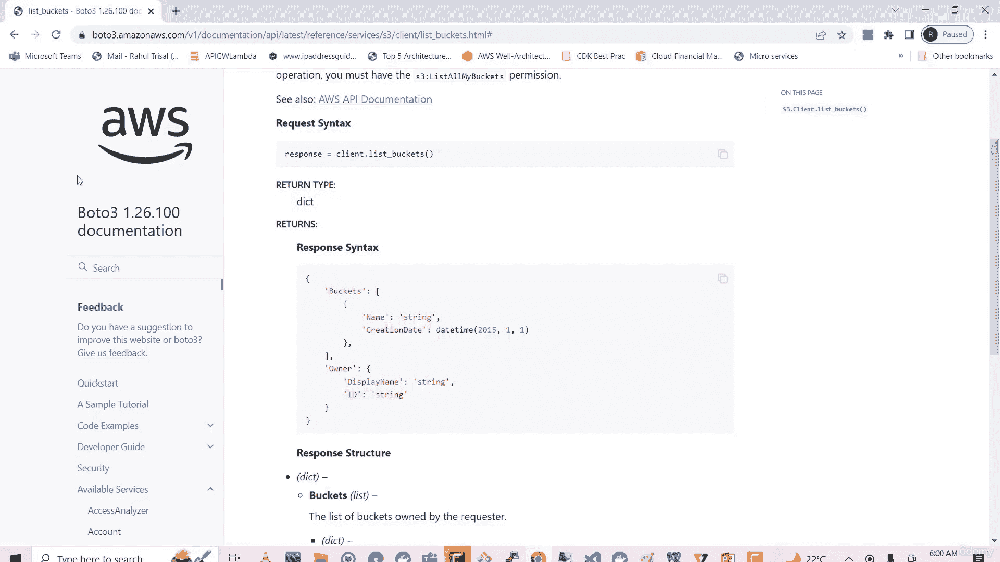

## 📦 生成式AI on AWS：第03章：从S3响应中读取字典数据

上一节我们围绕Python基础概念做了铺垫，本节中我们来看看一个来自Boto3的真实例子：检索S3桶。原文先给出了一个响应结构，这个结构会返回AWS账号中所有桶的列表。假设我们只想取第一个桶，或者只取第一个桶的名称和创建日期，就可以通过字典来取值。AWS文档中也给出了这个例子，原文直接把它复制过来使用。

下面是一个简化的响应结构示例，方便理解字典里面有什么。

```python
response = {
    "Buckets": [
        {"Name": "bucket-1", "CreationDate": "2026-01-01"},
        {"Name": "bucket-2", "CreationDate": "2026-01-02"}
    ],
    "Owner": {"DisplayName": "owner"}
}
```

这段结构里，`response`是一个字典，字典里有两个元素：一个是`Buckets`键，另一个是`Owner`键。`Buckets`键对应的值里面装着桶列表，`Owner`键对应的值里面装着所有者信息。字典取值的基本公式如下。

```python
字典值 = response["键名"]
```

变量名可以随便起，原文使用`response`只是因为AWS示例里经常这么写。原文先把旧代码注释掉，然后稍微修改代码，让`response`成为当前变量。接下来如果只想取`Buckets`这个键对应的数据，就可以打印`response["Buckets"]`。下面代码展示这个取值过程。

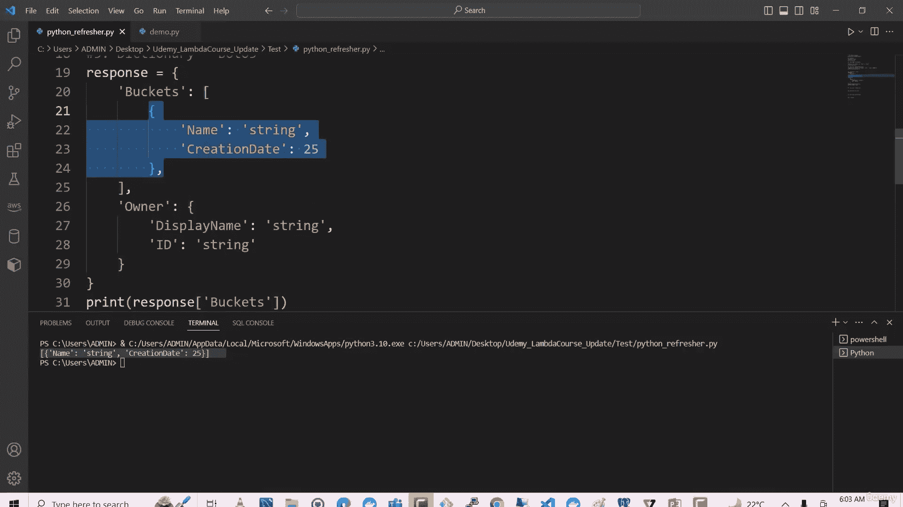

```python
print(response["Buckets"])
```

运行后只会得到`Buckets`键的值，不会得到`Owner`键的值。这样我们就完成了字典按键取值的基本操作。字典的特点是通过键来拿值，键写错或者不存在时会报错，所以实际写代码时要检查键名是否和返回结构一致。

## 📋 生成式AI on AWS：第03章：列表、索引与切片

上一节我们介绍了字典按键取值，本节中我们来看看另一种非常常见的数据类型：列表。列表用方括号表示，方括号里面可以放整数、字符串，也可以放对象。列表是有序的，这一点很重要，因为列表取值靠的是位置，而不是靠键名。下面是一个列表示例。

```python
my_list = [1, "string", 4, 14, "Anishia"]
```

列表取值公式如下。

```python
列表值 = my_list[index]
```

列表索引从0开始，第一个元素的位置是0。下面是这个列表的位置对应关系。

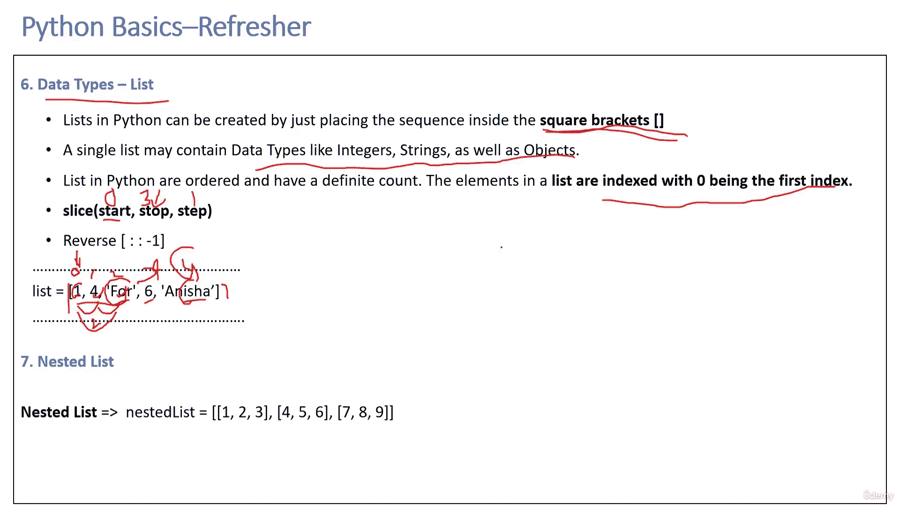

- 位置0对应`1`
- 位置1对应`"string"`
- 位置2对应`4`
- 位置3对应`14`
- 位置4对应`"Anishia"`

所以如果想取位置4的值，就写`my_list[4]`，会得到`"Anishia"`。如果想取位置1的值，就写`my_list[1]`，会得到字符串。列表除了单个位置取值，还可以切片。切片的基本公式如下。

```python
切片 = my_list[start:stop:step]
```

`start`是开始位置，`stop`是结束位置但不包含在结果里，`step`是步长。下面用几个例子说明切片。

- `my_list[0:5:1]`表示从0开始，到5之前结束，步长为1，所以会打印全部元素。
- `my_list[0:3]`表示从0开始，到3之前结束，所以只打印位置0、1、2这三个元素。
- `my_list[4]`表示只取位置4，得到`"Anishia"`。
- `my_list[0:4:2]`表示从0开始，到4之前结束，步长为2，隔一个取一个，会得到位置0和位置2的值。

这里要特别注意，`stop`位置本身不包含在结果里。步长为1表示逐个取，步长为2表示隔一个取。下面代码把这些取值方式放在一起演示。

```python
print(my_list[0:5:1])
print(my_list[0:3])
print(my_list[4])
print(my_list[0:4:2])
```

运行后可以看到，列表既可以整体打印，也可以只打印前几个元素，还可以按位置取单个元素。这样我们就掌握了列表索引和切片的基本用法。列表的取值方式在后面处理AWS返回的桶列表时会非常常用。

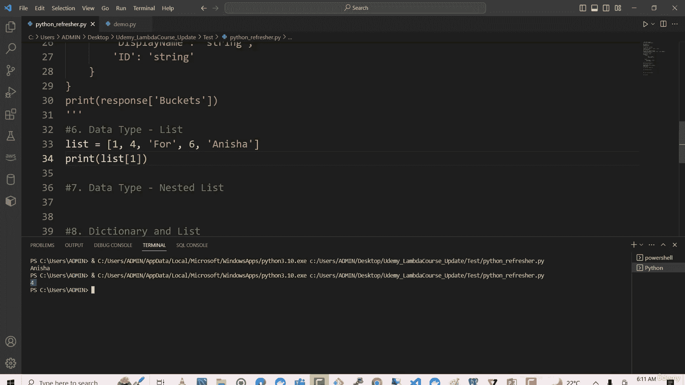

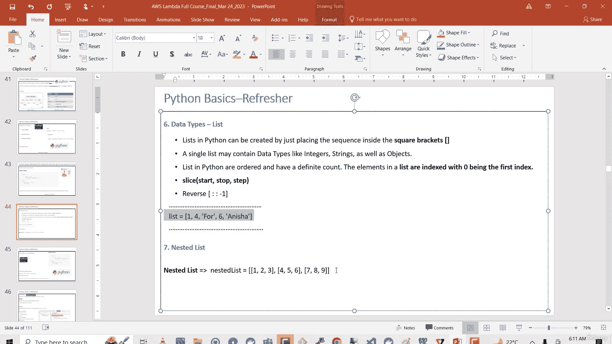

## 🧱 生成式AI on AWS：第03章：嵌套列表的取值

上一节我们介绍了普通列表的索引和切片，本节中我们来看看嵌套列表。嵌套列表就是列表里面还有列表，外层用方括号，内层也用方括号。下面是一个嵌套列表示例。

```python
nested_list = [[4, 5, 6], [7, 8, 9]]
```

嵌套列表的取值方式和字典有点类似，需要先取外层，再取内层。取值公式如下。

```python
嵌套值 = nested_list[外层索引][内层索引]
```

下面用几个例子说明嵌套列表怎么取值。

- `nested_list[0]`会得到外层第一个列表，也就是`[4, 5, 6]`。
- `nested_list[0][1]`会先取外层位置0，再取内层位置1，得到`5`。
- `nested_list[1][2]`会先取外层位置1，再取内层位置2，得到`9`。

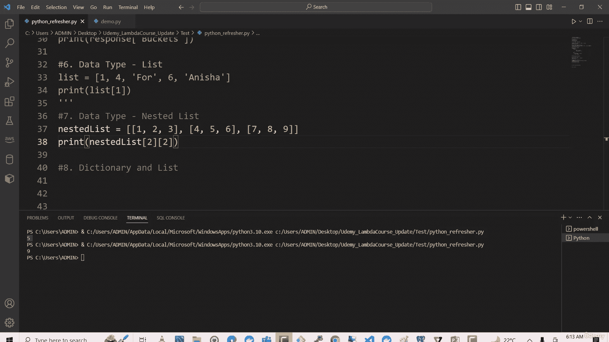

原文演示时曾经忘记一个字符，修正后代码才能正常运行，这也提醒我们写代码时要检查括号、变量名和索引位置。下面代码展示嵌套列表的取值过程。

```python
print(nested_list[0])
print(nested_list[0][1])
print(nested_list[1][2])
```

运行后可以看到，嵌套列表的取值就是一层一层往里取。先确定外层位置，再确定内层位置，思路和字典先取键再取内部值很像。这样我们就完成了嵌套列表的基本练习。后面遇到复杂JSON结构时，这种一层一层取值的方式会经常用到。

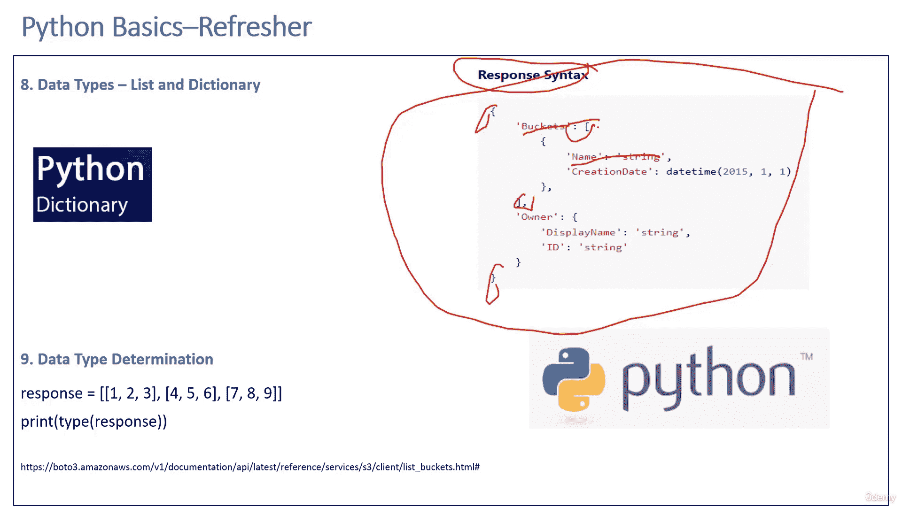

## 🔗 生成式AI on AWS：第03章：列表与字典组合取值

上一节我们介绍了嵌套列表，本节中我们来看看一个非常常见的场景：列表和字典组合在一起。Boto3的响应语法本身就是一个字典，字典里面的`Buckets`又是一个列表，列表里的每个元素又是字典。如果想取桶的名称，就要先取列表，再按位置取元素，最后再按`Name`键取值。组合取值公式如下。

```python
桶 = response["Buckets"][索引]
桶名称 = response["Buckets"][索引]["Name"]
```

下面代码展示从响应中取桶信息的步骤。

```python
buckets = response["Buckets"]
print(buckets)
print(buckets[1])
print(buckets[1]["Name"])
print(buckets[1]["CreationDate"])
```

先打印`response["Buckets"]`会得到所有桶的列表。这个列表是有序的，所以可以按位置取值。位置0是第一个桶，位置1是第二个桶。原文示例里写1，会拿到第二个桶，而不是第一个桶。这一点要特别注意，索引从0开始，想取第一个桶应该写0。

假设账号里有10个桶，只想取第一个桶的名称和创建日期，就应该使用位置0。下面代码展示取第一个桶的方式。

```python
first_bucket = response["Buckets"][0]
print(first_bucket["Name"])
print(first_bucket["CreationDate"])
```

另一个常见需求是：取出账号里所有桶，并找出创建日期最晚的那个桶，把它存下来。思路是先取出`Buckets`列表，再比较每个桶的`CreationDate`。下面是一个思路示例。

```python
buckets = response["Buckets"]
latest_bucket = max(buckets, key=lambda b: b["CreationDate"])
print(latest_bucket)
```

这里的`max`用来找最大值，`lambda`是一个临时小函数，后面函数部分还会讲到。通过这个例子可以看到，列表和字典组合时，关键是先分清当前数据是字典还是列表：字典用键取值，列表用位置取值。这样我们就能从复杂的AWS响应中取出需要的数据。

## 🔍 生成式AI on AWS：第03章：用type函数判断数据类型

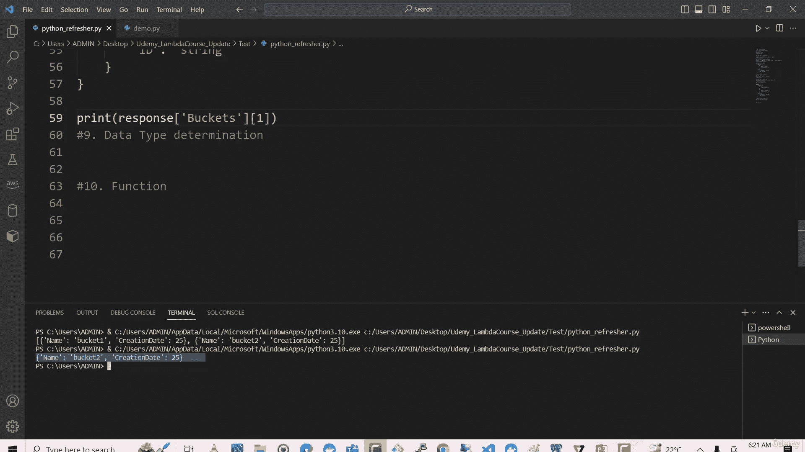

上一节我们处理了列表和字典组合取值，本节中我们来看看当不确定数据类型时该怎么办。实际写代码时，有时文档会写明数据类型，但有时我们拿到一个变量并不确定它是列表、字典还是字符串。这时可以用`type()`函数来判断。判断公式如下。

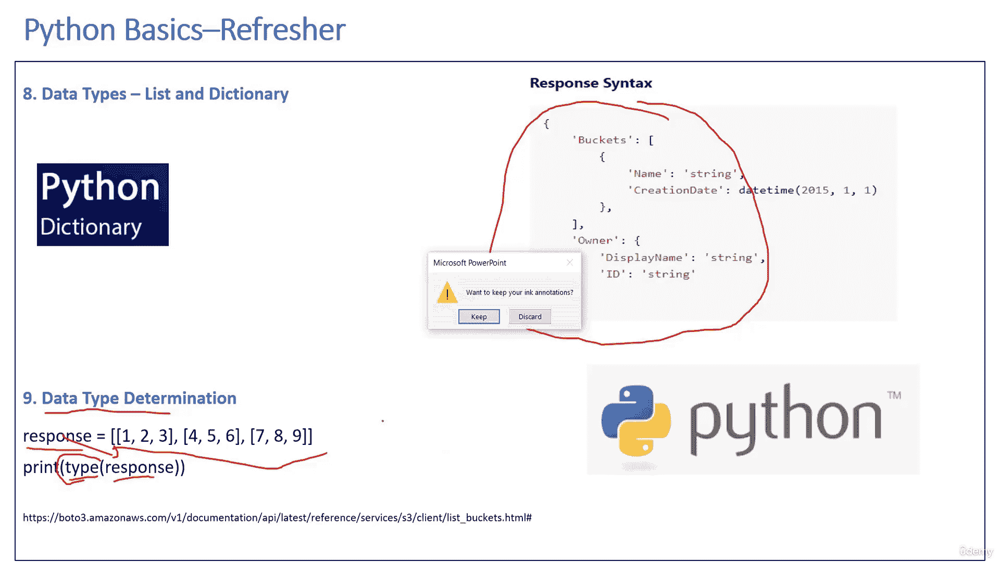

```python
数据类型 = type(变量)
```

下面代码展示如何判断`response`以及它内部值的数据类型。

```python
print(type(response))
print(type(response["Buckets"]))
print(type(response["Buckets"][0]))
```

运行后可以看到，`response`的类型是`dict`，`response["Buckets"]`的类型是`list`，列表里的元素类型又是`dict`。如果变量是字符串，就会显示`str`；如果是列表，就会显示`list`；如果是字典，就会显示`dict`。这样我们就能在取值之前先确认数据类型，避免用错方法。原文也提到，不确定类型时用`type()`是一个很直接的排查方式。掌握这个技巧后，阅读复杂返回结构会轻松很多。

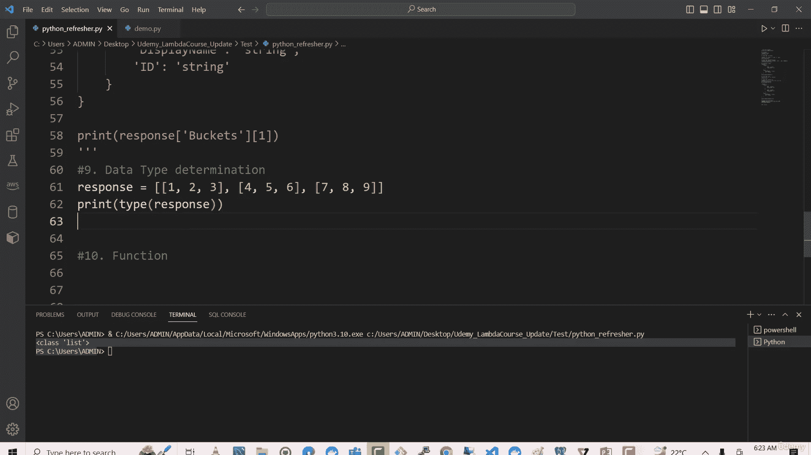

## 🛠️ 生成式AI on AWS：第03章：Python函数与Lambda函数

上一节我们介绍了用`type()`判断数据类型，本节中我们来看看Python函数。函数本质上就是一段代码块，被调用时才会运行。函数可以接收参数，做一些计算，然后返回一个值。函数的基本语法如下。

```python
def 函数名(参数):
    # 这里写计算逻辑
    return 返回值
```

`def`是定义函数的关键字，后面跟函数名，再后面是参数。下面是一个判断数字是奇数还是偶数的简单例子。

```python
def even_or(x):
    if x % 2 == 0:
        return "even"
    else:
        return "odd"
```

这个函数接收参数`x`，如果`x`除以2的余数等于0，就返回`"even"`；否则返回`"odd"`。运行这个函数就能知道数字是偶数还是奇数。下面代码展示调用函数并打印结果。

```python
print(even_or(3))
print(even_or(4))
```

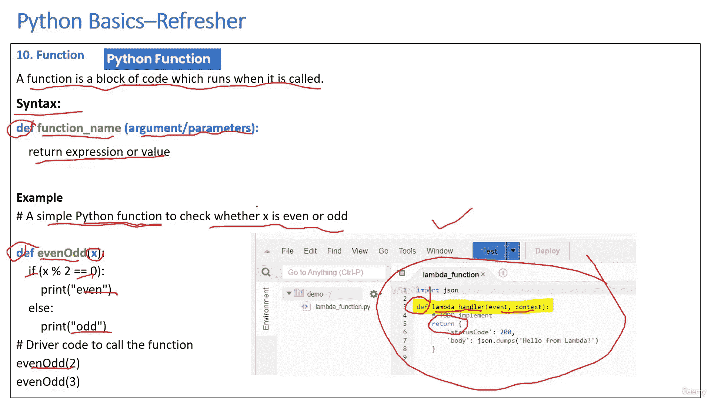

运行后，`even_or(3)`会输出`odd`，`even_or(4)`会输出`even`。接下来看Lambda函数的模板。Lambda函数本身也是Python函数，结构是相似的。下面是一个常见的Lambda处理函数骨架。

```python
def lambda_handler(event, context):
    # 这里写计算逻辑
    return 返回值
```

这里的`lambda_handler`是函数名，`event`和`context`是参数。函数内部做一些计算，最后返回一个值。原文展示这个模板，是为了让我们先熟悉语法，后面真正编写Lambda函数时就不会陌生。把上面的奇偶判断例子运行一遍，再对照Lambda模板看，就能理解函数名、参数、计算和返回值分别在哪里。这样我们就完成了Python函数的快速复习。

## ✅ 生成式AI on AWS：第03章：本节总结

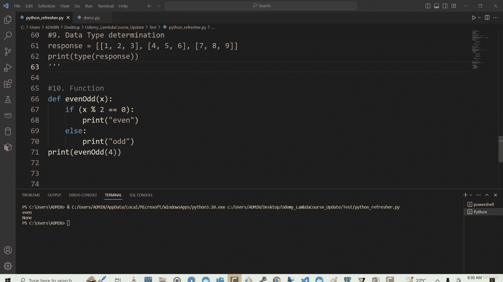

本节课中我们一起学习了Python基础复习的第二部分，内容包括从S3响应中读取字典数据、列表索引与切片、嵌套列表取值、列表与字典组合取值、用`type()`判断数据类型，以及Python函数和Lambda函数的基本结构。我们还通过Boto3返回S3桶的例子，理解了字典用键取值、列表用位置取值、嵌套结构要一层一层往里取。原文最后也提到，如果希望更详细地回顾这些例子，可以查看最后章节中更完整的说明。把这些基础打牢之后，后面创建Lambda函数、处理AWS返回数据时就会更顺畅。

