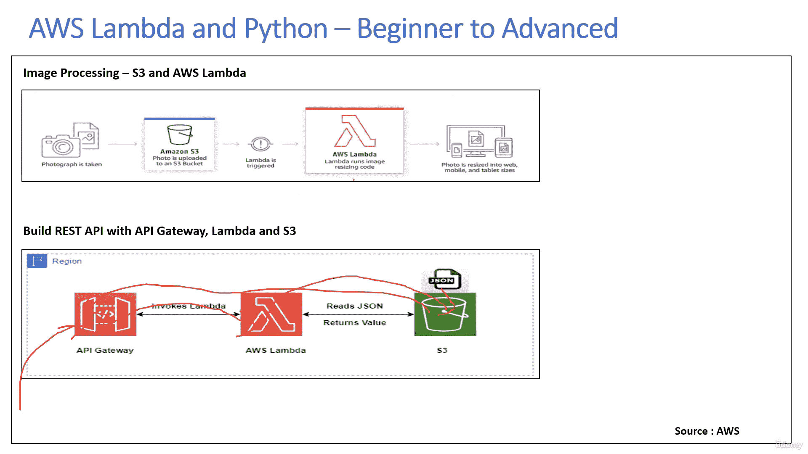
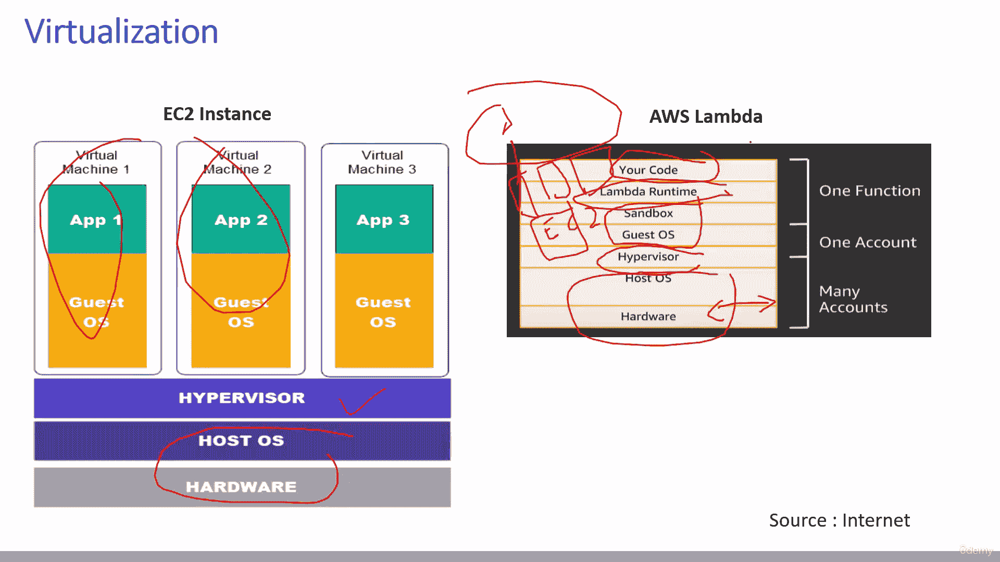

# 🧩 Udemy - Generative AI on AWS - Amazon Bedrock, RAG & KIRO [2026]：Part 2 p04 106：AWS Lambda 概览

在本节课中，我们将要学习 AWS Lambda 的基本概念、关键特性、计费方式、运行机制、适用与不适用场景、典型事件驱动用例以及底层架构。课程会尽量用直白的话解释，让初学者也能看懂。Lambda 是 AWS 中非常常见的一种计算服务，理解它有助于后续把生成式 AI 应用和 AWS 上的其他服务连接起来。本节课会从 AWS 对 Lambda 的官方定义讲起，再逐步拆解它为什么被称为无服务器、事件驱动的计算服务。

## 🧭 Udemy - Generative AI on AWS - Amazon Bedrock, RAG & KIRO [2026]：Part 2 p04 106：Lambda 的定义与关键特性

在开始学习 Lambda 之前，先理解 AWS 对它的定义会更容易抓住重点。AWS 对 Lambda 的定义可以概括为下面这段引用。

> AWS 对 Lambda 的定义是：Lambda 是一种计算服务，让你无需预置或管理服务器即可运行代码；它会在高可用计算基础设施上运行代码，并自动完成操作系统维护、容量预置、自动扩展和日志等管理任务。

这个定义里包含几个关键点。第一，Lambda 是一种计算服务，AWS 还有其他计算服务，例如 EC2 实例。第二，它让你运行代码时不需要预置或管理服务资源。第三，Lambda 会在高可用计算基础设施上运行你的代码。第四，操作系统维护、容量预置、自动扩展和日志等管理任务都由 Lambda 完成。原文还强调，物理服务器和虚拟服务器相关的维护工作也由 AWS 负责。

从上面的定义中，可以提炼出以下关键特性，下面逐条说明。

- Lambda 是一种计算服务。
- Lambda 默认就是高可用的，你不需要做额外操作来让它高可用。
- 计算资源的管理工作，包括运维、自动扩展和日志，都由 AWS 完成。
- 物理基础设施和虚拟基础设施都由 AWS 管理。
- 你不需要管理服务资源，预置工作由 AWS 完成，并且按使用量付费。

可以用一个简单公式概括这些特性，公式如下。

```text
Lambda = 计算服务 + 默认高可用 + AWS 托管运维 + 按使用付费
```

理解这些关键特性后，下一节我们把它和 EC2 放在一起对比，看看两者在预置和计费上的差别。

## ⚖️ Udemy - Generative AI on AWS - Amazon Bedrock, RAG & KIRO [2026]：Part 2 p04 106：Lambda 与 EC2 的计费对比

上一节我们介绍了 Lambda 的关键特性，本节中我们来看看它和 EC2 的计费差异。EC2 也是一种计算服务，但在使用 EC2 时，你需要在预置实例时提前决定使用小实例、中实例还是大实例。之后你按照预置的容量付费，而不是按照实际使用量付费。也就是说，如果你预置了一个大实例，但只使用了其中一小部分，你仍然需要为大实例付费。

Lambda 的计费方式不同。使用 Lambda 时，你不需要提前做任何预置，预置工作由 AWS 完成，你只需要为实际使用量付费。为了更直观地理解这一点，下面把它和 EC2 做一个计费对比。

- EC2 在预置实例时，需要提前选择小实例、中实例或大实例。
- EC2 按照预置的容量付费，不按照实际使用量付费。
- 如果预置大实例但只使用一小部分，仍然需要为大实例付费。
- Lambda 不需要提前预置，预置由 AWS 完成。
- Lambda 按照实际使用量付费。

两者的计费差异可以用下面的公式表示。

```text
EC2 费用 = 预置实例规格 × 运行时长
Lambda 费用 = 实际调用与运行消耗 × 单价
```

清楚了计费差异后，下一节我们来看看 Lambda 函数到底是怎么运行起来的。

## ⚙️ Udemy - Generative AI on AWS - Amazon Bedrock, RAG & KIRO [2026]：Part 2 p04 106：Lambda 的运行机制

前面我们对比了 Lambda 和 EC2 的计费方式，本节中我们来看看 Lambda 函数如何运行。使用 Lambda 时，你可以把自己的代码带过来，也可以直接编写代码，或者上传代码，然后让代码在 AWS Lambda 服务上运行。你不需要关心底层服务器如何准备，AWS 会管理运行应用代码的服务器。

由于这些特性，Lambda 有时被称为无服务器、事件驱动的计算服务。无服务器并不是说没有服务器，而是说你不需要管理底层服务器，底层服务器由 AWS 管理。Lambda 也是事件驱动的，原文提到事件驱动的具体含义会在下一张幻灯片中展开，这里可以先理解为由某个事件触发后才运行。

Lambda 的基本运行过程可以用下面的代码描述。

```text
编写或上传代码 -> 部署到 Lambda -> 等待事件触发 -> 运行代码
```

理解了运行机制后，下一节我们结合具体场景看看 Lambda 适合做什么。

## 🎯 Udemy - Generative AI on AWS - Amazon Bedrock, RAG & KIRO [2026]：Part 2 p04 106：Lambda 的适用场景

上一节我们介绍了 Lambda 的运行方式，本节中我们来看看它的适用场景。Lambda 是事件驱动服务，因此它不会连续运行。对比来看，如果你在 EC2 实例上运行一个应用服务器，这个服务器会持续运行，无论有没有请求发到这个服务器，它都会继续运行。Lambda 函数则需要某些触发器，例如你要调整照片尺寸，并把照片上传到 S3 存储桶；上传完成后会生成事件通知，这个事件通知可以触发 Lambda 函数，Lambda 随后运行代码，调整图片尺寸，再把图片上传到其他地方。因此 Lambda 需要某种事件来触发，不会连续运行。

第二个适用场景是需求不可预测。比如你发布一个新应用，不知道会获得 100 万客户还是 100 个客户。如果使用 EC2 实例，你需要提前预置，例如说我需要一个大的实例，然后即使只有 100 个客户，你也要为大实例付费。当需求不可预测时，使用 Lambda 有时是更好的选择，因为你不必提前预置 Lambda 函数的大小，它按使用量付费。

下面看看 Lambda 适合哪些场景，重点理解事件驱动和不可预测负载。

- 事件驱动场景：有事件触发时才运行，不需要连续运行。
- EC2 应用服务器会连续运行，无论有没有请求。
- Lambda 需要触发器，例如 S3 上传事件触发图片尺寸调整。
- 需求不可预测的场景适合 Lambda，因为无需提前预置规格，按使用量付费。

事件驱动的核心关系可以用下面的代码描述。

```text
事件源 -> Lambda 函数 -> 处理结果
```

虽然 Lambda 适合事件驱动和不可预测负载，但它并不是万能的，下一节我们看看什么时候不该用它。

## 🚫 Udemy - Generative AI on AWS - Amazon Bedrock, RAG & KIRO [2026]：Part 2 p04 106：Lambda 的不适用场景

在了解了适用场景之后，本节中我们来看看 Lambda 不适合哪些情况。第一，当你需要管理基础设施时，不适合使用 Lambda，因为它是无服务器解决方案，你不会被允许管理底层服务器，底层服务器由 AWS 管理。第二，如果因为安全或合规原因，你需要管理底层服务器，那么不应该使用 Lambda。第三，如果你需要让服务器连续运行，而不是由事件或事件驱动来运行，也不适合使用 Lambda。例如你希望有一个 Web 服务器并让它持续运行，而不是根据请求是否存在来决定是否运行，这种情况下不应该使用 AWS Lambda。

下面这些情况不适合使用 Lambda，需要提前避开。

- 需要管理基础设施时，不适合使用 Lambda。
- 因安全或合规原因需要管理底层服务器时，不应该使用 Lambda。
- 需要服务器连续运行，而不是事件驱动运行时，不适合使用 Lambda。
- 例如需要持续运行的 Web 服务器，不应基于请求触发的方式使用 Lambda。

可以用下面的条件判断来描述这些限制。

```text
需要管理底层服务器 或 需要长期连续运行 -> 不使用 Lambda
```

排除了不适用场景后，下一节我们看两个 Lambda 的典型落地例子。

## 🖼️ Udemy - Generative AI on AWS - Amazon Bedrock, RAG & KIRO [2026]：Part 2 p04 106：Lambda 的典型用例

前面我们讨论了 Lambda 适合和不适合的场景，本节中我们来看两个具体例子。第一个例子是图片处理。用户上传需要调整尺寸的图片到 S3 存储桶，图片上传后会产生一个 S3 事件通知，这个事件通知触发 Lambda 函数。Lambda 函数运行代码，调整图片尺寸，然后把图片上传到另一个 S3 位置或其他地方。这个例子展示了事件驱动架构的典型用法。

第二个例子是使用 API Gateway、Lambda 和 S3 服务构建 REST API。客户端调用 API，API 进而触发 Lambda 函数，Lambda 函数运行代码，从 S3 存储桶中检索数据，然后把数据返回给客户端。这两个例子都是基于事件驱动架构的用例。

下面两个例子可以说明 Lambda 的典型事件驱动用法。

- 图片上传到 S3 后产生事件通知，触发 Lambda 调整图片尺寸，再把图片上传到另一个位置。
- 客户端调用 API Gateway，API Gateway 触发 Lambda，Lambda 从 S3 读取数据并返回给客户端。

两个例子的流程可以用下面的代码描述。

```text
S3 上传图片 -> S3 事件通知 -> Lambda 调整图片 -> 上传到另一个 S3 位置

客户端 -> API Gateway -> Lambda -> S3 -> Lambda 返回数据给客户端
```

看完典型用例，下一节我们再看 Lambda 的底层架构，理解它为什么能做到无服务器。

## 🏗️ Udemy - Generative AI on AWS - Amazon Bedrock, RAG & KIRO [2026]：Part 2 p04 106：Lambda 的底层架构

上一节我们看了 Lambda 的实际用例，本节中我们来看看它的整体架构。Lambda 的架构和前面看到的计算架构很相似：底层是物理基础设施，上面是虚拟化层，再上面是虚拟机。物理服务器由 AWS 管理，并且可以跨 AWS 账户共享，这些账户可能属于不同客户。AWS 使用 Hypervisor 虚拟化层，在物理基础设施上创建多个虚拟机，这些虚拟机通常就像 EC2 实例一样的虚拟服务器。

有了 EC2 实例之后，AWS 会在此基础上创建多个 MicroVM，也就是微虚拟机。每个微虚拟机充当一个 Lambda 函数，其中包含 Lambda 运行时和你的代码。这样一层层抽象下来，你只需要提供代码并配置触发方式，底层服务器和虚拟化资源都由 AWS 管理。

Lambda 的架构层次可以用下面的代码描述。

```text
物理服务器（AWS 管理，可跨 AWS 账户共享）
  -> Hypervisor 虚拟化层
    -> 多个虚拟机（类似 EC2 实例）
      -> 多个 MicroVM（微虚拟机）
        -> 每个 MicroVM 对应一个 Lambda 函数（含 Lambda 运行时和你的代码）
```

从架构可以看出，Lambda 的无服务器特性来自 AWS 对底层物理资源、虚拟化层和运行时的统一管理。下一节我们对本节课内容做一个总结。

## 📝 Udemy - Generative AI on AWS - Amazon Bedrock, RAG & KIRO [2026]：Part 2 p04 106：课程总结

前面我们从定义、计费、运行、场景、用例和架构几个角度介绍了 Lambda，本节中我们来做一个小结。Lambda 是一种计算服务，默认高可用，AWS 负责操作系统维护、容量预置、自动扩展和日志等管理工作。你不需要预置服务器，只需要按实际使用量付费。Lambda 是事件驱动的，不会像 EC2 应用服务器那样连续运行，因此适合图片处理、REST API 等由事件触发的场景，也适合需求不可预测的负载。需要管理底层服务器、因安全合规要求必须管理服务器、或者需要长期连续运行的场景，不适合使用 Lambda。底层架构上，AWS 通过物理服务器、Hypervisor、虚拟机和 MicroVM 来承载 Lambda 函数。

下面用几条要点回顾本节课的核心内容。

- Lambda 是无服务器、事件驱动的计算服务。
- Lambda 默认高可用，底层运维由 AWS 完成。
- Lambda 按实际使用量付费，EC2 按预置容量付费。
- Lambda 适合事件驱动和需求不可预测的场景。
- 需要管理基础设施或需要连续运行服务器时，不适合使用 Lambda。
- Lambda 底层通过 MicroVM 承载函数运行时代码。





本节课中，我们一起学习了 AWS Lambda 的定义、关键特性、计费方式、运行机制、适用与不适用场景、典型用例和底层架构。掌握这些内容后，后续把 Lambda 与 S3、API Gateway 等服务组合起来构建生成式 AI 应用会更顺畅。

