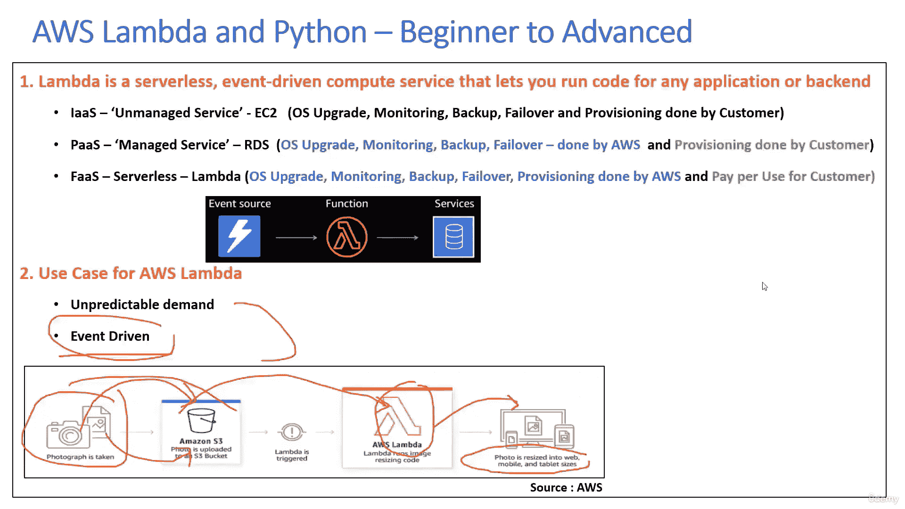
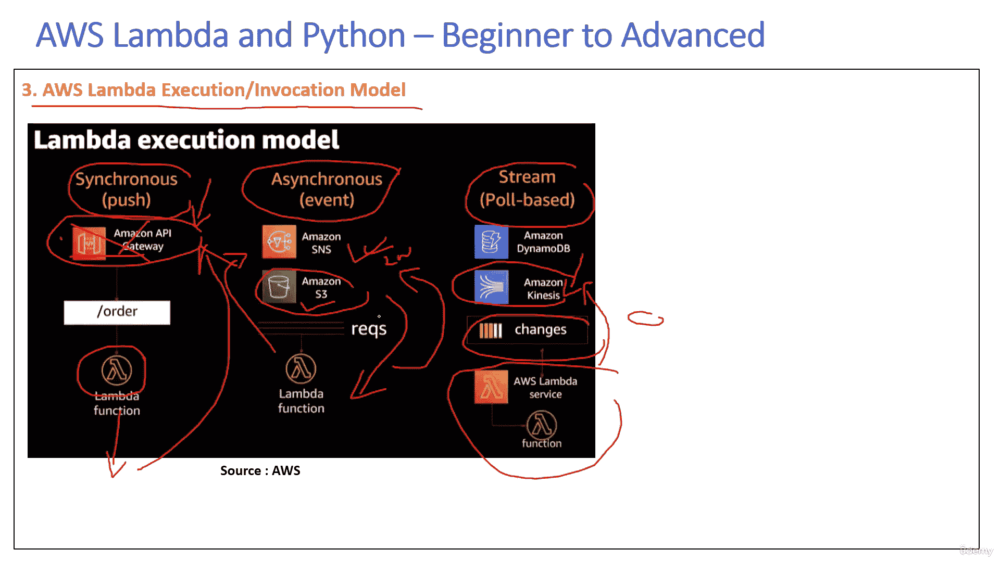
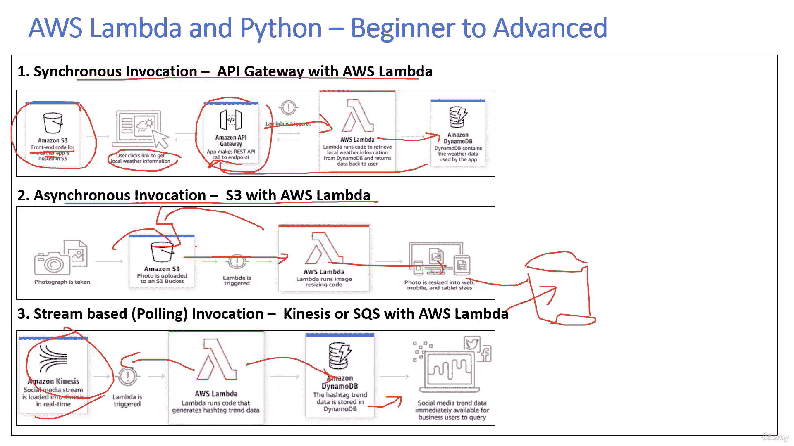

# Generative AI on AWS：第 5 节：AWS Lambda 调用模型 ⚡️

## 📖 概述

在本节课中，我们将来学习 AWS Lambda 的执行模型，也就是调用模型。这是理解 Lambda 工作原理的第三个关键概念。我们会介绍 Lambda 的三种调用方式，并且结合 AWS 官方的例子来讲解，帮助你把每个概念都落到实处。无论你是刚开始接触 Serverless，还是已经写过一些 Lambda 函数，理解“函数是怎么被启动的”都是非常重要的一步。

## 🔍 什么是 AWS Lambda 的调用模型？

先从 AWS 官方的一张图说起。这张图展示了 AWS Lambda 可以被执行的三种方式。简单来说，调用模型回答了几个问题：谁负责触发 Lambda？触发之后 Lambda 要不要返回结果？Lambda 是主动去拉数据，还是被动等别人推数据？把这几个问题搞清楚了，你就能根据业务场景选择合适的触发方式。

以下是这三种调用方式的总体对比：

- 同步推送（Synchronous Push）：调用方发出请求后，必须等待 Lambda 返回响应。
- 异步调用（Asynchronous）：调用方触发 Lambda 后，不等待任何响应。
- 流式或轮询（Stream / Poll）：Lambda 定期去数据源拉取数据，然后批量处理。

下面我们逐一详细说明。

## 🎯 同步推送（Synchronous Push）

首先来看第一种调用方式：同步推送。这种模式通常出现在 Amazon API Gateway 的场景里。比如一个客户发送请求，想获取他所有的未完成订单。一旦他发出这个请求，请求就会触发 Lambda 函数。Lambda 函数执行后端的业务逻辑，然后把处理结果返回给发起调用的最终客户。

这里需要你牢记一个关键点：整个过程是同步的。也就是说，客户发出请求之后，会一直等待 Lambda 的响应。响应结果只有两种可能：要么把所有的未完成订单返回给客户，要么返回一个错误信息告诉客户哪里出了问题。即使你返回的是错误，客户也会期待收到这个错误。这种“一问一答”的模式就是同步调用的核心特征。

用代码表达的话，同步调用的流程大致是这样的：

```text
客户 -> API Gateway -> Lambda -> 后端处理 -> 返回数据/错误 -> 客户
```



这种模式在 API Gateway 这类服务中非常常见，因为 API 调用天然就是请求-响应模式。

## 🔄 异步调用（Asynchronous）

了解了同步调用之后，我们来看第二种调用方式：异步调用。这种模式常见于 Amazon S3 这样的服务。在之前的例子中，我们往 S3 上传了一个 JSON 文件，这个动作触发了 S3 的事件通知，事件通知又调用了 AWS Lambda。注意，在这个场景里，调用 Lambda 的那个服务并不期望收到 Lambda 的任何响应。

也就是说，事件源触发 Lambda 之后，Lambda 会在后台做自己的处理，但事件源并不会一直等在那里。这就是“异步”的含义：调用方只管把任务丢出去，后续结果怎么处理，调用方一概不关心。有点像你发了一封邮件，发完就去做别的事了，你并不需要等对方回信。

异步调用的流程可以用下面这段代码来描述：

```text
S3 上传文件 -> 事件通知 -> 触发 Lambda -> Lambda 后台处理（无响应返回）
```

这种模式非常适合那些不需要即时返回结果的场景，例如图片处理、文件格式转换、日志分析等等。

## 📥 流式或轮询调用（Stream / Poll）

接下来是第三种调用方式：流式或轮询方式。这种模式在 Amazon Kinesis 中非常常见。假设有一些数据，比如日志流数据，持续地被写入 Amazon Kinesis 数据流中。AWS Lambda 会每隔一段固定的时间间隔，主动去查看 Kinesis 数据流（也可能是 DynamoDB）里有没有新数据。如果发现有数据，它会把那个时间窗口内到达的数据全部拉取出来，放入 AWS Lambda 自己的队列里，随后由 Lambda 函数来处理这些数据。

所以这种模式更像是“轮询”：Lambda 每隔一段时间就去问一次“有没有新数据？”，有的话就批量取走。取数据的动作通常是一次拉一批，而不是一条一条地拿。

轮询调用的流程可以用下面的代码来描述：

```text
Lambda -> 每隔 N 秒轮询 Kinesis/DynamoDB -> 批量拉取数据 -> Lambda 处理
```



这就是 Lambda 的三种调用方式，你可以把它们看成三种不同的“触发风格”：同步是“你问我答”，异步是“你不问我也答”，轮询是“你不给我就自己去拿”。

## 🧪 三个具体例子

理解了三种调用方式之后，我们来看看三个 AWS 官方给出的实际例子。这三个例子分别对应同步、异步和流式调用，能让你更直观地感受到每种模式在真实业务中的样子。

### ☁️ 例子一：同步调用（天气应用）

第一个例子是使用 API Gateway 和 AWS Lambda 实现同步调用。这里有一个 Amazon S3 存储桶，托管着前端天气应用的代码。用户点击页面上的按钮来获取天气信息，这个点击动作会向某个 API 端点发起一个 REST API 调用，从而触发 Lambda 函数。Lambda 函数从后端获取天气数据，然后把数据返回给 API Gateway，最终由用户直接消费这些数据。整个链路是同步的，用户会一直等待天气结果出现在页面上。

同步调用的完整链路如下：

```text
用户点击 -> REST API 请求 -> API Gateway -> Lambda -> 后端取数据 -> API Gateway -> 用户
```

### 🖼️ 例子二：异步调用（照片处理）

第二个例子是异步调用，这个例子其实我们上一张幻灯片已经讨论过了。用户拍摄一张照片，然后把照片上传到 S3，S3 的事件通知会触发 Lambda 函数。Lambda 函数把照片尺寸调整好之后，可能会把处理后的照片放到另一个存储桶中，用户可以到这个新存储桶里访问最终的照片文件。注意，在这个场景中，上传照片这个动作并不期待 Lambda 返回任何响应。照片上传后，用户就可以直接关闭页面，后续的调整工作全部在后台自动完成。

异步调用的流程如下：

```text
拍摄照片 -> 上传到 S3 -> S3 事件通知 -> Lambda 调整尺寸 -> 放入新存储桶
```

### 📊 例子三：流式处理（社交媒体数据分析）

第三个例子是流式处理。真实世界的社交媒体数据会实时地被加载到 Kinesis 中，然后触发 Lambda 函数。Lambda 函数会分批读取这些数据，并将数据推送到 Amazon 的数据库（例如 DynamoDB）中进行处理。处理完成之后，这些数据就可以被立即查询。这种模式可以分成两种类型：近实时处理和实时处理，具体取决于数据加载和读取的延迟要求。

流式处理的流程如下：

```text
社交媒体数据 -> Kinesis 数据流 -> Lambda 分批读取 -> DynamoDB 处理 -> 可查询
```

## 📝 总结



本节课中，我们一起学习了 AWS Lambda 的调用模型，这是理解 Lambda 工作机制的第三个关键概念。我们首先从 AWS 官方的一张图出发，了解到 Lambda 有同步推送、异步调用、流式或轮询三种执行方式。同步推送的特点是调用方发出请求后必须等待响应，常见于 API Gateway；异步调用的特点是触发后不需要等待响应，常见于 S3 事件通知；流式或轮询的特点是 Lambda 主动按固定间隔去 Kinesis 或 DynamoDB 拉取数据，然后批量处理。最后，我们还通过天气应用、照片处理和社交媒体数据分析三个真实案例，把三种调用方式的具体场景串联了起来。现在，你应该能够根据业务需求选择合适的 Lambda 调用模式了。
