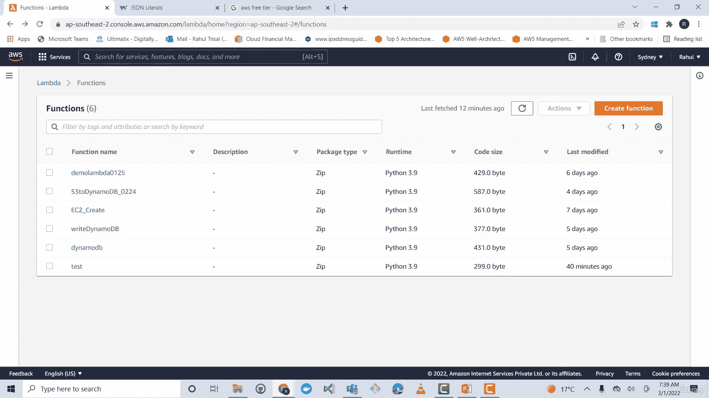
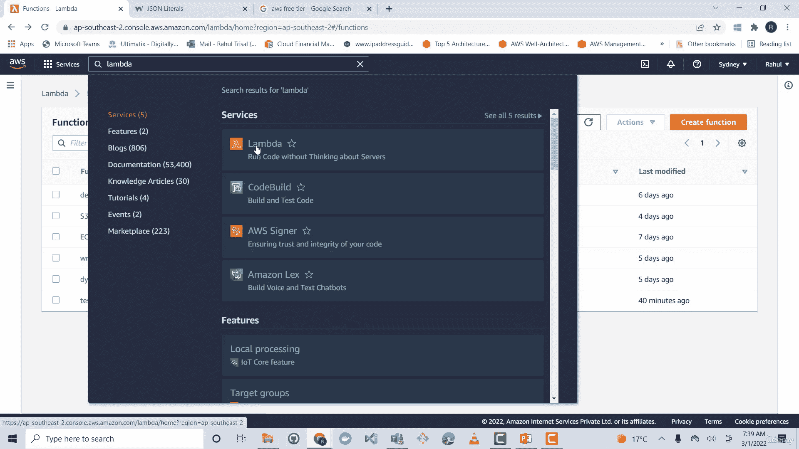
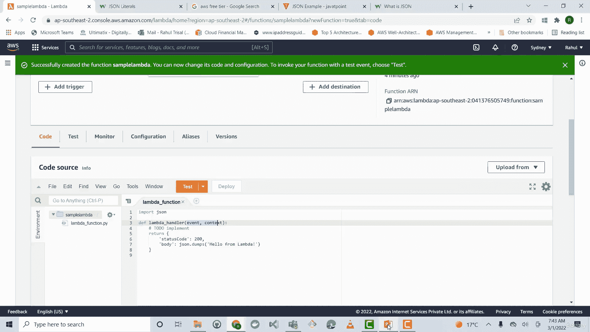
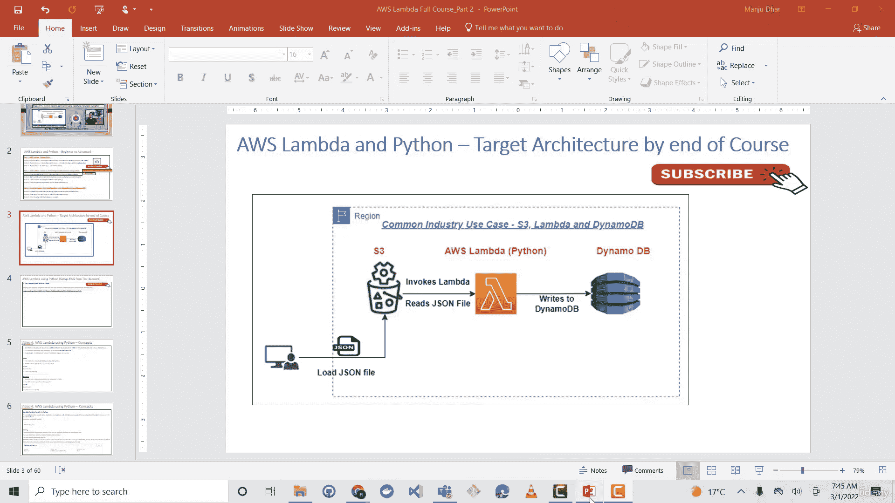
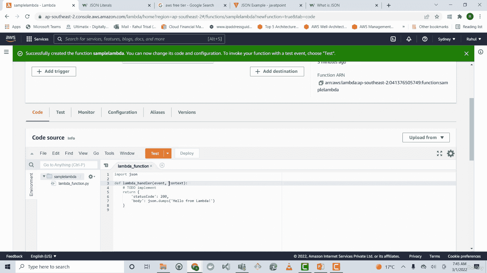
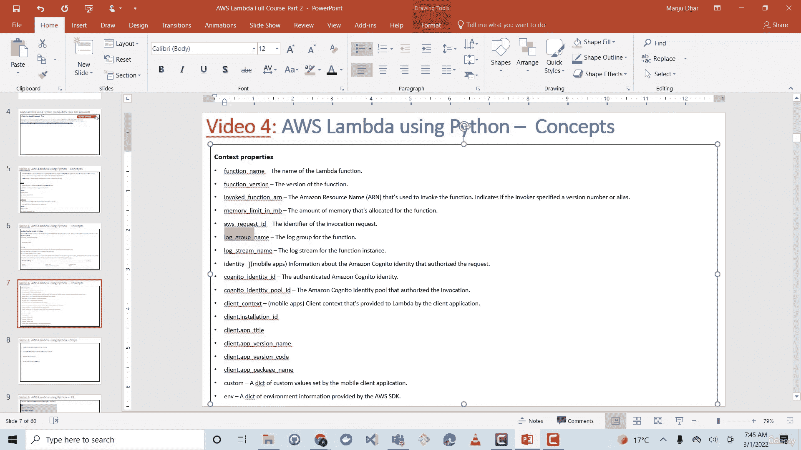
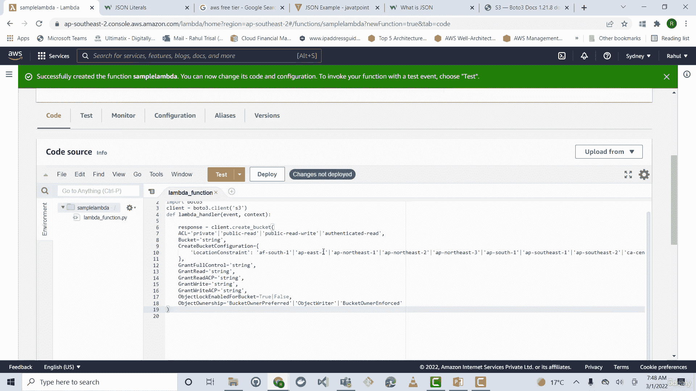
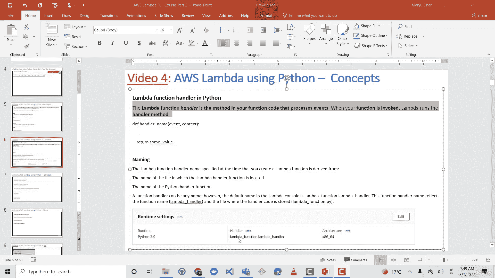
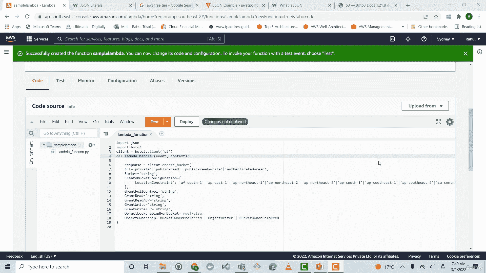

# ☁️ AWS Lambda 与 Python 全栈课程：第4章：Boto3、Client/Resource 与 Lambda Handler 入门

在本节课中，我们将要学习 AWS Lambda 与 Python 全栈课程中的 Boto3 客户端、Boto3 资源对象以及 Lambda 函数处理器。这是本系列的第四个视频，内容属于理论铺垫，重点是先把概念和代码结构讲清楚，为后面真正编写 Lambda 函数做准备。欢迎来到另一节 AWS Lambda 与 Python 全栈课程视频，本节会先概述这些概念的含义，再带你看它们在 Lambda 控制台和 AWS 文档中的实际样子。

## 🧭 AWS Lambda 与 Python 全栈课程：第4章：课程概述与免费账户准备

上一节我们进入了 AWS Lambda 与 Python 的学习主线，本节中我们来看看开始写 Lambda 函数之前需要做哪些准备，以及 Boto3 在 AWS Lambda 中扮演什么角色。首先，如果你还没有 AWS 账户，需要去获取一个免费的 AWS 账户，可以前往 AWS 免费套餐页面创建一个免费账户。创建免费账户是能够创建 Lambda 函数的第一步，因为没有账户就无法进入 AWS 控制台，也无法创建和测试 Lambda 函数。

下面是开始前需要完成的准备事项。

- 前往 AWS 免费套餐页面。

- 创建一个免费 AWS 账户。

- 确认账户可以正常登录 AWS 控制台。

- 后续使用该账户创建 Lambda 函数。

拿到 AWS 账户之后，就可以查看 AWS Lambda 的一些最基本概念。使用 Python 编写 AWS Lambda 函数时，底层依赖 Boto3。Boto3 是 AWS 为 Python 提供的软件开发工具包，也就是 AWS SDK for Python，用来与各种 AWS 服务进行交互。你可以把 Boto3 理解成 Python 程序和 AWS 服务之间的桥梁，Python 代码通过它向 AWS 发出请求，并接收 AWS 返回的结果。我们可以快速搜索“Boto3 AWS”，然后点击进入官方页面，在页面上可以看到 AWS SDK for Python Boto3 的说明。

根据官方说明，AWS SDK for Python Boto3 可以让你的 Python 应用程序、库或脚本更容易集成 AWS 服务，包括 Amazon S3 等服务。Boto3 有两个关键特性：一个是 client，也就是客户端；另一个是 resource，也就是资源对象。下一节我们会详细对比这两个概念，并给出它们的基本语法。

## 🧰 AWS Lambda 与 Python 全栈课程：第4章：Boto3的Client与Resource

上一节我们说明了 Boto3 是 Python 访问 AWS 服务的 SDK，本节中我们来看看 Boto3 中两个最常用的入口：client 和 resource。Boto3 文档中明确给出了这两个关键特性，client 是低层接口，resource 是相对更高层的抽象。理解这两者的区别，可以帮助你在写 Lambda 函数时决定什么时候用 client，什么时候用 resource。

下面是 Boto3 两个关键特性的对比。

- client 是低层接口，它为每一个 AWS 服务操作提供与底层 HTTP API 操作一一对应的映射。

- client 的好处是每个 AWS 服务操作都受支持，缺点是通常需要写更多代码。

- client 返回的结果大多是字典，因此你可能需要自己解析返回字典中的内容。

- resource 是相比 client 更高层的抽象，好处是通常需要写的代码更少。



- resource 的缺点是并非所有 AWS 服务操作都支持 resource 方式。



从使用体验上看，client 更接近 AWS API 的原始形态，控制更细，但代码会更啰嗦；resource 更像是对 AWS 资源进行的面向对象封装，写起来更省事，但覆盖范围不如 client 完整。实际写 Lambda 函数时，需要根据具体服务和操作来选择使用哪一种方式。

下面是 Boto3 中 client 和 resource 的基本语法。

```python
import boto3

s3_client = boto3.client('s3')
s3_resource = boto3.resource('s3')
```

这段代码先导入 Boto3，然后以 S3 为例创建 client 和 resource。语法整体很接近，区别只是创建 client 时使用 `boto3.client('s3')`，创建 resource 时使用 `boto3.resource('s3')`。如果你连接的是其他 AWS 服务，只需要把括号里的服务名称替换成对应的服务即可。了解完语法之后，我们进入 AWS Lambda 控制台，看看这些代码在真实函数中如何出现，以及 Lambda 函数的样板代码包含哪些内容。

## 🧪 AWS Lambda 与 Python 全栈课程：第4章：创建示例Lambda函数与JSON

上一节我们介绍了 Boto3 的 client 和 resource 语法，本节中我们来看看如何在 AWS Lambda 控制台创建一个示例函数，并理解默认样板代码。进入 AWS Lambda 服务后，如果你当前不在 Lambda 页面，可以直接在控制台搜索 Lambda。创建函数时，可以把函数名称设为 `sample`，运行时选择 Python 3.9，然后点击创建函数。创建完成后，示例函数就已经生成，控制台中会显示一些样板代码，也就是 Lambda 默认提供的初始代码。

下面是在 Lambda 控制台创建示例函数的主要步骤。

- 在 AWS 控制台搜索并进入 Lambda 服务。

- 点击创建函数。

- 将函数名称设置为 `sample`。

- 运行时选择 Python 3.9。

- 点击创建函数，等待函数创建完成。

函数创建完成后，可以看到控制台自动生成了一段样板代码。样板代码第一件事是导入 JSON 模块，也就是 `import json`。JSON 是一种轻量级的数据格式，主要用于存储和传输数据。当你在客户端和服务器之间交换数据，或者在两个应用程序之间交换数据时，可以使用 JSON。JSON 是系统之间传输数据的标准方式之一，早期常用 XML，现在更常用 JSON。

下面是一个 JSON 数据示例。

```json
{
  "employee": {
    "name": "张三"
  }
}
```

这个示例中有一个 employee 对象，里面有 name 字段，字段名是键，字段值是值，数据以键值对的形式传输。JSON 的写法和 Python 字典有些相似，但两者并不完全相同。字典是 Python 中的一种数据结构，而 JSON 是一种传输数据的格式。只是在语法表现上，JSON 也使用键值对，所以看起来接近字典。



在 Lambda 函数中导入 JSON 很有用。大多数场景下，你可能需要从 S3 对象中读取文件，然后把数据插入 DynamoDB。当你从 S3 读取文件时，拿到的数据很多时候是 JSON 对象，因此需要导入 JSON 模块，并在 Lambda 函数中执行与 JSON 相关的操作。理解完 JSON 的作用后，我们继续看 Lambda 函数处理器，也就是 `lambda_handler` 中的 event 和 context 参数。

## 🧩 AWS Lambda 与 Python 全栈课程：第4章：Lambda Handler的event与context

上一节我们创建了示例函数并解释了 JSON 的作用，本节中我们来看看 Lambda 函数处理器的结构。样板代码中会出现类似 `def lambda_handler(event, context):` 的定义。如果你还记得之前 Python 基础中关于函数的内容，就会知道 `def` 关键字表示定义一个函数。这里 `def` 后面是函数名，默认名称是 `lambda_handler`，它接收两个参数：event 和 context。



下面是 Lambda 函数处理器的基本结构。

```python
def lambda_handler(event, context):
    ...
```



先看 event 参数。event 可以理解为触发 Lambda 函数时传入的事件数据。举例来说，当用户把文件上传到 S3 时，S3 会产生一个事件通知，这个事件通知会触发 Lambda 函数。触发时，事件可以把一些数据传递给 Lambda 函数，这些数据大多是 JSON 形式。Lambda 函数中的 `lambda_handler` 会读取这个 event，然后你可以基于 event 中的数据执行相应操作。

再看 context 参数。context 主要提供与该 Lambda 函数运行环境相关的细节信息，也就是一些元数据。下面是 context 中常见的环境信息。

- 当前 Lambda 函数的名称。

- 当前函数的内存限制。

- 当前函数的日志组名称。



- 其他与 Lambda 函数运行环境相关的元数据。

这些信息可以帮助你在函数中了解运行环境。回到 Lambda 函数代码，你还会看到函数返回了一些值。实际编写 Lambda 函数时，可以把不需要的样板代码删掉，然后根据业务需要写自己的逻辑。理解完 handler 的参数后，我们来看一个更实际的代码预览：如何使用 client 创建 S3 桶。

## 🪣 AWS Lambda 与 Python 全栈课程：第4章：用Client创建S3桶的代码预览

上一节我们拆解了 Lambda handler 的 event 和 context，本节中我们来看看如何使用 Boto3 的 client 创建一个 S3 桶。假设我们要在 Lambda 函数中创建 S3 桶，可以先使用 client 方式。前面已经展示过基本语法：先导入 Boto3，然后启动 client。如果连接的是 S3，就使用 `boto3.client('s3')`；如果连接的是其他服务，就把 `'s3'` 替换成对应服务名称。

下面是用 client 创建 S3 桶的代码预览。

```python
import boto3

s3_client = boto3.client('s3')

response = s3_client.create_bucket(
    Bucket='your-bucket-name',
    CreateBucketConfiguration={
        'LocationConstraint': 'ap-south-1'
    }
)
```

这段代码先创建 S3 client，然后调用 `create_bucket` 方法。具体参数需要回到 AWS 文档中查看。进入 S3 文档后，找到创建桶的 `create_bucket` 操作，文档会给出与该操作相关的数据说明。你需要重点查看请求语法，也就是 request syntax，然后把其中的参数复制到代码中，并根据实际情况填写值，例如桶名称和区域位置。

下面是创建 S3 桶时需要重点关注的请求参数。

- `Bucket` 参数用于指定桶名称。

- `CreateBucketConfiguration` 参数用于指定桶所在区域等配置。

- 其他参数由 AWS 文档定义，需要根据文档说明填写。

- 返回值通常是字典，文档中会给出返回类型和示例。

文档还会说明返回类型是字典，并给出一些实现示例，帮助你理解如何调用。你可以复制文档中的请求语法，粘贴到 Lambda 函数中，然后修改具体值。最后需要重点强调 Lambda 函数处理器。AWS 文档对处理器的描述可以概括为：Lambda 函数处理器是函数代码中处理事件的方法，这一点前面已经讨论过。

> Lambda 函数处理器是函数代码中处理事件的方法。



处理器的命名约定也需要注意。常见写法是 `lambda_function.lambda_handler`，其中 `lambda_function` 是文件名，`lambda_handler` 是文件中的处理函数名。下面是 handler 命名约定的拆解。

- `lambda_function` 表示 Python 文件名。

- `lambda_handler` 表示该文件中的处理函数名称。

- 完整写法是 `lambda_function.lambda_handler`。

这些内容就是本节想要讨论的重点，目的是在真正编写 Lambda 函数之前，先预览这些代码的含义。下一节视频中，我们会实际执行创建、删除和列出 S3 桶的操作。到这里，本节的各个概念已经串联起来，下面做一个整体总结。

## ✅ AWS Lambda 与 Python 全栈课程：第4章：本节总结





本节课中我们一起学习了 AWS Lambda 与 Python 全栈课程中 Boto3、client、resource 和 Lambda handler 的基础知识。我们了解了 Boto3 是 AWS 为 Python 提供的 SDK，client 是低层接口，resource 是高层抽象；也知道了 Lambda 函数样板代码中为什么要导入 JSON，handler 中的 event 表示触发事件数据，context 表示运行环境信息。我们还预览了使用 client 创建 S3 桶的代码结构，以及 `lambda_function.lambda_handler` 的命名约定。下一节视频将进行创建、删除和列出 S3 桶的实践操作，感谢观看。

