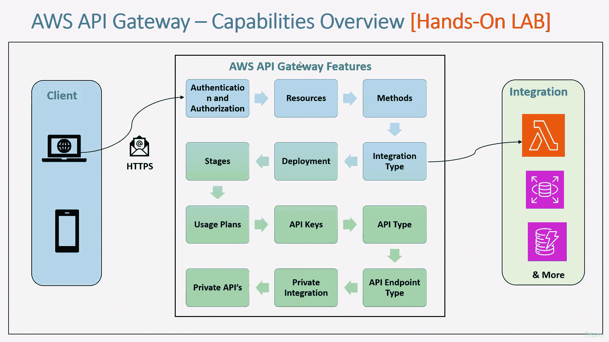

# Generative AI on AWS - Amazon Bedrock, RAG & KIRO [2026]：109：AWS API Gateway Refresher 🚀

  

在本节课中，我们将一起学习AWS API Gateway的核心知识。我们会先从它的基本定义讲起，然后逐步展开它的典型架构、API类型、控制台操作、认证授权方式以及私有集成等内容。通过这节课，你可以掌握API Gateway的常见使用方式，并且知道在什么场景下应该选择哪种配置。整个课程会从零开始，用通俗的语言和实际演示来帮助你理解，所以你不需要担心没有基础。  

  

## 🧠 什么是Amazon API Gateway？

  

Amazon API Gateway是AWS提供的一项托管服务，它的主要用途是创建、发布、维护、监控和保护REST API以及WebSocket API，而且这些操作都可以在任意规模下进行。换句话说，它相当于你API流量的“大门”，所有进出请求都要经过它来统一管理。  

  

我们来看一个具体的例子来说明它会怎么工作。假设你通过Amazon API Gateway创建了一个REST API，那么一旦这个API创建完成后，它就可以被各种客户端接口调用，比如Web应用、移动应用、IoT设备、已连接的用户等等。这些接口发出API请求之后，API Gateway会对这些请求进行身份验证和授权，确保只有合法的请求才会被转发到后端。之后，API Gateway可以调用你在后端定义的各种服务，包括AWS Lambda、Amazon ECS、Amazon DynamoDB，也可以是任何可公开访问的HTTP端点。除了这些，它还可以通过私有方式连接到你的数据中心。简单来说，这就是API Gateway的整体概貌。  

  

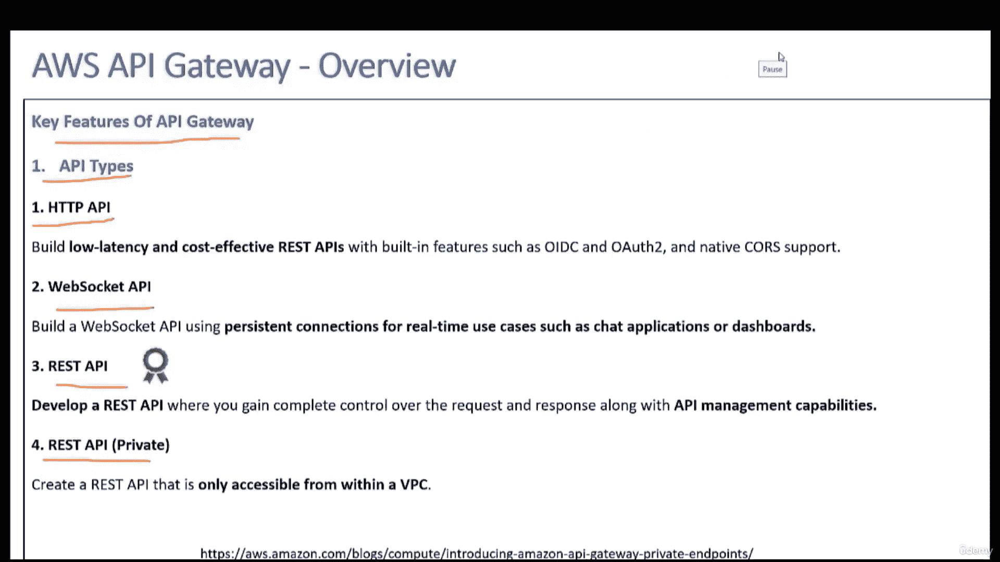

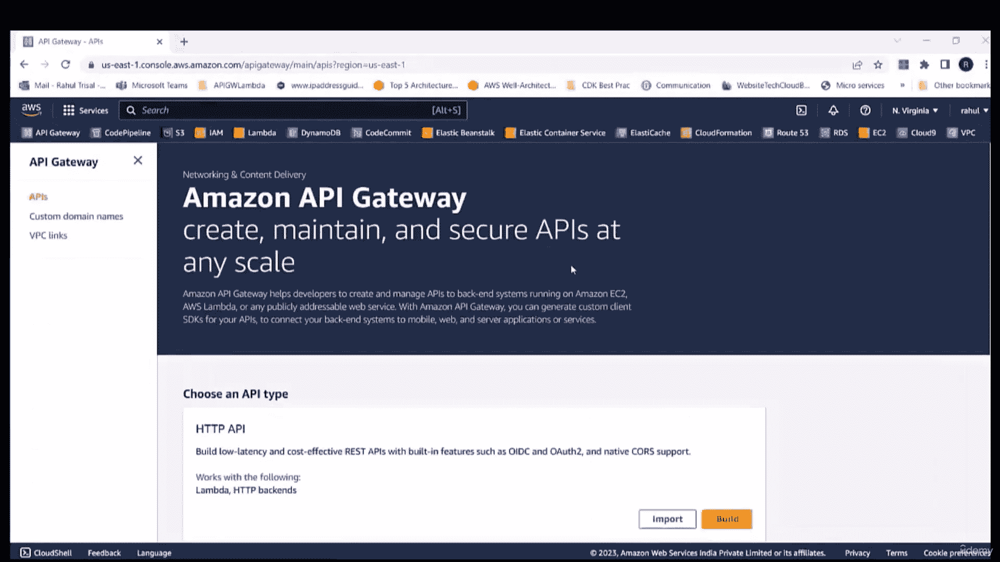

## 🏗️ API Gateway的典型架构：RESTful微服务

  

在真实的开发场景中，API Gateway最常见的用途之一就是支持RESTful微服务架构。其实，目前几乎所有的产品开发都在使用微服务架构，那么API Gateway在这个架构中扮演什么角色呢？我们来看一看。  

  

假设你有一个应用，无论是Web应用还是移动应用，它会向API Gateway发起请求。API Gateway首先会对这个请求进行身份验证和授权，如果验证通过，它就会调用相应的Lambda函数。这个Lambda函数再去访问后端服务获取数据，最后把数据返回给Web端或者移动端。你可以把API Gateway理解成一个“保安加前台”，所有请求都要先经过它，再由它去叫后面的“工作人员”处理。  

  

## 🔑 API Gateway的核心特性：四种API类型

  

接下来，我们来了解API Gateway的关键特性，第一个特性就是API类型。API Gateway一共有四种API类型，分别是HTTP API、WebSocket API、REST API和REST API Private。下面我们逐一说明每一种类型的特点和适用场景。  

  

### 🔹 HTTP API

  

HTTP API是一种低延迟且经济高效的REST API类型。如果你需要构建一个成本较低、响应速度较快的REST API，那么HTTP API就非常合适。它支持的后端包括Lambda函数和任意HTTP后端。这意味着你不必为一些高级功能额外付费，只要基础功能够用就行。  

  

### 🔹 WebSocket API

  

WebSocket API用于构建需要持久连接的实时应用，比如聊天应用或者需要实时刷新数据的仪表盘。这类应用要求客户端和服务器之间保持一条长期打开的连接，以便随时推送数据，这时候就必须使用WebSocket API。  

  

### 🔹 REST API

  

当你需要开发一个功能丰富、并且希望对请求和响应有完全控制的REST API时，就应该选择REST API。它提供了完整的API管理能力，支持的后端包括Lambda和各类AWS服务。它会给你更多的自定义空间，比如你可以自己控制错误格式、请求验证等等。  

  

### 🔹 REST API Private

  

你还可以创建私有的REST API，这种API只能从你的VPC内部访问，不能通过互联网直接访问。在银行业、制药业等受监管的行业中，经常有这样的合规要求。当你创建了私有API后，外部流量无法直接到达API Gateway，所有请求都需要先路由到你的VPC内部，然后通过VPC端点经由AWS私有网络转发到API Gateway。  

  

这里顺便说一下HTTP API和REST API的区别。REST API支持的功能比HTTP API更多，而HTTP API则被设计为极简功能，所以价格也更低。如果你只需要最小化的功能，并且希望节省成本，那就选择HTTP API；如果你需要丰富的特性，那就选择REST API。REST API额外支持客户端级API密钥、节流控制、请求验证以及私有集成等功能。这些细节我们后面会逐步看到。  

  

## 🛠️ 动手创建API Gateway：控制台演示

  

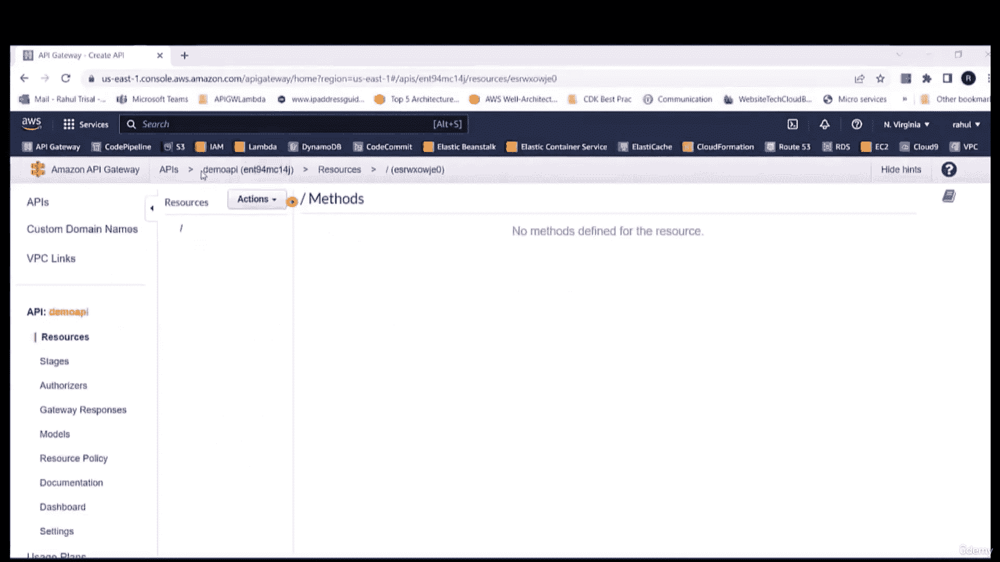

理解了概念之后，我们来进行一些实际操作。首先打开AWS控制台，进入API Gateway服务。第一步要做的，是选择协议。之前我们讨论过REST和WebSocket两类协议，这里我们选择REST。然后，在创建方式上，你可以选择使用示例API（比如宠物商店示例），但我们这里直接选择“New API”，也就是新建一个API。接下来会给API起一个名称，在演示中我们把它叫做“Demo API”，描述是可选项，你可以填也可以不填。  

  

创建过程中还需要选择端点类型（Endpoint Type）。控制台会提供三种类型：边缘优化（Edge Optimized）、区域（Regional）和私有（Private）。我们通过示意图来理解一下它们的区别。  

  

### 🌍 边缘优化（Edge Optimized）

  

边缘优化主要用于全球性的应用场景。如果你的用户分布在全球各地，他们都向你的API Gateway发起请求，那么通过边缘优化，你可以将API Gateway前置一个Amazon CloudFront。来自全球任何位置的请求都会先被路由到CloudFront，然后再通过AWS骨干网络到达API Gateway。这么做能显著降低访问延迟，提升用户体验。  

  

### 📍 区域（Regional）

  

如果你的应用只会在特定区域内被访问，比如只在印度、日本、澳大利亚或美国，那么可以直接创建一个区域型的API Gateway。该区域的用户可以直接向这个API Gateway发送请求，然后API Gateway再把请求路由到任意的AWS服务上，比如Lambda或者在ECS上的端点。  

  

### 🔒 私有（Private）

  

第三种端点类型是私有。之前我们提到过，在银行或制药行业，有时请求不能走互联网，必须通过私有网络才能访问。在这种情况下，请求首先会被路由到你的VPC，然后由VPC内的EC2或其他AWS服务进一步处理，接着转发到VPC端点，再通过AWS的私有网络PrivateLink到达API Gateway。整个过程完全不经过公共互联网。  

  

对于当前演示，我们选择“Regional”区域类型，然后点击“Create API”。稍等片刻，就可以看到我们的“Demo API”已经创建成功，并且页面上会显示一个REST API ID。这个ID之后会使用到。  

  

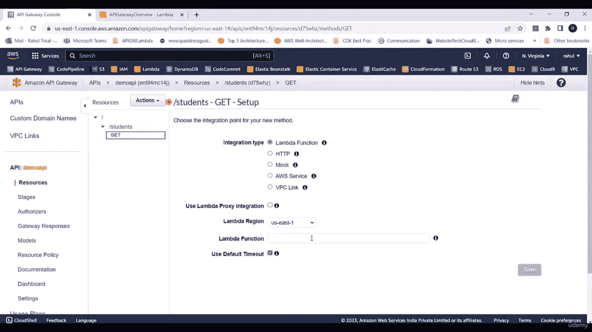

## 📦 创建资源和操作方法

  

创建好API Gateway之后，我们需要在里面定义资源和操作方法。在REST架构中，一切内容都被视为资源，比如文本文件、页面、图片、视频或者业务数据。操作方法则是对这些资源进行的操作，主要有四类：GET方法，用于检索资源信息；POST方法，用于创建资源；PUT方法，用于更新资源；DELETE方法，用于删除资源或相关组件。  

  

下面我们进行演示。点击“Actions”菜单，选择“Create Resource”来创建一个新资源。我们把这个资源命名为“students”。想象一下，我们是一所学院，现在需要检索学生的详细信息，那么资源的路径就是“/students”。点击“Create Resource”之后，就可以在控制台看到这个资源已经创建好了。  

  

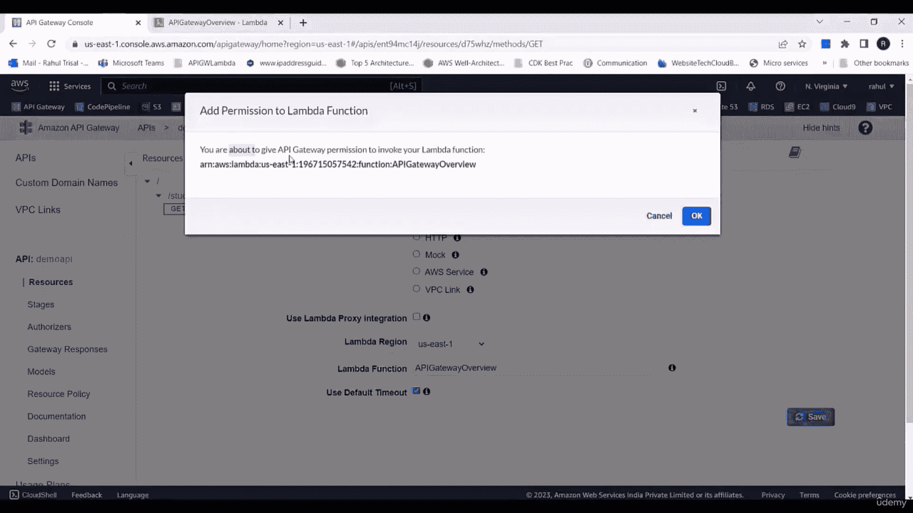

接下来，我们要为这个资源创建一个方法。点击“students”资源，在“Actions”中选择“Create Method”，然后会列出所有可用的方法。这里我们选择“GET”，点击确认后，GET方法就创建成功了。  

  

## 🔗 集成类型详解

  

现在，我们来学习下一个重要的概念：集成类型。前面我们提到过API Gateway的各种集成目标，下面逐一梳理。  

  

- **Lambda函数**：可以将API Gateway与Lambda函数集成，当API收到请求时，直接触发Lambda执行。  

- **HTTP端点**：可以集成任何可公开访问的HTTP后端，也就是任意HTTP服务。  

- **Mock**：Mock集成意味着请求不会真正发送到后端，而是直接由API Gateway返回一个模拟响应，通常用于测试。  

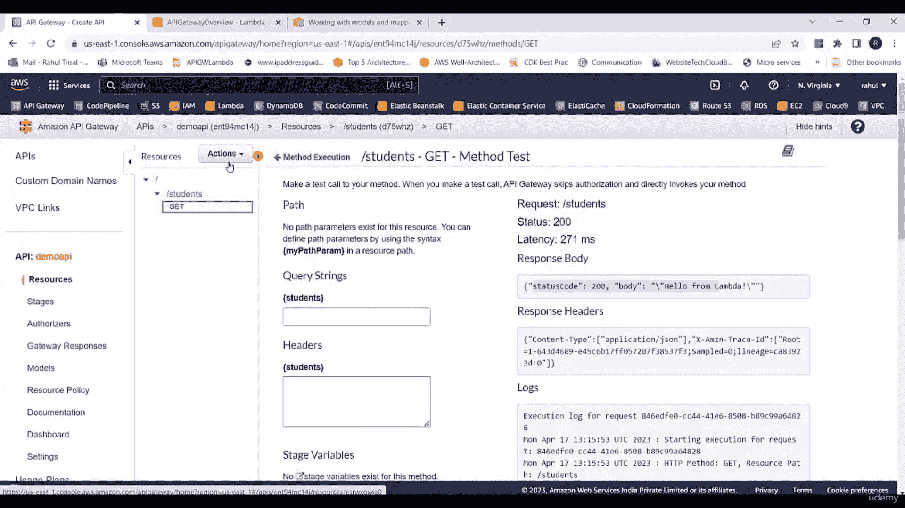

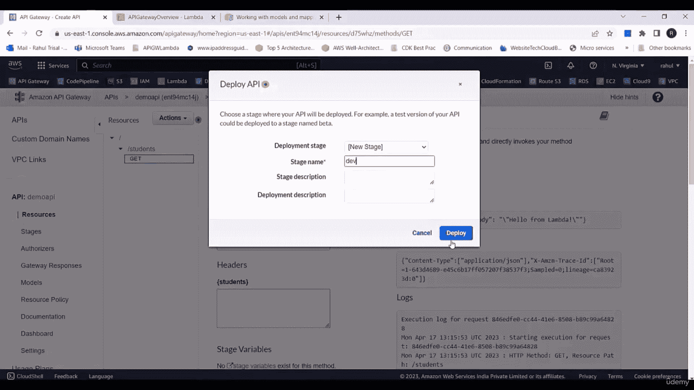

- **AWS服务**：可以集成任意其他AWS服务，比如DynamoDB。  

- **VPC Link**：通常用于将API Gateway连接到你自己VPC内部的资源，这个我们稍后会详细讨论。  

  

在控制台里，你可以在集成类型下拉菜单中看到这些选项。如果你选择了Lambda函数集成，那还需要指定要调用的Lambda函数名称。在演示中，我们已经提前创建了一个叫作“API Gateway Overview”的Lambda函数，这个函数非常简单，只返回状态码200和“Hello from Lambda”。我们把该Lambda函数的名称复制下来，粘贴到集成配置中，然后保存。此时系统会提示你“即将授予API Gateway调用Lambda函数的权限”，点击确认就可以了。  

  

## 📋 配置方法请求与集成请求

  

在测试API之前，我们先看一下几个重要的配置面板。在方法执行界面中，你会看到“方法请求”（Method Request）、“集成请求”（Integration Request）、“集成响应”（Integration Response）和“方法响应”（Method Response）几个部分。  

  

- **方法请求**：这一部分描述了客户端发起的请求本身。你可以在这里配置授权方式、请求验证器、是否要求API Key，以及允许的参数等。比如，你可以设置使用AWS IAM来授权，也可以要求对请求体、查询字符串或请求头进行验证。  

- **集成请求**：这一部分定义了API Gateway如何将请求转发到后端。你可以设置集成类型，并根据后端的要求在“映射模板”中使用Velocity模板语言对请求数据进行修改。  

- **集成响应**：当后端返回响应后，你可以在这里配置如何将响应转换并返回给客户端。  

  

配置好之后，我们进行本地测试。点击“Test”按钮，然后再次点击“Test”，就可以看到响应体返回了“status: 200, body: Hello from Lambda”。这正是我们预先定义的Lambda函数返回的内容，说明集成已经正常工作了。  

  

## 🧪 测试API并部署到阶段

  

本地测试通过之后，接下来就需要部署API。当你创建好API之后，它并不会自动对外可用，必须手动执行“部署”操作。在API Gateway中，部署目标被称为“阶段”（Stage）。这个概念类似于Web应用开发中的开发环境、测试环境和生产环境。有一个非常重要的经验要记住：每次你更新API，无论是修改路由、方法还是集成，都需要重新部署一次API到一个已有阶段或新阶段，否则修改不会生效。  

  

现在我们来部署。选择“students”资源和“GET”方法，点击“Actions”里的“Deploy API”。因为目前还没有任何阶段，所以我们选择“New Stage”，创建一个新阶段，并命名为“dev”。点击“Deploy”后，在左侧就会出现“dev”这个阶段条目。点击“dev”，再点击“GET”方法，就能看到一个调用URL（Invoke URL）。把这个URL复制到浏览器中打开，你应该会看到和Lambda函数相同的响应内容：“status: 200, body: Hello from Lambda”。  

  

这个调用URL的格式是有规律的，我们可以用下面的结构来表示：  

  

```text
https://{rest-api-id}.execute-api.{region}.amazonaws.com/{stage}/{resource}
```  

  

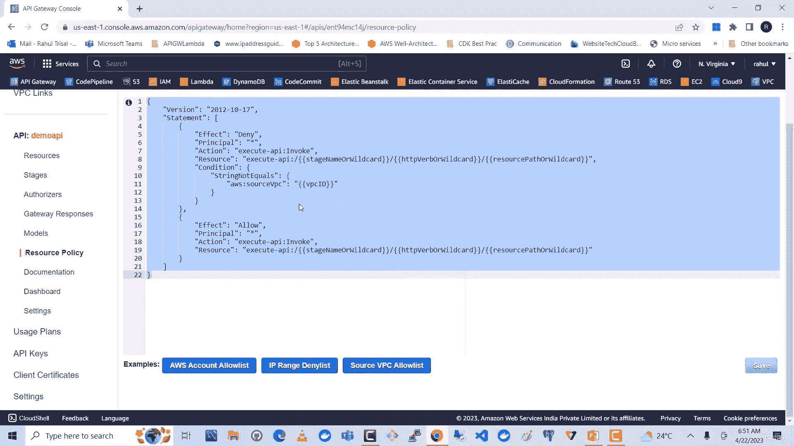

其中，`{rest-api-id}` 是你的REST API ID，`{region}` 是区域名称（比如us-east-1），`{stage}` 是阶段名（这里是dev），`{resource}` 是资源路径（这里是students）。以后你看到类似的API地址，就能大概猜到它的组成部分了。  

  

## 📊 使用计划与API密钥

  

在很多业务场景中，你可能需要区分不同等级的客户，比如基础客户和高级客户，并为他们设置不同的请求限制。API Gateway提供了“使用计划”（Usage Plan）和“API密钥”（API Key）来实现这个需求。  

  

使用计划可以定义三类参数：  

  

- **速率（Rate）**：每秒允许发送多少个请求。  

- **突发（Burst）**：允许的突发流量峰值。  

- **配额（Quota）**：一段时间内允许的请求总数，比如每月50次或每月5000次。  

  

对于基础套餐，这些限额通常会设置得比较低；对于高级客户，则会设置得更高。而API密钥本质上是一串字母数字组成的字符串，API Gateway通过它来识别调用方。每次调用方发出请求时，它都必须在请求中包含自己的API密钥，以表明身份。  

  

在控制台里，你可以在我们创建的“Demo API”下方找到“API Keys”区域。我们可以创建一个名为“demo”的API密钥，点击“Show”就能看到完整的密钥字符串。这个密钥可以被关联到某个使用计划上，从而对该调用方实施相应的限制。  

  

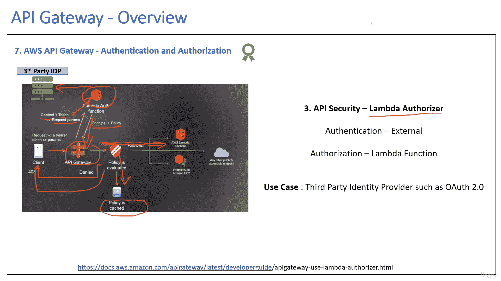

## 🔐 身份验证与授权方法

  

这一节我们重点学习API Gateway中的身份验证与授权。API Gateway支持三种常见的认证授权方法，分别是AWS IAM、Cognito用户池和Lambda授权器。下面我们分别介绍它们的适用场景和运行方式。  

  

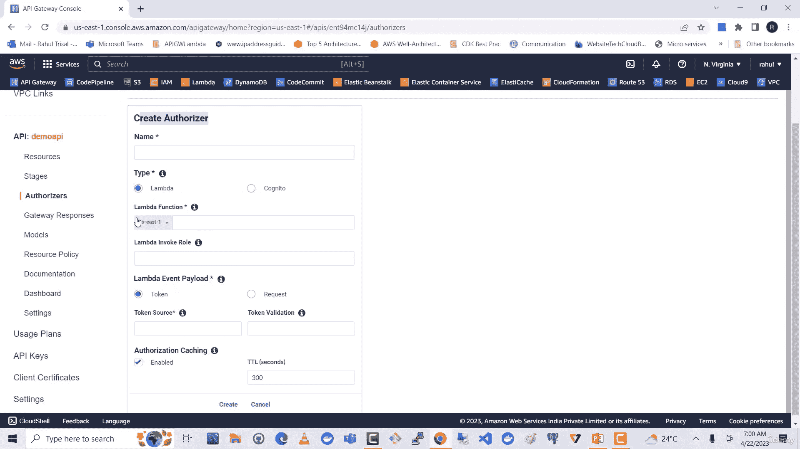

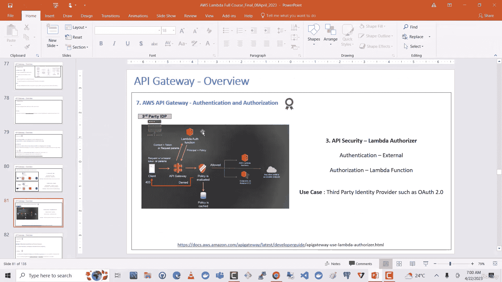

### 🔑 使用AWS IAM

  

当请求来自内部AWS服务时，比如同一个账户内的AWS服务，或者跨账户的AWS服务，通常会使用AWS IAM进行认证。授权则是通过附加在IAM角色上的IAM策略来完成的。  

  

具体流程是这样的：假设有一个客户端（比如EC2实例）在账户内或跨账户，它会使用SigV4签名能力向API Gateway发起REST API调用。API Gateway与IAM服务集成，它会检查这个服务所附加的IAM角色以及IAM策略，并向IAM服务验证这些配置。如果一切都匹配，就会允许访问后端。如果请求来自同一个AWS账户，只需要使用IAM角色并附加对应的策略即可；如果是跨账户访问，则需要额外在API Gateway中配置资源策略（Resource Policy），比如指定允许访问的AWS账户列表，或者设置IP范围拒绝列表、源VPC允许列表等。  

  

### 🧑‍🤝‍🧑 使用Cognito用户池

  

第二种方法是使用Cognito用户池，它特别适合Web或移动应用的外部用户场景。在这种方法中，用户的认证由Cognito用户池负责，授权则由API Gateway的方法配置负责。  

  

流程是这样的：客户端首先向Cognito用户池发起身份认证请求。Cognito用户池中存有该用户的信息，认证通过后，它会返回一个令牌（Token）给客户端。客户端拿到令牌后，会在调用API Gateway时附带这个令牌。API Gateway收到请求后，会与Cognito用户池集成，验证这个令牌是否有效。如果令牌有效，就允许请求访问后端。  

  

### 🤖 使用Lambda授权器

  

第三种方法也是最常见的一种，叫作Lambda授权器（Lambda Authorizer）。它的典型用途是当你希望使用第三方身份提供商（比如Okta、Auth0）来进行认证时。这种模式下，认证过程由第三方身份提供商完成，而授权过程则交给Lambda函数来执行。  

  

流程是这样的：客户端先向第三方身份提供商发起认证请求，第三方验证通过后会返回一个Bearer Token或者其他参数给客户端。之后，客户端带着这个Token向API Gateway发起请求。API Gateway会把Token和请求参数一并交给Lambda授权器，你需要在这个Lambda函数中写一点代码，用第三方身份提供商来验证这个Token。如果验证通过，Lambda授权器会返回一个Principal和IAM策略给API Gateway，于是客户端请求就被允许访问后端。为了高性能，API Gateway还会缓存这个策略，供后续请求使用。如果验证失败，请求就会被拒绝。  

  

在控制台左侧可以看到“Authorizer”选项，点击“Create New Authorizer”可以创建新的授权器。授权器有两种类型：Lambda授权器和Cognito授权器。如果要创建Lambda授权器，你需要填写Lambda函数名称、Lambda调用角色、事件负载类型（Token或Request）、Token来源、Token验证方式等，还可以启用策略缓存。如果要创建Cognito授权器，则需要提供Cognito用户池的详细信息以及Token来源信息。你需要先在AWS Cognito服务中创建好用户池，然后才能在这里使用它。  

  

## 🔒 私有API与VPC集成

  

最后，我们来讨论一个比较高级但企业场景中非常常见的主题：私有API和VPC集成。为了理解这个主题，我们需要先回顾一个知识点：亚马逊API Gateway并不部署在客户的VPC中，它有自己独立的VPC，这一点与Lambda非常类似。所以在默认情况下，API Gateway是可以通过公网访问的，只需要拿到调用URL即可。  

  

但是，在一些受监管的行业（比如银行和制药）中，存在很多合规要求，不允许API直接从互联网访问。此时我们就希望整个访问链路完全在AWS私有网络中完成。实现方法是这样的：在你的客户VPC中，你可以创建一个接口VPC端点。创建接口VPC端点后，会生成一个弹性网络接口（ENI）。来自客户端（比如EC2）的请求会先被路由到这个ENI，然后ENI再通过AWS PrivateLink将请求转发到API Gateway的VPC中。PrivateLink是AWS提供的一种私有网络传输服务，它保证流量不会经过公共互联网。请求到达API Gateway后，API Gateway会进行认证和授权，然后决定是否允许访问后端资源。在这个架构中，客户VPC是服务消费者，API Gateway VPC是服务提供者。  

  

接下来我们再看私有集成和VPC Link。假设请求已经通过VPC Link从你的VPC到达了API Gateway，现在API Gateway需要访问客户VPC中私有子网内的RDS数据库。那么问题是，API Gateway怎样访问这个RDS实例呢？答案是在API Gateway自己的VPC中再次创建一个接口VPC端点，流量会被发送到该端点对应的弹性网络接口。然后这个流量会通过PrivateLink路由到你创建的网络负载均衡器（NLB），再通过NLB转发到RDS实例。  

  

我们看一下完整的端到端架构图：在客户VPC中，有一个EC2实例作为客户端。客户端创建接口VPC端点，生成ENI。请求从EC2到ENI，再通过PrivateLink到达API Gateway。API Gateway要访问后端RDS时，再创建接口VPC端点，流量到ENI，之后通过VPC Link经由PrivateLink到达网络负载均衡器，再转发到客户VPC内的目标组和RDS实例。整个过程中，所有组件都在AWS私有网络中运行，没有任何公网暴露。  

  

最后我们看看如何在控制台创建私有API。在API Gateway控制台中，点击“Create API”，选择“REST API Private”，点击“Build”。然后选择“New API”，给它取一个友好名称，比如“R”。填写描述后，需要选择端点类型为“Private”。由于私有API只能通过VPC端点访问，控制台会提示你创建VPC端点并为API添加资源策略。点击“VPC Endpoints”链接，填写VPC端点的名称，选择服务类型。在服务搜索框中输入“API”，会出现一些选项，我们选择“us-east-1 execute-api”。然后选择你希望部署端点的VPC和子网，再指定安全组。你还可以配置VPC端点策略，然后点击“Create Endpoint”。需要提醒的是，VPC端点是按小时收费的，所以如果不使用了，记得尽快删除以节省费用。创建好VPC端点后，可以在API Gateway控制台中选择这个端点，然后点击“Create API”。这样一来，你就成功创建了一个只能通过私有网络访问的API，并完成了私有集成的配置。  

  

## 🎓 总结

  

本节课我们一起学习了AWS API Gateway的多个核心概念和操作方法。我们从API Gateway的基本定义入手，了解了它是用来创建、发布、维护、监控和保护API的托管服务。然后我们介绍了API Gateway在RESTful微服务架构中的典型角色，以及它的四种API类型：HTTP API、WebSocket API、REST API和私有REST API。在控制台演示部分，我们学习了如何创建一个名为“Demo API”的REST API，如何创建资源和方法，以及如何配置Lambda集成和方法请求。我们还学会了如何测试API，以及如何通过部署到阶段来生成可用的调用URL。  

  

此外，我们还讨论了使用计划与API密钥的用途，学习了如何通过它们限制不同客户的调用频率和配额。在安全性方面，我们详细介绍了三种认证授权方式：AWS IAM适用于内部服务访问，Cognito用户池适用于外部用户，Lambda授权器则适合与第三方身份提供商搭配使用。最后，我们探讨了私有API和VPC集成的架构，包括接口VPC端点、PrivateLink、VPC Link和网络负载均衡器的配合使用，并演示了如何创建私有API。  

  

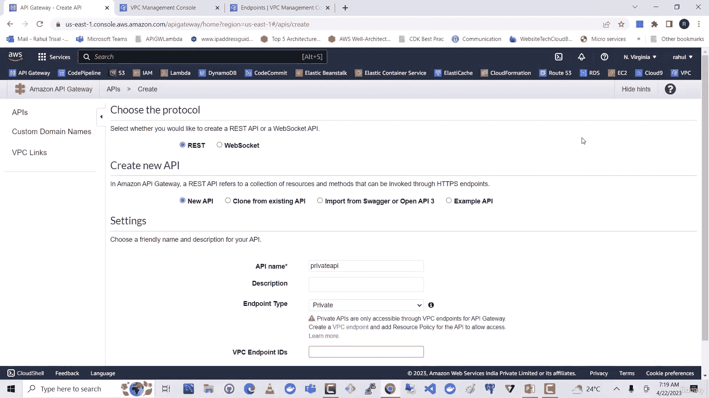

通过本节课的学习，你应该对AWS API Gateway有了一个比较全面的认识。以后无论是构建微服务、实时应用，还是需要在企业环境中实现私有网络访问，你都能知道该从何处入手，以及如何选择合适的配置。  

