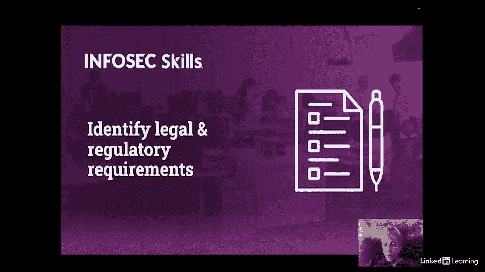
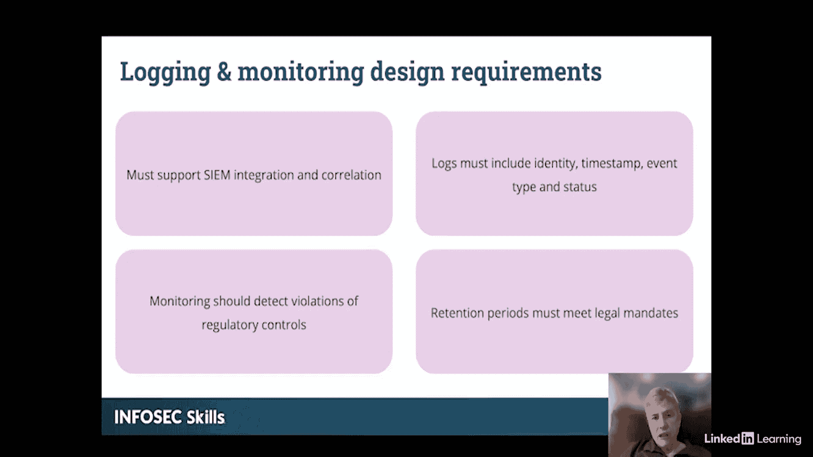

ISSAP 信息系统安全架构专家：第 01 章：识别法律、法规、组织和行业要求 🛡️


在本节课中，我们将一起学习 ISSAP 第一课的核心内容，重点围绕治理、风险与合规展开。我们会了解为什么每一项系统设计都必须建立在合规的基础之上，并逐步梳理法律法规、组织政策以及行业标准如何影响我们的安全架构决策。无论是保护隐私还是确保数据完整性，合规要求都是我们设计系统时必须首先考虑的前提。从理解业务目标开始，到最终落地具体的安全控制措施，整个过程都需要围绕合规展开，确保系统在设计之初就满足相关的法律与行业义务。




为什么合规是系统设计的起点

我们需要先搞清楚自己的法律与法规合规要求是什么，因为我们所做的每一件事都需要在合规的基础上进行构建。系统设计的核心关注点是隐私与完整性，而法律法规会明确规定我们应当如何保护信息。这里面存在一个实际问题：我们面对大量法律条文和法律术语，必须想办法将这些要求落实到具体系统中，并提供相应的合规程度。下面我们先来看看可能需要考虑的一些法规，帮助你建立整体的认知框架。


法律法规与政府监管

在了解了合规的基础作用之后，我们来看看具体的法律法规和政府监管是如何运作的。首先是法律法规，它们由立法机构制定。法规通常针对特定行业，并由政府机构监督。

以下是法律法规的主要特点：

- 由立法机构实施，具有强制约束力
- 针对特定行业开展专项监管
- 由政府机构负责监督和执行

当然，我们还需要在组织内部运营，遵循治理层制定的政策、标准、程序和指南。这些内部文件是外部法规在组织层面的具体体现。


组织目标与风险偏好

法律法规之外，组织内部的政策同样重要，下面我们来看组织目标与风险偏好。我在这里特别强调一个重要概念：风险偏好。我们的组织政策主要是为了支持风险偏好而制定的。在开始任何工作之前，我们必须先了解业务本身：业务关注点是什么，我们的目标和目的又是什么。之后，我们可能还需要遵循行业标准，比如 `PCIDSS` 或 `ISO` 系列标准。

我们可以用一个简单的表达来概括组织合规的构成要素：

```
组织合规目标 = 业务目标 + 适用法律规则 + 行业标准要求
```

简单来说，底线就是：我们必须了解组织目标，也必须了解管理我们组织的规则。只有两者都清楚，才能设计出既符合业务需求又满足合规要求的系统架构。


数据分类与基线安全配置

有了组织目标的指引，接下来需要将合规要求转化为具体的数据保护措施。回到法律要求，我们必须确保信息受到最低可接受标准的保护，稍后我们会讨论基线配置。并不是所有数据都会以相同的方式保护，当然，不同类型的数据会有不同的基线配置。

我们需要思考数据的整个生命周期：如何收集、如何存储、如何传输，以及如何销毁。为此，我们需要建立分类策略，将基线配置与数据的价值挂钩。下面是数据生命周期的关键环节：

- 数据收集
- 数据存储
- 数据传输
- 数据销毁

通过明确这些环节，我们可以为不同类别的数据制定相应的保护措施，避免采取一刀切的方式。


数据主体权利与跨境合规

数据分类不仅涉及存储方式，还关系到数据主体的权利和跨境流动。我们还要考虑客户，也就是数据主体，要考虑他们的权利，同时还要考虑跨境法律。仅仅知道数据在哪里被收集、存储和处理是不够的，我们还必须考虑数据在地理上的流动路径。例如，流经欧盟地理区域的数据就必须遵守 `GDPR`。在构建系统之前，我们需要掌握大量相关信息，确保在数据跨国界流动时依然合规。


全球隐私法规与数据本地化

除了跨境合规，全球范围内的隐私法规和数据本地化要求也不容忽视。`GDPR`，即《通用数据保护条例》，专门针对欧盟公民，但由于许多组织与欧盟开展业务或与欧盟公民打交道，它在全球范围内产生影响。隐私设计是实现法律合规时的一个重要目标。

在美国，我们有加州的 `CCPA` 和 `CPRA`，涉及信息删除权和退出权。这意味着我们需要在 Web 应用中思考：收集什么信息、如何存储，以及是否为数据主体提供加入和退出的选择。加拿大有 `PIPEDA` 法规，与 `GDPR` 非常接近。许多全球性和州级法律都与 `GDPR` 的某些原则相关联。

另一个需要考虑的问题是数据本地化。某些国家要求在那里收集的数据必须留在本地。例如，朝鲜和中国等国家，如果你在那里收集信息，就不允许将该信息导出。

在考试中，你不需要详细了解所有法律法规，但需要明白如何将这些法律法规与组织架构相结合，使系统设计能够反映合规要求。


美国行业特定法规

全球法规之外，美国还有针对特定行业的专项法律规定。`HIPAA` 讨论医疗信息的收集方式，要求必须实施管理、物理和技术防护措施，这本身就体现了纵深防御的理念。格雷-里奇-布莱利法案侧重于保护银行领域的信息和隐私。

如果你在政府机构工作，`FISMA` 非常重要，它基本上要求联邦信息按照 `NIST` 指定的标准化方式进行保护。稍后我们可以讨论 `FIPS 199` 和 `200` 文档，它们帮助我们确定数据的价值或分类，随后这些分类会关联到 `NIST 800-53` 中的控制措施。

还有一个是《儿童在线隐私保护法》，它限制可以收集未成年人（特别是 13 岁以下儿童）的信息。


州级法规与新兴法律要求

联邦层面的行业法规之外，各州也有各自的隐私法律和新兴要求。在国际法规、国家法规和要求之上，我们还要考虑州级合规。加州和弗吉尼亚等一些州在隐私保护和数据主体权利方面走在前列。此外，还有不断涌现的新法律。

你不需要对每一部法规都了如指掌，我们会咨询法律团队，确保掌握正确的要求，因为我们将基于这些要求进行系统设计，以确保合规。重点将放在诸如隐私设计等方面。此外，架构师必须理解什么是个人信息，并确保系统设计体现对个人信息的保护。


监管机构与行业标准

了解法律法规后，我们需要关注监管机构和行业标准如何进一步细化合规要求。监管机构和影响力方面，考试中可能会考到。例如 `FTC`、`HHS`、`SEC`、`DPAOS` 等，这里有很多组织。下面是常见的监管机构列表：

- `FTC`：联邦贸易委员会
- `HHS`：卫生与公众服务部
- `SEC`：证券交易委员会
- `DPAOS`：数据保护机构

在行业标准方面，我们稍后会更详细地介绍。`ISO 27001` 定义了 `ISMS`，即信息安全管理系统，它描述了如何在组织内部构建信息安全计划。该标准涵盖从规划、建立、监控和管理一直到信息安全计划退役的整个过程。

`ISO 27001` 中引用的政策、程序、标准、指南和控制措施，实际上是在 `ISO 27002` 中详细说明的，这一点可能会让考生混淆。如果问题问的是框架，那么框架是 `ISO 27001`；控制措施在 `ISO 27001` 中只是简要引用，主要附录中简单提及，而具体控制措施和实施细节则在 `ISO 27002` 中详细展开。可以这样理解：`ISO 27002` 帮助我们获得 `ISO 27001` 认证，两者相辅相成。

我已经提到过 `NIST 800-53`，还没再次提到网络安全框架，我们稍后会深入探讨。

风险基础控制意味着要了解资产价值、威胁和漏洞，并基于风险做出成本效益良好的决策。此外，肯定要了解 `PCIDSS`，特别是要知道它是一个行业标准，是通过合同而非法律来强制执行的。这一点容易让很多人困惑，信用卡行业是自我监管的，它们提供了数据安全标准，规定了如何保护支付卡信息。


将法规映射到控制措施

掌握了法规和标准之后，下一步是将这些要求转化为可执行的控制措施。了解法律法规只是第一步，接下来需要将这些要求映射到控制措施。为了确保一致性，分类方案将非常有用。我们将根据适用的法律和要求对信息进行分类，然后确定应该实施哪些基线安全控制措施。

我们希望在整个组织中保持一致性，再次回到分类方案，并对数据进行正确分类。下面是分类带来的好处：

- 一致性
- 可重复性
- 可审计性
- 与业务流程相对齐的能力

一旦建立要求并实施控制措施来满足要求，我们还没有完成，因为必须继续记录和监控，以确保保持合规。开始时符合合规要求一回事，但环境会发生变化。

我们需要确保使用基于标准的报告格式，以便 `SIEM` 系统能够汇总信息，并在整个组织中关联事件。确保日志有意义，也就是说，日志应包含身份信息。时间戳至关重要，尤其是在涉及法律问题并引入取证时，但即使不涉及，准确的时间戳在故障排除和事件调查中也能起到实质性作用。

任何违规行为都需要被标记，理想情况下，如果出现信息被不当访问等问题，应有人接收警报或通知。保留期限必须满足法律要求，这并不总是容易的，因为法律对信息保留时间的规定在不断扩展。过去我们可能考虑保留三年或七年，现在某些信息可能需要保留一百年或七十年。底线是：在构建系统之前，必须先了解要求。


专家咨询与持续合规

掌握了如何将法规映射到控制措施之后，我们还需要考虑持续的合规维护和专家支持。这听起来似乎不言而喻，但由于全球法律、法规和行业标准的复杂性，现在比以往任何时候都更加复杂。这些知识不一定完全来自我们自己的内部积累，我们需要寻求专家的帮助，以理解这些要求到底是什么。只有在清楚法律边界的前提下，才能设计出安全且合规的系统架构。




本节课中，我们一起学习了识别法律、法规、组织和行业要求的核心内容。我们探讨了合规作为系统设计基础的重要性，梳理了法律法规、组织政策与风险偏好的关系，讨论了数据分类、基线配置以及跨境隐私法规，还了解了美国行业特定法规、州级与新兴法律要求，以及 `ISO 27001`、`NIST 800-53` 和 `PCIDSS` 等行业标准。最后，我们学习了如何将法规映射到控制措施，并强调了持续日志监控和专家咨询的必要性。
