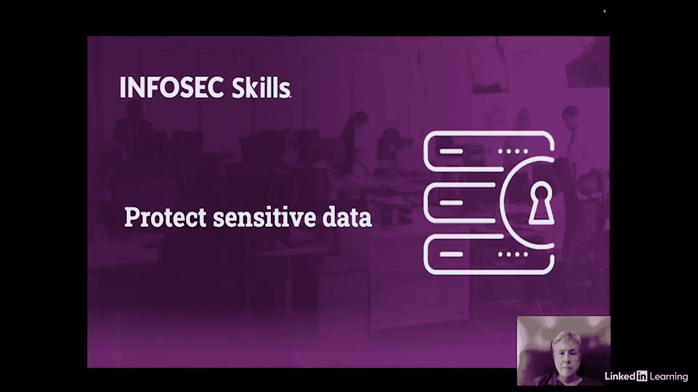
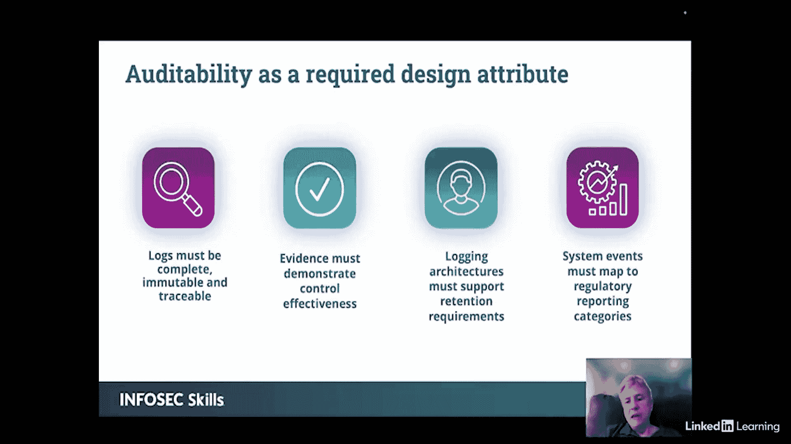

# 信息系统安全架构专业师（ISSAP）：02：保护敏感数据 🔒


在本节课中我们将要学习如何保护敏感数据，以及法律法规、组织政策和风险管理之间的关系。内容适合初学者，我们会用大白话把每一个概念讲清楚，确保你能听懂并记住。学习完之后，你应该能够理解安全架构设计为什么需要以合规要求为起点，并且知道如何把抽象的政策转化为可落地的技术实践。

## 从法律合规到敏感数据保护

上一节我们介绍了合规的大致背景，本节中我们来看看法律法规与敏感数据保护之间具体是什么关系。很多时候，法律法规合规说到底就是一件事，也就是保护我们的敏感数据。法律和法规是外部强制要求，而组织需要把这些外部要求变成内部可以执行的规则。治理团队负责把法律法规翻译成组织政策，而我们作为架构师，需要理解这些政策具体是什么，以及它们将如何影响我们设计的应用程序和系统架构。只有搞清楚企业的期望，才能确保设计方案符合要求，避免在后续开发或审计中出现偏差。



## 政策、标准与流程的层级

有了政策的概念之后，我们还需要把它和标准、流程区分开来，因为这三者在实际工作中分工不同。以下是这三个概念的对比关系：

- 政策：来自领导层的广泛期望，比如声明我们会保护患者隐私并符合 HIPAA 要求。
- 标准：填充具体细节，比如规定使用 AES-256 加密。
- 流程：提供逐步实施说明，告诉大家具体怎么操作，哪些人负责哪个环节。

代码示例：

```text
策略示例：我们将保护患者信息隐私并遵守 HIPAA
标准示例：使用 AES-256 加密
流程示例：加密前先对密钥进行轮换，然后对数据分块加密，最后记录审计日志
```

核心公式：

安全实施 = 政策 + 标准 + 流程

这三者缺一不可，只有政策标准流程配合使用，才能确保安全要求从高层意图落地到具体技术实现。

## 风险偏好决定安全程度

所有的政策、标准和流程，最终都是组织风险偏好的直接结果。作为架构师，必须理解这一点，因为风险偏好会决定我们愿意承担多少风险，以及愿意承担什么类型的风险。这里有一个关键点，安全并不是越多越好，答案永远不是无限增加安全措施，而是要投入适当的安全措施。换句话说，我们需要根据组织能够容忍的风险程度，来决定该买多少安全设备、该设置多少访问控制、该做多少安全检查。

核心公式：

适当安全量 = f(组织风险偏好)

有了风险偏好的概念，接下来我们需要进一步区分风险偏好和风险姿态，因为这两个词容易混淆。

## 风险姿态与可接受风险水平

风险姿态是指组织相对于风险所处的位置，以及面对这些风险时的整体健康状况。风险偏好可能是风险寻求型、风险规避型或风险中立型，而风险姿态则回答的是：我们目前面临哪些风险，以及在应对这些风险时处于什么样的状态。

以下是需要搞清楚的几个要点：

- 风险寻求型：愿意接受较高不确定性以换取潜在收益。
- 风险规避型：倾向于尽可能降低风险。
- 风险中立型：主要关注预期收益，对风险本身没有强烈偏好。
- 风险姿态：当前暴露的风险清单以及应对健康度。

必须知道什么是可接受风险水平，因为安全工作的目的不是要消除所有风险，而是要把风险降到可以接受的程度。在现实系统中，完全没有风险几乎是不可能的，所以架构师需要和业务方一起划定底线，确保剩余风险不超过组织能够承受的范围。

核心公式：

剩余风险 ≤ 可接受风险水平

## 总结



本节课中我们一起学习了保护敏感数据的基本逻辑，包括法律法规如何转化为组织政策，政策、标准和流程如何分工协作，以及风险偏好和风险姿态如何决定安全措施的适当程度。希望这些内容能帮助你建立起初步的安全架构认知，为后续深入学习打下基础。
