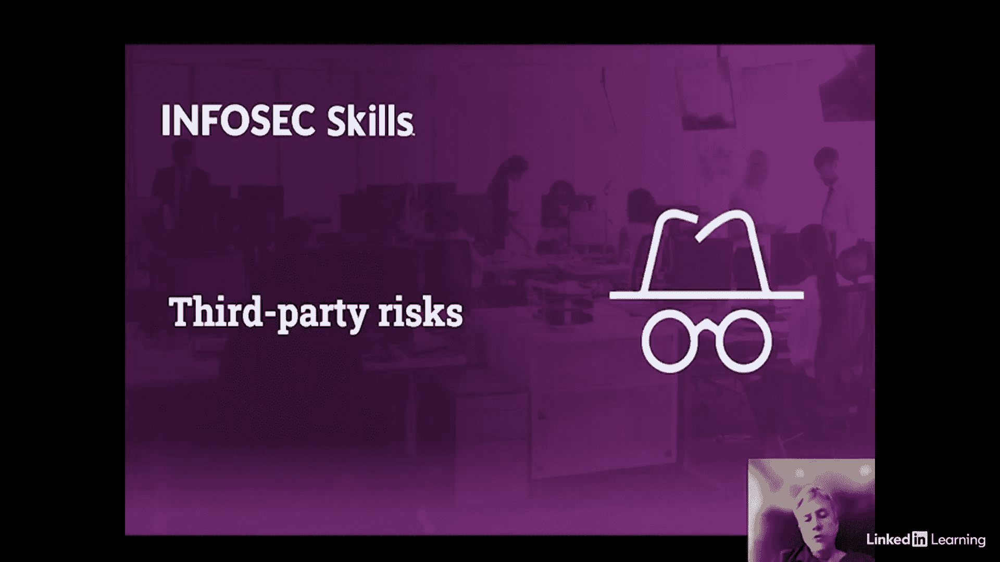
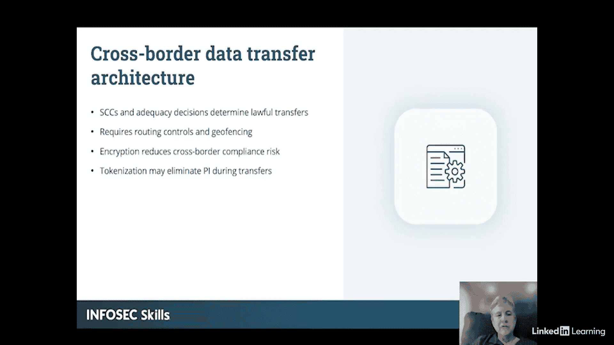

# ISSAP课程：03：第三方风险管理 🔒

在本节课中我们将要学习关于第三方风险管理的核心内容。我们在前面的章节里已经详细讨论了组织内部的法律和法规合规问题，但现实中没有任何一个组织能完全靠自己完成所有事情。本节中我们来看看当业务延伸到外部供应商时，安全架构需要注意哪些关键点。我们会聊聊为什么现在比以往任何时候都更依赖第三方，供应商合同应该如何签订，云服务下的责任如何划分，以及数据跨境传输要注意什么。希望通过这节课，你能建立起对第三方风险的直观认知，并在实际工作中避免常见的安全陷阱。

## 1. 第三方风险的基本概念

上一节我们介绍了组织内部的合规要求，本节中我们来看看当我们把部分业务交给外部厂商时，风险是如何传导过来的。

现在的组织几乎无法完全闭环地完成所有工作。也就是说，几乎所有内部能够建设的资源，无论是硬件、软件还是各类服务，今天都可以外包给外部供应商。我们与第三方打交道的频率比历史上任何时期都要高。当我们采购资源时，必须对供应商提出明确要求，并且要提前设定好期望值。这里有一个非常核心的原则，用公式可以简单表达为：

风险转移 ≠ 责任转移

即使我们把服务交给了外部供应商，法律上的最终问责依然在我们自己身上。也就是说，无论第三方服务提供商发生了什么安全问题，保护我方资源和数据的责任，始终由我方承担，无法推给对方。供应商带来的风险会向上游传导，最终仍然由我们来兜底。

## 2. 供应商要求与服务等级协议

刚才我们讲了责任不能转移这个核心观点，接下来我们看看如何通过合同和技术手段把控制落到实处。

我们必须为供应商制定明确要求，并在服务等级协议中把这些期望写清楚。服务等级协议是我们与供应商之间的正式约定书，里面要明确供应商在可用性、安全性、性能等方面的具体表现。以下是服务等级协议中需要重点约定的内容：

- 安全控制要求
- 数据访问权限边界
- 事件响应与通知时限
- 审计与合规配合义务

除了合同约定，技术隔离同样至关重要。要把供应商的活动与我们的生产网络隔离开。可以用一段伪代码来帮助理解网络分段的含义：

if 供应商网络 == 生产网络:
    风险等级 = 极高
else:
    风险等级 = 可控

多年前有一家大型零售商发生过严重的数据泄露，起因竟然是一个空调承包商。这个暖通承包商无意中执行了一些操作，这些操作竟然接到了零售商的销售点网络，并且在内存里安装了一个叫做“内存刮取器”的恶意程序，把内存里残留的信息全部清空了。一个第三方供应商凭什么有权安装应用程序？凭什么能接触销售点网络？这说明完全没有做好恰当的隔离和分段。所以，必须把供应商活动从生产网络中隔离，同时通过服务等级协议限定并明确我们对供应商的期望，确保责任边界清晰可见。

## 3. 云环境下的共享责任模型

前面我们讨论了传统外包中的责任划分，接下来我们看看云计算带来的责任模式变化。

过去，在“老旧的日子”里，责任边界非常清晰。有一个分界点，我们可以称之为分界点。分界点以内的一切都是我的责任，分界点以外的一切属于供应商。但是今天，因为我们大量使用云服务，责任模型变成了共享责任模型。也就是说，云服务提供商和我们共同承担安全责任，但这个边界往往比较模糊。为了避免争议，我们必须确保服务等级协议写得非常清楚，并且要理解云服务提供商到底在可用性、安全性和性能方面提供了什么保障，哪些部分是我们自己需要负责的。

## 4. 数据驻留与跨境数据传输

刚才我们聊完了云端的责任分担，本节中我们来看看数据存放在地理位置上的合规问题。

在云环境下，启动服务器和存储数据变得非常容易，很容易不经意间就把数据存到合规法律更复杂的区域或地区。这就带来了数据驻留的问题。数据驻留可以简单理解为，数据必须存放在特定的地理位置，以满足当地法律法规的要求。另外，在云端使用软件即服务时，审计也会变得更加困难。我们并不总能知道保护软件的控制措施具体是什么，即使知道了，审计的可行性也会变得非常具有挑战性。身份和访问管理、备份、冗余这些概念，在每个云环境、每种实现方式、每个云服务提供商那里都有所不同。

除了数据收集、存储和处理的地点，我们还要考虑数据跨越地理边界传输时的要求。有些国家或地区的法律法规规定，穿越其地理范围的数据必须受到特定方式的保护。为了保持合规，最好的做法之一是采用隐私设计理念，并根据数据的价值提供一致的保护，确保数据在任何地方、任何传输路径上都得到妥善看护。

## 课程总结

在本节课中我们一起学习了第三方风险管理的主要内容。我们了解了为什么现在必须重视第三方带来的风险，学习了如何为供应商设定要求并写好服务等级协议，认识到风险可以转移但责任不能转移的核心原则，掌握了网络隔离和分段在供应商管理中的重要性，还探讨了云共享责任模型以及数据驻留和跨境传输的合规要求。希望这些内容能帮助你在实际的安全架构工作中，更好地控制第三方风险，保护组织的资产与数据安全。

