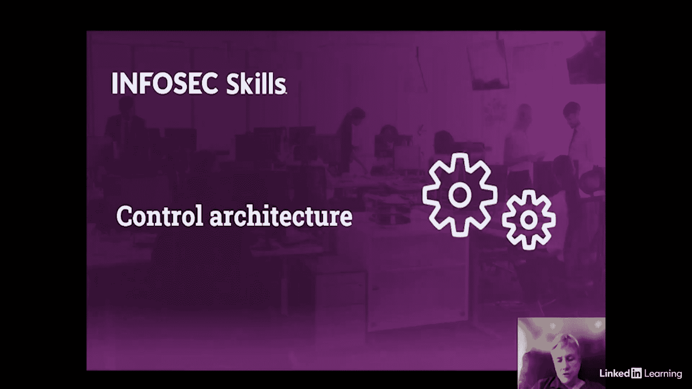
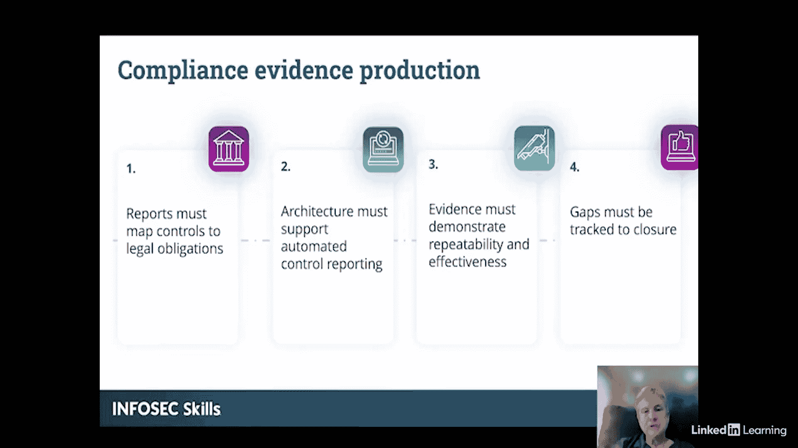

# 🏗️ linkedin ISC2 ISSAP：p04 04：控制架构


## 📖 本节概述

在本节课中，我们将要学习控制架构的核心内容。控制架构其实就是在设计系统时，根据法律法规、行业标准和组织政策，把安全控制措施合理地安排到系统各个部分的过程。我们会聊聊怎么理解合规要求，怎么把控制措施映射到具体的系统组件，以及怎么验证这些措施到底好不好用。另外，我们还会讨论领导层支持的重要性，常见的安全控制手段，控制继承的好处，违规通知的要求，还有零信任和微分段等现代安全理念。最后，我们会看看灾难恢复、业务连续性，以及怎么用文档和报告来证明合规性。希望大家能从这节课里，建立起一套完整的控制架构设计思路。



## 🎯 第一部分：明确责任与合规要求

在设计任何安全架构之前，我们首先要搞清楚自己的责任是什么。最大的责任之一，就是要正确理解和解释所有的合规要求，因为这些要求会直接决定我们如何设计系统环境和架构。

我们要看看哪些控制措施是必须实现的，才能满足合规要求。这里说的合规，不仅仅是法律法规，还包括行业标准、组织内部的政策，以及基础配置规范。所以，我们得对合规要求有一个清晰的认识。

在考试和实际工作中，我们要始终把安全工作关联到业务目标上。因为只有服务于业务目标，才能为组织创造价值，这往往是考试里得分的关键。

以下是合规要求的主要来源：

- 法律法规：国家或地区的数据保护法律，比如 GDPR 等。
- 行业标准：行业内公认的安全最佳实践和认证标准。
- 组织政策：公司自己制定的安全管理制度和规范。
- 基础配置：系统和设备的标准安全设置基线。

## 🔗 第二部分：将控制措施映射到架构组件

上一节我们介绍了怎么明确责任和合规要求，本节中我们来看看怎么把控制措施落到实处。我们需要把选定的安全控制措施，一一映射到系统架构的具体组件上，这样才能保证安全需求真正被实现。

具体做法是，先分析系统的安全需求，再确定怎么实现这些需求，并且在设计阶段就验证控制措施的有效性。这里要注意两个概念的区别：

```
Verification: build the product to security specifications
Validation: meet real world requirements and customer needs
```

简单来说，verification 是“做对了”，validation 是“做对了对的事情”。稍后我们会更详细地展开这两个概念。

与此同时，我们要保持和领导层的持续沟通，让他们明白我们打算如何展示合规情况。领导层需要承担一定的责任，因为合规的主体责任通常属于管理层。如果领导层不支持安全职能，我们就得把安全架构和组织价值挂钩，让他们明白安全虽然不直接创造利润，但能减少损失、提升性能和效率、减少停机时间，这些才是领导层关心的。

以下是向领导层展示安全价值的常见角度：

- 减少损失：降低安全事件造成的经济损失。
- 提升性能：优化系统运行效率。
- 减少停机：降低系统中断带来的业务影响。

## 🛡️ 第三部分：常见的安全控制措施

前面我们讨论了控制映射和领导层沟通，本节中我们来看看具体的常见控制措施有哪些。

网络分段是保护网络和计算机的最佳方式之一。理想情况下，如果一台设备不需要联网，就直接把它从网络中移除，这样就能降低不少风险。不过，现实中并不是所有设备都能离线运行。如果不能移除网络，我们就可以对它进行分段，把它隔离在独立的网络区域里。稍后我们会再聊微分段，以及怎么用它来保护单个系统，这和零信任架构也是紧密相关的。

分段的核心思想是设置边界，配合最小权限原则和“知情权”原则，这些都是我们必须考虑的安全基础。

加密是保护数据机密性的最佳手段之一。虽然加密并不是万能的，但它在很多法律法规中都是必需的，所以在控制架构中占据重要位置。

治理方面，当我们谈论对资源访问的控制时，通常会联系到身份与访问管理，具体包括身份认证、授权和审计三个部分。同时，我们还要监控这些控制是否按预期工作，是否符合合规要求。

以下是身份与访问管理的三大支柱：

- 身份认证（Authentication）：确认用户是谁。
- 授权（Authorization）：确认用户能做什么。
- 审计（Accounting）：记录用户做了什么。

## 🔄 第四部分：控制继承与效率优化

上一节我们介绍了常见的安全控制措施，本节中我们来看看控制继承，以及怎么用它来提高实施效率。

控制继承是一种让控制措施实施更高效的方法。当我们谈论父系统时，整体环境需要实施基线安全，而基线安全与我们保护的资产价值相关联。我们之前也聊过，根据数据的价值对数据进行分类。

子系统应该继承父对象的基线安全设置，这样可以减少重复工作。这里要记住，安全设计不仅仅是为了安全本身，还要考虑设计效率和成本效率。

```
child_security_baseline = parent_security_baseline.inherit()
```

这样做还能帮助我们确保基线安全在各种环境中都得到执行。特别是在云环境下，实施安全措施不如传统环境那么简单，有了基线安全和继承机制，流程就会更加精简和高效。

以下是控制继承的核心逻辑：

- 父系统建立基线安全配置。
- 子系统自动继承父系统的基线设置。
- 减少重复配置工作，保证安全基线在所有环境中统一执行。

## 🚨 第五部分：违规通知与证据保全

上一节我们讨论了控制继承，本节中我们来看看如果发生合规问题，我们该怎么处理违规通知和证据保全。

如果合规出现问题，我们需要能够快速发现。这就要求我们要加入检测机制。通常我们说，一个完整的控制措施应该包含三个部分：预防性控制、检测性控制和纠正性控制。

检测性控制的作用是发现违规行为和未授权活动，并且提供通知。保存证据也很重要，特别是当可能触犯法律时。例如，根据 GDPR 规定，一旦发生数据泄露，我们可能需要在 72 小时内通知监管机构。这时候，日志和时间戳就非常关键，我们需要保持证据链的完整性。

虽然这节课不会深入讲解取证，但这个理念我们始终要放在心里。

自动化工作流也是提升效率的重要手段。我们自动化得越多，工作就越高效。

此外，数据丢失场景必须是可衡量且可归属的。也就是说，当发生泄露时，我们得能算出损失的程度。比如，从定量角度来看，我们需要知道多少个账户号码被泄露，信用卡号码的价值是多少，或者密码等信息的损失量。我们要能够度量和量化泄露造成的影响。

以下是违规通知和证据保全的关键点：

- 尽早发现合规问题：引入检测机制，快速识别违规行为。
- 检测性控制：发现未授权活动并发出通知。
- 证据保全：保存日志和时间戳，维护证据链，满足法律通知时限（如 GDPR 的 72 小时）。
- 自动化工作流：通过自动化提高检测和响应效率。
- 损失量化：能够度量和归属数据丢失的具体范围和价值。

## 👥 第六部分：用户权限处理与主体对象访问

上一节我们介绍了违规通知和证据保全，本节中我们来看看用户权限该怎么处理。

我们要确定允许用户拥有什么样的访问权限，最基本的就是读取、写入和执行权限。除了这些，我们还要考虑是否允许删除能力，是否需要修改已经失去完整性的数据，以及数据的可移植性，也就是信息能否从一个平台移植到另一个平台。

后端系统和目标数据提取也很重要。这意味着我们需要能够从后端服务器、数据库服务器中提取数据，并且这些提取要符合我们的需求。同时，我们要确保有问责机制，把操作或权限使用情况与具体的主体关联起来。

这里有个关键概念：我们通常说的是用户权限，但实际上更应该关注主体权限。因为不仅仅是用户，很多主体都可以访问服务或数据等对象。在讨论访问控制时，我们经常提到主体对对象的访问，其中主体是主动实体，对象是被动实体。我们希望具有可追溯性，也就是能把一个动作追溯到具体的主体。

```
subject_access_object: traceability(action -> subject)
```

以下是用户权限处理中需要考虑的权限类型：

- 读取（Read）：查看数据或资源。
- 写入（Write）：修改或创建数据。
- 执行（Execute）：运行程序或脚本。
- 删除（Delete）：移除数据或资源。
- 可移植性（Portability）：在不同平台间迁移数据。

## 🔐 第七部分：零信任与微分段

上一节我们讨论了用户权限处理，本节中我们来看看零信任架构和微分段，这是当前安全领域非常重要的理念。

传统的安全思维是“信任但验证”，认为只要你进了我们的内网，就是可信的，因为我们不会让不可信的东西进入内网。但实际上，无论我们是否有意，内网里都可能存在恶意服务、恶意软件，会话也可能被劫持，不可信实体有很多种方式进入我们的环境。

所以，“信任但验证”的理念正在淡出，取而代之的是“永不信任，始终验证”。这也是很多法规要求的方向。

```
trust_model = "never trust, always verify"
```

要实施零信任，需要持续认证。但这不代表用户要不断输入密码、提供指纹或 PIN 码，而是需要底层的应用程序能够持续证明，当前发起交易的仍然是 Kelly，并且 Kelly 已经获得授权。为了实现持续认证，我们可以使用 SAML、OpenID Connect 等服务。

微分段是另一个重要概念，目的是限制损伤半径，把网络切得更小。小网络更容易保护。比如，如果我有关键服务器，与其把它们放在大网络里，不如把服务器单独划分到自己的网络段，并以非常细粒度的方式保护对该服务器的访问。

在微分段中，如果某个微段被攻破，损伤半径会小很多，这主要是为了限制横向移动。过去我们信任内网的横向移动，但现在我们知道，仅仅因为某个进程在我们的网络里，并不代表它就是合法的。

由于网络被分成了更小的段，违规通知的范围也会相应缩小。我们不需要面对整个网络范围的妥协，可能只有部分网段受影响，因此需要通知的人也会更少。

以下是零信任和微分段的核心对比：

- 传统模式：信任但验证，内网默认可信，横向移动相对开放。
- 零信任模式：永不信任，始终验证，持续认证，限制横向移动。
- 微分段：将网络划分为更小的独立段，控制段内和段间访问，最小化损伤半径。

## 📅 第八部分：灾难恢复、业务连续性与冗余

上一节我们介绍了零信任和微分段，本节中我们来看看灾难恢复、业务连续性，以及相关的冗余设计。

法律法规要求我们在环境中构建冗余和恢复能力。这一点我们稍后还会更详细地探讨，但现在我们要考虑如何规划高可用性，并满足 RTO 和 RPO 等指标。

RTO，即恢复时间目标，关注的是我们需要多快恢复业务流程或服务。我们有一个希望恢复的时间点。

RPO，即恢复点目标，关注的是数据必须有多新。比如，如果要求数据最新要保留一小时之前的状态，那么 RPO 就是一小时。

```
RTO = maximum_acceptable_recovery_time
RPO = maximum_acceptable_data_loss_window
```

冗余不仅仅是硬盘和服务器的冗余，还包括处理路径的冗余。同时，我们必须进行审计，始终要证明我们具备一致性和实施保证。

法律法规要求这些，那么我们要怎么产生这些证据呢？我们需要报告、文档、记录。我们要确保控制措施与法律法规的要求相对应，并且有文档来证明这一点。

以下是 RTO 和 RPO 的简单区别：

- RTO（恢复时间目标）：恢复业务所需的最大允许时间，回答“多久能恢复”。
- RPO（恢复点目标）：数据丢失容忍的最大时间窗口，回答“数据可丢失多久”。

## 📋 第九部分：合规证据、报告与持续改进

上一节我们讨论了灾难恢复和业务连续性，本节中我们来看看怎么生成合规证据，进行报告，以及怎么持续改进。

自动化控制报告是内置在系统中的，用于证明合规性，提供合规证据。这不是一次性的工作，而是需要定期执行的事情。我们要收集和监控日志，进行差距分析，看看我们现在的状态和需要达到的状态之间有什么差距。

拿到日志信息后，我们要确保记录的内容是聪明的，也就是符合 SMART 原则：具体、可衡量、可达成、相关、有时限。如果你听说过 SMART 目标，就知道我们要怎么利用这些信息来弥补存在的差距。

自动化控制报告不仅要能重复执行，还要证明控制措施持续有效。我们要把日志信息用起来，找出差距并加以弥补，这样控制架构才能始终保持有效。

以下是合规证据和持续改进的主要工作内容：

- 编写报告和文档：记录控制措施如何满足法律法规要求。
- 自动化控制报告：系统自动生成合规证据，定期进行。
- 收集和监控日志：确保日志内容符合 SMART 原则。
- 差距分析：对比当前状态与目标状态，找出不足并改进。
- 保证重复性和有效性：控制措施不是一次性展示，而是持续有效的。

## 📝 本节总结

本节课中我们一起学习了控制架构的方方面面。我们先聊了怎么明确责任，理解法律法规、行业标准、组织政策和基础配置等合规要求，并始终把安全工作与业务目标挂钩。接着，我们了解了怎么把控制措施映射到架构组件，区分了验证和确认的概念，并强调了与领导层沟通、展示安全价值的重要性。

随后，我们介绍了常见的安全控制措施，包括网络分段、加密以及身份认证、授权和审计等身份与访问管理的三大支柱。接着讲解了控制继承，如何通过子系统继承父系统的基线安全来提高设计效率和成本效率。我们还讨论了违规通知和证据保全，包括检测性控制、GDPR 下的 72 小时通知要求、日志与时间戳的重要性，以及数据丢失的可衡量性和可归属性。

在用户权限处理部分，我们梳理了读取、写入、执行等权限，并区分了用户权限和主体权限，强调主体对对象访问的可追溯性。然后，我们深入了解了零信任架构和微分段，从“信任但验证”转向“永不信任，始终验证”，并通过微分段限制横向移动和损伤半径。最后，我们学习了灾难恢复和业务连续性中的 RTO 与 RPO、冗余设计，以及如何通过报告、文档和自动化控制报告来生成合规证据，配合差距分析实现持续改进。



希望这节课能帮助你建立起完整的控制架构设计思路，在实际工作中把安全控制措施落地到系统架构中，并为组织创造真正的价值。
