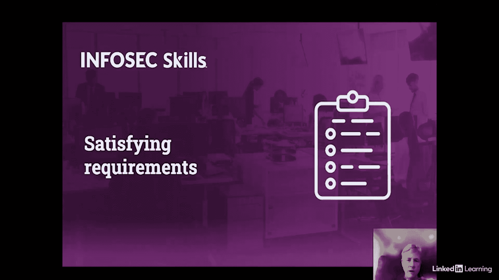
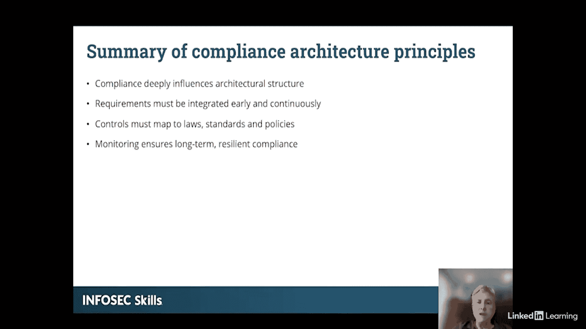

# ISSAP：05：满足需求 🔐

在本节课中，我们将学习如何满足安全架构项目中的各种需求，理解每个项目存在的根本目的，并探讨如何从高层级的法律法规出发，逐步落实到具体的安全控制措施之中。无论你是刚接触安全架构的新手，还是希望梳理知识体系的从业者，都能从中了解需求分析在整个项目中的基础地位。


任何一个安全项目，不管规模大小，其核心目的都围绕着满足需求展开。如果搞不清楚需求到底是什么，后续的架构设计和控制措施就容易偏离方向，甚至无法通过合规检查。因此，在动手设计具体方案之前，首先要弄清楚项目到底要满足哪些要求，这是保证项目不走弯路的前提。

以下是关于项目需求的核心观点：

- 每个项目的根本目的就是满足其定义的需求。
- 开展任何工作之前，都需要先明确需求的具体内容。
- 需求通常分为不同层级，不能混为一谈。

上一节我们介绍了需求的基本概念，本节中我们来看看高层级需求与具体控制措施之间存在哪些差异。

在实际工作中，我们经常会接触到 GDPR 和 PCI DSS 这样的高层级要求。它们属于法律法规层面的规范，通常比较宽泛，侧重于宏观的合规目标，而不会直接告诉架构师在技术实现层面该怎么做。

以下是常见高层级需求的示例：

- GDPR：欧盟通用数据保护条例，侧重个人数据的隐私保护。
- PCI DSS：支付卡行业数据安全标准，侧重持卡人数据的安全处理。

我们可以用一个简单的表达式来描述高层级需求与具体控制措施之间的关系：

```text
高层级法律法规 ≠ 具体的安全控制措施
```

这意味着，光有 GDPR 或 PCI DSS 这样的规定还不够，我们还需要把它们翻译成可以执行的技术方案，才能真正落地。

上一节我们了解了高层级需求的特点，本节中我们来看看法律法规到底会规定到什么程度，以及它们不会触及哪些细节。

很多初学者可能会认为，法律法规里会直接写明“必须使用 AES-256 加密”或者“必须部署某种防火墙”。但实际上，绝大多数法律法规都不会深入到控制措施的层面，更不会指定具体的算法或产品。

以下是法律法规通常不会做的事情：

- 不会直接规定必须使用 AES-256 进行数据保护。
- 不会指定具体的加密算法、密钥长度或协议版本。
- 不会列出必须购买的具体安全产品或供应商。



所以，我们面对的是这些宽泛的法律，而我们的任务就是将这些原则性要求转化为可落地的控制措施，这是安全架构师日常工作中的重要部分。



在本节课中，我们一起学习了满足需求的基本原理，了解了高层级需求的常见类型，也认识到法律法规不会直接给出具体的技术控制要求。希望这些内容能帮助你更好地理解安全架构设计的起点，为后续的实践打下基础。
