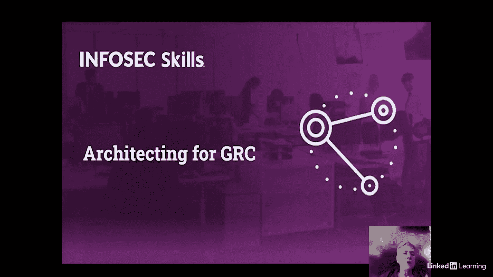
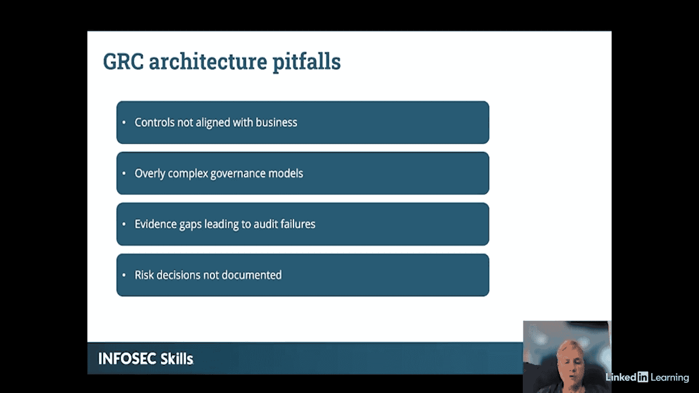

ISSAP 教程：06：治理、风险与合规架构设计 🛡️

在本节课中我们将学习如何在安全架构中融入治理、风险和合规，也就是 GRC。我们会先从治理的顶层方向入手，解释风险和不确定性如何影响架构设计，接着讨论合规要求与法律法规的关系，最后介绍如何用关键指标来衡量合规与风险状态。所有内容都会用大白话讲解，让初学者也能听懂。

## 1. GRC 的三大核心要素

首先，我们来看看 GRC 包含哪三个核心部分。

治理表达的是组织的方向、环境以及对安全的期望。在任何环境中，都存在不确定性，我们必须在架构中考虑这些风险。我们的目标是把残余风险降低到可以接受的水平。同时，架构还要保持对法律法规的合规。要做到这一点，第一步是理解这些要求，然后才能开始构建具体的架构。这里所说的架构，主要是指落地层面的“怎么做”。

治理、风险、合规三者缺一不可。治理告诉我们需要实现什么目标，风险管理告诉我们哪些威胁需要关注，合规则规定了必须遵守的法律和规则。三者共同决定了安全架构的上限和下限。

残余风险 = 固有风险 - 安全控制效果  
目标：残余风险 ≤ 可接受风险阈值

## 2. 治理规定“什么”，架构决定“怎么做”

接下来，我们探讨治理与架构之间的分工关系。

当我们谈论治理时，通常是指董事会层面的自上而下优先级。董事会会把利益相关者的需求映射到组织目标上。作为架构师，我们需要理解高层的优先级，并确保我们的架构直接体现这些优先级。透明度和问责制是治理的重要部分，还可以加入可追溯性，用来审视合规问题和治理期望，再把它们映射到具体的控制措施和实施手段上。

战略对齐是另一个关键点。架构不仅要满足技术指标，更要与业务目标保持一致，始终围绕如何为组织创造价值来展开。报告、审计性、可追溯性、事件响应，以及确保法律法规合规和产出证据，这些都是前面章节反复提到的内容。

## 3. 合规框架与设计约束

然后，我们看看常见的合规框架，以及 GRC 对架构的约束作用。

提到合规框架，大家可能会想到 ISO 27001。如果是政府机构，可能会使用 NIST 框架，例如网络安全框架。这些框架提供了一套结构，帮助我们把控制措施映射到合规要求上，进而满足框架的规定。

GRC 会覆盖架构设计的方方面面。领导层的投入、风险的充分管理、对法律法规的合规，这些都不是可选项。如果我们只关注功能，可以把世上所有的功能都集成进去，让用户和利益相关者非常开心。但是，我们必须在治理设定的限制范围内运行，不能为了功能而突破合规红线。

在架构决策中，常常需要在可用性、功能性和安全性之间做权衡。政策机制决定了如何强制执行策略，这在一定程度上会限制用户能做什么。我们倾向于站在安全的一边，但必须清楚治理层的真正优先级是什么。优先级不一定永远是“安全至上”，法律法规和合规要求同样重要。

## 4. 可追溯性与审计性

接下来，我们重点理解可追溯性和审计性在架构中的具体含义。

策略告诉我们要完成什么，这些要求来自治理实体。我们的责任是决定“怎么做”。可追溯性意味着我们要有审计和问责机制，确保能够证明控制措施满足策略期望。我们反复提到可追溯性和审计性，具体来说，就是要有正确的度量指标。

## 5. 关键指标：KRIs、KPIs、KCIs

接下来，我们看看度量指标通常分为哪三类，下面分别介绍。

- 关键风险指标（KRI，Key Risk Indicators）
- 关键绩效指标（KPI，Key Performance Indicators）
- 关键合规指标（KCI，Key Compliance Indicators）

关键风险指标是面向未来的指标。换句话说，我们用这些指标来预测未来可能出现的风险。关键风险指标有时也被称为触发器，是风险即将发生的早期预警信号。比如，如果某台关键服务器的处理器利用率不断上升，上升，再上升，这就应该是一个风险指标，提示我们风险可能正在浮现。可能是服务器硬件不足，也可能是某些进程过度占用 CPU，或者正在发生拒绝服务攻击。不管具体原因是什么，我们都在监控这些关键风险指标，用作早期发现手段，以便在事件或泄露发生时快速响应。所以，关键风险指标是前瞻性的，我们需要关注哪些需要立即告警。

KRI = 早期预警指标（前瞻性）  
示例：服务器 CPU 利用率持续上升 → 风险可能正在出现

关键绩效指标是回顾过去的指标。截止目前，我们是否达到了绩效目标？是否按时、按计划、在预算范围内？时间和计划有点重叠，但关键是是否在范围内，是否提供了适当的服务，是否在做正确的工作，是否按计划进行，是否在预算内。这些都是看过去已经完成的工作。比如，我们的目标是在某个时间点前给一定数量的系统打补丁，我们现在是否在按计划推进，能否按时达成目标？这些就是关键绩效指标。

KPI = 历史绩效考核指标（回顾性）  
示例：截止当前已补丁系统数 / 计划补丁系统数

关键合规指标则是用来展示合规状态的指标。这些指标也是回顾性的，用来确认我们是否满足了合规要求，并对合规状况进行度量和展示。

KCI = 合规要求满足度指标（回顾性）  
示例：通过合规检查的控制措施数量 / 总控制措施数量

## 6. 数据收集与常见陷阱

接下来，我们讨论如何收集数据，以及架构中容易掉进去的陷阱。

数据收集需要采集正确的数据，分析正确的信息，并能够把信息提取出来。日志文件可能非常大，所以必须确保只记录必要的内容，并且拥有合适的过滤和缩减工具，才能评估合规性。

说到做错的地方，陷阱随处可见。最大的问题是控制措施与业务目标没有对齐。这句话在考试和 ISC2 的教材中反复出现。我们必须先理解业务目标和业务目的，这不仅仅是合规，还包括提升客户信任、扩大客户群、增加市场份额等常见的业务目标，确保控制措施与这些目标保持一致。治理模型越复杂，满足要求就越困难。所以我们需要简化模型，增进理解，与高层领导会面，了解优先级，评估利益相关者的需求。

## 7. 证据与风险决策文档

最后，我们看看证据留存和风险决策文档的重要性。

要确保文档记录了正确的信息。这一点同样重要，就是记录风险决策。我们在哪些地方做出了选择，为了充分管理风险，或者在风险与性能、可用性等目标之间取得平衡？把这些决策记录下来，能够增加审计踪迹。证据的产出也是合规的一部分，所有记录都要能经得起审计检查。

在本节课中我们一起学习了 GRC 在安全架构中的作用。我们了解了治理、风险、合规三大核心要素，明确了治理负责方向、架构负责落地，掌握了 ISO 27001 和 NIST 等合规框架的映射方法，学习了 KRIs、KPIs、KCIs 三类关键指标及其前后向区别，还讨论了数据收集、业务对齐以及风险决策文档化等内容。希望这些知识能帮助你在实际架构设计中更好地平衡安全、合规与业务目标。

