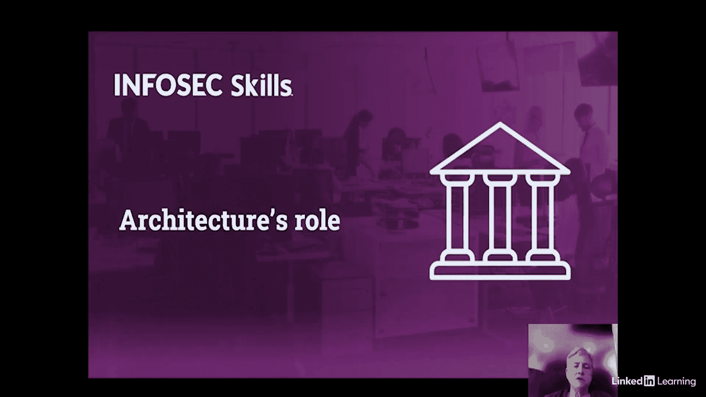
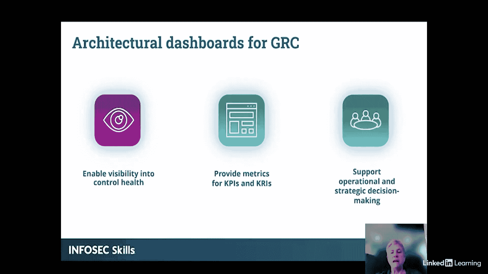
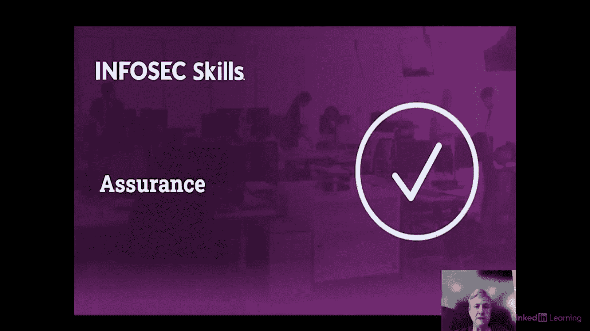

# ISSAP认证教程：第07章：架构师的角色与安全架构职责 🛡️


在本节课中我们将要学习安全架构师在组织中具体承担什么职责，架构工作如何服务于业务目标，以及如何与利益相关方协作。我们会把治理层面的宏观目标转化为可以落地执行的安全设计，了解合规差距分析的方法，掌握利益相关方识别与需求收集的流程，学习文档记录和决策边界的重要性，探讨关键资产保护优先级的设定，最后通过仪表盘和沟通技巧完成高层管理者的汇报。所有内容都围绕ISSAP考试的核心考点展开，帮助你建立对架构师角色的完整认识。


我们先来看看架构师在安全架构中到底负责什么。架构师的核心工作是把企业治理提供的宽泛目标，转化成可以强制执行的具体安全设计。换句话说，架构师需要把管理层定下的方向，变成技术团队可以直接落地的方案。安全架构师不是单纯的技术人员，更是业务需求与安全控制之间的桥梁。




以下是安全架构设计通常需要覆盖的具体内容：

- 强身份认证机制，确保只有合法用户能进入系统。
- 数据加密措施，保护存储和传输中的敏感信息。
- 隐私保护设计，在系统构建阶段就考虑个人信息合规。
- 故障安全和安全故障机制，即系统出错时不会把安全性降低。
- 业务价值交付，确保安全措施最终服务于组织的业务目标。

安全设计看起来可能有很多方面，但它们最终都回归到同一个目的，就是通过安全能力来支撑业务达成目标。我们不能单纯为了安全而安全，必须让安全措施创造实际价值。


接下来我们要了解合规差距分析和现状评估。安全架构不仅要设计新方案，还要清楚组织当前处于什么状态，应该达到什么状态，中间差距在哪里。


以下是合规与差距分析的关键步骤：

- 确认当前合规状况，找出现有控制措施中的缺口。
- 对比目标合规标准，明确需要改进的地方。
- 进行差距分析，回答“我们在哪里”以及“我们应该在哪里”这两个问题。
- 制定补救计划，把发现的缺口逐步消除。

通过这些步骤，架构师可以帮助组织保持合规，避免在安全建设中遗漏重要控制点。


然后我们进入利益相关方沟通与期望管理。很多架构师可能觉得沟通不是自己的主要工作，但实际上架构师需要管理很多有不同优先级的利益相关方。


以下是沟通中需要注意的要点：

- 识别所有利益相关方，包括治理机构、业务所有者、流程所有者和数据所有者。
- 了解每一方的需求和优先级，因为不同角色可能关注点不同。
- 管理期望，确保利益相关方知道安全架构能够提供什么，不能提供什么。
- 保持沟通畅通，在项目推进过程中及时同步进度和风险。

利益相关方的需求往往存在冲突。比如数据所有者和业务所有者可能更看重性能优化和系统可用性，而安全团队更关注访问控制。架构师需要听取所有需求，记住自己本质上是咨询者和设计师，职责是根据业务所有者和组织提出的需求来设计方案，而不是自行做最终决定。


接着我们讲需求收集与利益相关方识别。在开始收集需求之前，必须先弄清楚利益相关方到底是谁，否则后续的需求分析就会缺乏基础。


以下是识别利益相关方的方法：

- 列出治理实体，确定哪些部门或委员会拥有决策权。
- 找出业务所有者，了解业务流程的目标和限制。
- 确定流程所有者，明确谁负责具体业务运作。
- 锁定数据所有者，掌握数据分类和保护要求。
- 分析各方需求，找出竞争性需求并做好协调。

只有把利益相关方识别清楚，架构师才能在后续工作中满足他们的实际需求，避免设计出任何人都不满意的方案。


接下来是文档记录与决策边界。架构师在工作中必须坚持记录一切，因为建议和最终决定是两回事。


以下是文档记录的核心原则：

- 记录所有安全控制建议，无论是否被采纳。
- 记录决策过程，包括哪些方案被拒绝以及拒绝原因。
- 明确架构师不是决策者，业务所有者和数据所有者才是最终决定权人。
- 确保文档能够证明架构师履行了职责，即使最终决策与安全建议不一致。

在ISSAP考试中，你要记住架构师不负责做最终决策，业务驱动我们做出的决策，架构师的职责是提供专业建议并留痕。


然后我们讨论需求追溯与升级机制。在实际工作中，需求往往不一致，甚至存在直接冲突，这时候需要明确的升级路径。


以下是处理需求冲突的流程：

- 记录不一致需求和竞争性需求。
- 尝试在架构层面协调，寻找折中方案。
- 如果无法协调，向项目赞助人、高级领导或直接汇报的委员会升级。
- 确保后续推进的需求保持一致，避免矛盾指令导致设计混乱。

追溯性和一致性是安全架构落地的重要保障，架构师不能让相互冲突的需求进入最终实施阶段。


接下来我们聊聊关键资产与保护优先级。安全资源是有限的，架构师必须知道哪些资产最重要，才能把保护精力用在刀刃上。


以下是资产保护的处理方法：

- 建立资产清单，把组织内的所有资源列出来。
- 确定资产所有者，明确谁负责每一项资产。
- 评估资产重要程度，确定哪些资产对业务最关键。
- 根据重要程度设定保护优先级，优先保护核心资产。

在讨论重要性时，我们通常关注可用性和冗余；在讨论安全需求时，通常关注隐私和完整性。当然这不是绝对规则，只是常见的表述习惯。归根结底，安全基础是机密性、完整性和可用性，也就是CIA三要素。

**机密性（Confidentiality）：** Confidentiality = 仅授权用户可访问数据

**完整性（Integrity）：** Integrity = 数据未被未授权篡改

**可用性（Availability）：** Availability = 系统在需要时可正常使用


利益相关方会推动架构师产出的架构方向，因此利益相关方识别必须在需求优先级排序之前完成。


然后是风险合规与分类基线。架构工作必须满足治理、风险和合规要求，降低组织面临的整体风险敞口。


以下是风险与合规的处理流程：

- 确保架构方案符合治理、风险和合规框架要求。
- 降低组织暴露在外的风险，使安全态势处于可接受范围内。
- 统一风险处置方式，避免不同系统采用不一致的标准。
- 建立数据分类体系，定义不同等级数据的保护基线。
- 根据分类结果，为每类数据制定相应的基础配置和防护措施。

分类体系让架构师可以根据资产重要性统一保护标准，而不是对所有数据一视同仁。

下面是一个简单的数据分类基线代码示例：

```
数据分类基线示例：
级别 1（公开）：无特殊保护要求
级别 2（内部）：基本访问控制
级别 3（敏感）：加密存储 + 审计日志
级别 4（机密）：多因素认证 + 端到端加密
```

基线配置能够帮助架构师在不同系统之间保持保护标准的一致性。


接着我们讲监管就绪与弹性架构。合规不仅是通过审计，还要有文档证明，同时要确保组织在出现问题时能够持续运行。


以下是监管就绪与弹性的关键点：

- 提供合规证据，不仅要达到合规，还要有文档支持。
- 构建弹性架构，让组织在故障或攻击发生时仍能维持运营。
- 通过冗余实现弹性，消除单点故障。
- 引入容错机制，提升系统在异常情况下的可靠性。

弹性架构的核心思路是，组织不能因为某个组件失败而整体停摆，架构师需要在设计阶段就把容错和冗余考虑进去。


最后我们学习利益相关方汇报与仪表盘沟通。高级管理者通常没有时间阅读冗长的书面报告，架构师需要用直观的方式传递信息。


以下是仪表盘沟通的建议：

- 使用仪表盘展示宏观信息，包含醒目指标。
- 支持钻取功能，让管理者在需要时查看更详细数据。
- 提供可视化展示，向高层传达“他们需要知道什么”。
- 在必要时允许钻取深入，获取更多背景信息。

这种可视化沟通方式对时间有限的高级利益相关方非常有价值，能让他们快速掌握安全架构的整体状况。


本节课的核心考点在于理解架构师的角色，理解如何沟通，如何说服领导层做出符合安全要求的决策，如何投资于安全架构。良好的沟通是其中必不可少的一环，架构师不仅要懂技术，还要懂如何把安全价值讲给业务方听。






在本节课中我们一起学习了架构师在安全架构中的角色定位，从治理目标到可执行安全设计的转化方法，合规差距分析与现状评估，利益相关方沟通与期望管理，需求收集与利益相关方识别，文档记录与决策边界，需求追溯与升级机制，关键资产保护优先级，风险合规与分类基线，监管就绪与弹性架构，以及仪表盘沟通技巧。希望这些内容能帮助你在ISSAP考试和实际工作中更好地理解安全架构师的职责。


