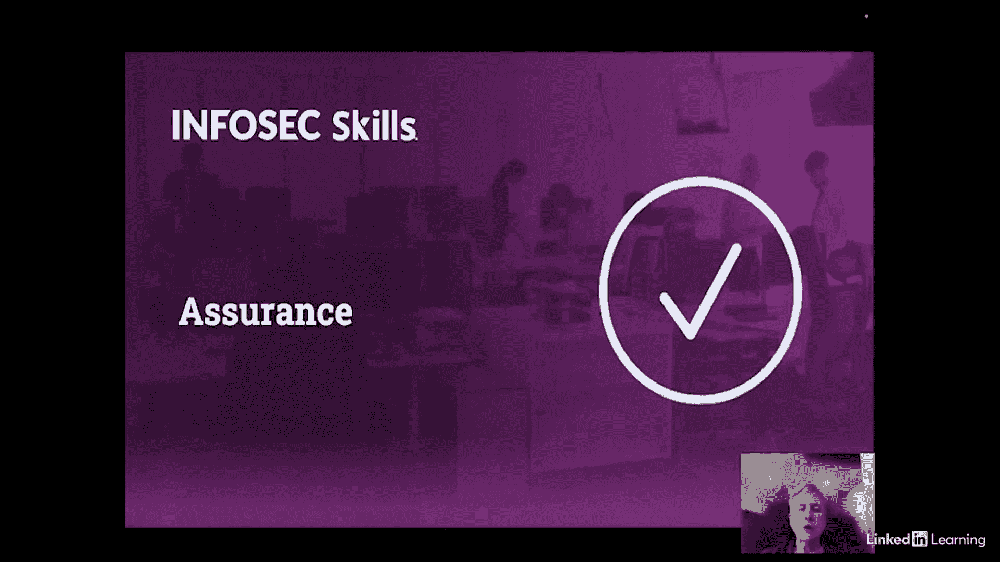
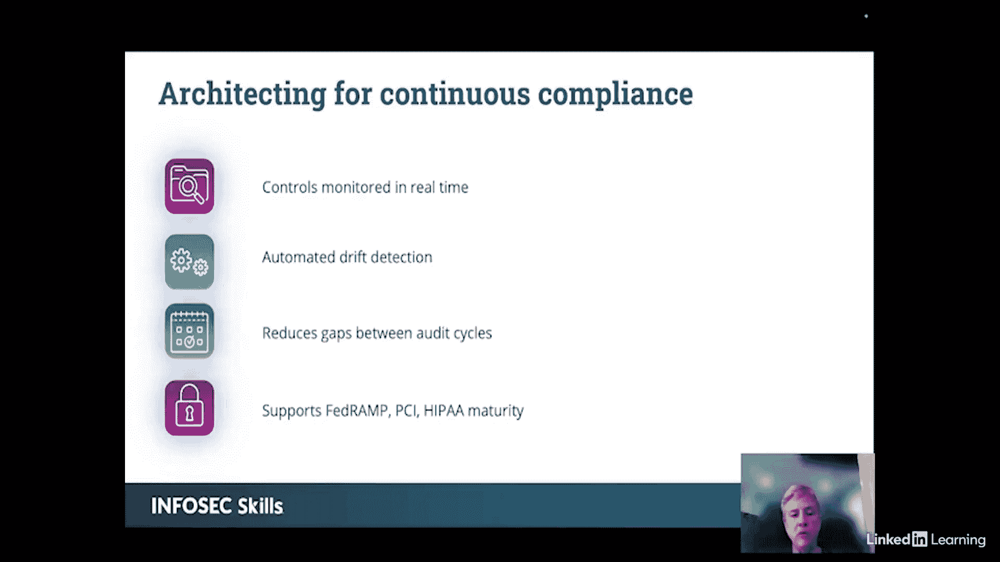

# LinkedIn ISC2 信息系统安全架构专家：08：保证 🛡️

在本节课中我们将要学习保证的概念，以及它如何与审计能力联系起来。我们会讨论身份、认证、授权，还有配置管理、不可变日志、漏洞管理和持续合规等内容。这些知识点对于理解安全架构非常重要，也会反复出现在考试中，所以建议大家仔细阅读，不要跳过任何细节。

# 什么是保证 📋

保证简单来说，就是我们能否拿出证据来证明系统是安全的，并且符合法律法规和公司政策。保证的核心可以用下面的公式来表示：

保证 = 可验证证据 + 法规与政策合规证明

我们需要把保证和审计能力联系起来看，因为审计就是检查这些证据是否真实有效。如果没有证据，就无法证明合规，也就谈不上保证。

大部分保证工作都落在了文档上。有完整的日志，日志内容一致，记录了正确的信息，并且带有时间戳，这些都是证明合规的基础。法律法规本身也提供了合规的证据框架。证据要映射到控制措施，来证明我们满足了所有要求。同时，我们需要能快速响应审计，在短时间内拿出所需信息，不能让审计人员久等。

# 身份与访问管理 🔐

了解了保证的基本概念，接下来我们看看身份和访问管理在保证中的作用。身份、认证和授权三者缺一不可，下面是它们的基本流程：

用户声称身份 → 认证验证 → 授权分配权限 → 审计记录动作

身份就是用户声称自己是谁，比如说“我是Kelly Henderhand”或者“我是系统管理员”。认证则是证明这个声称是真的，怎么证明呢？可能是密码、令牌或者生物特征。授权则是根据身份确定用户有哪些权限和操作权。审计则负责把身份和用户实际做的动作联系起来，形成可追踪的记录。没有这一套机制，我们就无法知道是谁做了什么，也就无法提供有效的保证证据。

# 配置管理与不可变日志 ⚙️

身份管理解决了谁在操作的问题，接下来我们看看系统配置和变更控制如何影响保证。严格的配置管理要求我们记录系统中所有控制措施的配置情况，并且配合强有力的变更控制，防止未经授权的修改。我们需要能够证明系统当前的配置是什么，并且有证据表明系统没有被擅自修改，依然符合基线标准。

不可变日志和不可变配置也是关键概念。不可变日志意味着日志一旦写入就不能被修改，通过完整性检查来保证日志里记录的内容和我们看到的完全一致。虽然这里不深入展开不可变配置，但在软件定义网络和可编程网络环境中，创建不可修改的环境对提供高保证系统很有帮助。

# 监控与信任边界 🌐

配置和日志解决了记录问题，接下来我们谈谈监控和信任边界。监控和理解信任边界同样重要。记得我们之前提到过零信任架构，当数据或请求从一个元素跨越到另一个信任边界时，必须确保有足够的保护措施。这个要求在很多情况下都受到法律或框架的规范，不能忽视。

# 审计包含哪些内容 🔍

有了监控和边界保护，那实际的审计过程具体包含哪些内容呢？常见的审计场景包括以下几点：

- 访谈操作人员，要求他们演示并提供证明
- 分析各种实物证据，比如产品销毁的记录和销毁签批文件
- 确保所有事情都有文档记录

审计首先是验证我们的架构，证明系统架构既满足法规合规要求，又能有效运行。审计是一个很好的工具，可以帮助我们发现哪些风险没有得到充分管理，存在哪些漏洞。通过这些方式，审计人员能够判断我们的系统是否真的达到了声称的安全水平。

# 架构测试与文档记录 📄

审计需要证据，那这些证据怎么来？这就涉及到架构测试和文档了。我们的架构设计必须支持测试，也就是说，我们要有能力去验证和确认控制措施是否满足要求，是否提供了期望的功能。如果不能测试，就无法证明控制措施有效。为此，必须拥有清晰的文档和明确的路径，说明系统是如何设计和实现的，这样审计人员才能顺利地查看和理解。

# 可信日志与外部监管 📊

文档和测试之外，日志报告的可信度也是审计的重点。可信的日志和报告不言自明。我们反复强调过时间戳和不可变日志，就是要确保审计的信息准确无误。除了内部检查，我们还要考虑外部监管机构的审查，系统必须经得起内外部的严格审视。

从法律角度理解法规，并将其转化为系统和环境的具体要求，是我们的责任。文档的作用就是为我们的安全措施进行辩护，证明它们符合监管标准。虽然这些内容之前已经提到过，但在考试中非常重要，所以我们会再次强调。仅仅达到合规还不够，我们必须提供恰当的证据，并且这些证据必须能够经受住质疑，站得住脚。

# 漏洞管理与异常处理 🛠️

合规和证据之外，漏洞管理也是保证体系中不可忽视的一环。漏洞管理是指我们能否对系统进行评估，找出开放端口、未打补丁的软件等问题。漏洞扫描可以评估环境中的弱点所在。发现漏洞后，我们需要收集相关信息，并进行响应和修复。具体到系统补丁，我们要查看配置基线，并具备回滚到基线配置的能力。比如通过系统镜像，如果某个系统偏离了基线，就可以推送新镜像来恢复正常状态。

异常处理则关注意外情况发生时该怎么办。无论是漏洞扫描发现的问题，还是系统运行时的故障，系统都应该以安全的方式失败，比如终止进程，而不是以不安全的方式打开所有权限，那可能会违背安全要求。

# 取证准备与证据保全 🕵️

异常处理解决了运行时的安全问题，那如果真发生了安全事件，取证准备又该如何做呢？取证准备、审计和证据保全也是保证体系的一部分。对于虚拟系统，可以定期进行快照，作为潜在证据。我们要确保监控系统和记录信息时不会干扰系统正常运行。

证据保管链在设计中是一个关键考虑点。我们需要记录证据是谁收集的、如何分析、如何保护、如何存储和传输。这些要素都构成了证据保管链，它是取证中不可或缺的文档，能够证明证据从采集到呈交的全过程没有被篡改。

# 日志隔离与权限控制 🔒

证据保全之后，我们再看看日志本身应该如何保护，避免被篡改。设计是一切。日志必须与管理员隔离，只能以只读方式访问，不能有写权限。通过哈希等手段保证完整性，并且不能有后门让管理员擅自访问日志。相关权限必须被严格限制，只读访问是提供证据、证明日志防篡改性的重要部分。只有日志本身是可信的，后续的审计才有意义。

# 可见性与持续改进 📈

日志保护好了，那如何利用这些信息推动安全持续改进呢？可见性不仅仅是收集系统漏洞和弱点的信息，更重要的是要了解这些信息如何流入风险评估流程。监控的目标就是持续改进。你可以把它看作一个循环过程，获得信息后采取行动，行动成为反馈。

这里提到的德明循环，也就是计划-执行-检查-处理模型，可以用下面的代码表示：

计划安全 → 执行安全 → 检查控制措施是否有效 → 根据学习结果采取行动

我们先规划安全措施，再实施，然后检查控制措施是否有效，最后根据学到的经验采取行动。这个模型基于持续改进，而日志和监控就是持续改进中最好的输入来源。我们要问自己：是否达到了预期的安全状态？如果没有，如何弥补这些差距？

# 持续合规与偏差检测 ✅

持续改进的思想贯穿始终，那如何保持持续合规呢？持续合规的关键措施包括以下几点：

- 使用持续的仪表盘展示合规状态
- 从集中位置采集全环境日志，形成单一视图
- 使用合适的指标，如KRIs、KPIs和KCIs进行证据收集
- 开展偏差检测，对比基线和当前状态

如何维持并保证持续合规？答案就是监控、监控、再监控。偏差检测帮助我们回答：基线是什么，当前状态在哪里，如何做出纠正。强有力的变更控制防止系统被随意修改，配合系统修改检测和配置管理，确保我们始终与基线保持一致，因为基线直接关联到合规法规。

# 组织成熟度与总结 🎓

最后，我们来看看组织成熟度和持续改进的最终目标。在考虑我们的控制措施时，组织成熟度和持续改进体现了组织的成熟程度。最终目标是构建一个以持续改进为重点的环境。我们为合规性进行审计，收集支持合规的信息，并把学到的经验用于推动前进。

本节课中我们一起学习了保证的含义，身份认证与授权，配置管理与不可变日志，监控和信任边界，审计内容与架构测试，可信日志与外部监管，漏洞管理与异常处理，取证准备与证据保全，日志隔离与权限控制，可见性与持续改进，以及持续合规与偏差检测。希望这些内容能帮助你更好地理解安全架构中的保证体系，并顺利通过相关考试。

