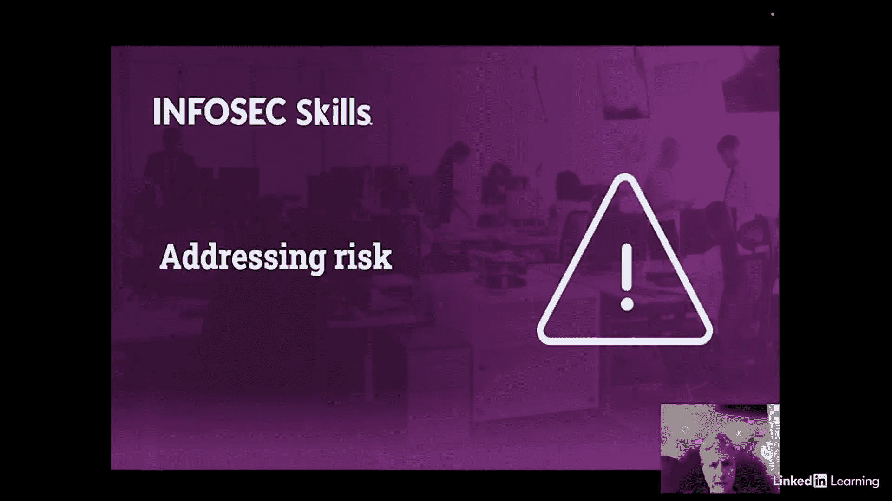
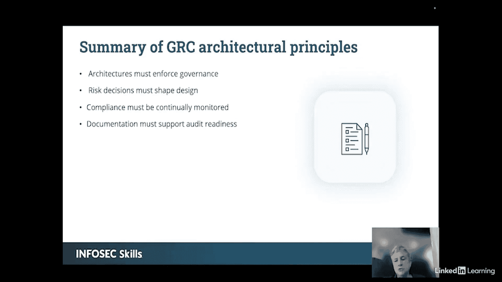

# linkedin - ISC2 ISSAP：09：风险应对 🛡️

在本节课中我们将要学习信息系统安全架构中的风险处理方法。我们先回顾治理的作用，也讨论过合规及其周围的问题，现在把重点放在风险上。你会了解风险管理的完整流程，从资产识别开始，经过威胁与漏洞分析，再到风险处置和控制措施实施，最后结合事件响应与业务连续性来保护组织资产。

## 课程概述 📚

本节内容围绕风险展开，帮助你理解如何在安全架构中识别、评估和处置风险。我们会把之前提到的治理与合规作为背景，然后逐步深入到具体的风险控制措施，确保你能用大白话掌握每一个核心概念。

## 风险识别的起点是资产清单 🔍

上一节我们介绍了治理与合规的基础知识，本节中我们来看看风险管理的具体操作。

当我们谈到风险时，首先必须识别我们的资产。我们要从资产清单开始，弄清楚我们在保护什么，这些资产值多少钱。这里的第一点直接跳到了威胁、漏洞和影响，但在识别出资产之前，不能进入那一步。所以我们在保护什么，以及我们在保护的东西有多大价值。这通常与数据有关，也就是我们的信息。它的价值由成千上万个不同的因素决定，合规性对组织的价值、对竞争对手的价值，以及与之相关的责任，都是这些因素之一。但我们首先要确定资产的价值。

以下是资产清单中需要记录的内容：

- 资产名称
- 资产所属部门
- 资产当前价值
- 资产对业务的重要性

有了资产清单之后，就可以看看威胁和漏洞了。因为当你拥有一个资产、一个威胁和一个漏洞时，就存在风险。一旦识别出风险，我们就开始思考影响，同时也要考虑概率。这个风险场景发生或者发生的概率是多少。通常我们所说的总风险或固有风险是同一个意思，指的是在没有控制措施时就存在的风险，也就是没有任何控制措施实施时的风险。这个风险是否可接受？如果不可接受，架构就派上用场了，这时候我们实施控制措施。请记住，我们的目标是将剩余风险降低到可接受的水平。

$$ \text{剩余风险} = \text{总风险} - \text{控制措施的缓解效果} $$

当我们说起剩余风险时，就像之前所说的总风险一样，每件事都有一定程度的总风险。如果这个总风险不可接受，我们就要实施缓解。缓解之后，风险就会降低，剩下的部分就叫剩余风险。如果一系列控制措施还不够，我们就继续增加缓解措施，不断增加，直到风险达到可接受的程度。我们还要持续监控风险，因为威胁环境始终在变化，安全控制措施会随着时间失效，有各种各样的理由让我们继续监控风险。

以下是风险评估的基本步骤：

- 识别资产及其价值
- 分析可能的威胁与漏洞
- 计算总风险
- 判断风险是否可接受
- 实施控制措施
- 评估剩余风险

## 总风险与剩余风险的关系 ⚖️

在理解了风险评估的步骤之后，我们需要更清楚地分辨总风险和剩余风险之间的区别，这有助于我们判断控制措施是否足够。

$$ \text{风险} = \text{资产} \times \text{威胁} \times \text{漏洞} \times \text{影响} $$

总风险是指在没有任何控制措施存在时的原始风险，而剩余风险则是实施控制措施之后剩下的风险。架构的作用就是帮助我们把剩余风险压低到组织能够接受的水平。如果实施一轮控制措施后风险仍然过高，我们需要继续增加更多缓解措施，直到风险变得可以接受为止。与此同时，由于威胁环境一直在变化，安全控制措施也会随时间失效，所以持续监控风险是必不可少的工作。

## 四种主要的风险处置方式 🔀

当风险评估完成之后，我们需要决定如何处理这些风险，这引出了本节要讨论的四种主要处置方式。

我们有三种，或者说四种主要的处置决策，分别是规避、缓解、转移，或者接受。规避风险的方法是做些不同的事情。比如我们正在考虑实施一套系统，可能是在环境中部署 Wi-Fi。然后我们决定，说实话，我们没有足够的控制措施来保护 Wi-Fi，防止数据泄露、未授权访问截获数据等情况。我们觉得没有适当的控制措施，因此决定不在环境中实施 Wi-Fi。这就是风险规避，也就是做出不同的选择。

```text
风险处置决策 = {规避, 缓解, 转移, 接受}
```

如果不选择规避，那种情况下的缓解措施可能包括通过 WPA3 和等价同时身份验证实现强身份验证。技术细节我们稍后再讨论，但核心思想是，如果我不想规避，我可以实施安全控制措施来缓解风险。有时候风险可能非常大，而我们自身缓解的能力又有限，这时候我们会考虑转移风险。转移风险意味着与另一个实体共享损失潜力。但是请记住，你可以转移风险，可以转移损失潜力，但不能转移责任，所以最终我仍要对资产的保护承担责任。或者，如果风险在可接受范围内，我可以接受风险。如果我们能容忍这个风险量度，那就接受它。这对总风险和剩余风险都适用。无论采取什么风险处置方式，架构都需要存在来实施该处置方式。当然，我们要记录风险决策，包括风险接受。因为从外部来看，风险接受就像什么都没做，但如果有完整的文档和证据链，我们就可以证明风险接受的合理性。

以下是四种风险处置方式的简要说明：

- 规避风险：改变业务方式，不再开展该活动
- 缓解风险：实施安全控制措施降低风险等级
- 转移风险：与第三方共享损失潜力，例如购买保险
- 接受风险：当风险处于可接受范围时主动承担

## 根据资产重要性选择控制措施 🎯

风险处置方式确定之后，还需要根据实际情况选择控制措施，不能对所有东西都采取同样的做法。

影响大的资产，也就是关键性更高、对业务影响更大的资产，当然会获得更严格的控制措施。我们不可能对所有东西都一视同仁地保护，即便能做到，也不一定想这么做，因为安全措施会影响性能和易用性。所以我们要根据风险来选择控制措施。影响越大，控制越严格。我们不实施一刀切的安全，也不会什么都锁死。如果你雇佣我来为你的组织缓解风险，而你只关心安全，我不会进来把所有不该断开的东西都拔掉，那不是基于风险的决策。并不是所有东西都值得网络分段、流量检查、锁死和加固环境。我不是说某些系统完全没有安全，我想强调的是，我们如何缓解风险取决于资产的价值和保护需求。

$$ \text{控制措施强度} = f(\text{资产价值}, \text{业务影响程度}) $$

我们缓解风险的方式包括网络分段，我们之前讨论过分段和微分段。将这些关键系统与网络其他部分隔离，比如把它们放在一个内部防火墙后面，非常严格地管控到该设备的所有进出流量。还有最小权限原则和需知原则。最小权限是关于动作的，需知是关于数据的。我们如何实施最小权限和需知原则，是通过架构来完成的。永不信任，始终验证，这是零信任的核心思想，我们后面会详细讲零信任如何运作。还有监控与分析。

以下是常见的风险缓解控制措施：

- 网络分段与微分段
- 最小权限原则
- 数据需知原则
- 零信任架构
- 持续监控与分析

## 职责分离与技术执行 🔐

控制措施选定之后，我们还需要从人员和职责角度来防止欺诈与滥用，这引出了职责分离的话题。

职责分离是任何环境中重要的实施方式。我们想要做的是强制串通。第一次听到这个词时我曾困惑，因为串通是指多方合伙实施欺诈，那我为什么要强迫人们串通呢？我并不想让人们去欺诈。但是如果有人要欺诈，我希望他必须与其他人一起串通，因为这会大大降低他们成功的几率。所以打印支票的人与签署支票的人不同，也与邮寄支票的人不同。这就是职责分离的例子，也可以称为网络分段或角色与职责的分离，意思相同。我们的目标是防止欺诈和滥用。

```text
打印支票人员 ≠ 签署支票人员 ≠ 邮寄支票人员
```

那么如何在技术上强制执行职责分离呢？我们可以使用基于角色的访问控制（RBAC）。基于角色的访问控制会为特定账户关联特定的权限和许可，这是强制执行职责分离的最佳方式之一。我们还要确保访问控制与之保持一致，回到基于角色的访问控制，执行最小权限原则和职责分离。我们需要考虑入职、岗位变动和离职流程。有人被录用入职，有人可能会更换职位或环境，还有人离开组织时的离职流程。环境中的角色必须经过审计，必须被认证为准确、受限且基于最小权限。

以下是职责分离的技术实施方式：

- 基于角色的访问控制（RBAC）
- 入职、岗位变动、离职流程管理
- 角色定期审计与认证

## 项目生命周期中的 GRC 落地 📋

前面我们聊了很多具体的控制措施，这些措施不能孤立存在，而应该贯穿于项目从开始到结束的整个生命周期。

当我们继续关注治理、风险与合规时，在管理项目和工作时，包括安全在内的需求要立即捕捉，就在最开始的时候。在设计阶段，我们验证控制措施是否能满足预期需求、是否能实现目标、是否能满足客户需求。在运营过程中，通过测试和评估产生证据。然后记录我们学到的教训，也就是经验教训，还有对控制措施进行配置管理。一旦实施控制措施，我们就要记录，实际上，我们在实施控制措施之前就开始记录了。我们的配置，系统出厂时的设置是什么样子，以及如何以符合策略的方式实施变更，如何记录变更。良好的变更管理能防止未经授权的修改。例如，系统重启时恢复到黄金镜像，以保持与基准的合规性，不保存对系统的更改，因为用户会擅自更改系统。那么我们如何利用架构来防止这种情况呢？我们可以限制用户安装应用程序，将这一点与基于角色的访问控制关联起来，严格限制用户拥有的权限。

以下是项目各阶段的安全要求：

- 启动阶段：立即捕捉包括安全在内的需求
- 设计阶段：验证控制措施能否满足预期目标
- 运营阶段：通过测试与评估产生证据
- 收尾阶段：记录经验教训

## 变更管理、信任边界与接口安全 🔌

系统上线之后，变更管理和边界管控是保持合规的关键，下面我们来看看具体如何操作。

我们要思考信任边界是什么。当数据从一个信任边界移动到另一个信任边界时，我们在讨论横向移动。控制区域，当流量从一个区域移动到另一个区域时，有什么设备来检查流量？比如从生产环境移动到关键服务器。要确保有控制措施在执行零信任架构。API，即应用程序编程接口。我们的 API 将允许应用程序，特别是 Web 应用程序进行通信。当我们设计自己的软件，允许客户访问，允许其他应用程序访问我们的数据库，这些都通过 API 完成，那么我们能否以一致的方式保护 API 来提供安全保障。对于任何第三方软件，要确保有适当的身份与访问管理，并且要明确合同要求。要确保我们理解，并且我们的供应商也理解他们所提供服务相关的安全需求。我们会将这些内容写入服务级别协议，如果我们无法制定服务级别协议，也要确保安全需求得到满足。

```text
源信任域 → 流量检查设备 → 目标信任域
```

接下来是联邦风险，我们稍后会详细讨论联邦风险。但当信任超越域边界，当我们创建单点登录之类的东西时，不仅限于内部环境，还要跨越互联网边界，与我们的软件即服务提供商进行对接。就像我们刚才讨论的实现 API，确保有控制措施到位，确保使用基于标准的 API，确保有强身份验证，确保与服务提供商拥有可信环境，所有这些都必须成为架构的一部分。

以下是变更管理的核心要求：

- 禁止未经授权的系统修改
- 系统重启后恢复黄金镜像
- 限制用户安装应用程序
- 基于角色限制用户权限

## 事件响应与业务弹性 🚨

无论预防工作做得多么好，安全事件仍然可能发生，因此必须做好事件响应和业务恢复的准备。

在事件响应方面，快速检测非常重要。我们之前谈过快速检测的重要性。有时会听说某些组织过了好几个月甚至更长时间，才突然发现可以追溯到 18 个月前的恶意活动或网络中的恶意软件。我们必须做得更好。我们要更好地限制进入环境的内容，并检测任何不应该存在的东西。遏制，我们能否将恶意软件移动到隔离区域，能否恢复运营？能否以一种方式恢复，同时为数据隐私提供一致的保护。

然后我们要考虑弹性。弹性与可用性相关，也与关键性相关。当我们谈到关键性时，指的是我们在哪些地方会遭受损失。一个流程或功能停机的时间越长，代价就越高。这与关键性相关，我们会创建一份名为业务影响分析的文档。这份业务影响分析会识别我们的关键功能，并根据关键性进行优先级排序。对于那些关键系统，我们需要建立冗余，这样如果一个系统故障，我们仍然拥有高可用性。许多法律法规要求制定灾难恢复和业务连续性计划，因为即使发生灾难，并不意味着我们不再需要保护数据或遵守法律法规。因此，我们需要制定一致的计划，以便能够继续提供合规性证据。

```text
关键业务功能 = 按关键程度排序的清单
```

以下是事件响应的主要步骤：

- 快速检测异常活动
- 隔离恶意软件或受影响系统
- 恢复业务运行
- 在恢复过程中保护数据隐私

## 课程总结 ✅

我们已经讨论了从资产识别到事件响应的完整流程，最后来回顾一下本节的核心要点，为下一节打下基础。

总结一下 GRC 架构原则，架构用于强制执行治理，这一点我们是知道的。风险决策塑造设计，最终目标是将风险降低到可接受的水平。合规性不仅仅是合规，虽然我们在这里主要讨论了合规，但我们也要考虑性能和其他问题，以及持续监控。为持续改进的反馈循环提供输入。然后，记录，记录，记录，记录本节我们讨论的一切内容。希望这些信息对你有所帮助，在进入下一节课程时能派上用场。



本节课中我们一起学习了风险识别、风险评估、四种风险处置方式、控制措施选择、职责分离、项目生命周期安全、变更管理、接口与第三方风险、事件响应和业务弹性等内容。

