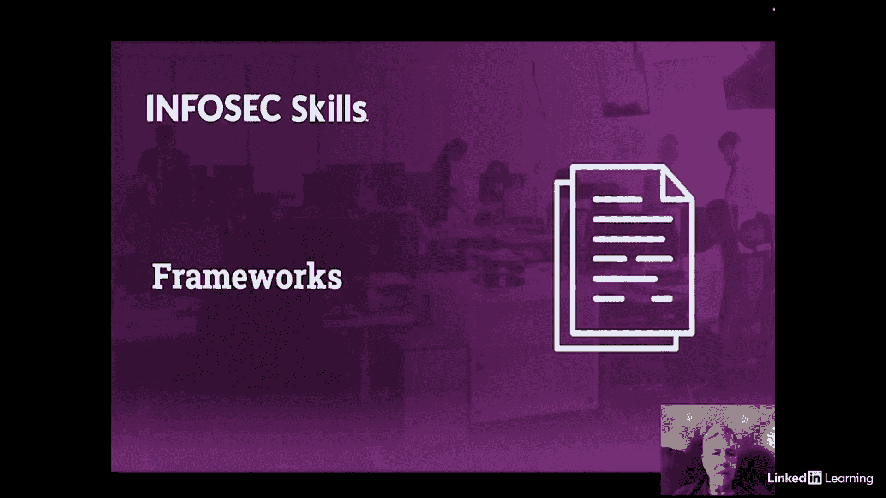
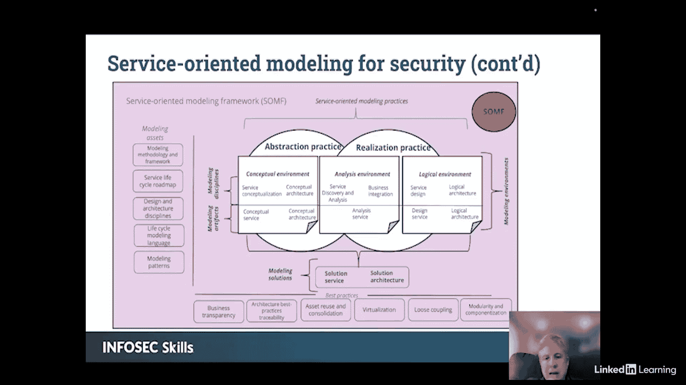

🏗️ ISSAP信息系统安全架构专业认证课程：10：识别安全架构方法

在本节课中我们将要学习安全架构方法的核心内容。首先我们会回顾什么是安全架构框架，以及它在企业环境中的作用。接着我们会重点介绍三种常见的安全架构框架，分别是TOGAF、SASA和面向服务的安全模型。每个框架都有自己的视角和适用场景，了解它们能帮助你在实际工作中选择合适的方法来构建安全体系。下面我们开始正式学习。

在进入具体框架之前，我们先来看看安全架构框架的基本概念。

安全架构框架是一套结构化的方法，用来指导组织如何设计、实施和管理安全控制。你可以把它理解为盖房子的蓝图，它告诉我们从哪里开始，每一步要做什么，以及最终要达到什么目标。在企业环境中，安全不能孤立存在，它必须与业务目标和技术基础设施紧密结合。以下是安全架构框架的主要作用：



- 统一安全设计的标准和流程
- 确保安全措施覆盖业务的所有阶段
- 提供从业务目标到技术实施的完整路径
- 帮助安全团队与业务部门保持沟通一致

这些作用共同构成了安全架构的基础，没有它们安全建设容易变得零散和无效。

上一节我们介绍了安全架构框架的基本概念，本节中我们来看看第一个具体的框架，也就是TOGAF。

TOGAF是The Open Group Architecture Framework的缩写，中文可以称之为开放组架构框架。历史上人们会完整说出这个缩写，但今天大多数人直接称它为TOGAF，不再特别强调首字母缩写的含义。这个框架提供了一种架构开发方法，核心目标是在架构的所有阶段都融入安全考虑。以下是TOGAF架构开发方法的主要阶段：

- 需求管理：这是起点，需求会流向架构的每一个元素
- 架构愿景：确定我们要实现什么样的安全目标
- 业务目标和宗旨：了解组织想要达成什么
- 基础设施评估：找出支撑业务目标的合适基础设施
- 技术架构：涉及防火墙、加密、身份认证和访问管理等安全技术
- 机会与方案：评估是否能利用新兴趋势，最大化业务潜力
- 迁移规划：把现有环境和新安全要素结合，尽量减少业务中断
- 实施治理：确保实施过程满足既定需求
- 持续监控：关注变化，及时调整安全措施

用一个简单的公式来表示安全融入的概念：

```
安全架构 = 业务目标 + 基础设施 + 技术控制 + 持续监控
```

你不需要对TOGAF有非常深入的理解，只需要知道这是如何把安全整合进标准TOGAF模型中的即可。

本节我们了解了TOGAF的架构开发流程，接下来我们来看看另一个以业务为中心的框架，即SASA。

SASA全称是Sherwood Applied Business Security Architecture framework，中文可以理解为雪伍德应用商业安全架构框架。这个名称很长，所以大家通常直接叫它SASA，而不是去拼读那个缩写。SASA是一种非常注重业务的安全方法，它从组织的目标和宗旨出发，逐层向下构建安全架构。简单来说，安全架构是由业务驱动的。

以下是SASA框架的不同视角和对应的治理问题：

- 企业风险视角：企业面临哪些风险？哪些风险最需要立即缓解？
- 概念视角：是否建立了风险策略？是否遵循风险管理框架RMF、网络安全框架或ISO 27001？
- 逻辑视角：如何利用这些框架来满足逻辑需求？例如需要哪些安全策略，如可接受使用策略、职责分离策略。
- 实践视角：日常运营中如何执行弹性、事件检测和事件响应等操作？
- 组件层面：具体的标准和技术细节是什么？标准比策略更具体，更聚焦技术。
- 风险管理层面：例如持续监控等低层级的风险管理活动。

在策略和标准之间有个简单的区分，可以用这个关系来理解：

```
策略 = 广泛的原则和要求
标准 = 具体的技术实施细节
```

SASA就像一个多维表格，左侧是不同的视角，上方是领导层需要提出的问题，比如什么、为什么、怎么做、谁、在哪里、什么时候。这个高层概述能帮助你快速掌握SASA的核心思路。

我们刚才介绍了SASA的业务驱动方法，本节中我们来看看第三种模式，即面向服务的安全架构。

面向服务的模型把安全重点放在服务本身，而不是一个单体的巨型应用程序。在这种模式下，我们把系统拆分成多个服务，这些服务之间需要建立信任边界，才能互相调用和访问特定功能。身份和访问管理在这里非常关键，必须确保不同服务之间有安全的通信和安全的API。以下是面向服务建模框架的主要阶段：

- 服务概念化：确定服务的性能和基本定义
- 分析：思考如何与业务集成
- 逻辑环境：进行逻辑设计，融入安全抽象
- 抽象：聚焦概念与实现
- 实现：逐步迈向实际部署

你不需要深入钻研每一个细节，只需要理解底层有各种目标和资产，并且这是一种评估服务如何交互、确保它们与业务环境紧密结合的方法。

用代码形式来表示服务间的信任关系：

```
服务A --[信任边界 + 安全API]--> 服务B
服务B --[身份认证 + 访问控制]--> 服务C
```

这种表示方式能帮你直观地看出，服务之间不是随意连接的，而是需要明确的安全边界。



本节课中我们一起学习了识别安全架构方法的核心内容。我们先回顾了安全架构框架的基本作用，然后重点介绍了TOGAF的架构开发阶段，了解了如何在每个阶段融入安全。接着我们学习了以业务为中心的SASA框架，掌握了它从风险到组件层面的不同视角。最后我们探讨了面向服务的安全模型，重点在于服务间的信任边界和安全API。希望这些内容能帮助你建立对安全架构方法的初步认识，为后续学习打下基础。

