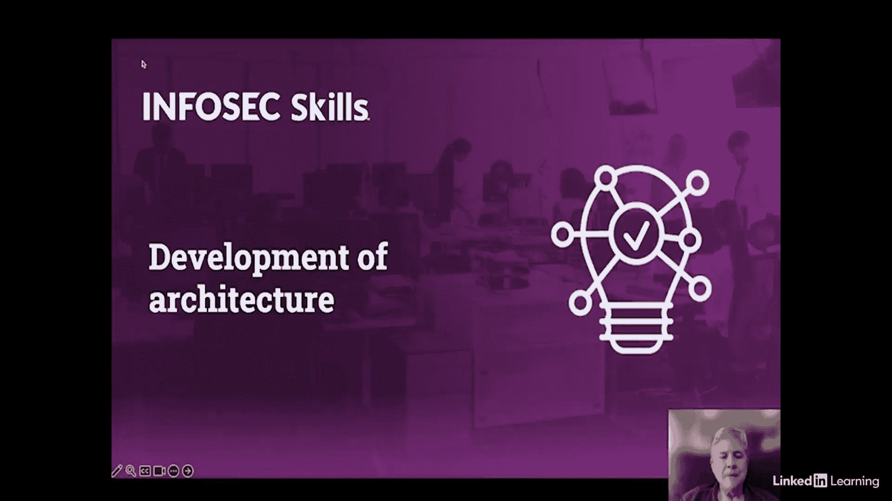
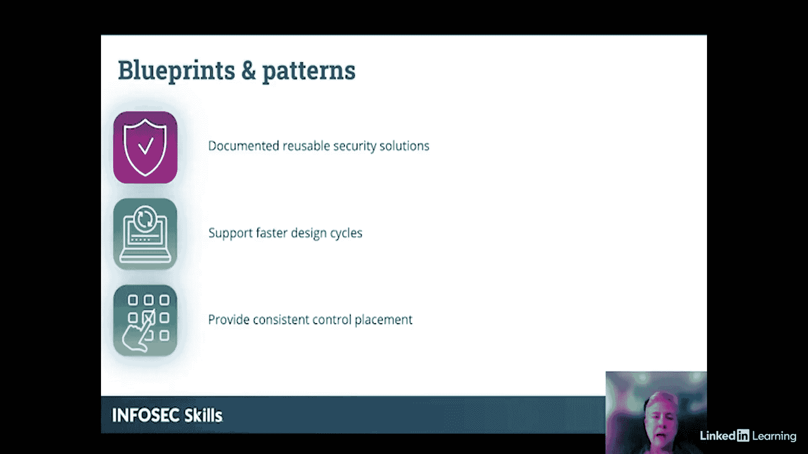

# LinkedIn ISSAP：02：架构的开发 🏗️


在本节课中我们将要学习架构的开发，重点理解架构绝非一次性完成的工作，而是一个需要反复打磨的持续过程。我们会聊聊迭代规划，看看监控与评估如何把我们带回 PDCA 循环，探讨如何把行之有效的云架构、网络架构和安全架构拿来复用，还会讲到基于概率和影响来确定风险优先级，以及为什么要把复杂度降到最低，保持系统简单、统一和标准化。最后，我们会了解蓝图和模式如何在类似场景中为我们提供实施指导。

## 架构不是一次性的工作

首先，我们来看看架构开发的核心思想。

架构不是做完就结束的事情。我们需要进行迭代规划，不断寻求持续改进。这意味着安全架构的建设是一个循环往复的过程，而不是一次性的项目。每次完成一个阶段之后，都要回头检查，看看哪些地方可以做得更好，然后再进入下一轮改进。

## PDCA 模型与监控评估

上一节我们介绍了架构需要持续改进，本节中我们来看看监控和评估是如何把我们拉回到熟悉的 PDCA 模型中的。



监控和评估会把我们带回之前提到的 PDCA 模型。

`Plan → Do → Check → Act`

先制定计划，再执行，然后检查结果，最后根据检查结果采取行动。这样就能形成一个闭环，让架构不断优化。通过持续的监控，我们能发现哪些做法有效，哪些需要调整，从而在下一轮规划中做出更好的决策。

## 复用有效的架构

有了 PDCA 的循环思路，接下来我们看看如何找出有效的架构并把它复用到其他地方。

找出哪些做法行之有效，然后把云架构、网络架构和安全架构中的成功经验拿来重复使用。不要每次都从零开始，而是把已经验证过的方案直接套用到新场景里，节省时间并降低出错的可能性。

以下是常见的可复用架构类型：

- 云架构
- 网络架构
- 安全架构

把这些经过验证的架构模板保存下来，以后遇到类似需求时可以直接调用，不需要重新发明轮子。

## 风险管理与决策验证

复用架构的时候，我们同样需要关注风险，下面我们看看风险优先级是怎么决定的。

要充分管理风险，确保风险实施的缓解策略直接源于基于风险概率和影响的优先级。

`风险优先级 = 概率 × 影响`

```
缓解策略 = 基于风险概率和影响的优先级
```

简单来说，风险发生的可能性越大、影响越严重，优先级就越高，我们也就越要优先处理。除此之外，我们需要持续验证自己的决策，并在必要时愿意做出改变。决策不是一成不变的，环境变了，方案也要随之调整。

## 可重用的安全模式

验证决策之后，我们可以把那些行之有效的做法固化成模式，下面是几个典型的例子。

对于常见场景，我们希望有可重用的模式。比如零信任架构、网络架构和隔离、微分段，这些做法经过了验证，效果不错，我们就希望在类似场景中再次使用它们，避免重复造轮子。

以下是常见场景下的可重用安全模式：

- 零信任架构
- 网络架构和隔离
- 微分段

这些模式可以直接套用到新的项目中，帮助我们快速搭建起安全可靠的基础。

## 降低复杂度与 KISS 原则

知道了要用哪些模式，接下来我们聊聊为什么要尽量降低复杂度，以及“保持简单”意味着什么。

我们要降低复杂度。你大概听过 KISS 哲学，也就是“保持简单”。这里的核心思想是机制经济性，复杂性本身不能提升安全性，反而会阻碍安全。

`复杂度 ↑ ⇒ 安全性 ↓`

所以我们希望尽量把复杂度降下来，让系统更清晰、更容易管理。越复杂的系统越难维护，出问题的概率也越高，简单才是安全的基础。

## 一致性、标准化与组织成熟度

保持简单之后，我们还需要在整个组织内保持统一，下面我们看看一致性和标准化是如何体现组织成熟度的。

我们希望整个组织都保持一致性，同时进行标准化。如果你看成熟度模型，就会发现可重复性、策略定义和随后的重复执行，都是衡量组织成熟度的重要部分。标准化能让大家做事有依据，不至于每个部门都按自己的想法来。

以下是体现组织成熟度的几个方面：

- 策略定义
- 可重复性
- 标准化

有了这些标准，组织才能在安全建设上稳步前进，而不是各自为战。

## 蓝图、模式与控制实施

有了标准化的基础，最后我们来看看蓝图和模式到底怎么用，以及控制如何在安全环境中落地。

蓝图和模式就是一套说明或视觉材料，告诉我们将要完成什么。

```
蓝图 = 安全解决方案 + 关键资源隔离 + 信任边界之间的控制配置
```

具体来说，包括我们现有的安全解决方案是什么，如何隔离关键资源，以及如何从一个信任边界到另一个信任边界配置控制。有了这些蓝图，我们就能在类似情况下直接实施，拿到明确的实施指南。最后，还需要理解控制本身，知道这些控制要如何在安全环境中实施，才能真正落地。

## 总结



本节课中我们一起学习了架构的开发，了解到架构不是一次性的过程，而是需要通过迭代规划和持续改进来不断优化。我们学习了监控与评估如何把我们带回 PDCA 模型，如何复用云、网络和安全架构，如何基于风险的概率和影响来确定优先级，以及为什么要降低复杂度、保持简单和标准化。最后，我们也了解了蓝图和模式如何为我们在类似场景中实施安全控制提供指导。

