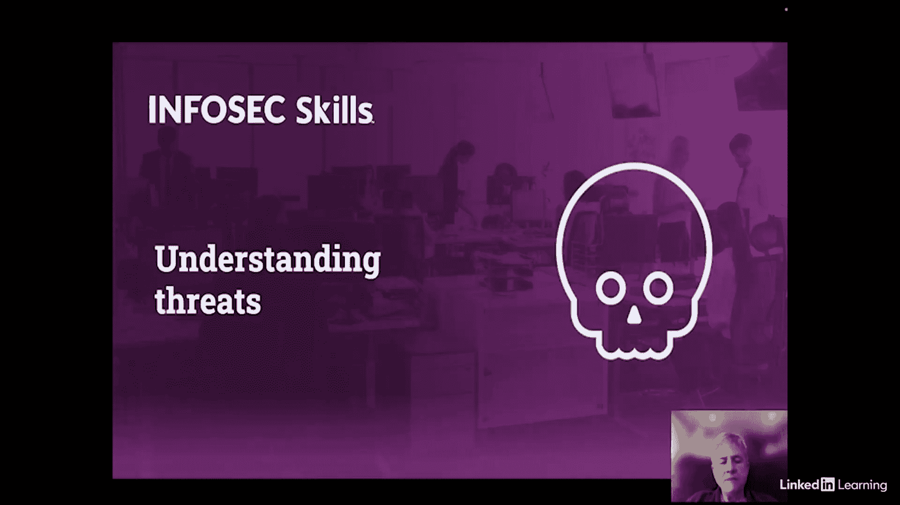
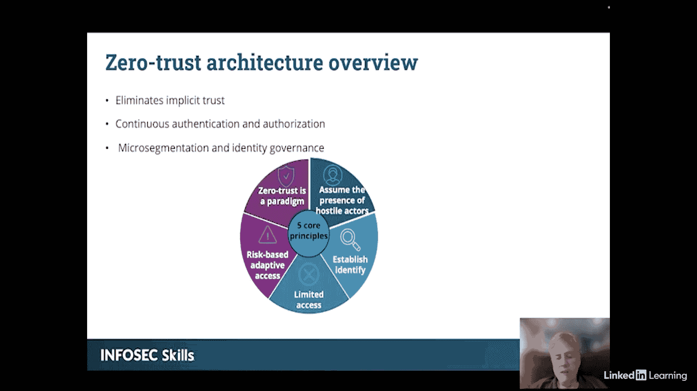

🛡️ ISC2 信息系统安全架构专业师（ISSAP）：03：理解威胁




在本节课中，我们将一起学习什么是安全威胁，如何识别威胁，以及常用的威胁建模方法和架构原则。我们会先回顾风险管理的基础，然后重点放在威胁建模、威胁情报、STRIDE 框架、漏洞评分系统、系统分解和零信任架构上。所有内容都会用大白话来讲解，即使是初学者也能看懂。


在谈论具体的威胁之前，我们需要先明白风险由什么组成。简单来说，风险不是凭空产生的，它由资产、威胁和漏洞共同构成。

```
风险 = 资产 + 威胁 + 漏洞
```

如果没有资产，就没有东西需要保护；如果没有威胁，资产就不会受到危害；如果没有漏洞，威胁可能也无法得逞。这三者缺一不可，理解这个关系是后续所有内容的基础。掌握这个公式，有助于我们在后面判断哪里需要加强防护。


威胁是指那些会危害我们环境的因素。它们会对资产造成损害，进而影响业务的正常运行。为了搞清楚存在哪些威胁，我们需要进行威胁建模。威胁建模是一种系统化的流程，首先识别我们的资产，然后分析哪些事物可能会对这些资产造成伤害。从最基本的角度来看，这就是威胁建模的全部含义。市面上存在多种威胁建模技术或方法论，下面介绍几种常见的方法。

以下是几种常见的威胁建模方法：

- STRIDE，我们将在后面深入讲解。
- PASTA，即攻击模拟和威胁分析流程，这是一种非常注重风险的方法，不仅评估技术，还评估业务环境。
- OCTAVE，它从业务需求开始，逐步向下延伸到技术层面。这正符合我们应该做的事情，即先关注业务，再拆解到具体技术。

架构设计必须能够缓解这些高影响力的威胁。当然，我们优先处理风险最高的威胁，确保资源用在刀刃上。


接下来我们来看威胁情报。问题是，我们如何知道存在哪些威胁呢？答案是尽职调查。尽职调查意味着我们要进行研究，并获取来自不同供应商和组织（例如 MITRE）的实时信息流。我们要关注供应商通知，保持系统补丁更新。其核心思想是，威胁情报将支持零日漏洞和新兴威胁场景，因为很多检测机制可能无法检测零日攻击。如果我们能走在反恶意软件或防御机制的前面，关注未来的新兴趋势，这就特别有帮助，能让我们提前做好准备。


现在我们要介绍一个框架，名为 STRIDE。STRIDE 是缩写，代表以下六种威胁类型。

```
STRIDE = {伪造, 篡改, 否认, 信息泄露, 拒绝服务, 权限提升}
```

以下是 STRIDE 中的关键威胁及其含义：

- 伪造（Spoofing）针对身份验证，核心在于冒充他人身份。
- 篡改（Tampering）是指未经授权的修改，针对完整性。
- 否认（Repudiation）针对不可否认性。
- 信息泄露（Information Disclosure）是指机密性被破坏。加密是防止信息泄露的最佳方式之一。
- 拒绝服务（Denial of Service）攻击系统的可用性，目的是让服务器或服务无法响应合法请求。
- 权限提升（Elevation of Privilege）针对授权，意味着某人可能以普通用户身份访问系统，然后为该账户添加权限或特权。权限提升非常危险。

为什么我们要关注不可否认性呢？不可否认性意味着没有抵赖能力。你不能说“我没有执行这个操作”，也不能说“我执行了一个操作，但那不是我做的”。例如，如果我发送了一条消息，我不能说“我没有发送那条消息”，也不能说“我发送了消息，但它一定是在传输过程中被修改了”。因此，我们需要不可否认性来处理抵赖问题，确保行为可以被追溯。

STRIDE 架构是一种非常常用的高层威胁建模方法，了解它对我们非常有帮助，因为它被广泛应用于实际的安全评估中。


除了威胁，我们还需要关注漏洞。常见漏洞评分系统（CVSS）可以帮助我们理解日志或分析结果，这些结果可能显示存在特定的漏洞。CVSS 是一个评分系统，将漏洞在 1 到 10 的范围内进行评分。

```
CVSS 分数 = 1 到 10
```

通过这个评分，我们可以恰当地评估风险，并据此做出决策，决定先修复哪些漏洞。


很多系统都很复杂，由多个元素组成。如果我们把系统拆解，将其分解为特定的交互或功能，就可以考虑信任边界，并关注非常细粒度的控制。

例如，访问成绩单管理的方式可能与访问上传作业的方式不同。身份验证或访问控制会有很大差异。我们将整体系统拆解，在细粒度层面思考控制措施，而不是只给整个系统统一设置一套规则。


最后，我们来谈谈零信任架构。其核心思想是“信任，但验证”。

过去，一旦你经过验证并属于企业内部，我们就会明确信任你。而现在，我们要消除这种信任，采取“不信任任何人，验证所有内容”的原则。

```
零信任 = 不信任任何人，验证所有内容
```

零信任架构的基本原则包括以下几点：

- 假设网络中存在敌对行为者。
- 我们必须保护资产，因为敌对行为者可能已经在我们的网络中。
- 限制他们的横向移动。
- 强制他们建立身份并进行身份验证。
- 限制访问，遵循最小权限原则。
- 基于风险的自适应流程，即不仅仅给予资源的完全访问权限，而是根据个人试图做什么来实施控制，例如他们是否试图从特定位置访问信息，这样我们就可以实现基于上下文的访问控制。

零信任不仅仅是系统上的一次实现，它是一种新的范式，一种新的方法，需要架构、结构化的应用程序以及完全新的流程和方法。我们不能只是“开启”零信任，这是一个需要大量思考、规划和实施的过程，不能急于求成。




在本节课中，我们一起学习了安全威胁的基本概念、威胁建模方法、威胁情报、STRIDE 框架、常见漏洞评分系统、系统分解以及零信任架构。希望这些内容能帮助你建立起对威胁识别和缓解的初步认识，为后续学习打下基础。
