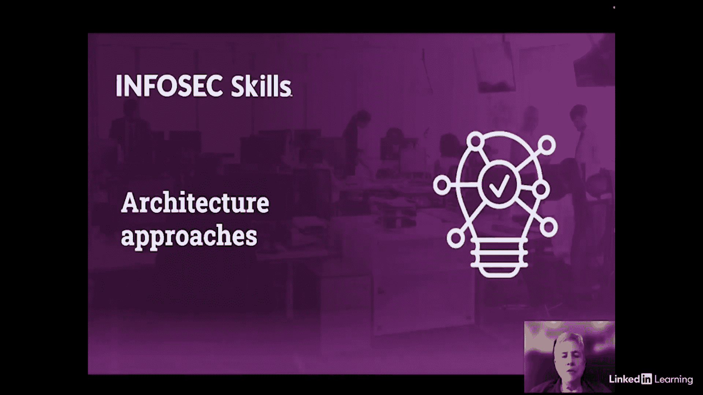
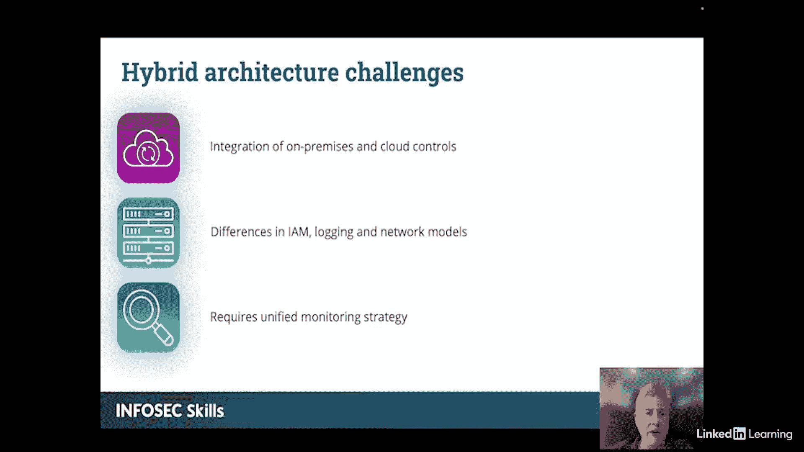

# ISSAP 信息系统安全架构专业认证：04：架构方法📐


在本节课中，我们将学习信息系统安全架构中的几种主要架构方法。这些方法决定了我们如何在不同的环境下设计安全防护体系，包括传统的本地网络、现代的云环境，以及两者结合的混合环境。理解这些方法，能帮助我们在实际工作中选择合适的安全控制措施。


首先，我们来看看网络中心安全模型。顾名思义，这种模型的核心关注点就是网络本身。我们把重点放在网络安全上，采用基于边界的防护策略，也就是关注网络的边界，并控制谁能进入这个网络。我们主要依靠技术安全手段来完成这项工作。比如部署防火墙，配置访问控制列表来限制进出网络的流量，使用 VPN 或其他远程接入模型，允许访问系统中的关键要素，还可以设置非军事区，也就是 DMZ。这些都只是常见的示例。不过这种方法有一个问题，当所有资源都部署在本地时效果不错，但环境一旦发生变化，就显得力不从心了。


以下是网络中心安全模型中常见的技术手段：



- 防火墙，用于在网络边界进行流量过滤。
- 访问控制列表，用于限制进出网络的通信。
- VPN 或其他远程接入模型，用于安全地访问系统关键要素。
- 非军事区 DMZ，用于隔离内部网络与外部网络。


不过，随着云环境的发展，尤其是云原生环境的出现，单纯依赖网络边界来做安全防护，变得更加困难了。实施起来确实不如以前那样简单直接了。


因此，我们需要引入身份中心安全模型。在这种模型中，身份被视为新的边界。也就是说，我们不再只依赖网络位置，而是依赖用户或系统的身份来决定访问权限。我拥有一个身份，凭借这个身份，我可以访问云中的各种资源。在这个思路下，我们会考虑单点登录技术，考虑跨域身份验证，还会使用各种身份和访问管理工具，例如 SAML、SPML、OpenID Connect 和 OAuth。现在很多企业拥有分布式员工队伍，员工从全球各地访问资源，还涉及很多软件即服务提供商，也就是 SaaS 提供商。在这些场景下，身份中心安全模型就显得非常有用了。


以下是身份中心安全模型中常见的协议和工具：

- SAML，用于跨域单点登录和身份交换。
- SPML，用于身份配置和管理。
- OpenID Connect，用于基于身份的身份验证。
- OAuth，用于授权第三方应用访问资源。


除了关注网络和身份，我们还可以把数据本身作为保护的核心，这就是数据中心架构。在这种架构中，我们要保护的是数据，所以重点就在于如何保护数据。实现方式有很多种。首先是加密，它能保护数据的机密性。其次是令牌化，也就是用指针指向实际数据，而这些指针是公开信息，可以存在于应用程序中或提供给供应商使用，它们指向受保护的敏感信息。我们还可以使用信息权限管理和数据防泄漏系统，来限制数据外泄。具体做法包括把权限嵌入到数据中，并与加密密钥绑定，这样数据就无法被外泄、发送邮件、复制或打印等。在数据中心架构中，最重要的是分类。分类驱动着我们对资产的保护。我们如何对数据分类，如何标明数据的重要性和价值，数据的价值和风险决定了我们将在哪里以及如何设置控制措施。


以下是数据中心架构中常用的保护手段：

- 加密，保护数据机密性，核心公式为 **密文 = 加密算法(明文，密钥)**。
- 令牌化，用公开指针替代实际敏感数据。
- 信息权限管理，将权限嵌入数据并与加密密钥绑定。
- 数据防泄漏系统，限制数据外发、邮件发送、复制和打印。


接下来，我们需要了解在云环境下，责任是如何划分的，这就是共享责任模型。就像之前提到的，很多东西正在因为云而发生变化，一切都在迁移到云端。以前我们在本地处理数据和资源时，关注的重点和原则虽然大体相同，但现在的责任边界发生了转变。屏幕上展示的这个模型叫做共享责任模型。它说明了什么在我们的管理之下，什么在云服务提供商的管理之下。当所有东西都在本地，或者即使我们拥有私有云时，我们要对所有内容负责。但是当我们转向基础设施即服务、平台即服务、软件即服务时，我们的责任越来越少，但控制权也随之减少。所以我们需要理解我们控制什么、配置什么、负责什么，并且永远记住一点：我们始终要对数据的保护负责。这有助于我们在云环境中向前推进。


共享责任模型可以用简单的代码逻辑来理解：

```
责任划分 = 客户责任 + 云服务提供商责任
本地环境：客户负责全部
IaaS：客户负责操作系统、应用和数据
PaaS：客户负责应用和数据
SaaS：客户主要负责数据和用户访问
```


最后，我们要谈谈混合环境。许多组织正在采用混合模式。我们既有本地基础设施，也有基于云的控制措施和云环境。几乎每个组织至少在某种程度上都在使用 SaaS。许多组织也在使用 IaaS 和 PaaS。因此，理解共享责任模型，理解边界，非常重要。在本地提供身份和访问管理的方式，与在云中提供的方式不同。我们也需要理解不同的网络架构，并且要知道如何监控和记录本地内部发生的事情，以及云中发生的事情。我们需要一套统一的监控策略，一套一致的监控策略。这些就是混合环境面临的一些挑战。


以下是混合环境中需要关注的主要挑战：

- 本地与云端身份和访问管理方式的差异。
- 不同网络架构的理解与整合。
- 本地监控与云端监控的统一与一致性。
- 共享责任模型下的边界划分与职责落实。




本节课中，我们一起学习了网络中心安全模型、身份中心安全模型、数据中心架构、共享责任模型以及混合环境面临的挑战。这些内容构成了我们在不同架构环境下设计安全防护的基础，希望能对你的学习和工作有所帮助。

