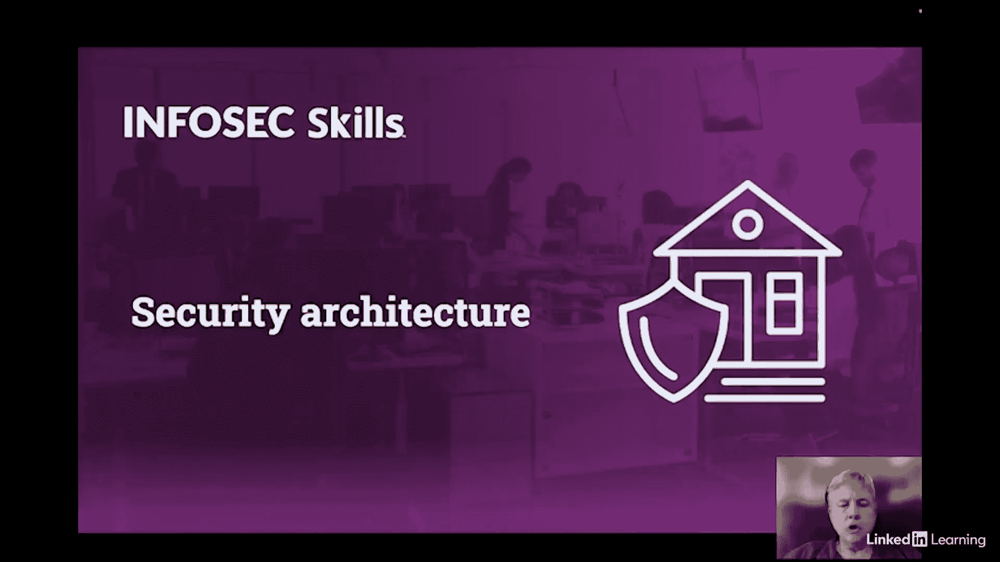
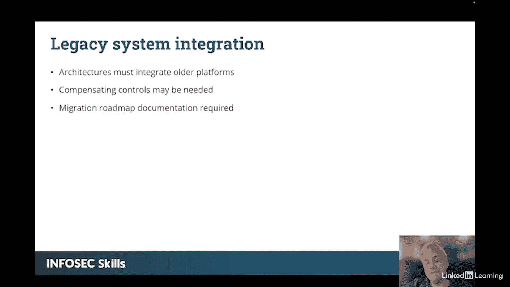

# ISC2信息系统安全架构专业认证（ISSAP）：第05章：安全架构 🏗️


在本节课中我们将要学习安全架构的基础知识。我们会聊聊什么是安全架构产出物，为什么追溯性和审计痕迹很重要，怎么梳理信任边界和数据流，如何把业务需求和安全控制对应起来，还有微服务、单体架构以及旧系统该怎么处理。内容会尽量用大白话来讲解，适合刚开始接触安全架构的朋友阅读。希望通过这节课，你能对安全架构的整体思路有一个清晰的认识，为后续深入学习打好基础。


## 安全架构产出物与追溯性 📄


上一节我们简单提到了安全架构的大致框架，本节我们先来看看安全架构里的产出物是什么，以及追溯性到底在说什么。安全架构产出物指的是在设计安全体系时产生的各种文档和图表，比如系统架构图、数据流图、控制清单等。这些产出物的作用是让团队知道系统长什么样，安全控制放在哪里，以及为什么要这么设计。我们需要强调追溯性的重要性，还要留下审计痕迹。所谓追溯性，就是当出现安全问题时，能够通过记录倒推回去，知道是谁在什么时候做了什么操作。审计痕迹就像是系统的黑匣子，记录下关键事件，方便事后调查和合规检查。

以下是安全架构产出物的主要方面：

- 系统边界图，用来展示系统的物理和逻辑范围。
- 信任边界图，标明信任级别变化的地方。
- 数据流图，描述数据在系统中怎么流动。
- 控制文档，说明实施了哪些安全控制。
- 审计日志，记录用户和系统的关键操作。



产出物的核心目标是让安全设计可追踪、可审计、可验证。


## 信任边界与数据流依赖 🌐


接着我们刚才讨论了产出物和追溯性，接下来我们要聊聊信任边界和数据流依赖，这是理解系统架构的关键。我们会画出信任边界的图表，看看信任是如何在组织内部流动的，那些边界在哪里，我们打算实施什么样的控制措施，以及我们的需求是什么。信任边界就像是不同区域之间的安检口，一边信任程度高，另一边可能就低，穿过边界时需要额外的验证和防护。

我们也要搞清楚服务、系统之间的数据流和依赖关系。比如说，我有一台Web服务器，但我需要知道让这台Web服务器正常运行需要什么。可能需要负载均衡器，显然还需要网络连接，后面可能还需要连接数据库服务器。理解这些依赖关系非常重要，因为如果其中一个环节出问题，整个服务都会受影响。同时，我们要确保文档能把安全控制和业务需求、需求以及我们做过的任何风险评估都映射清楚，这样有助于指导我们实施哪些控制措施。

数据流依赖可以用简单的流程图来表示：

```
Web服务器 → 负载均衡器 → 网络连接 → 数据库服务器
```

以下是理解数据流依赖时需要关注的点：

- Web服务器本身需要什么条件才能工作。
- 是否需要负载均衡器来分发流量。
- 网络连接是否畅通且安全。
- 后端数据库服务器的状态和访问方式。
- 各个服务之间的调用关系和数据传输路径。

把这些关系记录下来，后续排故和加固会方便很多。


## 业务需求映射与快速失败 🚀


刚才我们讲了信任边界和数据流，下面我们要进入业务需求映射和“快速失败”这个概念。我们要把业务需求和文档做好映射，越早明确需求，就能越早避免返工。这里有一个“快速失败”的思想，简单来说就是尽早发现问题，尽早把失败的事情经历完，然后根据反馈把产品做得更好，这样以后就不用大规模返工了。从成本角度看，早点失败比晚点失败便宜得多，因为返工的费用会随着项目推进而水涨船高。

我们要聚焦优先级，尽早拿到需求，做到快速失败。安全成果最终要体现为业务价值，我们要能跟高层领导说清楚：我们是如何交付价值的，怎么提高生产力，怎么减少人工工时损失。领导听得懂的语言通常是金钱、效率和风险，而不是晦涩的安全术语。

以下是业务需求映射的关键步骤：

- 提前收集业务需求，避免后期修改。
- 明确安全控制与业务目标的对应关系。
- 用快速失败的方式验证设计方案。
- 用业务价值来衡量安全投入的产出。
- 向管理层汇报时强调生产力提升和成本降低。

需求明确了，安全架构才有依据。


## 资产识别与数据中心方法 🔍


说完了需求映射，我们现在来看看怎么识别资产和业务流程，特别是怎么把数据放在中心位置来思考。我们要从识别资产和流程开始，搞清楚我们的数据是什么。我通常会采用数据中心的方法，先问自己的数据是什么，我们在保护什么，这些数据值多少钱，数据在组织内部怎么流动，哪些系统在使用这些数据，以及我们需要怎么设计架构，既能提供必要的访问，又能落实安全措施。数据中心方法的核心思想是，数据才是最宝贵的资产，围绕数据来构建安全控制，比围绕网络或服务器更有针对性。

数据中心方法的逻辑可以表示为：

```
数据资产 → 数据价值评估 → 数据流向 → 使用系统识别 → 安全架构设计
```

以下是资产识别时需要回答的问题：

- 组织中有哪些数据资产。
- 每类数据的价值和敏感程度如何。
- 数据在系统内部是如何流动的。
- 哪些系统和应用会使用这些数据。
- 应该如何架构以在开放访问和安全之间取得平衡。

搞清楚数据在哪里、怎么动，是做好安全架构的第一步。


## 模块化可扩展设计与基于风险的控制选择 🧩


接下来我们刚刚识别了资产和数据流，接下来要讨论模块化可扩展设计，以及如何根据风险来选择控制措施。模块化可扩展设计的意思就是把那些巨大的单体应用拆分成功能模块，这些模块可以复用，也能快速、轻松地扩展。以前的单体应用把所有功能都写在一起，虽然开发初期可能简单，但后期维护和扩展很痛苦。拆分成模块后，每个模块负责一件事，出了问题也容易定位，需要扩容时只扩那个模块就行。

模块化设计的结构可以表示为：

```
单体应用 → 功能模块A + 功能模块B + 功能模块C （通过API交互）
```

选择控制措施时，我们要基于风险来决定，还要考虑合规约束、可行性和成熟度。合规约束是指法律法规或行业标准强制要求的；可行性是指技术上能不能实现、成本高不高；成熟度是指我们的流程和环境是否足够成熟来支撑这个控制。

以下是模块化设计和控制选择的注意事项：

- 将单体应用拆分为可复用的功能模块。
- 模块之间通过明确的接口进行通信。
- 支持快速水平扩展，应对流量高峰。
- 根据风险等级决定控制措施的强度。
- 综合考虑合规要求、实施可行性和组织成熟度。

模块化和风险驱动是现代安全架构的两大支柱。


## 运营可行性与成熟度考量 ⚙️


刚才我们聊了模块化设计和控制选择，下面要深入聊聊运营可行性和成熟度这两个点。运营可行性问的是这个方案到底能不能在日常运维中落地，而成熟度考量则是看我们的流程是否足够成熟。我们之前聊过什么叫成熟的环境，什么叫成熟的流程。成熟的流程通常有明确的定义，可以重复执行，并且专注于持续改进。每当提到成熟度或成熟度模型，核心思想就是关注流程本身，产品的质量自然会随之提升。只要流程足够成熟，产出的产品质量就会有保障。

以下是评估运营可行性和成熟度时要看的维度：

- 该控制措施在实际运维中是否可行。
- 团队是否有能力长期维护这个控制。
- 流程是否有明确的定义和文档。
- 操作是否可重复，结果是否稳定。
- 是否建立了持续改进机制。

流程成熟了，安全效果才能稳定下来。


## 安全与性能、易用性的权衡 ⚖️


接下来我们刚才讲了成熟度，下面要聊一个永恒的话题，也就是安全与其他因素之间的权衡。安全总是要付出代价的，可能影响性能、易用性、使用便捷度，还有向后兼容性。我们要做的是评估并提供合适的安全级别，同时接受我们愿意做出的权衡。很多情况下，便捷性可能会胜过安全性，人们经常为了好用而牺牲一点安全。如果这对业务环境来说是正确的，那这就是一个好的决策。但我们作为安全人员，职责是提供建议，并把领导选择的方案融入到设计中。

安全权衡可以用一个简单的公式来理解：

```
安全投入 = f(性能损失, 易用性下降, 兼容性成本, 风险降低)
```

这个公式的意思是说，我们投入的安全成本，要和它带来的性能损失、易用性下降、兼容性问题，以及最终降低的风险来一起权衡。

以下是常见的安全权衡场景：

- 强密码策略提升安全性，但用户可能觉得麻烦。
- 多因素认证增加账户安全，但登录步骤变多。
- 网络隔离提高安全边界，但可能影响系统间通信效率。
- 旧系统兼容模式保留业务连续性，但可能引入新的漏洞。

没有绝对的安全，只有适合业务的安全平衡点。


## 微服务与单体架构 ☁️


说完了安全权衡，我们现在来对比一下微服务和单体架构，这是目前架构设计中非常热门的话题。现在的大趋势是从单体应用转向微服务。单体应用是指把所有功能都写在一个庞大的程序里，而微服务则是把应用拆成多个模块或服务，它们通过API互相交互。从性能和成本角度来看，单体应用通常性能更好，因为所有组件在同一个进程里，通信开销小。但微服务，尤其是在云上部署函数的时候，情况就不一样了。

函数即服务（FaaS）可以看作是微服务的进一步拆解，这些函数在被调用之前并不运行，所以你不需要为它们一直付费，而传统的SaaS应用则是全天运行的，你要一直付钱。这就是为什么有时候我们把FaaS称为无服务器架构，在很多场景下它是更经济的选择。

单体架构和微服务的区别可以表示为：

```
单体架构：[全部功能] 部署为一个整体
微服务架构：[服务A] --API--> [服务B] --API--> [服务C]
无服务器架构：函数仅在被调用时运行，按需付费
```

以下是单体架构和微服务的主要区别：

- 单体架构：所有功能在一个代码库中，部署一个整体，性能通常较好，但扩展和维护困难。
- 微服务：功能拆分为独立服务，通过API通信，便于独立扩展和迭代，但运维复杂度更高。
- 函数即服务：按需运行，仅在被调用时计算，适合事件驱动场景，成本更低。
- 无服务器架构：不需要管理底层服务器，云服务商负责运维，用户只关注代码逻辑。

选哪种架构，要根据业务规模、团队能力和成本预算来决定。


## 旧系统与补偿控制 🛡️


最后我们聊聊旧系统以及怎么给它们加上补偿控制，这也是实际工作中绕不开的问题。并不是所有旧系统都支持面向服务的方法，也不是所有旧系统都能支持微服务的思想。它们可能本身没有内置的安全控制，也可能不具备向前兼容性。这时候我们往往需要实施补偿控制，比如说把旧系统放在防火墙后面，从网络层面把它隔离开，减少被攻击的面。我们需要评估这些旧系统，看看是该升级，还是因为某些原因暂时无法升级，只能先用补偿控制来撑住。

旧系统补偿控制的逻辑可以表示为：

```
旧系统 → 防火墙 → 网络隔离 → 补偿控制
```

以下是处理旧系统时常用的补偿控制手段：

- 在网络边界部署防火墙，限制对旧系统的访问。
- 使用网络隔离，将旧系统放在独立VLAN或分区中。
- 加强身份验证和访问控制，弥补系统本身的安全不足。
- 定期进行漏洞扫描和渗透测试，尽早发现风险。
- 评估升级可行性，如果无法升级，就延长补偿控制的周期。

旧系统不能忽视，补偿控制是降低风险的务实手段。




本节课中我们一起学习了安全架构的产出物与追溯性，信任边界和数据流依赖，业务需求映射与快速失败，资产识别和数据中心方法，模块化可扩展设计与基于风险的控制选择，运营可行性与成熟度考量，安全与性能易用性的权衡，微服务与单体架构，以及旧系统和补偿控制。希望这些内容能帮你建立起对安全架构的初步认识，在实际工作中能更好地设计和评估安全方案。

