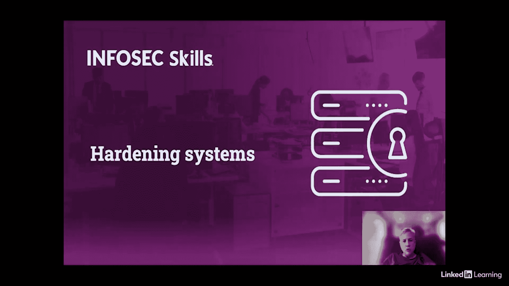
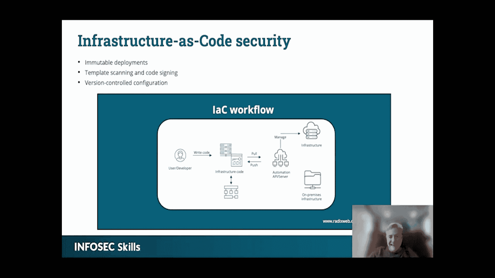

# 信息系统安全架构专业师 (ISSAP)：06：加固系统 🛡️




在本节课中，我们将一起学习如何对系统进行加固，也就是如何不断缩小系统的攻击面，让攻击者更难找到可利用的入口。我们会从操作系统的基础安全做起，再延伸到虚拟化环境、容器与 Kubernetes、API 接口、微服务架构，最后聊聊高可用性、DevOps 流水线以及基础设施即代码。整节课的核心思想就是：在环境的每一层都做好防护，构建分层防御，把“安全由设计开始”落实到实际架构中。加固系统不是一次性的动作，而是一个贯穿始终的过程，架构师需要在设计阶段就考虑安全，而不是在系统上线后再去补救。


## 什么是系统加固与攻击面


首先，我们需要弄清楚“加固系统”到底在说什么，以及它为什么对安全架构师如此重要。当我们说加固系统的时候，指的就是通过各种手段来减少攻击者可以利用的薄弱环节。简单来说，攻击面就是系统中所有可能被攻击的地方，包括开放的端口、运行的服务、未修补的漏洞，甚至是默认的管理员账号。我们的目标是把这些可以被限制、移除或修补的东西都处理掉，从而降低整体风险。攻击面越小，攻击者能找到的切入点就越少，系统也就越安全。


```
攻击面 = 不必要的服务 + 未打补丁的漏洞 + 默认或弱口令账户 + 可被利用的接口
```


以下是系统加固时需要关注的几个基本方向：
- 移除不需要的服务和程序，减少运行在后台的进程。
- 安装最新的安全补丁、热修复和更新，修复已知漏洞。
- 重命名管理员账号，避免使用默认的系统账户名称。
- 对操作系统进行基础安全配置，建立可信赖的基准环境。


## 虚拟化环境加固


上一节我们介绍了操作系统层面的标准加固步骤，如果系统运行在虚拟机或容器里，还需要额外注意一些特殊的安全点。在虚拟化环境中，虚拟机运行在虚拟机监视器（Hypervisor）之上。除了要加固虚拟机本身，我们还必须保护好这个 Hypervisor，因为如果 Hypervisor 出了问题，上面所有的虚拟机都可能受影响。关键是要确保 Hypervisor 已经打补丁并保持更新，并且不同虚拟机之间有真正的隔离，这样即使一台虚拟机被攻破，攻击也不会蔓延到其他虚拟机。我们要构建一个可信赖的基础，在其之上搭建后续的安全控制，这才是虚拟化安全的起点。


```
虚拟化安全 = 修补并更新 Hypervisor + 确保虚拟机之间真正隔离 + 建立可信基础
```


以下是需要重点检查的虚拟化安全项：
- Hypervisor 是否处于最新补丁版本。
- 虚拟机之间是否存在真正的逻辑隔离。
- 是否建立了可被后续服务依赖的可信基准。


## 容器与 Kubernetes 安全


虚拟化环境讲完之后，现在很多组织正在向容器即服务的方向发展，接下来我们看看容器和 Kubernetes 该如何加固。容器可以理解为一个应用程序的打包，里面包含了程序运行所需的一切，比如库文件、二进制文件和配置，这样它就能在不同平台上运行。而 Kubernetes（简称 K8s）是容器编排工具，它能让我们集体或单独地管理大量容器，实现自动化部署与扩容。在容器世界里，最重要的是隔离，确保一个容器里的安全问题不会波及到其他容器，避免单个工作负载被攻破后影响整个集群。


```
容器隔离 = 命名空间隔离 + 准入控制器访问控制 + Pod 级别安全边界
```


以下是容器与 Kubernetes 的关键安全措施：
- 使用命名空间划分逻辑安全边界，你可以把它看作独立的虚拟局域网或不同的部门。
- 配置准入控制器执行认证、授权与审计，只有合法请求才能进入。
- 在 Pod 层面实施安全策略，限制同一 Pod 内多个容器之间的信任关系。


## API 安全


容器和编排平台的安全讲清楚了，接下来我们转向应用程序编程接口（API），因为现代系统大量依赖 API 进行通信。API 是应用程序之间交互的桥梁，保护 API 就保护了系统的入口。在身份管理方面，OAuth 用于授权，决定应用程序能做什么、能访问什么资源；Open ID Connect 则用于跨域和跨安全边界的身份认证，提供用户身份的证明。为了让通信双方都能互相验证身份，我们通常使用 mTLS，即双向 TLS，这样不是只有一方在认证对方，而是两方都要证明自己是可信的。单向认证的信任程度不够，双向认证才能提供更强的安全保障，防止冒充身份的攻击。


```
API 安全 = OAuth 授权 + OpenID Connect 认证 + mTLS 双向认证 + API 网关集中策略执行
```


以下是 API 安全需要落实的具体环节：
- 使用 OAuth 管理应用程序的权限与资源访问。
- 使用 OpenID Connect 在跨域场景下验证用户身份。
- 部署 mTLS 实现通信双方的相互认证。
- 在 API 网关处集中执行认证、令牌验证、限流与监控，把网关当作安全检查站。


## 面向服务架构与事件驱动安全


API 安全主要解决接口层面的防护，而当系统内部服务之间需要互相访问时，我们还要考虑服务架构本身的设计。面向服务架构（SOA）让不同的服务能够相互调用，架构师需要确保服务之间的访问是安全的。除此之外，事件驱动架构是另一种常见的设计模式。在这种模式下，系统不是直接点对点通信，而是通过一个事件代理（Event Broker）来传递消息。比如客户下单后会产生一个“订单已创建”事件，支付系统、仓库系统和邮件服务都可以通过代理收到这个事件并做出反应，而不需要彼此直接调用，这样降低了系统间的直接耦合。


```
事件驱动安全 = 事件代理统一认证 + 发布/订阅权限控制 + 流量加密与请求频率限制
```


以下是事件驱动架构中的安全控制点：
- 通过事件代理验证服务身份，确保只有合法服务能参与通信。
- 控制哪些服务可以发布或订阅特定事件，比如只有支付系统可以发布“支付已批准”事件。
- 对事件流量进行加密保护，防止数据在传输中被窃听。
- 限制单个服务的请求频率，防止某个服务发送过多请求占用系统资源。


## 微服务安全


事件驱动架构讲完后，我们自然会想到微服务，因为很多现代应用都是把大型单体应用拆分成很多个微服务来实现的。微服务架构的核心思想是将单体应用拆分成多个独立服务，每个服务职责单一、耦合紧密。这样做的好处是，如果其中一个服务被攻破，影响范围可以被限制在该服务内部，不会波及整个环境。为了保障微服务安全，我们需要为每个服务建立强身份，使用互传 TLS（mTLS）保护传输通道，并且对请求的架构、令牌和 API 进行验证。完美前向保密（Perfect Forward Secrecy）也很重要，它能确保即使攻击者拿到了某个会话 ID，也无法解密过去的通信内容。此外，服务之间还需要良好的隔离和分段，避免攻击在横向扩散到其他服务。


```
微服务安全 = 强身份认证 + mTLS 传输保护 + 架构/令牌/API 验证 + 完美前向保密 + 服务隔离与分段
```


以下是微服务加固时需要注意的要点：
- 把单体应用拆分为独立微服务，降低单点被攻破后的影响范围。
- 为每个服务分配强身份凭证，避免匿名访问。
- 使用 mTLS 保护服务间通信，实现双向身份认证。
- 验证请求架构、访问令牌和 API 调用，确保只处理合法请求。
- 启用完美前向保密，保护历史会话数据不被追溯解密。
- 在服务间实施隔离与网络分段，防止攻击横向移动。


## 高可用性、容错与冗余


微服务安全落地之后，系统不仅要安全，还得保证在出问题的时候能够继续运行，这时候就要谈高可用性和容错性了。如果系统不可用，对业务来说可能是最大的损失，所以我们需要考虑韧性和冗余。韧性的目标是减少单点故障，理想情况下系统里不应该存在任何单点故障，因为任何一个组件挂掉都不应该导致整个系统崩溃。容错性可以通过多种方式实现，比如硬盘使用 RAID，系统使用集群，网络和电源也要有冗余备份，从而保证服务的可用性。可用性不仅是“能访问”，更是“及时访问”，因此我们还要考虑服务质量（QoS）、负载均衡和故障转移，让紧密耦合的集群表现出良好的性能。所有这些设计都要根据风险来决定，优先保护对组织价值最大的关键系统。


```
高可用性 = 消除单点故障 + 冗余（RAID/集群/链路/电源） + 负载均衡 + 故障转移 + QoS
```


以下是保障系统可用性的常见手段：
- 使用 RAID 保护硬盘数据，避免单盘故障导致数据丢失。
- 部署系统集群避免单点故障，提升整体可靠性。
- 配置冗余网络链路和电源，防止单点断网或断电。
- 实施负载均衡与自动故障转移，确保请求能及时被处理。
- 通过 QoS 保证关键资源的及时访问，避免网络拥塞影响业务。


## DevOps、SecDevOps 与基础设施即代码


高可用性保证了系统不停机，而现代软件交付通常离不开 DevOps 流水线，最后我们来看看如何在开发运维过程中嵌入安全。DevOps 或安全 DevOps（SecDevOps）要求架构支持 CI/CD 流水线，因为很多组织每天都要多次发布软件更新。在这种快速迭代的模式下，我们需要保证代码的完整性，防止源代码被篡改。密码、密钥、证书等敏感信息绝不能硬编码在代码里，而要通过安全的方式管理。构建产物，比如容器镜像和其中的二进制文件、库文件，都要经过验证，确保其可信。最终目标是在流水线中自动化安全控制，既能快速部署软件，又能做到安全部署，不为了速度而牺牲安全。


最后要讲的是基础设施即代码（IaC）。在虚拟化环境中，我们早已习惯使用脚本来定义环境，现在可以把整个网络基础设施都写成代码，以便快速部署、支持灾难恢复，并创建不可变工作负载。不可变基础设施意味着一旦部署就不能随意更改，这样就不会在安全基线中引入新的漏洞。任何对配置的添加或修改，都要通过 CI/CD 流水线和安全自动化来完成，而不是手动在生产环境中改配置，这样才能保证环境的一致性和可审计性。


```
基础设施即代码（IaC）= 基础设施配置即版本化代码 + CI/CD 流水线交付 + 不可变基础设施
```


以下是 DevOps 与 IaC 需要落实的安全实践：
- 在 CI/CD 流水线中自动化安全控制，实现安全即代码。
- 保护源代码完整性，避免密码、密钥等敏感信息硬编码。
- 验证容器镜像、二进制文件和库文件的可信度，防止恶意构建产物进入生产。
- 使用 IaC 定义网络基础设施，实现快速部署与灾难恢复。
- 构建不可变基础设施，所有配置变更均通过安全流水线执行，禁止手动修改生产环境。


## 总结




本节课中我们一起学习了系统加固的完整过程，从缩小攻击面、操作系统基础加固，到虚拟化与容器环境的安全，再到 API、微服务与事件驱动架构的防护，最后还讨论了高可用性、DevOps 流水线以及基础设施即代码。作为安全架构师，我们的主要任务始终是分层防御，把“安全由设计开始”的思想贯穿到整个环境的每一个层级，确保系统在每一步都处于加固状态，从而降低整体风险，保护组织的关键资产。

