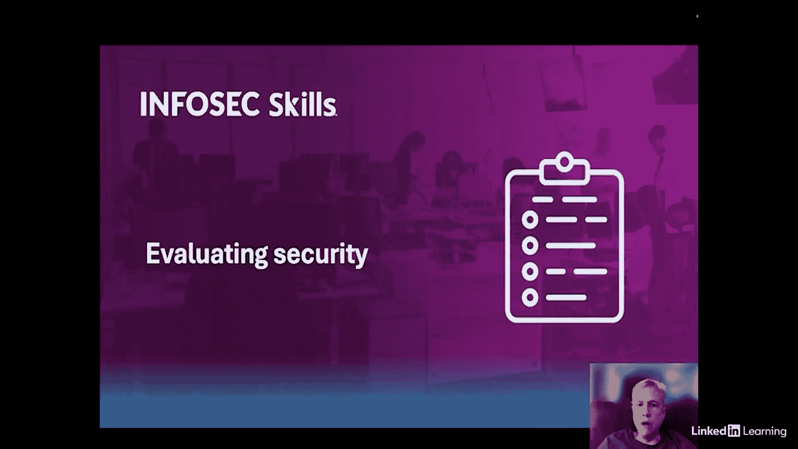
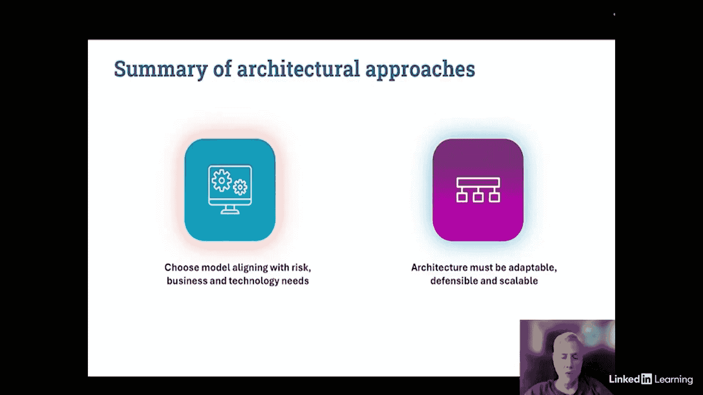

# ISSAP 信息系统安全架构专业认证：07：评估安全 🔒

## 📋 本节概述

在本节课中，我们将学习如何评估安全实施是否足够，以及如何判断现有的安全措施是否能够真正保护系统。简单来说，评估安全的核心目标就是确认我们已经部署的安全控制是否达标。要验证这一点，最常用且直接的方式当然是进行测试。在接下来的内容里，我们会从多个角度来看待安全测试，包括对代码的静态检查、对运行环境的动态验证，以及红蓝团队协作的攻防演练。此外，我们还会介绍架构决策记录、治理对齐、成熟度模型、关键绩效指标以及架构方法等重要概念，帮助初学者建立完整的安全评估体系认知。

## 🧪 测试类型：静态、动态与交互式

在了解了评估安全的总体目标之后，我们先来看看具体的测试方式。安全测试通常分为三种主要类型，分别是静态测试、动态测试和交互式测试。

静态测试是指我们不运行程序，直接查看代码或配置文件。例如，当我们的环境使用基础设施即代码（Infrastructure as Code）来管理，或者我们在审查某个特定应用程序的源代码时，就会进行静态测试。这类测试常用于漏洞评估或渗透测试的准备阶段，重点在于在代码提交之前发现潜在问题。

**公式**：静态测试 = 检查代码 + 配置审查 + 不运行程序

动态测试则不同，它关注的是程序在运行时的表现。当应用程序已经启动并处于运行状态时，我们观察环境的行为，检查是否存在运行期漏洞或配置错误。这种方式可以发现那些只在程序执行时才会出现的安全问题，比如运行时的权限提升或数据泄露。

**公式**：动态测试 = 运行程序 + 观察运行时行为 + 检查运行期漏洞

交互式测试结合了前两种方式。测试人员既会进行代码审查，查看源代码的逻辑，也会观察应用程序在实际运行中的表现，确保它按预期工作。这种全面的方法能够更完整地评估安全状况，因为它同时覆盖了代码层面和运行层面的风险。

**公式**：交互式测试 = 代码审查 + 运行时观察 + 双重验证

以下是三种测试类型的对比总结：

- 静态测试：查看代码，不运行程序，适合发现源代码层面的漏洞。
- 动态测试：观察运行环境，程序在运行时进行测试，适合发现运行期问题。
- 交互式测试：同时查看代码和运行状态，兼顾代码审查与运行时验证。

## 🛡️ 渗透测试与红蓝紫团队

除了常规的测试类型之外，在安全架构评估中，我们还经常提到渗透测试以及红蓝团队的协作模式。这些概念帮助我们从进攻和防御两个角度来验证安全强度。

渗透测试是指模拟攻击者的行为，尝试入侵系统以发现弱点。在讨论渗透测试时，我们通常会提到红队和蓝队。红队代表进攻方，负责模拟攻击，尝试制造安全漏洞；蓝队代表防御方，负责阻止攻击，保护系统安全。核心问题是：我们是否能够制造入侵？或者，我们的防御团队能否成功阻止这次入侵？

**代码**：
红队 = 进攻方 = 尝试制造入侵
蓝队 = 防御方 = 尝试阻止入侵

有时候，组织会让红队和蓝队共同工作，这种协作模式被称为紫队。紫队的目标是让进攻和防御双方交流经验，共同改进安全防御体系，使防御措施更加贴近真实攻击场景。

以下是团队角色的简要说明：

- 红队：进攻方，模拟攻击，寻找安全漏洞。
- 蓝队：防御方，阻止攻击，维护系统安全。
- 紫队：红队与蓝队的协作，共同提升防御能力。

## 📝 架构决策记录与可追溯性

测试和团队协作之外，安全架构中还有一个非常重要的产出物，即架构决策记录。这些记录有助于审计人员理解我们的设计选择，也能为未来的系统修改提供参考。

架构决策记录（Architectural Decision Records，简称 ADR）是文档化的决策依据。它记录了我们在特定时间点做出某个安全决策的原因。例如，为什么在这个应用程序中没有加入多因素认证？或者，为什么会出现某个特定的异常错误？记录这些决策过程，不仅能够提升审计的可追溯性，让审计人员更清楚我们在做什么，也能帮助未来的设计和修改工作。当我们需要回顾过去时，可以直接查阅这些记录，明白当初为什么做出这样的选择。

**代码**：
ADR = 决策原因 + 决策背景 + 决策结果 + 未来影响

与架构决策记录密切相关的概念是可追溯性（Traceability）。可追溯性要求我们能够将需求追踪到最终实现，同时也能够将安全控制措施逆向追溯到对应的需求。也就是说，每一项控制措施都应该有明确的需求支撑，每一项需求都应该能找到对应的实现，从而在整个架构中形成完整的闭环。

以下是架构决策记录的主要作用：

- 记录安全决策的理由和依据。
- 支持审计，提供清晰的审计痕迹。
- 方便未来的系统设计与修改。
- 实现需求与控制措施之间的双向可追溯。

## 🏛️ 治理对齐与规范框架

在评估安全的过程中，我们还需要关注治理对齐问题。这意味着我们的安全架构必须与组织的业务目标和治理要求保持一致。

治理对齐（Governance Alignment）是指安全架构与业务目标以及管理机构的要求保持一致。治理实体会为组织提供目标、指令和战略，并给出我们运行所需的结构或框架。在安全架构中，我们通常会提到组织规范框架和应用规范框架。组织规范框架为整个组织的应用开发流程提供标准，例如软件开发生命周期（SDLC）的各个阶段和使用的术语。而应用规范框架则是针对具体开发的应用程序制定的流程。组织可能有一个整体规范框架，同时也会有多个针对不同应用的规范框架。

**公式**：治理对齐 = 业务目标 + 治理要求 + 组织规范框架 + 应用规范框架

除了内部框架，当我们整体审视环境时，还需要考虑是否符合国际标准，例如 ISO 27001 和 ISO 27002。我们需要确认安全控制措施是否已按这些标准正确实施，是否达到合规要求。组织通常喜欢框架和标准化，因为我们希望整个组织的所有流程都保持一致性和可重复性，避免不同部门采取截然不同的安全做法。

以下是治理对齐涉及的关键要素：

- 业务目标与组织指令。
- 安全战略与运行框架。
- 组织规范框架（ONF）。
- 应用规范框架。
- ISO 27001 / ISO 27002 合规性。
- 流程的一致性与可重复性。

## 📈 成熟度模型

要了解组织在安全流程方面处于什么水平，我们可以使用成熟度模型来进行评估。成熟度模型能够反映流程的可靠性，进而间接反映产品的质量。

常见的成熟度模型包括能力成熟度模型集成（CMMI）和 OWASP 成熟度模型等。当我们谈论成熟度评估时，实际上是在评估流程的可靠程度。简单来说，展示给我你们组织的流程，我就能推断出你们会生产出什么样的产品。如果产品本身就是安全，那么查看项目管理方式和流程情况，也能得到类似的结论。

**公式**：流程成熟度 = 流程可靠性 → 产品质量

大多数成熟度模型使用一到五的等级，零级表示流程基本不存在。在这个级别，没有标准，没有冗余，可能曾经测试过但失败了，或者几乎没有任何流程。一级是初始阶段，也叫临时阶段，有时被称为混乱状态。这意味着组织非常被动，没有任何流程一致性的证据。我们可能会管理项目，但不会适当跟踪项目，不会遵守时间表，也没有可重复的一致流程。二级是开发中阶段，表示我们正在取得进展。此时开始分配工作，进行少量的工作跟踪，并开始按项目、范围、进度和成本来思考问题。

三级是已定义阶段，也是大多数组织希望达到的目标。在这个阶段，高层领导已经给予支持，这非常关键。光口头说说是不够的，高层领导需要以身作则，提供支持和监督。组织拥有明确的企业架构，具有一致性和可重复性。

四级是已管理阶段，有时也被称为定量管理阶段。此时，安全已融入企业架构流程，成为组织文化的一部分。流程会定期审查，我们能够直接理解流程变化如何影响产品变化，并且这种理解来自定量的数据。

五级是优化阶段，专注于持续改进。我们总是可以做得更好。持续改进的关键工具是利用四级中获得的定量测量数据，帮助我们精确了解当前所处位置，然后评估这些信息并做出改变，不断追求持续改进。

**公式**：
Level 0: 不存在，无标准
Level 1: 初始/临时/混乱
Level 2: 开发中
Level 3: 已定义（高层支持 + 一致性 + 可重复性）
Level 4: 已管理/定量管理
Level 5: 优化/持续改进

不同的成熟度模型可能会对等级名称略有不同。例如，在能力成熟度模型集成中，你可能会看到二级被称为已管理，而四级被称为定量管理。但无论名称如何，其核心概念是一致的。理解成熟度模型的要点在于：向我展示你们流程的成熟度，我就能据此判断你们产品的质量。

以下是各成熟度等级的简要说明：

- 0级：流程不存在，没有标准，几乎无流程。
- 1级：初始/临时，缺乏一致性，反应式管理。
- 2级：开发中，开始分配工作和跟踪，考虑项目范围与成本。
- 3级：已定义，有高层领导支持，流程一致且可重复。
- 4级：已管理/定量管理，流程融入文化，基于数据审查。
- 5级：优化，持续改进，基于定量数据不断提升。

## 📊 关键绩效指标（KPI）

在评估安全时，监控非常重要。为了衡量我们的进展，我们通常会使用关键绩效指标，也就是 KPI。

KPI 代表关键绩效指标。KPI 通常是面向过去的，也就是说，我们通过它来追踪到目前为止的进展，了解目前所处的位置。以下是一些 KPI 的例子，这些只是供参考，并不是一成不变的标准，各组织可以根据自身情况进行调整。

以下是常见的 KPI 示例：

- 控制采用率：例如，我们是否在所有系统中实施了多因素认证？已经有多少比例的系统集成了多因素认证？
- 漂移减少：系统是否随时间偏离了基本配置基线？管理员或用户是否在未经授权的情况下更改了安全基线，导致配置漂移？
- 事件趋势：某些类型的安全事件是否在增加？
- 架构复用率：在未来的项目或工作中，我们能复用多少比例的架构？

## ⚠️ 失败原因与设计考量

在评估安全时，我们也需要思考哪些地方容易出错，以及在设计架构时应该注意哪些事项。

组织在安全方面容易失败的一个常见原因是过度复杂化。总有一种倾向，想要添加数百万个安全控制措施。但实际上，我们应该关注机制经济原则，即用提供所需安全程度所需的最少控制措施，并确保这些控制措施以安全的方式相互作用。要保持事物尽可能简单，因为复杂性不会增加安全性，反而会增加漏洞。

**公式**：机制经济 = 必要安全程度 / 最少控制措施

另一个重要考量是信任边界。我们需要理解在容器、应用程序和虚拟机中，信任在哪里发生变化。我们设置的这些边界是否被明确执行？此外，我们还需要检查文档是否完善，架构是否与业务优先级保持一致。这些都是在评估安全时需要考虑的因素。

以下是设计时需要考虑的关键点：

- 避免过度复杂，保持控制措施精简。
- 明确界定并执行信任边界。
- 保持良好的文档记录。
- 确保与业务优先级对齐。

## 🏗️ 架构方法与防御性

最后，我们来讨论整体的架构方法。在构建安全架构时，我们需要选择一个合适的模型，并确保其具有可防御性和可扩展性。

在思考架构方法时，我们需要确保选择的模型与风险、业务需求和技术需求保持一致。例如，我们可能会选择网络安全框架，或者使用风险管理框架（RMF），无论采用哪种设计流程，都需要有一个作为基础的模型来推进工作。我们始终希望架构具有适应性和灵活性，但同时也希望它是可防御的。在谈到可防御性时，我们需要审计追踪，需要提供工件和证据。此外，我们还希望架构具有可扩展性，能够随着环境的增长而增长。

**公式**：架构方法 = 风险对齐 + 业务需求 + 技术需求 + 选定模型

**代码**：
可防御性 = 审计追踪 + 工件 + 证据
可扩展性 = 随环境增长而扩展的能力

以下是架构方法的核心要求：

- 与风险、业务和技术需求保持一致。
- 采用合适的框架或模型，如网络安全框架或 RMF。
- 架构应具备适应性与灵活性。
- 架构必须具备可防御性，并提供审计追踪、工件和证据。
- 架构必须具备可扩展性，支持环境增长。

## 📚 本节总结

本节课中，我们一起学习了评估安全的主要内容。首先，我们介绍了静态测试、动态测试和交互式测试三种方式，分别用于查看代码、运行环境以及两者的结合。接着，我们了解了渗透测试以及红队、蓝队和紫队的角色划分。然后，我们学习了架构决策记录和可追溯性的重要性，它们有助于审计和未来的系统修改。此外，我们还探讨了治理对齐、组织规范框架与应用规范框架，以及 ISO 27001 等合规标准。我们详细介绍了从 0 级到 5 级的成熟度模型，并说明了如何通过流程成熟度判断产品质量。接着，我们学习了关键绩效指标 KPI 的常见示例，包括控制采用率、漂移减少、事件趋势和架构复用率。最后，我们讨论了避免过度复杂、信任边界、文档记录、业务优先级对齐，以及具备可防御性和可扩展性的架构方法。
