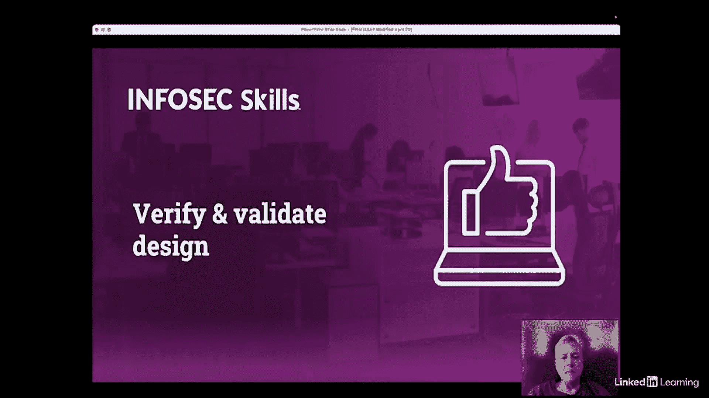
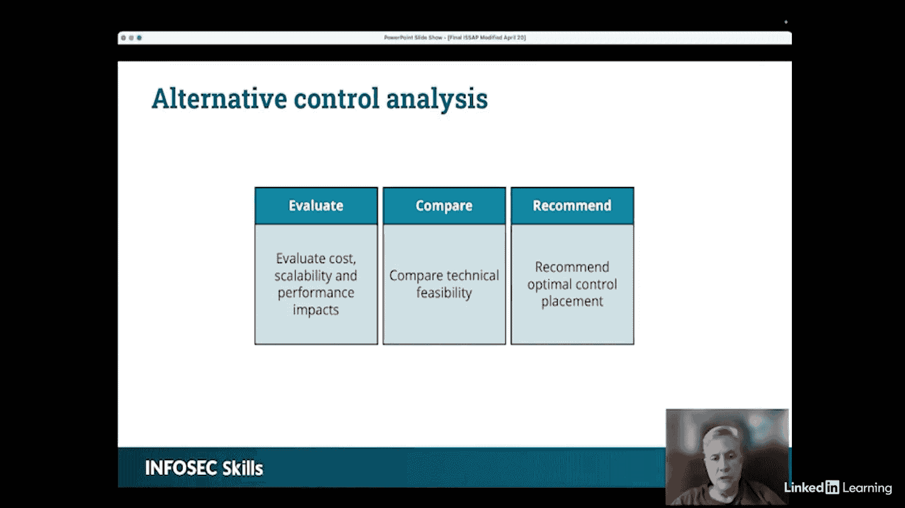

linkedin - ISC2 Information Systems Security Architecture Professional (ISSAP)：17：08. 验证和确认设计 🛡️

在本节课中，我们将要学习如何验证和确认系统设计。简单来说，这就是要确保我们构建的东西，既是按照正确的要求做出来的，也确实能解决客户面临的实际问题。这对安全架构师来说非常重要，因为如果设计偏离了最初的意图，系统可能无法提供应有的保护。

上一节我们提到了设计的重要性，本节中我们来看看验证和确认这两个核心过程。虽然这两个词听起来很像，但在安全架构中，它们的侧重点完全不同。

以下是验证和确认的具体定义：

- **验证（Verification）**：关注的是“我们是否正确地构建了产品”。也就是检查实际产出是否符合既定的需求文档。
  `Verification = "Did we build it right?"`

- **确认（Validation）**：关注的是“我们是否构建了正确的产品”。也就是检查最初的需求是否真正代表了客户的意图，以及最终产品是否解决了现实世界中的问题。
  `Validation = "Did we build the right thing?"`

在理想状态下，客户的意图和我们实际构建的东西应该是完全一致的。但现实中往往存在偏差，所以我们需要分别对待这两个过程，而不是把它们混为一谈。

刚才我们介绍了验证和确认的定义，本节中我们来看看为什么企业要投入资源去做这些工作。这不仅仅是为了完成任务，更与法律法规和业务风险直接相关。

以下是验证和确认的主要目的：

- 确保产品符合相关法律、法规以及内部政策的要求。
- 确保控制措施按照设计意图正常运行，没有被忽略或遗漏。
- 识别现有的安全缺口，并确保这些缺口已经被修复。
- 为业务提供充分的风险降低，并给利益相关者带来安全保证。

简单来说，就是我们要有证据证明系统是安全的，并且确实做到了它应该做的事，而不是仅仅停留在纸面上。

在了解了验证和确认的目的之后，本节中我们来看看一个经典的工程模型，即 V 模型。这个模型直观地展示了开发过程和测试过程是如何一一对应的。

以下是 V 模型的左右两侧活动：

左侧（下降阶段，侧重验证）：
- 收集需求
- 分析需求
- 设计系统
- 设计各个模块，直至编码阶段

右侧（上升阶段，侧重确认）：
- 对单个模块进行单元测试
- 检查模块是否匹配，即集成测试
- 检查整个系统是否按预期工作，即系统测试
- 客户进行验收测试，决定产品是否满足真实世界的需求

V 模型中的箭头指向显示，左侧的每一个设计阶段，在右侧都有对应的测试阶段与之匹配。如果需求质量高，那么验收测试也就更有意义，客户也能更好地判断产品是否达标，最终交付的系统才能真正解决问题。

V 模型帮助我们理解了测试的对应关系，本节中我们来看看在实际执行过程中，需要特别关注哪些质量问题。这主要涉及架构偏移的概念。

架构偏移是指实际构建的系统，逐渐偏离了最初的安全设计意图。为了防止这种情况，在验证阶段我们需要自问以下问题：

- 我们构建的东西，是否就是我们最初设计的意图？
- 控制措施是否按预期工作？
- 系统中是否存在缺陷或配置错误？
- 保护措施是否存在缺口或不足？

通过回答这些问题，我们可以及时发现并修复偏差，确保最终交付的系统不仅按需求构建，而且真正降低了业务风险，达到设计时期望的安全效果。

本节课中，我们一起学习了验证和确认设计的核心内容。我们了解到验证关注“是否正确构建”，确认关注“是否构建了正确的东西”；我们回顾了 V 模型如何将开发与测试对应起来；我们也探讨了如何通过检查架构偏移来保证系统质量。希望这些内容能帮助你在实际的安全架构工作中，更好地交付符合客户需求的安全系统。

