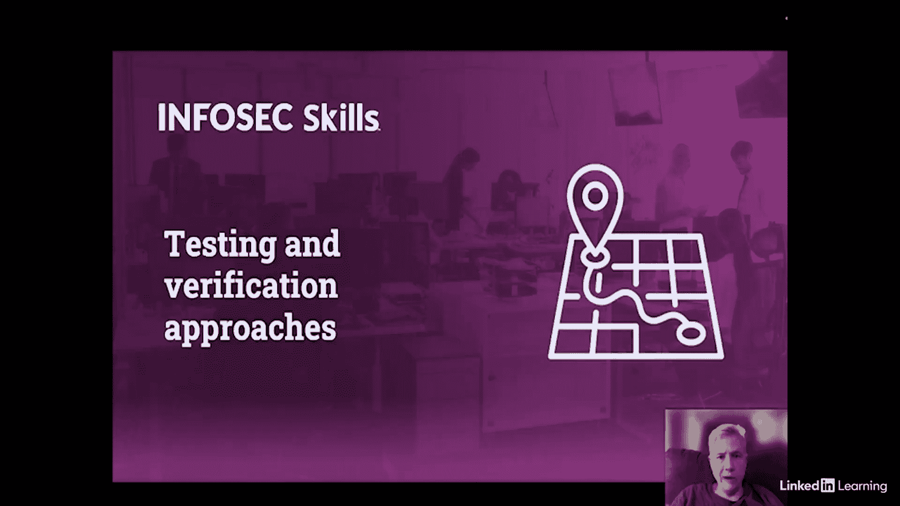
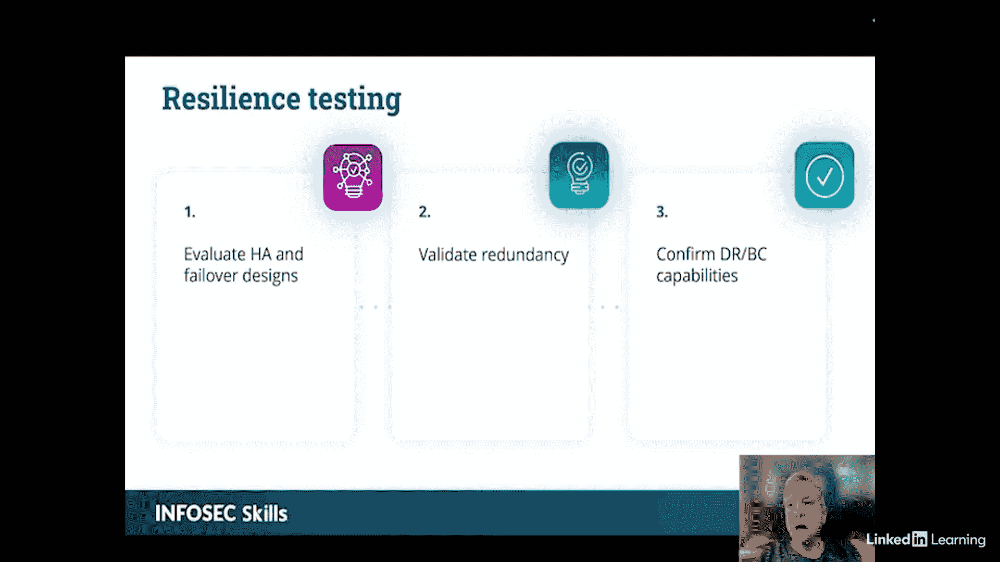
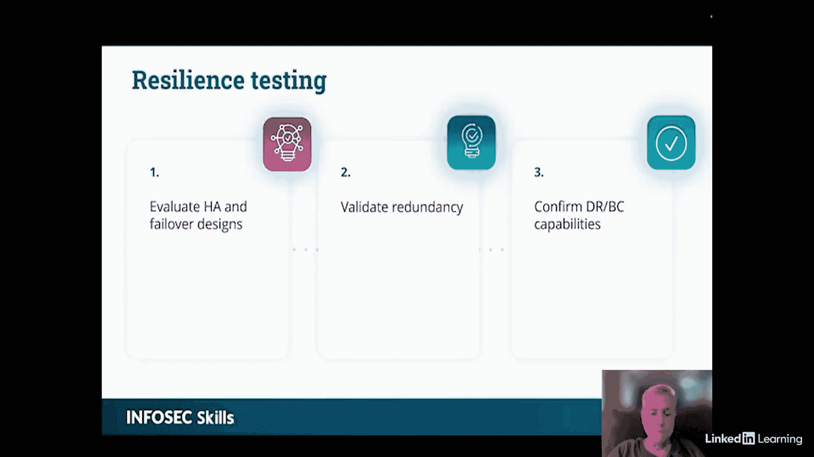

# ISSAP 认证教程：09：测试与验证方法 🔐


在本节课中我们将要学习测试和验证的核心内容。我们会先聊聊验证的基本目的，看看怎样确认安全控制措施是否真的能按预期工作。接着我们会介绍最小权限原则和分段测试，然后逐一说明常见的测试方法，包括静态分析、动态分析、人工审查、源代码构成分析以及渗透测试。后面还会讲红队演练、桌面演练、模拟与建模，最后讨论系统弹性、故障转移和灾难恢复。所有内容最后会串联起来，帮助你理解如何完成系统控制措施的整体验证。这部分内容对初学者来说可能有一些术语，但我们会用大白话逐句拆解，确保每个概念都能听明白。


## 验证控制措施的核心目的

当我们谈论验证时，指的是确认我们的控制措施能按预期工作，并且它们提供了必要的安全程度。这是安全架构中非常基础的一环，因为如果控制措施不生效，前面的设计再漂亮也没有实际意义。

以下是验证时需要关注的几个方面：

- 确认加密强度是否满足我们的安全目标。
- 检查是否使用了正确的加密算法。
- 确认算法是否公开、广为人知，并且经过了充分验证。
- 审查身份和访问管理流程，包括识别、认证、授权和审计。
- 检查跨域和跨信任环境下的安全情况。
- 确认从身份服务器等来源进行令牌交换和令牌验证是否正确。



核心验证目标可以用下面这个简单公式来理解：

```
验证目标 = 控制措施是否按预期工作 ∧ 安全程度是否充足
```

身份和访问管理的基本流程也可以用代码形式表示：

```
IAM 流程 = 识别 + 认证 + 授权 + 审计
```

很多新手可能觉得验证只是“跑一下测试就完事了”，但实际上验证需要从多个维度去审视，不能只看表面是否运行，还要看底层的安全机制是否真的达标。


## 最小权限原则与分段测试

接下来我们来看看测试分段和最小权限原则。上一节我们介绍了验证的核心目的，本节中我们看看如何在实际权限分配中落实安全要求。

以下是需要检查的重点内容：

- 是否充分实施了最小权限原则。
- 权限是否已经按照组织内的角色进行了合理分配。
- 最小权限是否与基于角色的访问控制（RBAC）一起正确实施了。

最小权限原则和 RBAC 可以用下面这种方式来表示：

```
最小权限 = 仅分配完成工作所需的最小权限
RBAC 关系 = 权限 → 角色 → 用户
```

简单来说，最小权限就是给每个用户和每个程序分配完成任务所需的最小权限，不要多给。权限过多就像把家里所有房间的钥匙都给送外卖的人，一旦丢失或者被滥用，风险就会很大。把权限和角色绑定，可以让管理变得更清晰，也方便后续审计和排查问题。


## 常见测试方法概述

上一节我们讨论了最小权限原则，本节中我们来看看常见的测试方法有哪些。不同的测试方法侧重点不同，结合使用才能更全面地发现问题。

以下是主要的测试方式：

- 静态测试（SAST）
- 动态测试
- 人工审查
- 源代码构成分析
- 渗透测试

下面我们逐一解释每种方法的具体含义和做法。

### 静态分析

静态分析有时候也被称为静态应用安全测试，简称 SAST。它的核心思想是不运行程序，直接审查代码本身。我们要看看代码写得是否规范，检查代码的结构和逻辑，寻找可能存在的弱点和不安全的编码习惯。同时还要确认团队是否遵循了正确的开发标准。这就像买房子之前先看设计图纸，而不是等房子盖好了再去检查。

### 动态分析

动态分析则是观察应用程序在运行时的表现。比如模糊测试用于检查输入验证是否到位，看看程序收到奇怪输入时会不会出错。还要关注是否存在竞争条件，也就是因为时序差异可能被攻击者利用的情况。压力测试也是动态分析的一部分，用来看系统能否处理高流量场景，比如早上八点大家同时登录，或者电话系统在特定时段突然打开的高峰期。通过这些方式，我们可以观察系统在压力环境下的真实行为。

### 人工审查

人工审查是指人工回头查看架构文档，看看是否能按照设计系统时使用的流程来走一遍。我们要确认是否理解系统的逻辑和推理过程，逻辑中是否存在缺陷。这些问题往往是自动化测试无法检测出来的，必须依赖人的经验和判断来评估。自动化工具很快，但它不具备人类的常识和上下文理解能力，所以人工审查不可替代。

### 源代码构成分析

源代码构成分析主要检查我们使用的代码元素是否安全。我们要看看是否在使用已经弃用的组件，代码中是否包含易受攻击的组件，不管这些组件是公开可用的开源代码，还是从其他渠道获取的。要确保只使用经过批准的组件。不要使用已经过时、薄弱或不再维护的组件，因为一条链条的强度取决于它最薄弱的那一环。对从外部获取的源代码进行验证，是保护供应链安全的重要步骤。

### 渗透测试作为验证

渗透测试用来验证控制措施是否按预期工作。我们要扮演攻击者的角色，尝试创建漏洞利用，寻找系统中存在的弱点，判断攻击者是否能通过这些漏洞攻破系统。这能帮助我们验证攻击路径，并确认控制措施是否有效、是否按计划工作。渗透测试就像雇佣一名专业小偷来试探你家的门窗锁是不是真的牢固。


## 渗透测试与红队演练

上一节我们介绍了常见的测试方法，本节中我们重点看看渗透测试和红队演练如何进一步验证安全控制。

以下是相关内容：

- 渗透测试作为验证手段，通过模拟攻击者视角来检验控制措施的有效性。
- 红队演练中，红队成员扮演进攻方，也就是渗透测试人员或道德黑客。他们的工作是利用已发现的漏洞，验证控制措施是否真正有效，以及组织是否具备足够的响应能力。

红队演练的目的不仅是找出漏洞，还要看看安全团队在发现攻击后能否及时做出反应。如果控制措施拦截了攻击，但安全团队完全没意识到，那说明响应流程仍然存在问题。


## 桌面演练与模拟测试

上一节我们聊了红队演练，本节中我们来看看桌面演练和模拟测试。这些方法更侧重于流程验证和环境模拟，而不是实际的代码攻击。

以下是具体说明：

- 桌面测试，有时也叫结构化走查，是利益相关者一起查看计划和文档，判断之前做出的选择是否正确。要看看事件是否能正确升级，如果有故障、错误或泄露，是否有适当的升级路径。沟通工作流是否过于复杂，或者各个组件之间能否有效通信。
- 模拟与建模中，数字孪生是指创建能够准确模拟生产环境的测试环境。我们最想在生产环境中测试，因为那样结果最准确，但实际操作中不希望在生产环境测试，以免引发各种问题。因此，我们会创建一个尽可能接近生产环境的测试环境，在里面模拟普通用户或恶意攻击者的行为，从而判断在该环境下会发生什么。

桌面演练就像消防演习，不需要真的点火，但大家需要走一遍逃生路线，确保方案在纸面上是可行的。


## 弹性、故障转移与灾难恢复

上一节我们讨论了桌面演练与模拟测试，本节中我们来看看系统的弹性、故障转移和灾难恢复能力。这些是确保系统在出问题时仍能生存下来的关键。

以下是需要验证的关键点：

- 压力测试用于检验弹性，看看系统如何处理异常流量激增、多个异常、洪水攻击，以及其他测试系统承受能力的情况。
- 高可用性故障转移：当系统发生故障时，是否能充分切换到另一台系统。如果有集群，集群是否继续运行，是否移除了受影响的节点，并且继续在现有节点上分配工作负载。我们要验证弹性设计是否按预期工作，是否提供了预期结果。
- 灾难恢复与连续性能力：是否能满足恢复时间目标，是否能将数据恢复到适当的恢复点目标。

恢复时间目标和恢复点目标可以用下面的方式来理解：

```
RTO = 希望恢复运营的时间点
RPO = 数据必须有多新 = 数据丢失容忍度
```




简单来说，RTO 是指我们希望在什么时间点之前恢复业务运营；RPO 是指我们能接受丢失多少数据，也就是数据必须保持到什么时间点的新鲜程度。所有这些能力都需要在业务影响分析中确定的性能指南范围内运行，才能算作合格的灾难恢复方案。




本节课中我们一起学习了验证控制措施、最小权限原则与分段测试、常见的测试方法、渗透测试与红队演练、桌面演练与模拟测试，以及弹性、故障转移和灾难恢复的相关内容。所有这些知识结合在一起，为我们提供了系统控制措施的整体验证，帮助我们确认安全设计是否真的有效，并能按计划运行。

