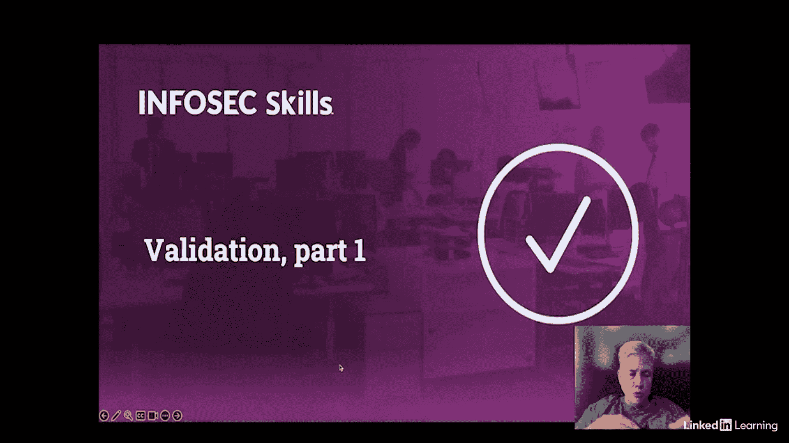
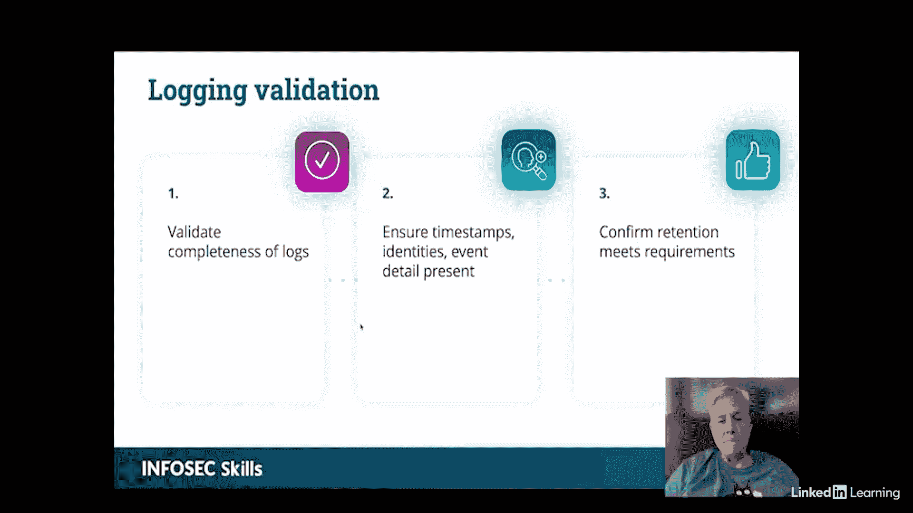

# linkedin - ISC2 Information Systems Security Architecture Professional (ISSAP)：p19：Validation Part 1 验证第一部分 🔐


在本节课中，我们将学习验证的基础知识。验证是确保我们构建的系统不仅满足设计需求，而且能够真正满足现实业务需求的关键步骤。我们将把验证内容分为两个部分，本节先讲解第一部分。主要内容包括配置验证、零信任验证、微分段验证、最小权限原则、身份与访问管理、网络验证、云架构以及日志和监控。



## 配置验证 🖥️

上一节我们简要介绍了验证的总体概念，本节中我们来看看具体如何验证系统配置是否符合安全要求。

配置验证是指确认我的系统是否按应有方式配置，以便妥善管理风险。我们需要先确认是否已经建立基线，并且每个平台都应有基线。存储特定分类数据的系统应具备基线安全性，并且这些基线必须得到强制执行。这不仅仅是部署和执行的问题，还要考虑随时间推移是否出现偏差，因为人们会进行更改。是否建立了良好的变更控制，以防止未经授权的更改？这一点在实际安全审计中非常常见，也是评估系统是否符合合规要求的重要环节。

以下是配置验证的核心检查点：

- 是否已为每个平台建立安全基线？
- 基线是否得到强制执行？
- 是否存在随时间产生的配置偏差？
- 是否有变更控制防止未经授权的修改？
- 补丁级别是否达到要求？
- 是否应用了最新安全包、补丁和修补程序？
- 是否符合系统加固要求？

基线应当代表已加固的系统，即我们可以推送的具有一定安全配置的系统。这种配置构成了最低可接受的安全配置。我们可以用下面的代码来表示补丁合规性检查：

```
合规性检查 = 当前补丁级别 >= 所需补丁级别
```

## 零信任验证 🚫

上一节我们介绍了配置验证，本节中我们来看看零信任架构中如何验证持续信任。

当我们谈论零信任验证时，我们要确保，仅仅因为用户登录了，并不意味着从那时起就明确受到信任。系统必须持续进行评估。这意味着什么？我需要你具备一致的用户身份，并从满足特定健康要求或健康基线的设备进行操作。例如，系统是否已打补丁，是否安装了反恶意软件，这些都与系统的健康状态相关。你是否从一致的位置登录？你的会话是否存在可疑之处？你是否继续以相同的风险等级运行？这意味着安全不是一次性完成的，而是一个持续的过程。

以下是零信任验证的关键要素：

- 一致的用户身份
- 设备健康基线，例如补丁状态和反恶意软件
- 一致的登录位置
- 会话中的可疑行为检测
- 风险等级是否保持不变

例如，假设我登录一个系统，一切正常，然后我的位置突然变更，没有明显原因。即使有明显原因，如果我的位置变更，我也需要重新验证，或者如果我访问特权功能，或者从未受监管或未管理的设备连接，任何非正常情况都应触发我重新验证。我们要确保我不是只被验证一次，任何特殊或可疑活动都会触发重新验证。也许需要提供多因素认证，也许如果我操作或访问可疑性质的内容，会话会被终止。

本质上，零信任可以用下面的公式表示：

```
信任 = f(身份，设备健康状态，位置，会话风险等级)
```

如果尝试超出当前等级的操作，则必须重新验证。

## 微分段验证 🧱

上一节我们讨论了零信任验证，本节中我们来看看如何验证微分段是否有效限制了横向移动。

微分段是限制爆炸半径的一种方式。我们想要做的是限制环境内系统之间的横向移动，不是外出，而是保持在内部。这也是零信任架构的重要部分，因为我们不再仅仅因为流量是内部的就信任它。例如，我们可能在自己的段中有一个Web服务器，它受到保护。不仅它本身受到保护，其他系统也受到保护免受它的影响。如果该Web服务器被攻破，我们不希望攻击者能够从该Web服务器移动到我们的薪资系统或其他内部系统。我们当然还要确保，如果该系统被攻破，其行为在限制范围内。例如，是否可以从Web服务器启动扫描来扫描内部系统？我们当然不应该允许。

那么我们是否分段正确？在分段正确的网络中，我们应该对特定服务器有限访问权限，一台服务器被攻破造成的损害不会影响其他服务器。

以下是微分段验证的检查项：

- Web服务器是否独立划分在专属网段中？
- 网段之间是否有适当的访问控制？
- 被攻破的服务器是否能访问其他关键系统？
- 是否禁止从Web服务器发起对内部系统的扫描？

## 最小权限原则 🔑

上一节我们介绍了微分段验证，本节中我们来看看如何验证用户权限是否遵循最小权限原则。

最小权限原则要求我们给予用户完成工作所需的绝对最小权限。这与基于角色的访问控制（RBAC）相关。RBAC是强制执行最小权限原则的最佳方式之一，因为我们想将这些权限分配给角色而不是用户。这样，如果你处于某个职位，你拥有一组权限，既不能更多也不能更少。我们也可以使用基于属性的访问控制（ABAC），但核心思想是限制用户能做什么。例如及时访问。你有一个普通账户，我有一个普通账户，其他人也一样。只有在需要执行管理功能时，我才能提升权限以以管理员身份运行。这些关于零信任的一些想法，以及我们如何限制组织内部的横向移动，真正控制内部流量。

最小权限原则可以用下面的公式表示：

```
用户权限 = 角色所需的最小权限集合
```

## 环境测试与信任边界 🧪

上一节我们讨论了最小权限原则，本节中我们来看看如何测试环境以验证信任边界是否正确实施。

那么我们如何测试这个环境，如何验证？我们是否有良好的边界控制？例如，当流量从一个区域移动到另一个区域时，我们是否有过滤？是否分段正确？然后我们必须进行测试。我们尝试看看，我是否能从一个系统移动到另一个系统？如果你真的想知道某事是否有效，就必须对其进行测试。然后我们确保那些信任边界已被实施，并且它们限制访问。

以下是环境测试的关键步骤：

- 检查区域间的边界控制和流量过滤
- 验证网络分段是否正确
- 尝试从一个系统访问另一个系统，确认横向移动是否受限
- 确认信任边界已实施并限制访问

## 身份与访问管理 🆔

上一节我们介绍了环境测试与信任边界，本节中我们来看看身份与访问管理的验证要点。

身份与访问管理真正是控制网络上的流量是什么、如何流动、如何进行身份验证和授权的核心所在。首先，我们要测试是否已启用多因素认证。仅使用密码对系统进行身份验证的日子应该已经结束，我们不应该再这样做。

现在，验证这些策略。我们在测试。测试确实是确保它们生效的方式。那么这些策略与基于规则的访问控制和基于属性的访问控制有何关联？然后确认预配和撤销预配工作流。当我们引入用户时会发生什么？该账户如何预配？当用户离开组织时，我们是否有流程能够准确且及时地撤销这些账户？

当然，当我们谈论身份与访问管理时，还要考虑联合测试。今天，当SAS以及众多应用程序通过互联网访问时，我们是否在域之间有信任？我们是否与需要建立信任关系的供应商建立了信任？因为建立这种联合信任将使我们能够实现单点登录和身份验证。我们将拥有像SAML或OpenID Connect这样的身份提供者，它们将通过使用令牌提供身份识别和身份验证。

我们在测试以确保此过程有效。我是否可以使用单一登录访问许多软件即服务提供商（SAS提供商）？它是否按预期工作？

以下是身份与访问管理的验证重点：

- 是否启用多因素认证？
- 预配和撤销预配工作流是否完善？
- 是否建立了联合信任以支持单点登录？
- 身份提供者（如SAML或OpenID Connect）是否正常工作？
- 基于规则和基于属性的访问控制策略是否经过测试？

## 网络验证 🌐

上一节我们讨论了身份与访问管理，本节中我们来看看网络基础设施的验证内容。

我们验证网络。是否有防火墙、正确的分段、入侵检测系统、路由等等。WiFi接入点是否正确进行身份验证？它们是否有加密？我们是否对网络设备有受保护的访问？像路由器这样的网络设备是否被加固，以限制它们如何了解网络。

就像我说过的，这是一个庞大的主题，我只是列举了其中几项。但你知道，这是我们测试计划的一部分。

以下是网络验证的检查清单：

- 防火墙是否已部署并配置正确？
- 网络分段是否正确？
- 入侵检测系统是否运行正常？
- WiFi接入点是否进行正确身份验证并启用加密？
- 路由器等网络设备是否已加固？

## 云架构与混合环境 ☁️

上一节我们介绍了网络验证，本节中我们来看看云架构和混合环境中的验证挑战。

而且我们知道，今天我们的网络不仅仅是本地的，所以我们必须考虑云架构。当我们谈论云架构时，再次回到联合信任的想法，因为许多资源都在云中。我们使用的应用程序中有哪些原生和固有控制？同时还要了解服务提供商中的原生安全控制。

有一个有些挑战性的方面，尤其是与SAS相关，即确保我们有适当的日志记录和监控。例如像云访问安全代理（CASB）这样的工具，确保策略得到执行，以及从云中进出的流量。我们不仅要监控，还要有适当的日志。

而且我们通常处于混合环境，当一些资源在本地而一些在云中时，我们的控制是否一致，我们是否在整个环境中保持一致的安全性。桥接点的概念是指我们从一种网络类型连接到另一种网络类型的地方。你甚至可以将无线视为提供桥接，例如WiFi网络桥接到局域网，那么从一个网络到另一个网络的连接点是什么？

确保我们遵循良好的模型，有良好的安全模型到位。请记住，模型是我们构建的基础。因此，我们遵循安全模型以确保提供我们期望的安全性。

以下是云架构和混合环境的验证要点：

- 云应用程序的原生安全控制是什么？
- 服务提供商的原生安全控制是否已了解？
- 是否使用CASB等工具监控云流量？
- 本地环境与云环境的安全控制是否保持一致？
- 网络桥接点（如WiFi到局域网）是否受到保护？

## 日志与监控 📋

上一节我们讨论了云架构与混合环境，本节中我们来看看日志和监控在持续改进中的作用。

日志和监控是我们提供持续改进的关键。确保我们记录并拥有完整的日志，确保有时间戳以保持一致性，在日志中提供良好的标识，以便我们可以将操作追溯到用户。然后最后一点，确保我们保留日志。我需要保留日志多长时间？这取决于法律法规和业务需求。因此，关于应该保留多久，从来没有简单的答案，但这取决于策略。

那么，我们是否在策略指定的时间范围内妥善维护我们的文档、日志以及监控内容？

以下是日志和监控的核心要求：

- 日志是否完整且包含时间戳？
- 日志中是否有良好的用户标识以便追溯操作？
- 日志保留期限是否符合法律法规和业务策略？
- 是否定期审查监控结果？



本节课中我们一起学习了验证的第一部分内容。我们讨论了配置验证，确认基线、补丁和加固要求是否到位；学习了零信任验证，确保系统持续评估用户身份、设备健康状态、位置和会话风险；了解了微分段验证，限制横向移动并控制爆炸半径；探讨了最小权限原则，通过RBAC和ABAC限制用户权限；介绍了环境测试与信任边界，确认网络分段和边界控制有效；阐述了身份与访问管理，包括多因素认证、预配工作流和联合身份验证；检查了网络验证中的防火墙、分段和设备加固；考虑了云架构与混合环境中的控制一致性；最后强调了日志和监控对于持续改进和合规性的重要性。我们将在下一节中继续学习验证的第二部分。
