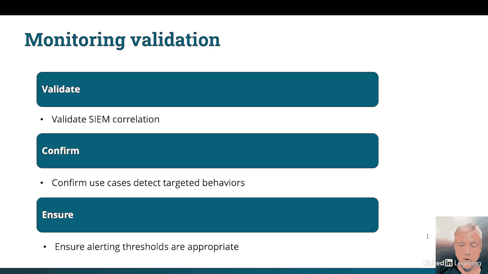
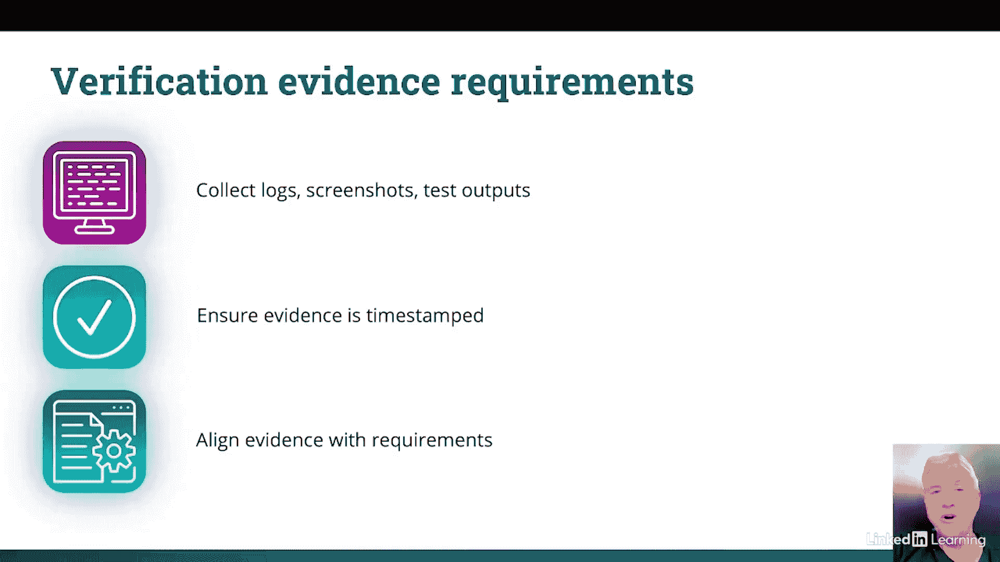

# ISSAP 信息系统安全架构专业认证：11：验证第二部分 🛡️


## 课程概述

在本节课中，我们将继续深入学习验证的相关内容，重点探讨如何确保安全系统和配置始终按预期工作。验证不仅仅是一次检查，而是一个需要持续监控和反复确认的过程。我们将讨论如何监控安全事件管理系统，如何设置审计日志和告警阈值，如何发现系统中的错误配置，以及如何建立安全配置基准。除此之外，我们还会学习安全软件开发生命周期、基础设施即代码、API 验证、数据保护、隐私控制、业务连续性和灾难恢复等内容，并了解如何收集和保存审计所需的证据。这些知识点构成了 ISSAP 认证中验证部分的核心内容，对理解安全架构师的日常职责非常重要。


## 验证监控与日志管理

上一节我们介绍了验证的基本概念，本节中我们来看看如何通过监控和日志来确保安全系统正常运行。



验证工作不能只做一次，我们需要持续监控系统，确保安全控制始终处于有效状态。安全事件管理系统（SEM）需要拉取正确的信息，帮助我们关联相关事件，并对网络性能和系统性能提供真实的安全洞察，特别是与安全事件相关的洞察。同时，SEM 系统需要被配置为识别特定类型的行为和特定的异常情况，这样才能及时发现潜在的安全问题。

以下是需要重点监控的项目：
- SEM 系统拉取的信息是否准确完整；
- 事件关联是否能够反映实际的安全状态；
- 是否能够发现与安全事件相关的系统性能异常；
- 是否配置为查找特定行为和异常模式。

当登录失败次数达到特定阈值时，系统应当触发通知，示例逻辑如下：

```
if (failed_login_count >= 5) {
    send_alert_to_admin();
}
```

审计日志也是验证的重要组成部分。我们需要确保审计日志记录必要的信息，并且告警阈值设置得当。例如，每次登录失败都发送通知是不必要的，但如果出现五次连续登录失败，就需要发送通知，因为这可能意味着有人在尝试破解密码。因此，录制、提取和分析正确信息非常重要，这能帮助我们及早发现攻击迹象。


## 识别错误配置与安全基准

在验证监控的基础上，本节中我们来看看如何识别系统中不应该存在的内容，以及如何建立安全配置基准。

验证的目标之一是发现错误配置，即系统中存在但不应该存在的内容。常见的问题包括弱口令、默认设置、未打补丁的系统，以及任何形式的暴露风险。安全事件管理系统还可以帮助我们进行趋势分析，不仅了解当前的安全状态，还能根据当前状态推断未来的发展方向，从而提前采取防护措施。

安全配置基准是经过批准的、加固过的系统、应用程序、网络设备和云资源配置。部署的系统必须与该基准保持一致。为了防止配置漂移，我们需要持续验证。配置漂移是指系统与基准之间缓慢、逐渐的偏离，可以用下式表示：

```
配置漂移 = 当前配置 ≠ 安全基准
```

以下是常用的安全基准来源：
- CIS 基准：互联网安全中心提供的供应商特定加固建议，通常分为第一级基础安全设置和第二级高级安全设置；
- DISA STIGs：美国国防部使用的详细、高度规范的配置要求；
- 组织安全标准：内部基准，应根据组织的风险偏好和业务需求进行定制。

安全架构师负责选择和定制授权基准或权威基准，并确保这些基准能够同时支持业务需求和安全要求。这意味着我们在制定基准时，不能只考虑安全，也要考虑业务能否正常运行。


## 安全软件开发生命周期

建立了配置基准之后，本节中我们来看看如何在软件开发生命周期中集成验证。

作为安全架构师，我们需要确保软件开发生命周期中的流程和产出的证据都经过验证。安全门禁是确保软件不会在未满足安全要求的情况下从一个阶段进入下一个阶段的机制。门禁可能要求威胁建模、安全测试、修复工作或正式风险接受，但在每个阶段都要评估安全，然后再进入下一阶段，从而避免将有缺陷的代码推向生产环境。

以下是安全软件开发生命周期中的关键证据来源：
- 静态应用程序安全测试结果：在不执行代码的情况下评估代码；
- 软件配置或成分分析：检查代码中可能包含的第三方组件，因为代码重用非常普遍；
- 威胁建模结果：确认是否识别了威胁、是否进行了优先级排序，以及如何缓解这些威胁。


## 基础设施即代码与 API 验证

在软件开发生命周期中验证安全之后，本节中我们来看看基础设施即代码和 API 的验证方法。

基础设施即代码是指通过机器可读的配置文件来定义和部署基础设施，而不是手动配置系统。这是一种很好的配置方式，因为可以通过软件开发生命周期来控制基础设施。我们需要验证模板，例如通过 Terraform 或 AWS CloudFormation，也可以使用 Azure。无论使用哪种工具开发配置代码，都需要确保模板经过验证，并且建立策略执行的护栏，防止配置越界。

基础设施即代码的验证流程如下：
1. 验证配置模板；
2. 建立策略执行护栏，设置限制和约束；
3. 尽早发现错误配置。

这里有一个重要概念叫作快速失败。快速失败意味着如果要失败，就要尽早失败，因为越晚发现错误，技术债务越大。我们希望尽早发现任何错误配置或错误，以便在成本较低的时候修复问题。

API 也需要像其他组件一样进行安全验证。我们需要确保 API 正确地对用户进行身份验证。请记住，很多 API 调用是由系统发起的，因此也需要验证这一点。每个请求都必须经过授权，输入也必须经过验证，最终目标是保护数据并防止滥用。


## 测试策略与数据保护

完成基础设施和 API 验证之后，本节中我们来看看测试环境、输入测试以及数据保护的相关内容。

测试不能在生产环境中进行，应该使用独立的测试环境。我们需要记录访问控制，因为访问控制通常是第一道防线。需要了解用户如何识别和身份验证，以及他们使用了哪些角色、作用域和权限。我们应该尽早并频繁地进行测试，并实现测试自动化，以便在开发过程中尽早发现问题。

以下是输入测试需要覆盖的情况：
- 输入超出限制的情况；
- 不正确的代码；
- 恶意代码；
- 意外的代码。

系统需要能够正确响应未预期的行为，并且我们需要验证所有响应，确保信息的机密性不会被泄露。

在了解常见风险时，OWASP 是一个很好的参考组织。OWASP 发布了针对 Web 应用和 IoT 设备等的十大漏洞列表。在考试中，不需要死记硬背当前的十大漏洞列表，只需知道 OWASP 是一个很好的参考点，并了解这些元素相关的常见风险即可。

关于秘密信息的存储，我们需要保护密码、密钥和会话。在会话密钥和会话管理方面，会话标识符必须是随机的，并且会话在不活动后需要过期。会话标识符临时代表经过身份验证的用户，可以用下式表示：

```
SessionID = 随机生成值 + 会话过期时间
```

如果攻击者获得了会话标识符，系统就会面临风险，因为攻击者可以冒充合法用户。

接下来需要回答的问题是数据是否受到保护。数据需要在静止状态和传输过程中都受到保护，也就是说需要加密。如果使用加密，就需要强大的访问控制和密钥管理，因为加密的安全性与密钥管理质量成正比：

```
加密安全强度 ∝ 密钥管理质量
```

对于敏感信息，可以使用标记化和掩码。标记化是将敏感信息用令牌表示，该令牌是指向受保护位置中敏感信息的指针。掩码是将敏感字符替换为星号或井号，例如信用卡号只显示最后四位，其余部分被掩码遮盖。


## 隐私控制与业务连续性

在数据保护的基础上，本节中我们来看看隐私控制以及业务连续性和灾难恢复的相关指标。

隐私控制验证需要考虑适用的法律法规。我们需要确认是否获得了存储数据的同意，是否实施了数据最小化并限制收集内容，是否建立了数据隐私评估，是否有隐私官员确保提供正确的证据，并验证控制措施是否到位，以提供所需的安全级别。此外，还需要处理访问权限和数据删除工作流，确保一切正确，并拥有支持证据。

业务连续性和灾难恢复涉及 RTO 和 RPO 等指标，这些指标来自业务影响分析文件。业务影响分析分析如果某些组件发生故障，对业务造成的影响。高价值组件离线或不可用的时间越长，对公司造成的损害越大。

以下是业务连续性中的关键指标：
- 恢复时间目标（RTO）：恢复服务的目标时间，即我们希望在多长时间内恢复服务；
- 恢复点目标（RPO）：数据必须保持最新的时间点，例如数据需要是一小时前的状态，这意味着可以接受丢失一小时的数据。

RTO 和 RPO 需要与领导层沟通并获得签字确认，不能自行假设可以在三到四小时内恢复，并且可以接受丢失一天的数据，必须获得高级领导的批准。此外，还需要建立支持 RTO 和 RPO 的流程。这两个指标可以用如下方式理解：

```
RTO = 服务恢复的目标时间
RPO = 可接受的数据丢失时间窗口
```

工作恢复时间是指验证应用程序完整性、确保数据没有损坏所需的时间框架。


## 运营就绪与人员能力

在业务连续性之后，本节中我们来看看运营就绪情况、人员培训以及证据管理。

运营就绪需要确保有正确的监控，在阈值被超过时收到告警，并在必要时立即联系相关人员。运维手册和流程是为了确保我们有有序的方法。这种有序方法不仅适用于日常运营，也适用于对异常和不正常事件的响应，从而保证系统在不同情况下都能稳定运行。

如果没有经过培训的人员，上述所有内容都无法发挥作用。我们需要有称职且经过培训的员工，否则会遗漏安全错误，无法建立适当的响应措施，并且会面临社会工程攻击和其他一系列问题。人员可能是组织中最大的弱点，但在有支持和培训的情况下，也可能是最大的优势。因此，在制定安全计划时，始终要考虑员工的能力和培训情况。


## 证据管理与课程总结

在人员培训之后，本节中我们来看看如何收集和保存验证证据，并对本节课程进行总结。

证据包括截图、日志、测试输出和带时间戳的证据。证据的时间同步非常重要，系统的时间日志或时间同步也需要保持一致，这样审计人员才能准确还原事件发生的先后顺序。任何支持要求的证据都需要提供，审计要求中会说明需要哪种类型的证据来支持我们的证明。我们希望让审计员更容易地工作，并建立自然的可追溯性，避免在审计时出现信息缺失或时间不一致的情况。



本节课中我们一起学习了验证的第二部分内容。我们讨论了如何通过安全事件管理系统和审计日志进行持续监控，如何识别错误配置并建立安全配置基准，如何在安全软件开发生命周期中设置安全门禁和收集代码扫描证据，如何使用基础设施即代码并配合快速失败原则验证模板，如何验证 API 的身份验证与授权，如何进行输入测试和数据保护，如何处理隐私控制与业务连续性中的 RTO 和 RPO 指标，如何确保运营就绪并培训人员，以及如何收集和保存带时间戳的审计证据。希望这些内容能够帮助你更好地理解 ISSAP 认证中的验证知识点，并为后续学习打下坚实基础。

