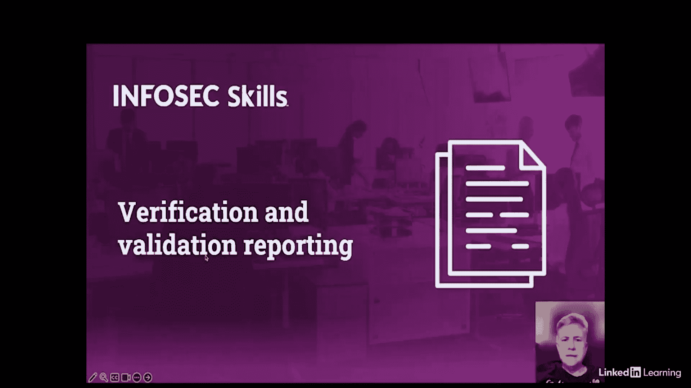
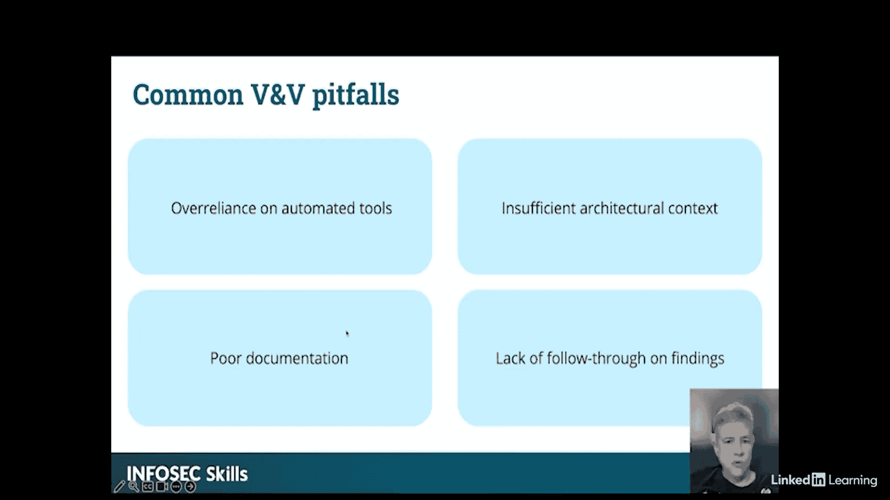

# linkedin - ISC2 Information Systems Security Architecture Professional (ISSAP)：12：验证与确认报告 🛡️

在本节课中，我们将学习如何编写验证与确认报告。重点内容包括总结架构覆盖范围、找出安全差距、评估剩余风险、提出补救建议，以及获得治理层批准。我们还会讨论架构评审委员会的作用、关键绩效指标的使用，以及如何把安全测试嵌入到 CI/CD 流水线中。最后，我们会探讨自动化测试的优点和陷阱，帮助你避免过度依赖工具带来的问题，确保架构层面的安全验证工作既全面又落地。

## 第一部分：确定验证与确认的覆盖范围

首先，我们需要明确验证与确认报告要覆盖哪些架构内容。以下是需要总结的架构领域：

- 已审查的架构域
- 已验证的模式，特别是安全模式
- 系统和信任边界
- 需要评估的集成内容

然后，还要思考一些具体的架构细节。比方说，是否跨域审查了联合架构，零信任分段是否得到了验证，API 安全控制是否经过测试。作为 ISSAP 从业人员，我们关注架构的完整性，跨域的一致性，以及各个领域是否正确执行安全原则。也就是说，我们要搞清楚企业架构的哪些部分接受了安全有效性评估。

## 第二部分：发现架构差距与薄弱点

接下来，我们要找出评估过程中发现的差距。以下是常见的差距或弱点类型：

- 缺失的控制措施
- 低效的控制措施
- 分段不当
- 违背最小权限原则的特权，公式：`最小权限 = 用户完成工作所需的最小权限集合`
- 缺失的安全层
- 没有层级的扁平网络架构，这种架构会轻易允许横向移动

扁平网络架构曾经导致过多次数据泄露。举个例子，有一家大型零售商的暖通空调承包商能够访问某个系统，最终干扰了它的销售点网络，并且安装了恶意软件，导致数百万个账户号码泄露。因此，我们必须核实自己的环境中不存在这种扁平网络架构，避免重蹈覆辙。

## 第三部分：身份访问管理与剩余风险处理

除了网络分段，身份和访问管理也是重要的检查点。我们需要确认以下几点：

- 是否建立了身份和访问管理
- 是否从中心位置进行联邦身份管理

实施控制措施之后，还会剩下一些风险。我们需要评估剩余风险，公式：`剩余风险 = 固有风险 - 控制措施降低的风险`，并判断这些风险是否完全在可接受范围内。如果不在可接受范围内，就需要提出补救建议，从架构或战略的设计导向角度改进环境。具体的补救措施可以包括引入零信任分段、重新分配权限并确保身份和访问管理集中化，或者采用微分段来限制横向移动。我们会逐一处理发现的差距并进行补救，把环境从架构层面提升到更安全的状态。

## 第四部分：例外情况与治理批准

在补救过程中，总会存在一些例外情况。以下是需要处理的事项：

- 我们选择接受的风险，需要进行文档化
- 如果控制措施不能提供足够保护，需要实施附加控制或补偿控制

最后，我们需要确保获得治理层批准。我们始终需要回归与组织治理目标保持一致，不能脱离业务整体目标而单独进行架构决策。

## 第五部分：架构评审委员会与业务目标对齐

从我们的角度来看，作为 ISSAP 从业人员，架构评审委员会是一个治理机构。架构评审委员会负责审查拟议的系统和架构，确保以下几点：

- 系统和架构是安全的
- 与企业标准保持一致，符合业务策略
- 在架构上是合理的

关键点在于实施之前。也就是说，在继续前进之前，我们的架构决策必须是合理的，我们要聚焦于设计。需要考虑的内容包括云采用策略、身份和访问模型、K8s 架构中的 API 安全、第三方集成等。我们一直在强调与组织战略保持一致，因为 ISC2 非常重视这一点，我们必须支持业务目标，保持合规，并从长期角度帮助组织实现战略目标。

## 第六部分：可追溯性、治理与文档管理

除了与业务目标对齐，架构评审委员会还要确保可追溯性和治理。以下是需要确保的内容：

- 有明确的问责制
- 拥有正确的文档和适当的监督
- 文档正式开发并受管理

从监控和报告的角度，我们需要向利益相关者提供合适的信息，即关键绩效指标。关键绩效指标是能够告诉我们是否按预期运行的度量。以下是一些常见的 KPI 示例：

- 发现缺陷的平均时间及其目标值
- 控制措施的有效性得分，有效控制的百分比
- 已测试和评估的控制措施百分比
- 架构漂移是否减少，公式：`架构漂移 = 当前实际架构 - 最初批准的架构需求`

这里没有需要死记硬背的内容，重要的是理解 KPI 在报告中的作用，即我们是否达到了预期，是否在安全有效性方面保持了合理的水平。

## 第七部分：自动化安全测试与 CI/CD 流水线

当然，在验证与确认的整个过程中，我们希望尽早并持续地进行测试。过去，我们通常在开发流程结束后才进行测试，而且大多是手动测试。但今天，我们要在整个过程中持续扫描环境，确保策略得到执行。安全测试应该嵌入到 CI/CD 流水线中，嵌入到我们的构建和部署工作负载中。

自动化安全测试的工作方式可以这样理解。以下是典型的流程：

- 开发者将代码提交到 GitHub
- 流水线自动检查代码中的漏洞
- 查找不安全的库和弃用代码
- 验证安全设置
- 确保基于角色的访问控制到位，公式：`RBAC = 基于角色的访问控制，只授予角色所需的最小权限`
- 如果存在违规，阻止部署过程

通过这种方式，我们拥有自动护栏，让我们在界限内运行，而不是依赖手动检查点。安全要求通过代码和自动化工具自动执行，减少人工疏漏带来的风险。

## 第八部分：工具参考与自动化陷阱

课件中列出了流程各部分使用的不同工具，这些工具仅供了解，不是考试重点，不需要死记硬背。当然，在现实世界中这些工具很有帮助，但将概念与具体工具联系起来就足够了，无需逐个记忆。

好了，那么我们在哪些地方容易出错，有哪些陷阱？自动化非常出色，它能加快速度，消除人为因素，并且比人更准确。但是，如果我们过度依赖自动化工具，就需要在适当的时候引入人为因素。自动化工具只和流程一样好，也只和拥有的信息一样好，所以我们需要回过头进行验证和确认。如果没有架构上下文，如果不理解设计和构建，而这通常源于糟糕的文档，那么我们将无法对控制措施进行适当的验证或确认。

## 第九部分：正当注意与正当照料

当我们发现失败或弱点时，当然需要跟进。如果我们不跟进，也许已经尽到了正当注意，但没有尽到正当照料。这两个概念可以这样区分：

- 正当注意：完成研究并发现了弱点
- 正当照料：完成研究并发现了弱点，并且采取了纠正措施

公式描述如下：`正当注意 = 发现弱点`；`正当照料 = 发现弱点 + 纠正弱点`。正当照料要求我们对发现的问题进行纠正，不能仅停留在调研阶段，而要真正推动安全改进落地。

## 总结

本节课中我们一起学习了验证与确认报告的编写方法，包括确定覆盖范围、发现架构差距、评估剩余风险、提出补救建议、获得治理层批准、架构评审委员会的作用、关键绩效指标的使用、在 CI/CD 中嵌入自动化安全测试，以及避免过度依赖自动化的陷阱。希望这些内容能帮助你从架构角度理解如何验证和确认安全措施，确保企业架构既安全又符合业务目标。
