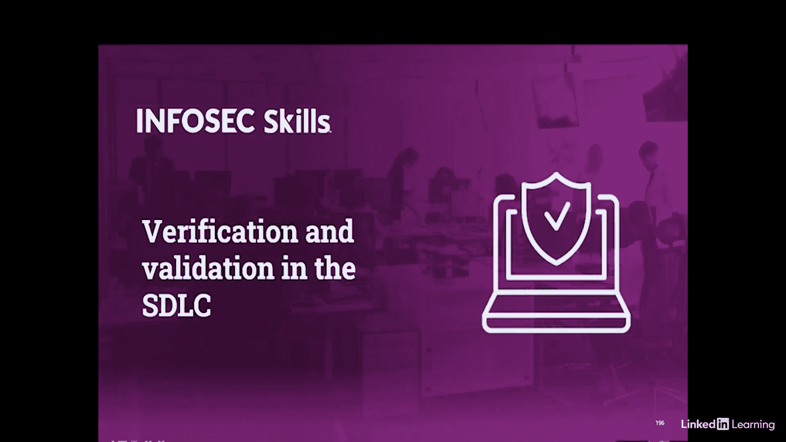
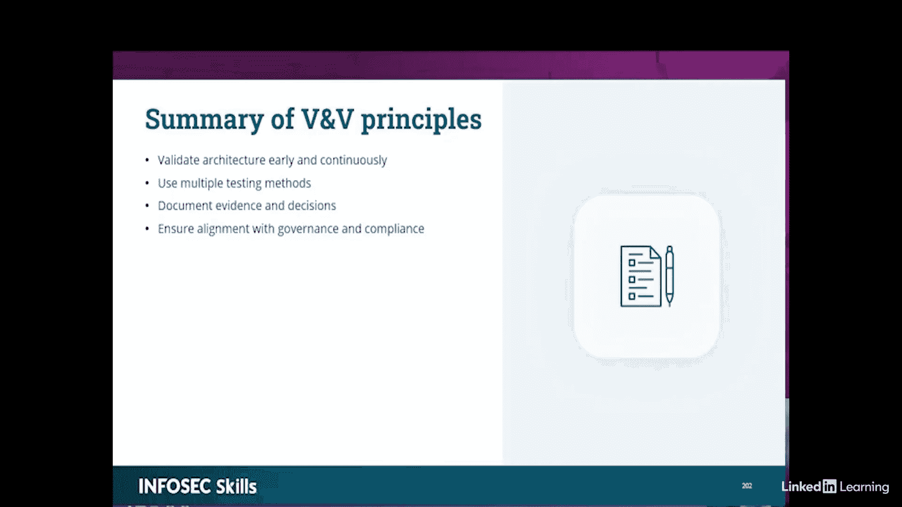

📘 ISSAP信息系统安全架构专家：1：软件开发生命周期中的验证与确认概述


在本节课中，我们将学习如何在软件开发生命周期中进行验证与确认。这是信息系统安全架构专家认证中的重要知识点。我们会讨论为什么安全不能只在项目最后阶段才考虑，而必须贯穿软件开发的每一个环节。同时，我们会对比传统的瀑布模型和现代的敏捷开发与DevOps方式，看看它们在安全验证方面有什么不同，以及为什么持续验证变得越来越重要。



软件开发生命周期中的安全验证可以用下面的公式简单表达：
```
安全验证 = 在需求、设计、编码、测试、部署每个阶段持续检查
```

🚀 ISSAP信息系统安全架构专家：2：传统瀑布模型与敏捷DevOps的区别

上一节我们介绍了软件开发生命周期中的验证与确认概念。本节中我们来看看传统的瀑布模型是如何工作的。瀑布模型是一种线性的开发方式，通常需要很长的时间才能完成一个产品。在开始写代码之前，团队会花大量时间编写文档和做计划，因为这是获取客户意见、明确需求的主要机会。一旦需求确定，团队就开始设计、编码、测试，最后一次性发布整个单体应用程序。

以下是传统瀑布模型的主要特点：
- 开发周期长，可能需要数月甚至更久
- 前期投入大量精力编写文档和制定计划
- 客户只在项目开始阶段提供输入和反馈
- 设计、编码、测试、发布按顺序进行
- 最终交付的是完整的单体应用程序

传统的瀑布模型虽然文档完备，但缺乏灵活性，无法适应快速变化的需求。因此，敏捷开发和DevOps应运而生，彻底改变了软件交付的方式。敏捷开发将软件需求拆分为小的、可独立工作的功能元素，通过短时间的冲刺周期来完成。每个冲刺周期通常持续几周，团队在每个周期结束时交付可用的增量，并从客户那里获得反馈。

以下是敏捷开发与DevOps的核心特征：
- 需求被拆分为小的功能单元
- 工作分为时间固定的冲刺周期，也称为迭代
- 每个周期结束时交付可运行的软件增量
- 持续集成、持续测试和持续交付
- 频繁获得客户反馈，快速改进产品

敏捷迭代流程可以用下面的公式简单表示：
```
需求拆分 → 冲刺开发 → 测试验证 → 获取反馈 → 改进优化
```

🔄 ISSAP信息系统安全架构专家：3：持续集成与持续交付流水线

在敏捷和DevOps环境中，持续集成与持续交付是实现频繁交付的关键。持续集成意味着开发人员不断将代码合并到共享代码仓库中，比如GitHub。代码提交后，自动化流程会立即开始构建、测试和扫描，我们把这个自动化流程称为流水线。传统的安全做法是先构建再安全，但在DevOps中，我们更倾向于SecDevOps，也就是把安全放在最开始。

以下是CI/CD流水线中的主要步骤：
- 开发人员将代码提交到共享仓库
- 自动化系统检查代码依赖关系
- 扫描代码中硬编码的敏感信息，如密码和密钥
- 运行静态应用程序安全测试，验证代码质量
- 检查API接口和基础设施即代码模板
- 检查基于角色的访问控制、加密设置、Kubernetes策略以及容器化流程的自动化情况
- 如果安全测试不通过，部署过程立即停止
- 测试通过后，代码进入持续交付阶段，进行部署和发布管理

测试在整个过程中是持续进行的，而不是定期进行的。常见的测试类型包括功能测试、回归测试、API测试和单元测试，这些测试贯穿软件开发的全过程。

CI/CD流水线的自动化测试流程可以用下面的伪代码表示：
```
代码提交 → 自动构建 → 依赖检查 → 密钥扫描 → SAST检查 → API验证 → 基础设施检查 → 安全测试通过 → 持续交付 → 部署
```

🏗️ ISSAP信息系统安全架构专家：4：基础设施即代码与安全自动化

除了应用程序代码，基础设施也可以被当作代码来管理。基础设施即代码意味着我们可以使用软件定义的方式来构建、配置和维护网络、服务器和容器环境。这样，基础设施本身也可以纳入版本控制，进行基线设置，并持续接受验证。

以下是基础设施即代码的优势：
- 环境配置通过代码自动完成
- 基础设施变更可被版本管理和追踪
- 安全配置可以自动化部署
- 变更会自动接受验证和确认
- 通过反馈循环持续获得系统状态信息

将基础设施即代码纳入DevOps流程非常合理。我们现在可以对运行系统的基础设施本身进行测试，因为基础设施具有版本控制、基线设置和持续验证的特点。这意味着我们可以自动部署安全措施，对变更自动进行验证和确认，并通过反馈循环持续获得系统状态信息。

🎯 ISSAP信息系统安全架构专家：5：混合开发模型、验证与确认及最佳实践

在现实世界中，很多组织并不完全使用敏捷或瀑布模型，而是采用混合开发环境。完全敏捷可能缺乏高度监管行业所需的正式文档，而完全瀑布又过于僵化。因此，混合模式试图结合两者的优点，既保留敏捷的灵活性，又保留瀑布的文档形式和审查门禁。

以下是混合开发模型的典型做法：
- 在每次迭代中保持开发的灵活性
- 在每个迭代结束时设置正式的评审门禁
- 保留必要的应用程序文档和合规记录
- 快速迭代的同时满足监管要求

当产品或流程接近完成时，我们需要执行最后的验证与确认步骤。首先，要确保所有需求都已经完全满足，这属于验证的范围。其次，要检查安全控制措施是否不仅存在，而且能够有效工作，这属于确认的范围。最后，要确认系统符合相关的标准和法规要求。

以下是验证与确认的关键区别：
验证：检查需求是否被完整实现，我们是否把产品构建正确
确认：检查是否解决了真实世界的问题，我们是否构建了客户真正需要的产品

验证与确认可以用下面的公式来区分：
```
验证 = 需求是否被满足 → 是否构建正确的产品
确认 = 是否解决实际问题 → 是否构建了正确的产品
```

在实际工作中，我们应该尽早且频繁地验证系统架构，而不是等到开发结束才检查安全问题。建议使用多种工具和多种流程进行测试，确保需求与实现之间有良好的可追溯性，并保存完整的文档。同时，所有的安全活动都要与组织的治理机制和合规要求保持一致。



本节课中，我们一起学习了软件开发生命周期中的验证与确认。我们对比了传统瀑布模型与敏捷DevOps模式，了解了持续集成与持续交付流水线的运作方式，认识了基础设施即代码的重要性，探讨了混合开发环境的适用场景，并明确了验证与确认的核心区别。希望这些内容能帮助你在未来的安全架构工作中，更好地将安全融入软件开发的每一个阶段。
