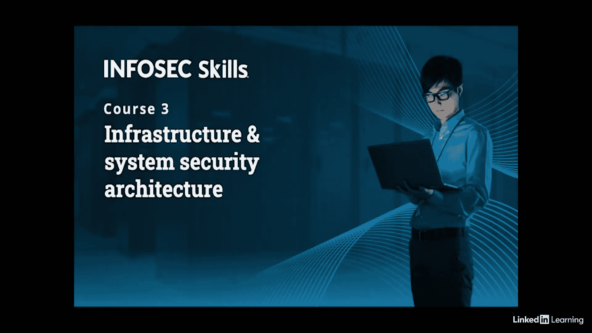
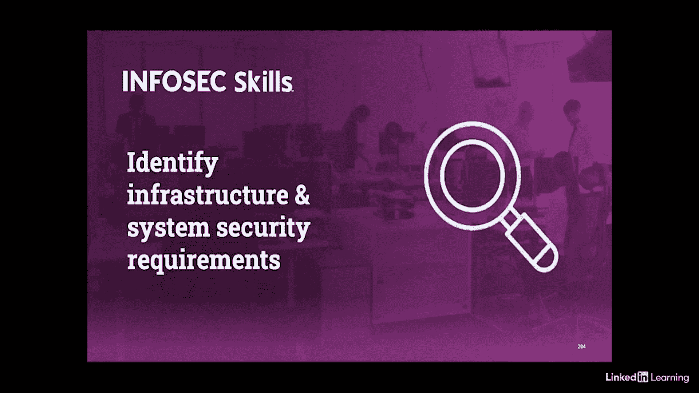
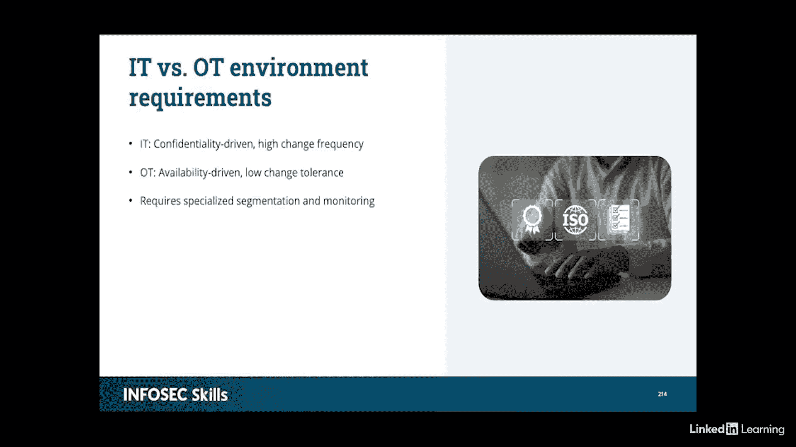

# 🏛️ ISC2 Information Systems Security Architecture Professional (ISSAP): 01: Identify infrastructure and system security requirements

在本节课中，我们将学习如何识别基础设施和系统的安全需求。课程内容会围绕构建整体安全架构展开，讲解安全控制如何在不同层面落地，以及本地环境、云环境与混合环境在安全责任上的差异。我们还会讨论 IT 环境与 OT 环境的不同侧重点，帮助你建立完整的安全架构视角。如果有内容暂时不明白，可以随时回放并深入钻研，确保每个知识点都理解透彻。

## 基础设施与系统安全架构简介

上一节我们完成了前面的课程内容，本节开始进入基础设施与系统安全架构的学习。这一部分的核心思想是，安全不应该是一堆孤立的产品简单堆叠，而应该是一个集成的架构，各个组件协同工作，为组织提供整体防护。

在构建基础设施安全架构时，我们需要考虑分层防御和多重控制。这意味着攻击者想要触及资源，必须突破许多防御机制。相关概念包括安全域、信任域、可扩展性、恢复能力以及零信任架构。零信任的核心在于不再默认信任内部网络中的实体，而是始终验证请求来源，避免因为实体位于内部就自动信任的问题。

> 安全架构的最终目标是支撑业务，同时保持性能、可扩展性、恢复能力和可用性，并保护资产的机密性。

安全控制需要集成到多个层面。以下是需要考虑的控制领域：

- 物理控制：保护设施、硬件设备，以及温度、湿度等环境保障措施。
- 网络控制：网络分段、防火墙部署、零信任路由架构。
- 计算控制：服务器强化、虚拟化、工作负载隔离。
- 存储控制：存储数据加密，并保护数据完整性。
- 云控制：理解云端的共享责任模型，充分利用云服务商提供的原生控制。

当我们把云端因素纳入考量时，安全关注点会发生变化。云端环境下，供应商和客户各自承担特定的安全责任，因此必须明确谁负责什么。此外，我们需要从传统的边界安全转向以身份为中心的安全模型，即关注用户是谁、被允许访问什么，以及请求是否看起来安全。

## 跨多层的安全控制

介绍完基础设施安全架构的总体思路后，我们来看具体的安全控制如何落实到不同技术层面。安全控制需要在物理、网络、计算、存储和云端等多个层面协同工作，才能形成有效的防御体系。

以下是各层面的安全控制要点：

- 物理层面：保护数据中心设施，控制硬件访问，做好供暖、制冷和湿度控制等环境保障。
- 网络层面：实施网络分段，在合适位置部署防火墙，采用零信任路由架构，确保流量可控。
- 计算层面：对服务器进行强化处理，使用虚拟化技术，实现工作负载隔离，降低单点风险。
- 存储层面：对存储中的数据进行加密，并保护数据的完整性，防止被篡改。
- 云端层面：明确云服务商与客户的共享责任边界，充分利用云服务商提供的安全控制能力。

云端环境带来了全新的安全考量。我们需要理解共享责任模型，即云服务商负责物理设施、底层基础设施和核心服务，而客户负责身份与访问管理、数据保护和应用安全。与此同时，应当利用云服务商提供的原生安全控制，并向以身份为中心的安全模型转变，而不是依赖传统的基于边界的思维方式。

## 安全基础设施架构的核心原则

了解了安全控制的分层部署后，我们需要掌握指导安全架构设计的核心原则。这些原则能帮助我们在实际工作中做出正确的安全决策。

安全基础设施架构遵循以下几个核心原则：

- 最小权限原则：用户或主体只应拥有完成工作所需的最小权限，不能多给任何额外权限。`Privilege(user) = Minimum required for job function`
- 纵深防御与分层防御：通过多层控制叠加，增加攻击者的突破难度。`Security = Layer 1 + Layer 2 + ... + Layer N`
- 零信任架构与持续身份验证：不默认信任任何实体，持续验证访问请求。`Trust = Never trust, always verify`
- 恢复能力与冗余：确保系统能够承受故障，具备容错能力。

平台安全架构的核心原则是先夯实基础，再讨论应用程序、用户等其他元素。具体做法包括加固基线配置，确保操作系统打补丁并保持最新，按照安全基线配置进行设定。我们还需要监控主机，例如部署基于主机的入侵检测系统。

在启动阶段，通过安全启动和固件完整性保护来保障信任根。我们要确保只有受信任的引导程序和内核被执行，并且固件没有被篡改。利用硬件信任根验证设置组件和启动组件，从架构上保障安全启动，使系统从受信任环境正常启动。

最后，配置管理同样重要。我们需要保持良好的文档记录，确保变更受控。变更管理与配置管理关系紧密，两者共同维护系统的一致性与可追溯性。

## 业务需求与基础设施安全原则

讲完架构原则后，我们需要回到业务本身，思考基础设施安全要求究竟应该如何制定。所有的安全设计都应当服务于业务需求，而不是脱离实际地堆砌安全产品。

在旧式环境中，所有资源都位于企业内部网络，内部默认被信任。但现在，用户、设备和应用程序可以从任何位置连接，大量业务已迁移到云端。因此，安全需要基于身份来判断：你是谁，被允许访问什么，请求是否看起来安全。我们正朝着基于身份的安全控制转型，包括身份与访问管理、多因素认证、权限管理等。

为此，我们需要让系统、平台和部署模型保持一致，因为不同的环境需要不同的安全方法。以下是本地环境与云环境在安全思维上的主要差异：

- 本地环境：应用程序位于企业内部环境，流量通过关键节点进出并接受检查，用户从内部位置访问系统。我们控制边界，部署防火墙、非军事区、VPN 以及网络边界的入侵检测与防御系统，主要目的是阻止外部攻击者。但同时也要关注横向移动和内部妥协风险。
- 云环境：用户从任何地方连接，工作负载动态移动，容器可能随时出现或消失，新服务器不断启动，API 成为主要的连接方式，系统不再位于固定边界之后。因此，身份成为新的边界。`Perimeter = Identity`

作为安全架构师，必须理解整个基础设施生态系统，而不仅仅是单一的安全技术。我们需要了解这些组件如何交互，信任边界在哪里，以及安全控制在不同运行环境中如何表现。技术范围包括硬件、操作系统、虚拟化、容器、云组件等。

安全要求会随环境而异，包括云环境、本地环境和混合环境。我们应在整个安全生命周期中融入安全，并采用基于风险的方法进行配置和安全执行。

## 本地部署与云部署模型

了解了业务需求与安全原则之后，我们来看看不同部署模型下的安全实施差异。保护网络的方式在本地、云端和混合环境中截然不同。

本地部署模型下，我们拥有完全的控制权。这是我们自己的环境，由我们掌控。我们完全控制物理基础设施、网络组件、服务器配置、存储以及虚拟化方式，因此拥有很大的灵活性和定制能力，并能直接掌控架构。

与此同时，更大的控制权也意味着更多的责任。以下是本地部署需要承担的具体工作：

- 维护和升级硬件
- 保持系统补丁更新
- 考虑可扩展性，尤其是扩容成本可能很高
- 处理旺季后的缩容问题，避免资源浪费
- 实施灾难恢复和持续监控

云端部署模型下，情况发生了转变。我们与云服务提供商实行共享责任模型，具体责任划分取决于所使用的云服务。通常情况下，云服务提供商负责物理硬件、物理设施、底层基础设施、虚拟化层和核心服务。而我们的工作是确保身份与访问管理到位，始终对数据保护负责，并处理访问控制和应用安全。服务商与客户各自负责的部分因云服务模型而异。

云端带来了几个重要优势。基础设施即代码改变了我们构建环境的方式，可以通过脚本编排基础设施并以编程方式处理变更。自动扩缩容，也就是弹性，可以根据需求快速调整资源。策略即代码让策略执行和开发更加便捷，将策略作为软件推送。不可变部署意味着部署后不能被更改，强制遵循基线配置，这样就不会在已经稳定的环境中引入新问题。

我们正在将重点转移到身份与访问管理上，聚焦识别、身份验证、授权和记账，而非传统的边界安全。

## 本地环境安全要求

在讨论完部署模型的共性后，我们专门来看本地环境的安全要求。当系统部署在本地时，物理保护是我们的责任，几乎所有安全事务都由我们自己承担。

本地环境的安全要求包括以下内容：

- 物理保护：保护数据中心，实施架构控制，管理供暖、空调和湿度控制。
- 网络分段与资源隔离：将网络划分为不同区域，隔离关键资源。
- 系统补丁与文档：保持系统更新，通过配置管理保持良好文档。
- 恢复能力：制定备份与资源恢复计划。

我们还需要考虑物理信任边界、可用性风险、内部威胁以及环境恢复能力等因素。本地环境下需要考虑的事项非常多。

## 云环境安全要求

说完本地环境，我们转向云环境的安全要求。迁移到云端后，我们必须理解责任共担模型，明确哪些是我们的责任，哪些是云服务提供商的责任，这一点会随部署模型而有所不同。

云环境的安全要求包括以下方面：

- 强身份与访问管理，以及角色分离：云端更加侧重身份，而非传统边界。
- 日志与监控：使用云服务提供商提供的原生工具和管理控制台。
- 区域与可用区配置：云架构涉及地理位置和恢复能力设计挑战，需要确定数据存放位置、工作负载运行区域以及故障转移机制。
- 合规边界：根据数据存储、处理或收集所在地区的法律法规，考虑数据主权和适用的合规要求。

由于业务分布在全球范围内，我们还需要关注延迟问题，尽量降低延迟和时延，并做好灾难恢复，保证高可用性。云基础设施的考量因素非常多。

## 混合架构安全考量

当企业同时拥有本地网络和云服务提供商时，就形成了混合架构。我们需要确保两者之间能够进行通信，并且连接方式要安全可靠。

常见的连接方式包括站点到站点 VPN、AWS Direct Connect、Azure ExpressRoute，以及使用 SD-WAN 的私有链路。混合架构的核心架构顾虑是，在不扩展过度信任的前提下，实现企业级的云端连接。

我们需要考虑以下安全方面：

- 云端往返的流量加密
- 流量分段
- 流量检查，例如使用云访问安全代理
- 数据丢失防护系统监控
- 流量路由、延迟、冗余和恢复能力

不要把云端当作受信任网络内部来对待。现代架构正在朝着零信任连接方向发展：不信任任何人，验证一切。

混合环境中存在身份与访问管理问题。如果云端和本地存在重复身份，且权限设置不一致，就会出问题。部分监控工具可能无法透明地查看云端环境。因此，我们希望推进联合身份、单点登录和集中式身份验证。

跨平台治理至关重要，治理会为整个安全体系提供方向和支持。此外，我们希望集中安全信息与事件管理系统，对多个环境进行轮询，关联警报，采用通用日志标准，以保证一致性，并在所有环境中获得可见性，特别是在应急响应场景中。

我们需要一套身份平面和一套可见性策略，贯穿所有环境。否则就会出现盲区或访问控制不一致的问题。我们应当在不同领域和边界之间保持一致的策略执行。

## IT 环境与 OT 环境的区别

最后，我们来对比 IT 环境与 OT 环境。这两类环境的安全侧重点完全不同，架构师需要分别对待。

在 IT 环境中，我们关注机密性，变更频率较高，关注机密性、完整性和可用性，也关注整体性能和业务敏捷性。IT 环境通常涉及企业网络、SaaS 平台、企业应用程序和云工作负载。

OT 环境，即运行技术环境，则完全不同。我们谈论的是工业控制系统，这些环境运行电力网络、炼油厂、核电站等关键基础设施。在 OT 环境中，可用性和安全性是首要关注点。

以下是 OT 环境的特殊挑战：

- 许多 OT 系统连续运行多年，无法容忍任何停机时间。
- 系统通常运行旧版操作系统，因为一旦经过批准并稳定运行，除非有强力驱动因素，否则不会轻易升级。
- 打补丁可能导致公用设施停止、设备损坏，甚至产生物理安全风险。

因此，在构建架构时，我们需要大量监控、隔离、严格的信任边界和网络分段，并采用单向网关进入这些环境。无论是 IT 还是 OT，都需要限制横向移动，保护控制系统免受任何形式的妥协，并尽量减少运营中断。

如果存在工业控制环境或运行技术，就必须确保两种架构之间有隔离，并且两者都关注安全，尽管安全在 IT 和 OT 中的含义略有不同。

## 本节总结

在本节课中，我们一起学习了识别基础设施和系统安全要求的核心内容。我们了解了安全控制如何在物理、网络、计算、存储和云端等多个层面集成，掌握了最小权限、纵深防御、零信任和恢复能力等核心原则，并学习了平台安全架构中先夯实基础的重要性。

我们还对比了本地环境、云环境和混合环境的安全责任差异，详细讨论了本地部署的完全控制与更高责任、云端的共享责任模型与身份为中心的安全方法，以及混合架构中的连接、治理和可见性挑战。最后，我们分析了 IT 环境与 OT 环境在关注点和安全挑战上的不同，特别是 OT 环境对可用性和安全性的极高要求。

希望这些内容能帮助你建立起完整的基础设施安全架构视角，为后续学习打下坚实基础。

