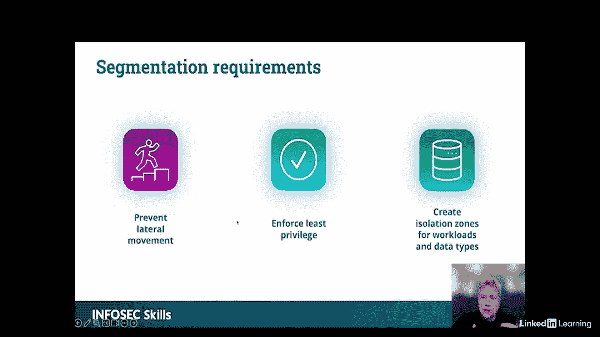

# 信息系统安全架构专家：02：物理安全 🔒


在本节课中，我们将一起学习物理安全的核心内容。物理安全是信息系统安全架构中不可忽视的一部分。无论数据中心是位于企业自有机房，还是部署在云服务提供商的环境中，我们都需要关注物理层面的防护措施。本节内容将从周界防御、入口控制、环境防护、火灾抑制以及网络分区等方面展开，帮助你建立完整的物理安全认知。


## 物理安全与分层防御

即使数据中心不在本地，云服务提供商的物理安全依然是我们需要关注的重点。我们要构建的是分层防御体系，也就是在不同位置设置多重防线，这样即使一层被突破，后面还有层可以阻止威胁。分层防御可以用下面的简单关系来理解：

```text
分层防御 = 外部环境 → 设施安全边界 → 场地 → 建筑入口
```

以下是分层防御的主要区域：
- 外部环境：这是第一道防线，包括围栏、照明和周围区域的监控。
- 设施安全边界：建筑物本身的外墙和围墙，用于划定内外空间。
- 场地：停车场、道路和建筑物周围的开放区域。
- 建筑入口：进入大楼的大门、侧门和其他出入口。

通过在每一层部署监控设备和访问控制策略，我们可以有效发现并阻止潜在的入侵行为。访问控制策略是安全工作的基础，高层领导必须参与制定，确保设施管理和人员进入的规则符合企业整体安全目标。


## 设施访问控制与监控

为了落实分层防御，建筑入口需要采用加固设计，并配备人员与技术双重防护。访问控制的核心思想可以概括为：只允许受权人员进入，其余人员一律拦在门外。

以下是常见的物理访问控制措施：
- 加固入口点：使用防撞、防破坏的门和窗。
- 安全保安：在关键区域安排人工值守。
- 刷卡权限：只允许持有有效凭证的人员进入。
- 人身核验陷阱：即人锁门或斜转门，确保一次只通过一人。
- 监控摄像头：记录所有人员进出大楼的行为。

除了访问控制，环境保护系统同样重要。我们需要考虑供暖、制冷和湿度控制，这些都属于环境防护范畴。环境条件不当会直接影响设备稳定性，因此必须纳入整体安全规划。


## 电力冗余与环境控制

电力供应是数据中心运行的生命线，任何中断都可能导致服务停止。建筑物应当引入多路电源，并配备不间断电源和发电机，以应对突发断电。电力与环境控制的关系可以简单表达为：

```text
可用性 = 电力冗余 × 环境控制
```

以下是电力与环境控制的关键点：
- 多路电源：从不同电网或不同方向引入电力线路。
- 不间断电源：在市电中断时提供短期供电。
- 备用发电机：在长时间断电时持续供电。
- 空调系统：控制机房温度和湿度，防止过热。

高温是破坏系统的头号元凶。我们需要在机房内设置热通道和冷通道，并确保通风良好。同时，应将服务器房间与其余物理环境隔离，并部署监控系统，以便在发生非法闯入时立即发出告警。


## 周界安全与篡改保护

周界防护不仅是围墙，还包括摄像头、保安人员和访问控制系统。此外，我们还需要具备证据和篡改保护能力，确保能发现任何物理控制措施是否被篡改。篡改保护的目标可以表述为：

```text
篡改检测 = 发现物理控制措施是否被修改
```

以下是周界与篡改防护的建议：
- 围栏与摄像头：对外围区域进行持续监控。
- 保安人员：在入口和关键区域进行人工巡查。
- 篡改检测：定期检查门锁、摄像头和传感器是否被破坏。
- 监控告警：对非法闯入行为实时响应。


## 火灾预防与灭火系统

防火的最佳方式就是不让火灾发生。我们应当避免在设施内储存普通可燃物，尤其不能将其放置在点火源附近。在许多装卸平台，工作人员会在将货物搬入设施前先取出纸箱，因为纸箱极易燃烧。

以下是火灾预防的关键做法：
- 不储存常见可燃物。
- 将可燃物远离点火源。
- 在装卸区拆除外包装再搬入设施。

当谈到灭火系统时，我们通常考虑惰性气体或干扰火灾化学反应的气体。人员安全始终是第一优先，灭火排在其次。这个优先级可以用简单的公式表示：

```text
优先级 = 人员安全 > 灭火
```

如果数据中心位于人员密集区域，水基灭火系统是常见选择，因为首要任务是保护人命。但如果是无人或少人的数据中心，可以使用气体灭火系统或预作用管道灭火系统。预作用系统增加了一道防线，避免误报导致水释放。它的工作原理是，除了等待报警触发外，还有一个阀门拦住水，只有当阀门熔化时水才会释放。

无论采用哪种方式，都必须符合国家和地方消防安全标准。


## 网络安全基础、分区与最小权限

物理安全与网络安全是紧密相关的。我们要保护服务器机房和布线间，不仅靠门锁和摄像头，还需要防火墙策略、物理划分和入侵检测与防御系统。

以下是网络物理防护的要素：
- 服务器机房：部署物理访问控制和环境监控。
- 布线间：限制进入，防止线路被篡改。
- 防火墙策略：在物理位置上合理部署，执行访问控制。
- 入侵检测与防御系统：发现并阻止恶意网络行为。

网络分区是系统架构中的核心思想。它的目标是限制横向移动，缩小攻击的爆炸半径。即使攻击者攻陷一个网络片段，也不能轻易扩散到整个网络。微分段是一种更细粒度的隔离方式。我们始终要执行最小权限原则，即仅授予用户和系统完成工作所必需的最小权限。此外，隔离区可以将工作负载与其余网络分离，确保它们免受恶意横向移动的影响。

相关概念可以表示为：

```text
最小权限 = 仅授予完成任务所需的最小权限
爆炸半径 = 攻击可能影响的系统范围
```




本节课中，我们一起学习了物理安全的核心知识点。我们介绍了分层防御的概念，明确了从外部环境到建筑入口的各道防线；讨论了访问控制、监控摄像头、保安人员以及人身核验陷阱等设施防护手段；讲解了电力冗余、暖通空调和温湿度控制等环境保护系统；探讨了火灾预防、惰性气体灭火、水基灭火和预作用系统；最后，我们将物理安全与网络安全结合，学习了服务器机房防护、网络分区、微分段、最小权限原则和隔离区。希望这些内容能帮助你在实际工作中构建更可靠的物理安全架构。

