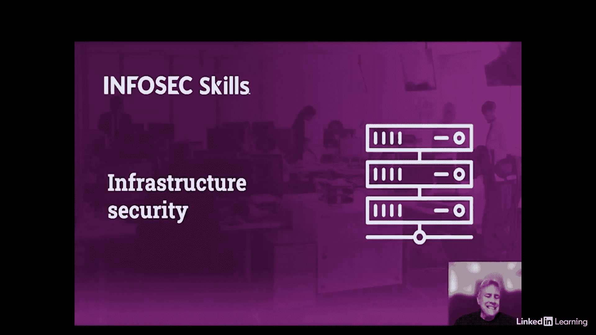
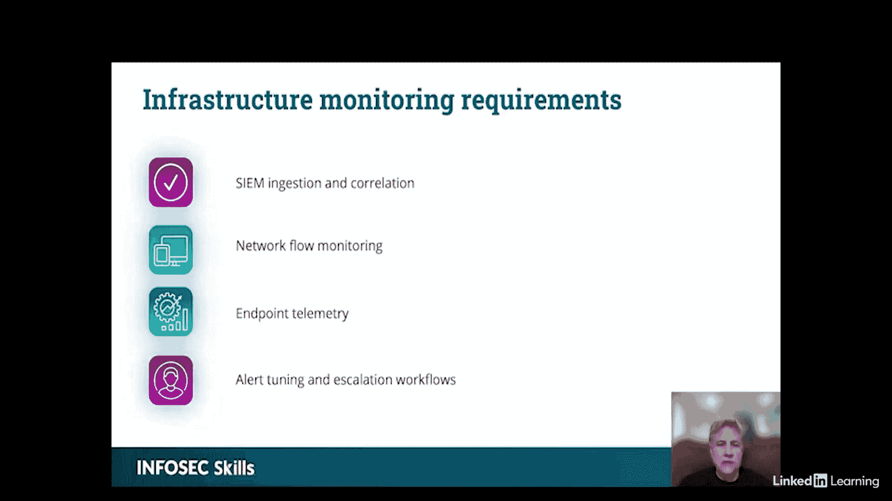

# ISSAP：03：基础设施安全 🔒


## 课程概述



在本节课中，我们将学习基础设施安全的核心内容。基础设施安全简单来说，就是保护组织内部的环境，包括网络资源和各种配置。我们会从终端安全开始，聊聊如何保护单个主机，再讲移动设备管理，接着是操作系统加固、应用白名单、补丁管理，最后讨论网络协议、安全路由、监控和事件升级。通过这些内容，你可以搭建起一套比较完整的内部安全防护体系。

## 基础设施安全的整体目标

基础设施安全的核心目标，是确保组织内部环境处于受控状态。这不仅包括服务器、数据库等硬件资源，也包括网络配置、访问权限等软件层面的设置。简单来说，就是让内部网络和系统不被随意破坏，降低被攻击的风险。

以下是基础设施安全需要覆盖的主要领域：
- 网络资源与配置管理
- 终端设备安全防护
- 移动设备管控
- 操作系统与平台加固
- 应用程序白名单与补丁更新
- 网络传输协议安全
- 安全路由与流量监控
- 端点遥测与事件升级

## 终端安全与主机防护

上一节我们简单了解了基础设施安全的整体范围，本节我们先从最基础的终端安全开始。终端就是员工使用的电脑、服务器等主机设备，保护好它们是整个网络安全的起点。

我们可以使用扩展检测与响应系统，也就是 EDR，来实时监控主机行为。同时，还要部署基于主机的入侵检测系统（HiIDS）、防病毒软件和反恶意软件，对每一台主机进行检查，确保没有病毒或恶意程序潜伏在内部。

核心思路可以用下面这个简单公式表示：
`主机安全 = EDR + HiIDS + 防病毒 + 反恶意软件 + 主机检查`

以下是终端安全需要落实的具体措施：
- 建立安全基线配置，并将基线锁定
- 严格执行变更控制，禁止未经授权的环境变更
- 对存储文件进行设备加密
- 考虑全盘加密，实现对驱动器中所有文件的整体防护，同时防范设备被盗后的数据泄露

## 移动设备管理

聊完固定终端，我们再看看移动设备。手机和平板电脑经常在公司内外切换，比台式机更容易丢失或被盗，所以它们需要单独的管理策略。

企业应该制定移动设备管理（MDM）政策，确保所有移动设备都遵循一致的安全标准。以下是常见的 MDM 措施：
- 开启远程擦除功能，设备丢失时可远程清除数据
- 启用 GPS 定位追踪，方便找回设备
- 要求强密码或多因素认证，防止未授权访问

移动设备常被网络管理员称为头疼的问题，因为管理员既担心设备把不安全的东西带入公司网络，也担心设备把公司敏感数据带出去。因此，必须有严格的策略把这些设备锁定下来。

## 操作系统与平台加固

在终端和移动设备之后，我们需要关注运行在上面的操作系统平台。操作系统如果配置不当，就是攻击者的入口。

操作系统加固的核心要求是：建立基线，进行系统加固。具体做法包括：
- 移除不必要的系统服务，减少攻击面
- 及时安装安全补丁和热修复
- 重命名默认管理员账户，避免被猜测
- 设置强密码策略

我们可以把操作系统加固理解为下面这个过程：
`系统安全 = 基线配置 + 移除多余服务 + 补丁更新 + 管理员账户重命名 + 强密码`

## 应用程序白名单与补丁管理

除了操作系统本身，安装在上面的应用程序也需要管控。应用程序白名单（或允许列表）的做法是：默认拒绝所有应用安装，只有明确允许的程序才能运行。这听起来可能有点反直觉，因为“允许列表”的名字里包含“允许”，但实际上它的意思是“除此以外全部禁止”。

用伪代码表示，就是：
```
如果 应用程序 在 显式允许列表 中：
    允许安装和运行
否则：
    拒绝安装和运行
```

同时，还需要建立定期的补丁推送计划，及时修复已知漏洞。在软件开发和交付过程中，应该通过 CI/CD 流水线把安全构建集成进去，特别是在使用基础设施即代码（IaC）的时候，要确保安全控制贯穿始终。

## 网络协议与传输安全

当数据在网络中传输时，很多协议本身并不安全，不能直接信任。我们需要在协议之上叠加额外的安全机制。

以下是常见的安全加固方式：
- 使用 TLS 保护 Web 流量，替代明文传输
- 使用 IPsec 保护网络中 IP 流量的安全传输
- 阻止遗留协议，例如不再使用 HTTP 连接 Web 服务器，改用 HTTPS
- 只使用未被弃用的、经过验证的安全协议

简单来说，就是把不安全的旧协议全部换掉，换成经过加密的新协议。

## 安全路由与网络监控

在大规模网络环境中，流量会经过很多路由节点，因此路由本身也需要安全防护。例如，边界网关协议（BGP）保护可以防止流量在传输过程中被劫持或误导。

网络监控则是掌握整体情况的关键。安全事件和事件管理（SEM）系统能够从不同来源聚合信息，并将其处理成有意义的结果。如果不加筛选，信息太多会让管理员无法处理，因此需要过滤和数据减少机制，让警报真正有用。

监控的重点还包括：
- 服务器之间流量的进出方向
- 流量的类型和数量
- 端点设备的进出数据，也就是端点遥测数据

所有采集到的监控数据都需要被评估，并进行系统调优，既避免误报，也避免漏报，确保安全系统提供准确且有价值的告警信息。

## 端点遥测与系统调优

端点遥测专门关注终端设备的通信行为。我们要监控什么数据发到端点，什么数据从端点发出，并对这些数据进行评估。

调优的目标非常明确：既不能让系统误报太多，也不能漏掉真正的威胁。理想的状态是：
`有效告警 = 减少误报 + 减少漏报 + 提供准确信息`

当检测到可疑事件时，还需要有明确的升级流程，比如将事件上报给事件响应团队，或上报给高级管理层。所有这些环节都必须有相应的流程和策略支持。

## 本节总结



本节课中，我们一起学习了基础设施安全的完整体系。内容包括终端安全与主机检查、移动设备管理策略、操作系统加固与应用白名单、补丁推送与 CI/CD 安全构建、网络协议加密与遗留协议阻断、安全路由与流量监控、端点遥测与系统调优，以及事件升级和响应流程。掌握这些内容，可以帮助你构建起一个相对安全可控的内部环境。
