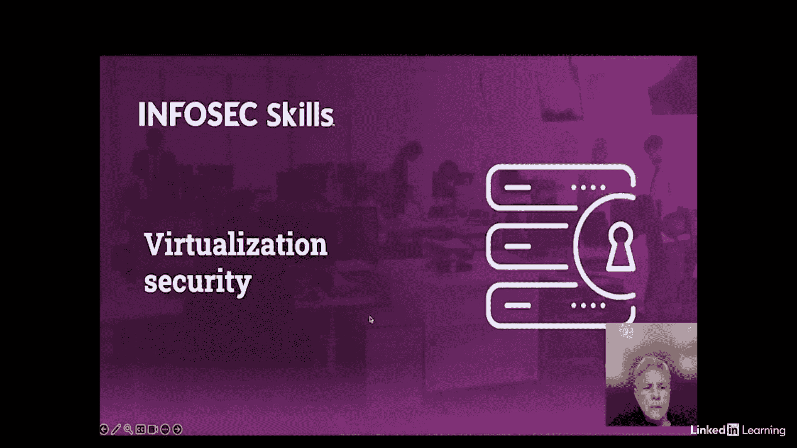
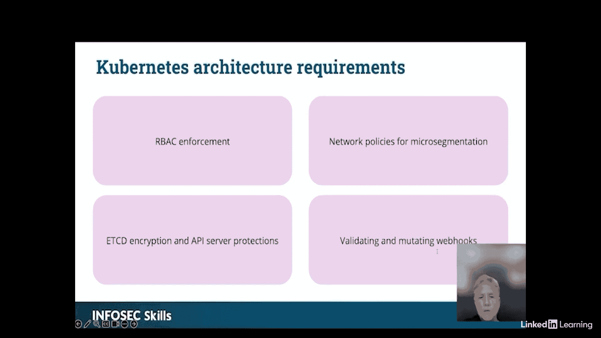

# 🔒 linkedin - ISC2 信息系统安全架构专家（ISSAP）：04：虚拟化安全

在本节课中，我们将一起学习虚拟化安全的核心内容。我们会先了解为什么要保护虚拟化管理程序，然后看看如何加固它，接着讨论虚拟机隔离、镜像模板管理、快照安全、网络流量加密以及微分段。之后我们会进入容器安全部分，学习容器镜像扫描、运行时策略、命名空间隔离、编排控制、密钥管理，最后讲解如何保护 Kubernetes 架构。希望大家能在本节课中掌握虚拟化和容器环境的安全基础。

## 虚拟化安全的核心思想

上一节我们介绍了课程的整体安排，本节中我们先来看看虚拟化安全的基本原理。

虚拟化安全的中心就是保护虚拟化管理程序，也就是 hypervisor。因为 hypervisor 控制着虚拟化环境里的一切，它管理所有虚拟机，如果它出了问题，所有虚拟机都会受影响。hypervisor 本质上只是一段软件，但它掌控着整个虚拟化平台，所以我们要把攻击面缩小到最低。

安全目标可以用简单的公式表示：

`安全目标 = 保护 hypervisor + 减少攻击面`

或者更直观地说：

`Hypervisor = 管理所有虚拟机的软件 = 虚拟化环境的控制中枢`

以下是虚拟化安全需要关注的几个核心点：

- 保护 hypervisor，防止它被攻破
- 移除不必要的服务、接口和功能
- 降低整体攻击面

## 加固虚拟化管理程序

在了解了虚拟化安全的基本思想之后，本节中我们来看看如何具体加固 hypervisor。

把 hypervisor 加固起来，意思就是把它配置得更安全。因为 hypervisor 是软件，里面可能自带很多我们不需要的服务、接口或者功能，这些多余的东西就是潜在的漏洞。我们需要把不用的服务关掉，不需要的接口关掉，多余的特性关掉，让 hypervisor 越精简越好，也就是我们常说的“锁定”它。

加固的逻辑可以用公式描述：

`加固 hypervisor = 移除 {不必要的服务, 不需要的接口, 多余的功能}`

或者：

`Hypervisor 安全等级 = 原始功能 - 禁用的不必要项`

加固时可以检查以下项目：

- 不需要的后台服务
- 未使用的管理接口
- 没有业务价值的额外功能

## 隔离虚拟机

把 hypervisor 加固好以后，本节中我们接着看虚拟机之间的隔离问题。

虚拟机隔离是指确保不同的虚拟机互不干扰。如果虚拟机之间没有做好隔离，其中一台虚拟机被攻击，攻击很容易蔓延到其他虚拟机。我们要通过 hypervisor 实现隔离，把每个虚拟机关在自己的“笼子”里，避免一个安全问题变成全面危机。

隔离效果可以用简单的公式说明：

`虚拟机隔离 = 攻击扩散路径被阻断`

或者：

`隔离效果 = 一台虚拟机被攻破 ≠ 其他虚拟机受影响`

做好虚拟机隔离需要注意以下几点：

- 使用 hypervisor 提供的隔离机制
- 避免虚拟机之间不必要的直接通信
- 限制跨虚拟机的资源访问

## 黄金镜像与模板管理

虚拟机隔离做好之后，本节中我们来看看部署前的镜像和模板该如何处理。

这里说的黄金镜像，就是我们用来批量创建虚拟机的模板。很多人的习惯是先部署虚拟机，再去找漏洞再打补丁，这样太晚了。我们应该在镜像还没有部署之前，就把它配置安全，打好补丁，做好加固。只有镜像本身是干净安全的，部署出来的虚拟机才有保障。

安全部署的正确顺序可以表示为：

`安全部署顺序 = 镜像加固 → 漏洞扫描 → 打补丁 → 部署虚拟机`

或者：

`安全镜像 = 基础镜像 + 安全配置 + 补丁 + 加固`

管理黄金镜像时建议执行以下步骤：

- 在模板阶段完成安全配置
- 在部署前扫描漏洞
- 对镜像进行打补丁和加固
- 将安全镜像作为唯一的部署基准

## 资源隔离与爆炸半径控制

镜像和模板安全之后，本节中我们来看看如何对不同类型的工作负载进行隔离。

资源隔离就是把重要的工作负载、网页服务、应用服务分开放。比如把处理核心业务的服务器和面向公众的网页服务器分开。这样做是为了限制“爆炸半径”，意思是说万一某个服务被黑客攻破，影响范围不会扩大到其他服务，不会一荣俱荣，一损俱损。

爆炸半径和隔离的关系可以用公式表达：

`爆炸半径 = 安全事件影响范围`

资源隔离后：单点被攻破 → 影响范围受限  
资源未隔离：单点被攻破 → 可能波及整个环境

进行资源隔离时可以按以下维度划分：

- 核心业务工作负载
- Web 服务
- 应用服务
- 其他非敏感服务

## 快照安全

资源隔离讲完以后，本节中我们来看看虚拟机快照的安全问题。

快照本质上是虚拟机在某一时刻的保存副本，里面包含内存内容、运行状态等信息。快照里面可能存着加密密钥、密码或者其他敏感数据。如果快照没有保护好，攻击者拿到快照就等于拿到了里面的秘密。所以我们要确保快照被妥善保护，访问权限严格控制。

快照内容和安全要求可以表示为：

`快照内容 = 内存状态 + 运行数据 + 可能的密钥或密码`

`快照安全 = 加密存储 + 访问控制`

保护快照需要注意以下几点：

- 加密存储快照文件
- 限制谁可以创建和恢复快照
- 避免在快照中留下明文密码或密钥

## 安全模板管理

快照安全处理完后，本节中我们再强调一下安全模板的持续管理。

安全模板管理是说，我们回滚或重新部署时会用到的那个基准镜像，也就是黄金镜像，它本身也必须是安全的。如果基准镜像里带着漏洞，那么从它部署出来的所有虚拟机都会继承这些漏洞。所以模板要定期检查、更新，确保它始终符合安全标准。

信任基准可以简单表达为：

`信任基准 = 黄金镜像必须是安全的`

`部署来源 = 唯一受信任的模板`

维护安全模板需要做到以下几点：

- 定期扫描模板中的漏洞
- 及时更新基准镜像
- 只允许授权人员修改模板

## 虚拟网络流量加密

模板管理讲完后，本节中我们来看看虚拟化环境中的网络流量如何加密。

虚拟化环境实际上是在物理硬件之上构建了一层虚拟网络，这叫覆盖网络。虚拟机之间、容器之间传输的数据，如果不加密，就像明信片一样，任何人在路径上都能看到。我们需要对虚拟网络里的流量进行加密，可以使用 IPsec、VXLAN 或者 TLS 等技术，确保数据在传输过程中不是明文。

传输安全可以用公式表示：

`传输安全 = 虚拟网络流量 + 加密协议（IPsec / VXLAN / TLS）`

核心原则是：

`禁止明文：流量 ≠ 明文`

加密虚拟网络流量可以采用以下方式：

- VM 到 VM 的加密通信
- 容器到容器的加密通信
- 使用 IPsec、VXLAN 或 TLS 保护数据

## 微分段

流量加密之后，本节中我们来看看网络微分段的概念。

微分段的意思是把大网络切成很多小的子网络。我们不能信任一个巨大的扁平网络，一旦里面有一台机器被攻破，攻击者可以横向移动。把网络切成小块后，每个虚拟机或者每个小网段都有自己的安全控制，这样就把攻击者限制在很小的范围内。

微分段可以用公式表示：

`微分段 = 大网络 → 多个小子网 + 每个子网独立安全控制`

信任模型是：

`不信任大网络，只信任微段`

实施微分段可以参考以下做法：

- 将网络划分为多个小子网
- 为每个虚拟机分配独立的安全策略
- 限制子网之间的通信

## 基于身份的路由

微分段讲完以后，本节中我们来看看一种比较新的技术，基于身份的路由。

基于身份的路由是指网络设备不再只看 IP 地址来决定放行谁，而是结合身份认证系统。比如用户登录公司笔记本，Active Directory 负责验证用户身份，然后网络准入控制系统检查设备和 IP 是否合法。路由器拿到身份映射后，根据策略决定放行哪些流量。比如人力资源部门的人可以访问工资系统，外部承包商就不能访问。关键是让网络决策基于“谁”而不是“基于哪个 IP”。

访问决策可以用公式表示：

`访问决策 = f(身份, 设备, IP, 策略)`，而不是仅仅 `f(IP)`

策略示例如下：

`HR 用户 → 可访问工资系统；承包商 → 拒绝访问`

基于身份的路由通常涉及以下组件：

- 身份和访问管理服务器（如 Active Directory）
- 网络准入控制系统
- 路由器或策略执行点

## 跨环境可见性

基于身份的路由之后，本节中我们来看看为什么需要跨环境的可见性。

跨环境可见性是说，我们要能同时看到本地数据中心、云平台、虚拟网络和容器里的情况。安全团队不能只关注某一块，需要在所有平台上监控和观察网络流量，才能及时发现异常。

可见性范围可以表示为：

`可见性范围 = 本地系统 + 云系统 + 虚拟网络 + 容器`

监控目标是：

`全平台网络状态可观测`

实现跨环境可见性需要覆盖以下内容：

- 本地数据中心资产
- 云平台资产
- 虚拟网络流量
- 容器环境

## 容器安全概述

跨环境可见性讲完后，本节中我们进入容器安全的部分，先看看容器环境的基础。

现在很多应用都跑在容器里，比如 Docker 和 Kubernetes（简称 K8）。容器安全首先要确保容器镜像本身是安全的。我们在部署容器之前，要先对镜像进行扫描，查找漏洞、恶意软件、弱库、不安全的库，或者镜像里面硬编码的密码和密钥。扫描通过之后，要对镜像进行数字签名，数字签名可以保证镜像没有被篡改，也就是提供完整性和真实性。

容器镜像安全可以用公式表示：

`容器镜像安全 = 镜像扫描 + 漏洞检查 + 恶意软件检测 + 数字签名`

数字签名提供的保障是：

`完整性 + 真实性`

保护容器镜像需要执行以下操作：

- 在部署前扫描镜像
- 检查漏洞、恶意软件和弱库
- 检查镜像中是否包含硬编码的密码或密钥
- 对通过检查的镜像进行数字签名

## 运行时策略执行

镜像安全之后，本节中我们来看看容器运行时的安全策略。

容器安全不能只在开发阶段做完就不管了，部署之后的运行时同样重要。容器是高度动态的，随时可能启动或销毁，所以我们要在运行时持续监控，查找权限提升、可疑进程、不正常的 shell 访问等行为，这些可能表明发生了恶意入侵。

运行时安全可以用公式表示：

`运行时安全 = 持续监控 + 权限提升检测 + 可疑进程检测 + 异常 shell 访问检测`

容器的特性决定了：

`高度动态 → 运行时监控必不可少`

运行时策略执行需要关注以下行为：

- 权限提升尝试
- 可疑进程启动
- 异常 shell 访问
- 其他可能指示恶意访问的活动

## 命名空间隔离

运行时安全讲完以后，本节中我们来看看 Linux 命名空间如何实现容器隔离。

命名空间是 Linux 的一种能力，用来确保容器之间保持隔离。它给每个容器提供一个独立的系统资源视图，让容器感觉自己拥有整个操作系统的所有资源。但实际上，多个容器还是共享同一台宿主机的内核。命名空间提供了这种抽象和分离，让容器之间互不干扰。

命名空间可以用公式表示：

`命名空间 = 容器独立视图 + 共享宿主机内核`

隔离效果是：

`容器认为自己独占资源，实际共享内核`

命名空间隔离的核心表现包括以下几点：

- 每个容器拥有独立的系统资源视图
- 容器之间的进程、网络、挂入点等相互隔离
- 所有容器共享底层宿主机内核

## 安全编排控制

命名空间隔离之后，本节中我们来看看容器编排的安全控制，特别是 Kubernetes。

安全编排控制是说，我们使用 Kubernetes 等工具来自动化部署容器时，自动化过程本身也要受到保护。代码从开发者那里开始，上传到像 GitHub 这样的代码仓库，然后进入 CI/CD 流水线。在流水线的每个阶段，我们都要执行镜像扫描、策略检查，查找漏洞、恶意软件、不安全的包或者暴露的密钥。这属于供应链安全控制。扫描结果只有通过、警告和失败三种。通过的话才能继续部署，警告表示发现问题但可以继续，失败则直接阻止部署并退回流水线。安全必须集成到部署之前，而不是事后补救，这就是“左移安全”，也就是把安全检查尽可能前移。这就是 DevSecOps 的核心，通过自动化安全检查，防止有漏洞的容器进入生产环境。

CI/CD 流水线可以用公式表示：

`CI/CD 流水线 = 开发者提交代码 → 代码仓库 → 镜像构建 → 镜像扫描/策略检查 → 部署`

扫描结果的集合是：

`扫描结果 = {通过, 警告, 失败}`

左移安全的含义是：

`安全检查位置 = 开发阶段 ≠ 部署后阶段`

容器编排安全流水线通常包含以下阶段：

- 开发者编写代码并提交
- 代码上传到仓库（如 GitHub）
- 自动化构建与部署
- 镜像扫描与策略检查
- 基于检查结果决定是否部署

## 镜像签名与验证

编排控制讲完后，本节中我们来看看镜像签名和验证的重要性。

镜像签名和验证是说，容器镜像应该被数字签名，这样才能验证镜像的完整性和真实性。签名可以证明镜像来自可信的发布者，并且在传输或存储过程中没有被篡改。

镜像信任可以用公式表示：

`镜像信任 = 数字签名 + 完整性验证 + 真实性验证`

镜像签名验证主要保证以下几点：

- 镜像来自可信来源
- 镜像内容未被篡改
- 只有签名有效的镜像才允许运行

## Pod 与容器隔离机制

镜像签名讲完后，本节中我们来看看 Pod 和容器的具体隔离机制。

Pod 和容器的隔离机制主要靠不同的命名空间和控制组（cgroups）。网络策略也能提供隔离。我们不希望一个容器被攻破后，影响到其他很多容器，所以要通过这些机制把影响范围控制住。

隔离机制可以用公式表示：

`隔离机制 = 命名空间 + 控制组（cgroups）+ 网络策略`

目标是：

`单容器被攻破 → 不影响其他容器`

常用的隔离机制包括以下内容：

- 不同的命名空间
- 控制组（cgroups）
- 网络策略

## 入场控制器与运行时安全

隔离机制讲完以后，本节中我们来看看 Kubernetes 入场控制器和运行时安全。

入场控制器是 Kubernetes 在 Pod 进入集群之前的安全守门员。它会检查一系列策略，比如镜像是否签名、是否以 root 身份运行、是否来自认可的镜像仓库、是否违反安全策略。如果策略检查不通过，部署就会被阻止。运行时安全则关注容器已经在运行时的状态，查找权限提升、意外进程、奇怪的网络流量等。因为攻击者可能在容器部署之后才去攻破它，所以我们需要持续监控。

入场控制器检查项可以表示为：

`入场控制器检查项 = {镜像签名, 是否以 root 运行, 是否来自认可仓库, 是否违反策略}`

检查结果的处理是：

`通过 → 允许进入集群；失败 → 阻止部署`

运行时监控的对象包括：

`权限提升 + 意外进程 + 异常网络流量`

入场控制器在 Pod 进入集群前会检查以下内容：

- 镜像是否已签名
- 是否以 root 用户运行
- 镜像是否来自认可的仓库
- 是否违反安全策略

## 密钥管理

入场控制器讲完后，本节中我们来看看容器中的密钥该怎么管理。

容器运行时需要密码、API 密钥等秘密来做身份验证，但是不要把这些秘密直接写死在镜像里面，非常危险。如果使用 Kubernetes 这类编排工具，应该使用集中式密钥管理，把密钥安全地存储并加密。一旦密钥泄露，攻击者就能拿到你的云资源和服务访问权限。

密钥管理可以用公式表示：

`密钥管理 = 集中式存储 + 加密保护 + 禁止硬编码到镜像`

密钥泄露的后果是：

`攻击者获取云资源和服务访问权限`

安全的密钥管理需要做到以下几点：

- 不要在镜像中硬编码密码或 API 密钥
- 使用集中式密钥管理系统
- 对存储的密钥进行加密
- 严格控制密钥访问权限

## 保护 Kubernetes 架构

密钥管理讲完后，本节中我们来看看如何保护 Kubernetes 整体架构。

保护 Kubernetes 架构需要多层防护。首先是基于角色的访问控制，根据组织里的角色规定谁能在 K8 里做什么。开发人员可以部署应用，安全管理员可以管理策略，普通用户只有日志的只读权限。K8 功能很强大，必须用 RBAC 来限制权限，遵循最小权限原则。

其次是 etcd 加密。etcd 存储了集群的关键信息，比如密钥、配置、集群状态、服务数量、策略等。如果 etcd 被攻破，攻击者可能拿到密钥甚至控制整个集群，所以必须加密保护 etcd 数据库。

再次是 API 服务器保护。K8 API 服务器是整个集群的主控制界面，kubectl 命令行工具、管理员、自动化系统都要通过它通信，它就是 K8 的大脑。保护 API 服务器需要认证、授权、加密、RBAC 和日志。

另外是 webhook，这是 K8 内部的自动化策略执行机制。我们可以验证 webhook，允许或阻止操作，比如拒绝容器以 root 身份运行、阻止未签名镜像、实施资源限制。变更 webhook 还可以注入安全代理、标签，强制日志设置和边车容器，实现自动策略调整。

相关公式如下：

`RBAC 原则：权限 = f(组织内的角色)，遵循最小权限`

`etcd 保护 = 加密 etcd 数据库 + 防止未授权访问`

`API 服务器保护 = 认证 + 授权 + 加密 + RBAC + 日志`

`Webhook 作用 = 准入/策略检查点 → 允许或阻止`

保护 Kubernetes 架构需要包含以下要素：

- 基于角色的访问控制（RBAC）
- etcd 数据库加密
- API 服务器认证、授权与日志
- Webhook 策略验证
- 微分段与资源限制

本节课中我们一起学习了虚拟化安全的完整体系。我们先了解了如何加固虚拟化管理程序、隔离虚拟机、管理黄金镜像、控制资源隔离和爆炸半径，接着学习了快照安全、虚拟网络加密、微分段和基于身份的路由。随后我们进入容器安全部分，讨论了镜像扫描、数字签名、运行时策略、命名空间隔离、编排控制、CI/CD 左移安全、入场控制器、密钥管理，最后讲解了如何保护 Kubernetes 架构，包括 RBAC、etcd 加密、API 服务器防护和 Webhook。希望大家能把这些知识应用到实际的虚拟化和容器环境中。

