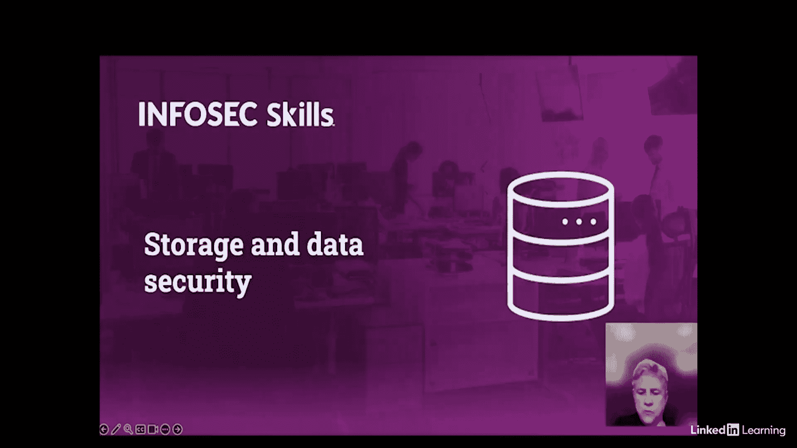
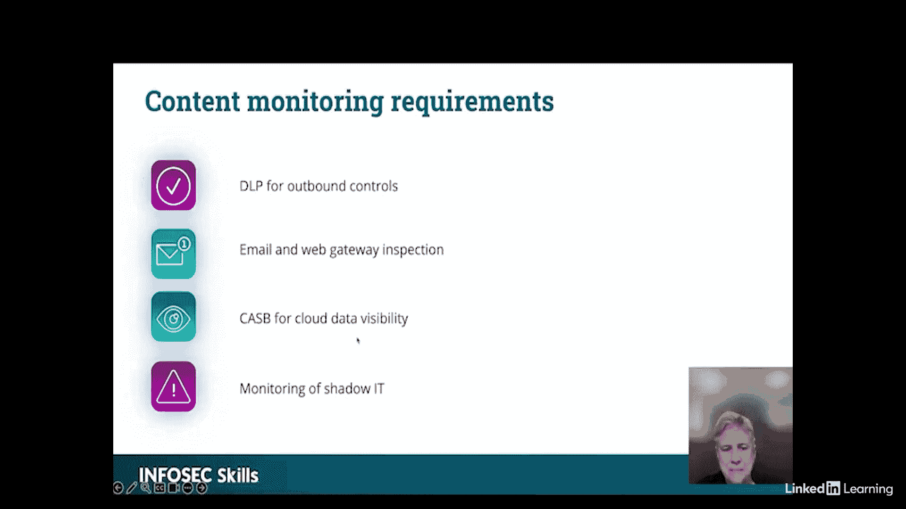

ISSAP 认证教程：05：存储与数据安全 🔒

在本节课中我们将要学习存储与数据安全的核心知识。存储安全本质上就是保护我们的数据，不论数据是静止存储还是在网络中传输。我们会讨论存储架构、加密机制、密钥管理、应用安全以及日志监控等内容。这些知识构成了信息系统安全架构的重要基础，帮助我们在云环境、虚拟化环境和多租户环境中保护敏感信息。请跟随本教程逐步理解每一个安全控制点，建立完整的防护观念。

## 一、存储安全的核心要求

存储安全关注的是保护集中式存储设备，对数据进行加密，保护加密密钥，并控制对共享资源的访问。在云计算、虚拟化和多租户环境中，这些要求变得尤为重要，因为多个客户共享同一套物理基础设施，安全风险也随之增加。

存储安全的核心要求包括以下几项：

- 集中式存储保护，防止未授权访问存储设备
- 数据加密，确保静态数据不被泄露
- 加密密钥保护，防止密钥被窃取
- 共享资源访问控制，只允许授权用户使用

以上就是存储安全需要重点关注的几个方面，我们会在后续章节中逐一展开说明，帮助你从整体上理解存储防护体系。

## 二、SAN 与 NAS 存储架构

接下来我们来看看存储区域网络和网络附加存储。这两种是企业中最常见的集中式存储方式，它们承载着敏感的企业信息、虚拟机镜像和备份数据，是数据安全防护的重点区域。

存储区域网络用缩写 SAN 表示，网络附加存储用缩写 NAS 表示。

SAN 和 NAS 的作用如下：

- 存储企业敏感信息，作为核心数据仓库
- 保存虚拟机镜像文件，支持虚拟化环境
- 存放备份数据，确保业务连续性

为了保护这些存储机制或设备，我们需要实施网络分段，强制身份验证，并启用加密。在光纤通道存储区域网络中，还需要关注逻辑单元号掩码，也就是 LUN 掩码。逻辑单元号用编号 LUN 表示，它是指向存储中特定位置的指针。我们需要确保这些指针受到保护，并且配置了良好的身份验证访问控制，同时对备份进行持续监控，这些都是保护存储卷的常见做法。

了解了存储架构之后，我们来看看如何对存储卷中的静态数据进行加密。

## 三、存储卷与静态数据加密

存储卷是逻辑存储单元，用卷表示。我们需要对静态数据进行加密，也就是数据存储在磁盘上时不以明文形式存在，防止物理设备丢失导致数据泄露。

静态数据加密可以用下式表示：

数据存储状态 = 明文数据 → 加密算法 → 密文数据

即使磁盘被盗窃，或者存储设备被攻破，加密后的数据依然无法被读取。全盘加密或全卷加密是常见的实现方式，例如 BitLocker 就是典型的全盘加密工具。市面上还有其他各种工具可以实现同样的功能，原理都是在数据写入磁盘前将其加密。

加密只有在密钥得到妥善保护时才有意义，因为加密密钥就是打开加密数据之门的钥匙。如果攻击者获得了密钥，所有的安全管理都将失效，数据防护也就形同虚设。

## 四、密钥管理与生命周期

安全密钥管理是存储加密的基础。密钥的生成和存储位置非常关键，通常可以放置在硬件安全模块或密钥管理服务器中。硬件安全模块用 HSM 表示，密钥管理服务器用 KMS 表示，它们是保护密钥的专用设备或系统。

我们需要保护这些密钥管理元素，确保它们经过加固处理。密钥生命周期管理包括以下各个阶段：

- 密钥生成，在安全环境中创建密钥
- 密钥存储，将密钥保存在 HSM 或 KMS 中
- 密钥轮换，定期更换过期密钥
- 访问控制，限制谁可以恢复密钥
- 职责分离，避免单人拥有完整密钥管理权限
- 密钥销毁，在密钥生命周期结束时安全删除

每个阶段都需要融入安全控制，防止密钥被泄露或滥用。只有完整保护密钥生命周期，加密才能发挥应有的作用，确保数据长期安全。

## 五、传输中数据保护

除了静态数据，我们还需要保护传输中的数据。传输中的数据是指正在网络中移动的数据，而传输协议本身通常不提供保护，容易被窃听。

因此我们需要在传输协议之上增加安全层，常见的方式包括使用 TLS 或 IPsec。

数据传输保护可以简化表示为：

原始数据 → TLS / IPsec 加密通道 → 目标接收端

这样可以确保数据在网络传输过程中不会被窃听或篡改。无论是静态数据还是传输中数据，都需要按照分类标准和安全策略基线进行相应保护，做到全方位覆盖。

## 六、应用程序安全开发

对于应用程序，我们需要遵循应用开发最佳实践，并在代码开发阶段引入安全扫描，从源头降低漏洞风险。

应用程序安全开发包含以下实践：

- 代码扫描，使用静态应用程序安全测试，也就是 SAST，对代码进行评估
- 运行时测试，使用动态应用程序安全测试，也就是 DAST，在应用程序运行期间检查安全问题
- 软件物料清单，用 SBOM 表示，了解应用程序中使用了哪些软件组件
- 身份验证与授权，为每个应用程序配置独立的访问控制
- 可追溯性，确保安全需求对应具体的安全控制措施，并能够追溯控制措施的添加原因

我们需要验证资产是否已得到充分保护，并开展差距分析。差距分析用于回答应用程序当前处于什么状态，需要达到什么状态，以及如何弥补差距。同时，还需要准备文档和证据收集，以应对审计和认证检查，证明安全措施已到位。

## 七、日志基础设施与审计准备

基础设施日志需要有一个集中收集点，例如安全信息和事件管理系统，用 SIEM 表示。我们需要确保日志时间同步准确，可能需要部署网络时间服务器，并将日志与用户身份关联，以便将活动追溯到具体主体。日志保留期限应根据法律法规或内部策略确定，以满足合规要求。

日志收集与管理需要满足以下要求：

- 集中收集点，部署 SIEM 系统统一汇总日志
- 时间同步，使用网络时间服务器保证时间戳准确
- 身份关联日志，将操作追溯到具体用户身份
- 日志保留，依据法律法规或内部政策保存日志

在监控方面，数据防泄漏系统，也就是 DLP 系统，是重要的防护手段。DLP 系统用于防止数据从内部网络向外部泄露，也称为数据外泄。

## 八、数据防泄漏与影子 IT

云接入安全代理，也就是 CASB，可以与 DLP 集成并提供数据泄漏防护。CASB 还可以进一步添加策略或查找恶意软件，扩展安全防护能力。

电子邮件和网关检查同样重要，因为网关是环境中的汇聚通道。我们需要查看进入环境的内容，并关注影子 IT 现象，防止未经授权的服务带来安全隐患。

影子 IT 指的是用户在未经组织知悉的情况下使用云资源或 IT 服务。以下是需要关注的影子 IT 行为：

- 用户上传文件到 Dropbox 或其他公共位置，组织不知情
- 用户使用互联网上可用的人工智能工具
- 用户使用未授权的云服务或 IT 服务

我们需要持续查找影子 IT，了解用户在做什么，并采取相应措施加以管理，防止数据在不可见的渠道中流动。

本节课中我们一起学习了存储与数据安全的核心内容。我们讨论了存储安全的核心要求，了解了 SAN 与 NAS 存储架构，掌握了存储卷与静态数据加密的方法，学习了密钥管理与生命周期保护，探讨了传输中数据保护的 TLS 与 IPsec 技术，介绍了应用程序安全开发与差距分析，说明了日志基础设施与审计准备的要求，并最后讨论了数据防泄漏系统与影子 IT 的识别。希望这些内容能帮助你建立完整的存储与数据安全防护体系，为后续学习打下坚实基础。

