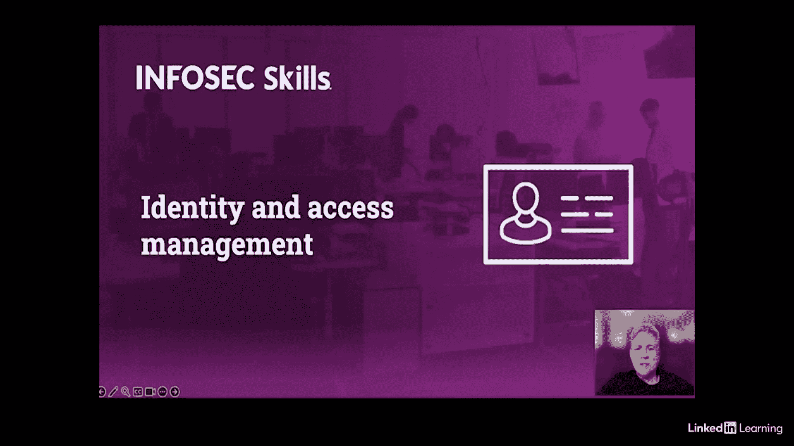
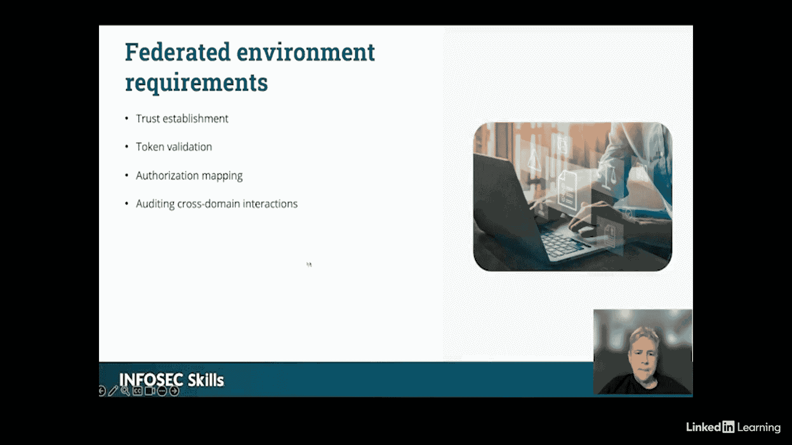

信息系统安全架构专业师：第6节：身份和访问管理 🔐




在本节课中我们将要学习身份和访问管理的核心知识。这部分内容是信息系统安全架构的重要组成部分，主要讲解如何确认用户身份、如何控制用户能够访问哪些资源，以及在用户离职或岗位变更时如何及时收回权限。我们会从身份的完整生命周期开始，依次介绍单点登录、多因素认证、授权模型、策略决策与执行、联合身份管理以及特权访问管理等话题。每个概念都会用大白话来解释，并加入一些实际例子，帮助初学者快速建立直观的理解。


先来看看身份的生命周期。

## 身份生命周期 🔄

在一个组织里，用户身份不是一成不变的，而是会经历一系列阶段。我们可以把这个过程理解为身份的生命周期，从入职时的身份证明开始，一直到离职时账号被注销结束。整个过程贯穿了用户在组织中的任职期，也是访问控制生命周期的重要组成部分。

以下是身份生命周期的主要阶段：

1. 身份证明。新员工入职时需要提供驾驶执照、护照、出生证明等材料，证明自己就是声称的那个人。
2. 账号配置。身份证明通过之后，组织会为用户创建并配置账号，这个过程叫做配置。
3. 监控与审计。用户在公司工作期间，其账号活动会被持续监控和审计，以确保没有异常行为。
4. 账号撤销。当用户离开公司时，其账号最终会被撤销，不再拥有访问权限。

用公式来描述这个生命周期，可以表示为：

```
身份证明 → 账号配置 → 监控与审计 → 账号撤销
```


接下来我们来看看单点登录和跨域信任。

## 单点登录与联合信任 🌐

为了提升用户体验，组织通常希望用户只需登录一次，就能访问多个系统，甚至跨越不同的域或组织边界。这就是单点登录和联合身份的应用场景。实现这个目标不仅需要技术支持，更需要不同域之间建立信任关系。

以下是实现单点登录需要关注的几个关键点：

1. 联合信任。不同域之间必须建立信任关系，才能互相接受对方的身份证明。
2. 身份提供者。可以是内部系统，也可以是外部服务，负责为用户出具身份凭证。
3. 多因素认证。在允许单点登录之前，通常要先做好多因素认证，增加安全性。

单点登录的流程可以简化为：用户登录门户 → 身份提供者验证 → 签发令牌 → 服务提供者信任令牌 → 用户访问多个软件系统。这里的核心在于信任，身份域和服务提供者之间必须有信任关系，否则令牌就无法被接受。


有了登录和信任，我们再看看怎么更安全地验证身份。

## 多因素认证与密码策略 🔑

仅仅依赖密码已经不够安全了，因为用户经常设置弱密码，密码也容易被彩虹表等工具破解。多因素认证通过要求用户提供多种不同类型的证明，大幅提高了账户安全性。

多因素认证通常包含以下几类因素：

- 你知道的东西，比如密码或 PIN 码。
- 你拥有的东西，比如手机、令牌卡或安全密钥。
- 你本身的特征，比如指纹、面容或虹膜。

用更正式的说法，这对应认证方式中的基于知识、基于持有和基于特征三种类型。

近来无密码策略越来越流行。无密码的意思就是不再依赖传统密码，而是更多依赖你拥有的设备或你的生物特征。当然，设备绑定的凭证也有风险，比如设备丢失、被盗或损坏，所以这也不是完美的方案，但总体上比单纯靠密码更安全。


身份确认之后，还需要决定用户能做什么，这就涉及授权架构。

## 授权架构模型 🛡️

确认用户是谁之后，系统还需要知道这个用户被允许访问什么资源、能执行什么操作。这就是授权，常见的模型有基于角色、基于属性和基于策略三种。

以下是三种授权模型的对比：

- 基于角色的访问控制。根据用户在公司中的角色来决定权限。比如人事部门员工可以访问薪资系统，其他人不能。
- 基于属性的访问控制。根据用户的任意属性来决定权限，比如所在部门、工作地点、安全等级等。这种方式可以做得非常细致。
- 基于策略的访问控制。使用集中式策略来动态决定是否授权，目前越来越受到重视。

基于属性的访问控制可以用简单的逻辑来表示：

```
IF 用户部门 = 人事 AND 用户地点 = 总部 THEN 允许访问薪资系统
```

除了这些模型，还有一个重要概念叫及时特权访问。管理员不需要一整天都以管理员身份登录，通常使用普通账号，只在需要执行管理操作时临时提升权限，完成后立即降回普通权限。这样可以减少高权限账号长期暴露的风险。


授权决策需要一个地方来做，这就是策略引擎相关的概念。

## 策略决策点与策略执行点 ⚙️

基于策略的访问控制需要一个专门的组件来决定允许还是拒绝访问，这个组件就是策略决策点。策略决策点有时也叫作 PDP，负责判断用户请求是否符合策略，返回允许、拒绝或条件访问的结果。

策略决策点通常依赖一个属性存储，里面保存用户所属组、设备健康状态、安全分级等信息。策略决策点会根据这些属性来做出决定。

而策略执行点，也就是 PEP，则负责在实际的访问请求处强制执行决策结果。比如用户想要加入网络，或者从 DHCP 服务器获取 IP 地址，如果系统健康分数不够，DHCP 服务器作为策略执行点就会拒绝分配 IP 地址。

一个简单的策略执行场景可以用伪代码描述：

```
如果 用户系统健康分数 < 阈值
    则 拒绝分配 IP 地址
否则
    允许分配 IP 地址
```

策略决策点负责下决策，策略执行点负责执行决策，两者配合才能完成完整的访问控制。


当访问需要跨越不同组织或域时，联合身份管理就派上用场了。

## 联合身份与跨域信任 🤝

联合身份管理主要关注跨域的认证和授权。用户早上登录本组织的门户，之后就能访问管理员配置好的所有软件，而不需要反复输入密码。

建立跨域信任需要满足以下条件：

1. 身份提供者需要向服务提供者发送经过签名的令牌。
2. 服务提供者需要信任来自该身份提供者的令牌。
3. 令牌可以是 SAML 令牌，也可以是基于 OpenID Connect 的令牌，关键在于双方之间存在信任关系。

令牌验证包括检查签发者是否可信、是否在有效期内、完整性是否完好。只有这三项都符合要求，服务提供者才会接受该令牌。

联合身份虽然方便，但也扩大了攻击面，因为信任关系被延伸到了组织边界之外。因此必须在多个域之间进行日志记录和监控，以保持问责性和合规性，必要时还能开展调查。


对于拥有最高权限的账号，安全要求更高，这就是特权访问管理的范畴。

## 特权访问管理 🔒

特权账号是指拥有管理权限或比普通用户更高权限的账号，如果这些账号被攻破，可能会对组织造成最大损失。因此需要额外的保护和监控。

特权访问管理包含以下几个关键措施：

1. 密码保险库。不要在多处共享特权密码或密钥，而是将它们存放在安全的保险库中，比如 CyberArk 或 HashiCorp 等工具。
2. 凭证轮换。如果发生任何可能的泄露，应该立即轮换凭证，降低被利用的风险。
3. 会话录制。对管理会话进行监控和记录，比如 SSH 访问、RDP 远程桌面协议、命令执行、账号创建等敏感操作，确保有迹可循。
4. 分层管理模型。将管理账号分为第零层、第一层和第二层。第零层控制身份管理和信任关系，权限最高；第一层运行业务系统；第二层支持终端用户设备。低层级的账号不得执行高层级的功能，这样可以隔离权限。

分层管理的目的是减少影响半径，也就是限制单个管理员可能造成的损害，同时也限制管理员之间横向移动的能力。

用简单的层级关系表示：

```
第零层 > 第一层 > 第二层
```

低层级不得跨越到高层级执行操作。


最后，我们总结一下联合环境下需要注意的要求。

## 联合环境要求 📋

在联合环境中，不同域之间必须建立信任，接受对方的域身份认证，或者确保对方接受我们的域身份认证。这通常通过令牌来实现。

在使用令牌时，需要验证以下内容：

- 签发者是否可信。
- 令牌是否在有效期内。
- 令牌的完整性是否完好。

授权映射是指将用户角色映射到具体的权限和访问权限，并且这个过程也需要被审计。

由于联合身份扩展了攻击面，跨域的日志记录和监控必不可少，以便在必要时保持问责、合规并具备调查能力。




本节课中我们一起学习了身份和访问管理的核心内容。我们讲解了身份从证明、配置、监控到撤销的完整生命周期，探讨了单点登录、联合信任和多因素认证，对比了基于角色、基于属性和基于策略的授权模型，介绍了策略决策点和策略执行点，还讨论了特权访问管理中的密码保险库、会话录制和分层管理模型，最后概括了联合环境下的信任建立、令牌验证和审计要求。希望这些内容能帮助你建立起对身份和访问管理的整体认识。
