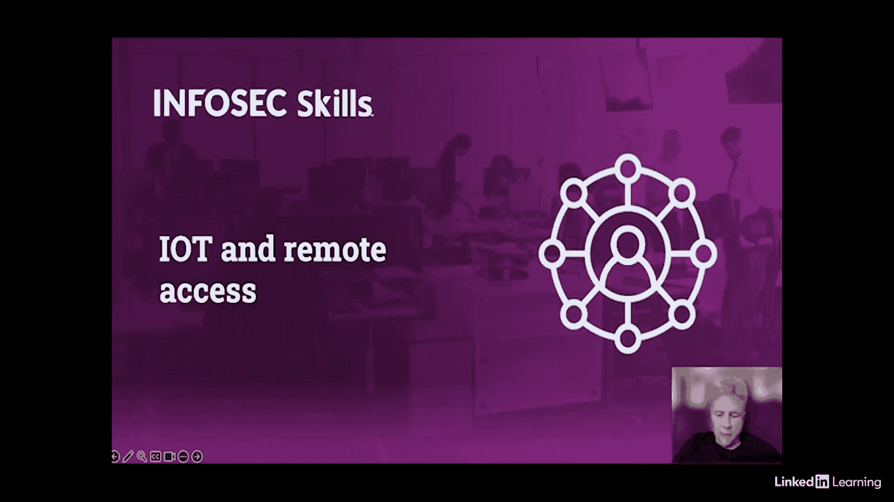
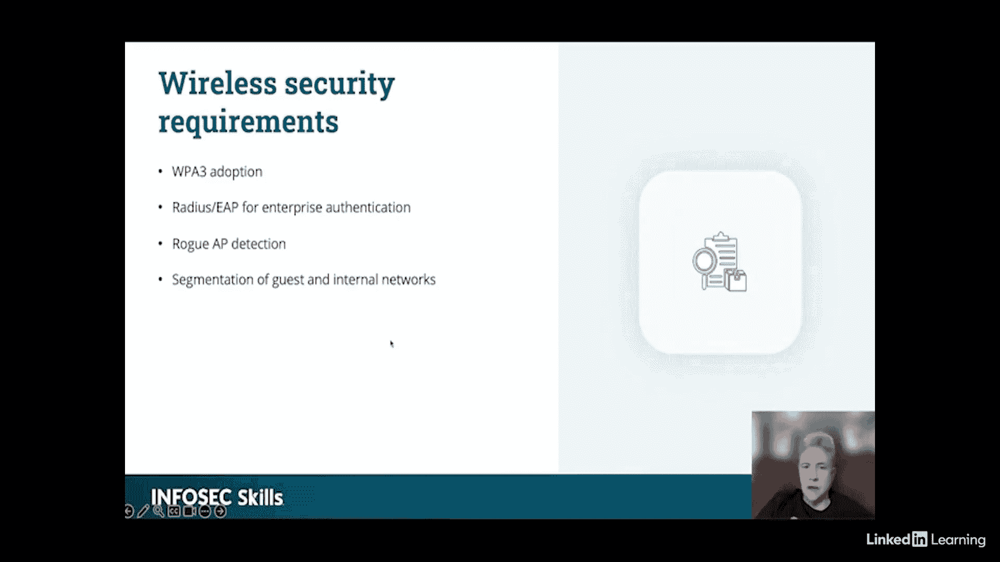

# 🛡️ ISSAP 信息系统安全架构专业师：07：物联网与远程访问安全


## 📖 课程概述



本节我们将学习物联网、运营技术以及远程访问的安全架构知识。在本节课中我们将要学习运营技术系统与传统企业IT系统的区别，为什么在这类环境中安全和可用性比保密性更重要，如何实现确定性通信，物联网设备的安全入职与固件管理，零信任与软件定义参数的作用，以及无线网络的加固方法。这些内容对于理解工业环境下的安全架构非常有帮助，建议大家跟着节奏一步步来看，不要跳过任何一个小节。

## 🏭 1. 运营技术（OT）与传统IT的不同

上一节我们介绍了通用的安全架构概念，本节中我们来看看运营技术到底是什么，以及它和我们平时接触的企业IT系统有什么不同。

当我们提到传统IT系统时，通常是指办公室环境里的电脑、服务器和网络，大家主要是在共享信息、处理邮件和文档。但是运营技术，也就是OT，完全不一样。OT关注的是物理世界的控制，比如工厂的生产线、电力电网、输油管道、工业控制系统，甚至包括核电站和炼油厂这类关键基础设施。

在这些环境中，我们的首要目标不再是保护数据不被泄露，而是确保人身安全和系统持续可用。保密性固然重要，但在这类场景下，安全和可用性的优先级通常更高。

为什么要这么强调隔离呢？因为水处理厂、电网这类公共资源的控制系统，一旦被攻破，可能会直接危及公众安全。所以我们需要把控制它们的系统和其他网络严格隔离开来。

同时，变更控制也必须非常严格。不能随便对这些系统做修改，理想情况下应该使用不可变工作负载，确保任何变更都必须经过合规的变更管理流程，不能擅自发生。

为了保证业务不中断，还需要做好冗余和故障转移。简单来说，就是要有备用设备或线路，万一主系统出了问题，备用系统能立即接手，让生产继续运行。监控工作也不能中断，要在不影响运行的前提下持续观察系统状态。

### 网络隔离架构

以下是隔离区设计的核心要点：

- 生产网络必须与可能影响安全的监控系统隔离
- 使用VLAN和防火墙来实现逻辑隔离
- 控制设备的通信路径要受到严格保护

架构师通常会在关键区域部署VLAN和防火墙，以确保生产网络不会被外部或办公网络直接访问，从而降低安全事故的风险。

下面给出网络隔离的逻辑表达：

```
生产网络 ∩ 可能影响安全的系统 = 空集
```

## ⚙️ 2. 确定性通信与连续监控

刚才我们介绍了OT的隔离和变更控制，接下来我们来看看OT环境里的通信有什么特殊要求，以及如何进行安全监控。

在OT系统中，设备之间的通信不能像普通网页浏览那样“偶尔慢一点也没关系”。这里需要的是确定性通信，也就是说，设备必须在正确的时间、按照正确的顺序、以极低的延迟收到信息，几乎不能有不可预期的卡顿。

举个大白话的例子，想象一条装配线上的机械臂，控制器可能需要每5毫秒收到一次更新指令。如果网络突然丢包或延迟，机械臂就可能动作走样，甚至发生安全事故。所以OT通信必须可靠且可预测，这就是确定性通信的核心含义。

关于监控，OT环境通常要求被动监控，也就是不向网络中注入任何额外数据，避免干扰正在运行的工业流程。监控系统需要具备协议感知能力，能够识别工业控制协议，并且必须是非侵入式的。

为了在不中断业务的前提下发现威胁，我们通常会部署专用的入侵检测系统、资产发现工具和行为分析系统。这些工具可以帮助我们看到设备状态、流量情况以及异常行为，从而在不干扰生产的情况下及时发现潜在风险。

下面给出确定性通信的核心特征：

```
延迟 ≈ 0
消息顺序 = 固定
时延 < 安全阈值
```

### 默认安全通信原则

以下是默认安全通信的处理方式：

- 系统出现故障时应默认进入安全关闭状态
- 防止压力积聚等物理危险
- 确保紧急控制功能继续正常工作
- 隔离任何可能不安全的设备或区域

如果系统出了问题，设备应该默认进入安全的操作状态，而不是继续乱跑。比如在压力容器中，如果检测到异常，系统应该安全停机，防止压力过度积聚导致爆炸。紧急停止按钮和安全联锁必须在任何情况下都能正常工作，同时需要把可能不安全的部分隔离开来。这非常重要，因为OT环境被攻破不仅会损坏设备，还可能直接威胁人身安全和关键基础设施。

下面给出默认安全的状态转移：

```
系统故障 → 默认进入安全关闭状态 → 防止物理危险
```

## 🔗 3. 物联网（IoT）与工业物联网（IIoT）

前面我们聊了OT的通信和监控，现在可能会有人问，为什么在讲物联网的时候要提运营技术？这两者到底有什么关系？

其实很多运营技术系统本身就使用了物联网设备。比如工厂里的传感器会把数据发送到云端仪表板，智能电表、设备维护系统都是联网的。当物联网技术被应用到工业控制系统中时，我们通常称之为工业物联网，简称IIoT。所以OT、IoT和IIoT在很多场景下是紧密交织的。

在物联网设备的安全要求方面，每一台设备都应该有唯一的身份标识，这样才能进行追溯和审计，知道是谁在什么时候做了什么操作。

设备加入网络的过程也必须安全，需要有一个受信任的注册或入职流程，不能让任何陌生设备随便接入。

固件完整性和补丁管理同样不能忽视。很多人觉得物联网设备不需要打补丁，但实际上厂商会发布补丁来修复漏洞，这和传统服务器或电脑一样重要。

另外，物联网设备的通信路径应该被分段和隔离，与企业内部其他网络分开，目的就是减少攻击者在内网横向移动的机会。

### IoT设备安全核心要求

以下是物联网设备需要满足的关键安全条件：

- 每台设备拥有唯一ID，支持追溯与审计
- 设备入职必须经过受信任的注册流程
- 固件保持最新并及时打补丁
- 通信路径与企业其他网络分段隔离
- API输入需验证格式，防止代码注入和畸形数据
- 使用mTLS、JWT等基于令牌的机制进行身份验证
- 对API实施速率限制，缓解暴力破解和拒绝服务攻击

在API安全方面，所有的输入都要做架构强制和格式验证，防止代码注入或畸形数据被利用。同时，互传TLS和基于令牌的保护可以确保通信双方都经过身份验证。为了应对暴力破解、API滥用和拒绝服务攻击，还需要设置速率限制，监控异常流量。可以看到，物联网和OT环境的安全需求与传统IT环境有大量重叠。

## 🔐 4. 零信任与软件定义参数（SDP）

刚才我们讨论了物联网设备的安全基线，接下来要聊一个目前非常主流的安全理念，也就是零信任架构，以及它与软件定义参数的关系。

零信任的核心思想很简单，就是不再默认信任网络内部的任何人或设备。过去我们使用VPN时，用户连上后通常就能访问整个企业网络，这种模式存在很大风险。而软件定义参数则不同，用户连接后只能访问自己被明确授权的特定设备、服务或资源，而不是整个局域网。

这就好比过去发一把万能钥匙，现在只发能开特定房间的门禁卡。安全边界被收得更紧了。

在实施零信任远程访问时，除了软件定义参数之外，还需要安全隧道来保护连接，并且要检查设备的安全态势，比如是否打了补丁、是否安装了反恶意软件、是否符合健康合规要求。所有这些要素结合在一起，其实并不复杂，核心就是：消除隐式信任，持续验证用户和设备，限制攻击的破坏半径，保护远程连接。

下面是零信任原则的代码化表达：

```
trust = 0
verify(everything)
不存在隐式信任
持续验证用户与设备
限制破坏半径
```

### 零信任原则与实践

以下是零信任架构在远程访问中的具体体现：

- 访问仅限于授权的应用和资源，而非整个网络
- 用户与设备需要持续验证，不存在永久信任
- 使用多因素认证和证书进行身份确认
- 评估设备安全态势，包括补丁状态和反恶意软件
- 对远程会话进行监控、记录并定期审查
- 支持联合身份，实现跨域身份互认

零信任的关键原则可以概括为：假设什么都不可信，不信任任何人，验证一切。在远程访问场景中，虽然VPN仍然可以使用，但软件定义参数通常是更好的选择，因为它能更精确地控制访问范围，与零信任网络架构的设计目标更加一致。

## 📶 5. 无线网络与远程访问加固

前面我们学习了零信任和软件定义参数，最后这部分我们来看看无线网络的安全配置，以及如何更好地保护远程访问环境。

在无线安全方面，现在建议大家使用WPA3协议。相比于旧版本，WPA3提供了更强的加密能力，能更好地抵御密码攻击和弱密钥交换攻击。它的握手过程使用了名为Dragonfly的机制，使得连接建立更加安全。

下面给出无线安全强度对比：

```
WPA3 > WPA2
支持Dragonfly握手
```

对于企业环境，可以使用RADIUS服务器进行集中认证。RADIUS有时也被叫做可扩展认证协议 over LAN，它的作用是让所有远程接入设备的认证策略在一个中心位置统一管理，从而保证策略一致性，增强对网络的控制。

另外，我们需要定期扫描网络，寻找流氓接入点。流氓接入点或者“双胞胎”接入点非常危险，攻击者可能在办公区域放置一个伪装的无线热点，诱导员工连接，然后将流量转发过去，从而完成中间人攻击。所以检测和清除这些非法设备是必须的。

如果公司要为访客提供WiFi，访客网络必须和内部网络完全分开，放在一个独立的、受保护的隔离网段中，这样即使访客设备有安全问题，也不会直接威胁到内部核心系统。

下面是无线安全配置清单：

- 部署WPA3，启用更强加密和Dragonfly握手
- 使用RADIUS实现企业级集中认证
- 定期扫描并清除流氓接入点和双胞胎接入点
- 为访客WiFi配置独立隔离网络
- 隔离网络需与内部生产网络严格分开

通过这些措施，我们可以显著提升无线环境和远程访问通道的安全性，减少未经授权接入的风险。

## 📚 总结



本节课中我们一起学习了物联网与远程访问的安全架构知识。我们了解了运营技术与传统IT系统的区别，掌握了安全和可用性在OT环境中的优先地位，学习了确定性通信、默认安全通信和连续监控的重要性。接着，我们探讨了物联网与工业物联网的关系，梳理了物联网设备在身份标识、安全入职、固件补丁、网络分段和API安全方面的要求。最后，我们介绍了零信任与软件定义参数的实现方式，以及WPA3、RADIUS、流氓接入点检测和访客网络隔离等无线安全加固方法。希望这些内容能帮助大家在实际的架构设计中，更好地保护物联网、OT和远程访问环境。
