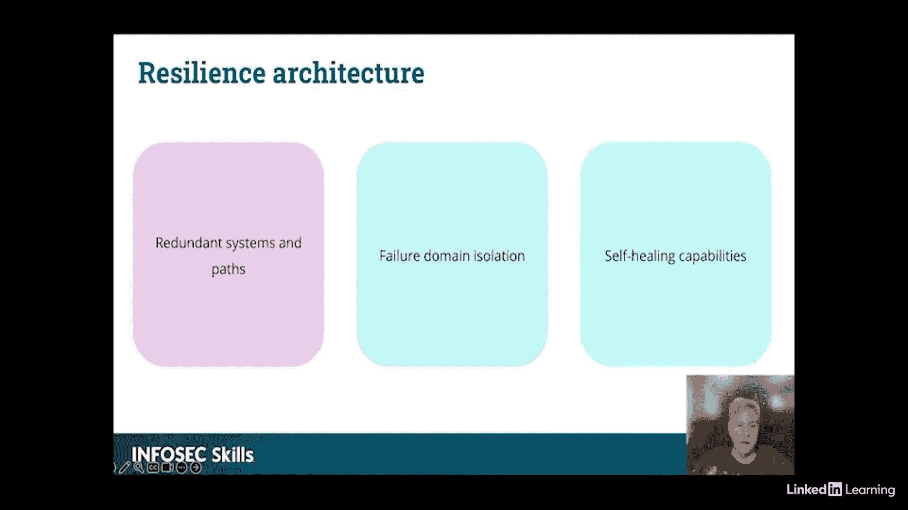

# ISSAP：08：韧性与业务连续性 🛡️

在本节课中我们将要学习系统韧性与业务连续性的核心概念。本节内容包括冗余设计、故障隔离、自愈机制、容错架构、负载均衡、分布式部署、防 DDoS 防护、高可用切换、灾难恢复指标、数据复制、地理多样性、备份策略、事件响应、配置管理以及可见性与漏洞管理。通过这些内容，你将了解如何在架构设计中构建能够抵御故障、快速恢复并持续运行的信息系统。

## 冗余系统与路径

首先，我们来看看冗余系统与冗余路径。这些是构建韧性架构的基础。服务器是关键功能所在，因此我们需要考虑多台防火墙、多台交换机以及多路电源等冗余设备。同样的道理也适用于冗余路径，即我们可以与互联网服务提供商建立多条连接，并在广域网路由中实现冗余。这样做的目的是，当某条链路发生故障时，流量仍然能够自动继续传输，而不会中断业务。

以下是常见的冗余设备示例：
- 多台防火墙
- 多台交换机
- 多路电源
- 多条互联网服务提供商连接
- 广域网路由冗余

## 故障域隔离

上一节我们介绍了冗余系统和路径，本节中我们来看看故障域隔离。故障域隔离的目标是降低我们所谓的“爆炸半径”。也就是说，我们希望确保一次故障影响的范围尽可能小。为此，我们可以采用微分段技术，并将工作负载分散到大量不同的系统上。这样一来，如果发生故障，故障影响就会保持在隔离状态，不会蔓延到整个环境。

以下是常用的隔离手段：
- 微分段
- 工作负载分散

## 自愈能力

接下来，我们讨论自愈能力。某些系统在发生故障时可以自行修复。例如，`Kubernetes` 能够自动重启崩溃的容器。云环境可以自动扩展。数据库集群支持自动故障切换。这些都是有韧性的系统。当某个组件出现故障时，系统会发现问题，要么修复它，要么替换它，从而保证服务继续运行。显然，架构层面的韧性是构建系统与环境韧性的第一步。

以下是自愈能力的典型例子：
- `Kubernetes` 自动重启容器
- 云环境自动扩缩容
- 数据库集群自动故障切换

## 容错能力

在了解自愈能力之后，本节中我们来看看容错能力。容错是指避免单点故障。无论是通过磁盘阵列实现硬盘冗余，还是配置多路电源、使用集群或部署多台服务器，冗余都是容错的关键。当我们谈到负载均衡时，关注的是服务器的质量。比如 Web 场景，用户访问网站时，后端有任意数量的服务器，负载会在这些服务器之间分发，以便获得更高的可用性和更好的服务质量。

以下是常见的容错措施：
- 磁盘阵列硬盘冗余
- 多路电源
- 服务器集群
- 多台冗余服务器

## 负载均衡

上一节我们介绍了容错能力，本节中我们来看看负载均衡。负载均衡的作用是将流量分发到多台服务器上，避免单台服务器过载。这样不仅能提升可用性，还能保证服务质量。当一台服务器出现问题时，其他服务器可以继续处理请求，用户几乎感觉不到中断。

## 分布式架构

接下来，我们讨论分布式架构。分布式架构有多种实现方式，但核心思想都是韧性。与其构建一个庞大的中心化系统，不如将服务分散到整个环境中。这样即使某个系统宕机，整体仍能继续运行。我们可以回到微服务的概念，同时也要考虑云区域和内容分发网络。内容分发网络是一个完美的例子，内容分布在遍布全球的 Web 服务器上。如果某台服务器故障，流量会被重定向到另一台服务器，同时也能提升服务质量。

## 防 DDoS 防护

上一节我们介绍了分布式架构，本节中我们来看看防 DDoS 防护。防 DDoS 防护包括流量过滤和网络监控。我们需要确保不会有大量流量指向某个特定的服务或服务器。为此，可以使用清洗中心，即专门用于监测恶意流量并尝试将其清除的区域。通过这些方式，我们可以在设计、构建和架构中加入韧性。

## 高可用与故障切换

接下来，我们讨论高可用与故障切换。当我们谈到集群时，通常有两种类型：`主动-主动` 和 `主动-被动`。`主动-主动` 意味着有多台服务器，它们都属于集群并响应流量。这样可以获得良好的性能、冗余和非常快速的故障切换，属于自愈架构。`主动-被动` 则有一台主服务器响应请求，另一台备用服务器在等待。备用服务器会监听心跳，心跳表示“我还在，我还在”。当心跳停止时，备用服务器接管。不过，这种方式没有负载均衡，因为备用服务器不处理活跃请求，配置起来更简单，也不必太担心数据一致性问题。两种方式各有优势，但故障切换架构非常重要。

以下是两种集群模式的对比：
- `主动-主动`：多台服务器均响应流量，性能好，故障切换快
- `主动-被动`：主服务器处理请求，备用服务器等待心跳，配置简单

## 环境测试

上一节我们介绍了高可用与故障切换，本节中我们来看看环境测试。我们还需要测试环境，确保能够恢复已故障的系统，能够从备份中恢复，并能够回归完全运行状态。

## 业务连续性与灾难恢复指标

接下来，我们讨论业务连续性与灾难恢复的核心指标。在业务连续性和灾难恢复方面，首先要讨论恢复时间目标和恢复点目标。恢复时间目标是指我们希望多快恢复服务。恢复点目标是指我们能容忍多少数据丢失。两者都以时间表示。恢复时间目标是指我们需要多快将某个系统重新上线。恢复点目标是指数据必须多新，因为这将决定我们的备份计划。

以下是两个关键指标的定义：
- 恢复时间目标 `RTO = 服务恢复所需的最大时间`
- 恢复点目标 `RPO = 可接受的最大数据丢失时间`

## 复制完整性与测试

上一节我们介绍了恢复时间目标和恢复点目标，本节中我们来看看复制完整性与测试。当我们拥有多个系统时，需要考虑冗余路径、故障切换和复制完整性。我们要确保这些系统保持同步，且没有数据损坏。还要考虑延迟，以及所谓的 `脑裂` 情况。`脑裂` 是指主服务器和备用服务器都认为自己是主服务器，也就是原始真理来源，因此可能会出现不同步的更新或数据，这也是需要关注的问题。

## 定期测试与文档

接下来，我们讨论定期测试与文档。从灾难恢复角度看，测试包括清单测试或桌面推演测试，这些是基于纸面的，可以让我们走一遍拟定的计划并判断是否合理。然后进入仿真测试，即实际走一遍流程。我们可以进行并行测试，在两个站点同时运行业务，也可以进行全中断测试，即从主设施完全切换到异地位置。全中断测试风险很大，需要对计划有极大的信心。

以下是常见的灾难恢复测试类型：
- 清单测试
- 桌面推演测试
- 仿真测试
- 并行测试
- 全中断测试

## 同步与异步复制

上一节我们介绍了灾难恢复测试类型，本节中我们来看看同步与异步复制。架构要能运行，需要同步或异步复制。无论是异地设施、镜像数据库、集群还是镜像，复制都是关键。以镜像数据库为例，数据如何复制？同步复制是指数据同时写入两个源，这样恢复点目标非常快，理想情况下恢复时间目标也很快。缺点是写入两个系统会降低性能，并且需要确保连接高度可靠。对于关键任务服务，同步复制是个好主意。异步复制则是先写入主服务器，然后定期将数据复制到备份服务器。这种方式系统性能更好，在长距离传输上更合适，因为跨广域链路复制时延迟较高，而且更容易扩展。

## 地理多样性

接下来，我们讨论地理多样性。地理多样性有很多例子，比如亚马逊的可用区，或者将主数据库放在某个地方，同时在不同城市或云区域部署冗余资源。我们要防范的是区域性灾难。

## RTO 与 RPO 对齐

上一节我们介绍了地理多样性，本节中我们来看看 RTO 与 RPO 对齐。我们需要思考如何让恢复时间目标和恢复点目标保持一致。如果恢复时间目标是五分钟，就需要非常快速的故障切换，以及高可用基础设施。同步复制在这种情况下至关重要。在设计架构时，我们必须考虑恢复时间目标和恢复点目标，并问自己真正的业务需求是什么。

## 离线与不可变备份

接下来，我们讨论离线与不可变备份。离线备份是指将数据存储在离线状态，比如异地设施，或者使用可移动驱动器和隔离存储库。不可变备份是指备份不能被更改，即一次写入介质，确保没有任何方式可以通过恶意软件或管理操作来修改备份。我们还要考虑使用什么加密，数据保留多久，数据保留通常由法律、法规或业务需求驱动，我们需要依据这些因素制定策略。然后要测试恢复流程，确保在需要恢复时具备恢复能力。也就是说，我们要测试备份。

## 事件响应与取证准备

上一节我们介绍了离线与不可变备份，本节中我们来看看事件响应与取证准备。事件响应需要确保有日志用于调查。如果可能发生调查，比如犯罪行为，需要以不同的方式保护证据，高度重视证据保护与保全，即取证准备。我们要思考是否有内部团队，是否有流程，是否能确保日志同步，这一点非常重要。虽然这不是取证课程，但我们必须在当今环境中考虑基于良好取证原则进行设计。可追溯性和审计非常重要。

## 配置管理

接下来，我们讨论配置管理。首先需要安全基线，必须首先建立基线，然后推送基线，之后任何变更都要使用版本控制，并且必须遵循正式的变更审批流程。这样做能通过稳定性提供安全性，防止环境处于持续变动之中。随着我们向 `基础设施即代码` 方向发展，还会讨论 `不可变基础设施`，即基础设施不能被修改，以保持与基线配置一致。这都是安全性与业务需求之间的平衡。

## 可见性与漏洞管理

上一节我们介绍了配置管理，本节中我们来看看可见性与漏洞管理。可见性是指从运营角度能否发现问题。比如，什么时候扫描漏洞？是每周一次、每月一次，还是对特定环境持续扫描？这都需要明确定义。必须能够根据风险进行优先级排序，不是每个漏洞都是危机，有些比较危险。我们会参考通用漏洞评分系统，即 `CVSS`，帮助确定并优先处理已发现漏洞的价值。当然，还要修补系统，使其具有韧性并能抵抗攻击。持续可见性是指继续监控，当新系统上线时，能够检测到，是否有缺失的补丁？影子 IT 是什么？用户是否在引入或连接未经授权的资源？我们要如何处理和发现它？这些都需要内建。漏洞管理中的持续扫描非常重要，并且要确保高可见性。

## 总结

本节课中我们一起学习了韧性与业务连续性的多个方面。我们探讨了冗余系统与路径、故障域隔离、自愈能力、容错架构、负载均衡、分布式架构、防 DDoS 防护、高可用与故障切换、环境测试、恢复时间目标与恢复点目标、复制完整性、同步与异步复制、地理多样性、备份策略、事件响应与取证准备、配置管理以及可见性与漏洞管理。希望这些内容能帮助你掌握如何在信息系统架构中构建韧性，并确保业务在面对故障和灾难时能够持续运行。
