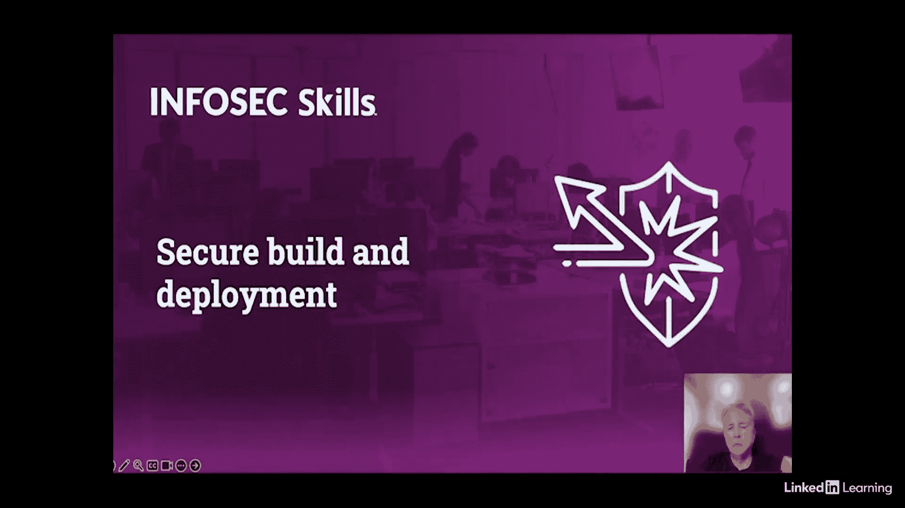
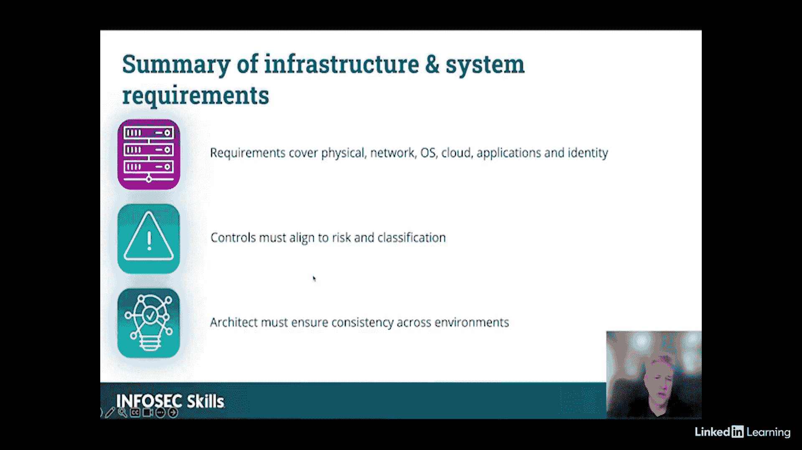

# ISSAP信息系统安全架构专业认证：09：安全构建与部署 🔒


在本节课中我们将要学习安全构建与部署的核心内容。我们会先从保障软件交付流水线安全说起，然后逐步深入不可变基础设施、签名构建、CI/CD流水线防护、依赖项完整性、资产发现、安全通信、网络分区以及核心基础设施安全等主题。每一部分都围绕同一个目标展开：在构建、测试、打包和部署系统的全过程中，始终把安全放在首位，确保我们交付的软件和基础设施是可信、可追溯且难以被篡改的。




## 保障软件交付流水线安全 🔧

我们要保障软件交付流水线的安全。这意味着在构建系统、测试系统、打包系统、部署系统的每个环节，都要聚焦安全，确保没有薄弱环节被攻击者利用。只有整个交付链条都受到保护，最终交付给用户的系统才具备基本的可信度。


## 不可变基础设施与基线一致性 🏗️

我们先看一些要求。近几年非常流行的做法是部署不可变基础设施。不可变的意思是不能更改。传统的做法是登录服务器手动修改、更新或打补丁，而不可变基础设施的做法是直接替换镜像和容器，重新构建而不是修改。当我们创建不可变架构或不可变基础设施时，恶意代码和漏洞被引入的难度会大大增加。我们将使用镜像和模板等方式来构建系统。

以下是传统环境中容易出现的关键问题：

- 配置基线随着时间发生偏移，系统逐渐脱离安全基线。
- 手动修改导致环境不一致，难以在多个实例中重复部署。
- 一旦服务器被人为修改，该服务器就不再可信。

我们要防止配置漂移，保持持续且一致的环境。我们希望环境可重复，以便可以在多个实例中部署。在DevOps场景下，如果服务器被修改，它就不再可信，因此必须重新构建或替换。


## 签名构建与供应链完整性 ✍️

因此我们使用签名构建。我们拥有构件，其中记录了谁创建了它，以及验证它未被修改的信息。我们的构件可能是容器镜像、软件包或任何二进制文件。我们可以使用多种工具来实现这一点，其中一个重要的工具是代码签名证书，它能提供防篡改保障和来源可信度。

核心验证逻辑可以用下面的公式表达：

```
验证结果 = 验证签名(构件, 公钥) && 检查哈希(构件, 预期哈希)
```

当然，我们的目标是防止软件供应链被篡改。我们要能够检测恶意活动和任何配置漂移，确保完整性和真实性。你还记得SolarWinds攻击吗？恶意代码被引入软件，CI/CD流水线最终被数字签名并推送出去，这次泄露影响巨大。因此我们要确保保护CI/CD流水线。


## 保护CI/CD流水线 🛡️

这里我们可以实施很多工具和控制措施。例如多因素身份验证、最小权限原则、隐藏密钥。这些想法不仅适用于不可变架构和保护CI/CD流水线，而且非常重要。因为如果攻击者能够攻破流水线，就像SolarWinds事件一样，他们可以将恶意软件插入构建中。他们可能会窃取密钥、部署恶意代码，引发各种问题。因此流水线在这里是最高价值的目标，也是我们不可变基础设施的起点。我们必须确保保护好CI/CD流水线。不惜一切代价。虽然我不愿说不惜一切代价，但这是关键要素之一。


## 依赖项完整性与软件物料清单 📦

我们还要考虑依赖项完整性，因为现代应用程序不再独立运行，存在第三方库或软件包。我们需要考虑对软件物料清单进行哈希处理，了解库中包含的其他内容或库的详细信息，确保使用经批准的软件包仓库，并扫描漏洞。因此当我们讨论安全构建和部署要求，以及当今运营和基础设施构建方式时，这一点变得至关重要。

以下是依赖项管理需要关注的要点：

- 对软件物料清单进行哈希处理，确认每个库的内容。
- 只使用经过批准的软件包仓库。
- 定期扫描第三方库中的漏洞。


## 资产持续发现与清单管理 🔍

像往常一样，我们要从资产入手。我们要保护什么，价值多少。如果不知道保护什么，也不知道价值多少，我们该如何保护，又如何以适当方式保护。只有先摸清家底，才能制定合适的防护措施。

我们从资产持续发现开始。当然，我们从典型的资产清单开始，但不能只做季度性的，当然也不能每年一次，甚至手动操作都会让我们面临遗漏资产的风险。我们希望采取持续自动化的流程。我们需要能够发现新的虚拟机、容器、物联网设备。我们需要这种高度动态的发现方式。你知道，当今环境高度动态。你可能有一个容器只存在一分钟，而不是永远。我们具有自动扩展功能。云环境能够快速创建和销毁服务器，这增加了挑战。

以下是资产发现需要具备的能力：

- 持续的网络扫描，自动发现新上线的资产。
- 维护最新的资产清单。
- 与变更管理数据库集成，记录资产变更。
- 利用所有可用工具实现自动化发现。

再说一次，依赖映射至关重要，要确保了解什么依赖于什么。如果不准确，如果我们对资产清单和资产没有准确评估，我们又将无法正确保护它们。


## 安全通信与证书管理 🔐

现在来看安全通信。我们知道许多使用的通信协议本身并不安全。因此我们要强制使用TLS或双向TLS，管理证书生命周期：证书何时过期、如何安全颁发、是否轮换，确保有吊销证书的方式并将其公开。我们内部为系统托管私有PKI。防止降级攻击意味着我们要降低攻击者导致系统回退到较弱协议或算法的风险。我们的重大目标是确保通信经过身份验证、加密，并防止拦截或篡改。

通信安全目标可以简化为：

```
通信 = 身份验证 + 加密 + 防拦截 + 防篡改
```


## 网络分区与零信任 🌐

然后是网络分区。你知道，在谈论零信任架构时，网络分区变得非常重要，因为我们根据安全需求划分网络。我们将限制影响范围，确保暴露区域较小。我们有DMZ，用于放置面向公众的系统，如Web服务器和邮件服务器。我们还为敏感系统设置分区。你知道，目标是防止横向移动。是的，仅限管理员的区段。我们管理管理平面，确保只有管理员可以访问该管理平面。

网络分区的主要目的包括：

- 根据安全需求划分网络区域。
- 限制攻击成功后的影响范围。
- 减小暴露区域，防止横向移动。
- 将管理平面隔离，仅允许管理员访问。


## 监控与分段 📊

当然，我们还要监控。我们基于风险进行监控，就像其他一切一样。如果我们能减少横向移动，我们将强制执行分段。我们将基于风险实施安全控制。然后我们将改善内部环境。监控不是孤立的动作，它需要与网络分区和风险评估结合，才能发挥真正的防护作用。


## 核心基础设施与共享安全要求 🖥️

既然我们关注共享安全要求，我们就要考虑保障核心基础设施的安全。目录服务。身份和身份验证就在这里发生。因此我们在这里谈论Active Directory。我们谈论身份和访问管理的核心。

不同的日志平台用于收集和分析信息，即SIEM系统。我们要审查日志。我们谈过密钥和密钥管理系统，用于保护密码或API密钥。确保任何加密密钥都是安全的，因为它们是任何加密过程和任何保密性的核心。

共享API网关将是API流量在服务间传输时的集中控制、身份验证和监控点。所有这些都是将与其他元素交互并真正推动核心安全的组件。

然后我们还要考虑端点。我们运行着不同的操作系统。不同操作系统需要不同的补丁。它们具有不同的身份结构。所以，在部署安全策略时，必须针对每种操作系统的特点分别制定补丁管理和身份管理方案。


## 总结 📝



本节课中我们一起学习了安全构建与部署。我们了解了如何保障软件交付流水线安全，如何通过不可变基础设施防止配置漂移，如何利用签名构建和代码签名证书保障供应链完整性，如何保护CI/CD流水线免受攻击，如何管理依赖项和软件物料清单，如何持续发现和管理资产，如何通过TLS和私有PKI实现安全通信，如何基于零信任进行网络分区，如何基于风险进行监控和分段，以及如何保护目录服务、日志平台、密钥管理系统、API网关和端点等核心基础设施。这些内容共同构成了安全构建与部署的完整体系，帮助我们在现代动态环境中构建可信、可追溯且难以被攻破的系统。

