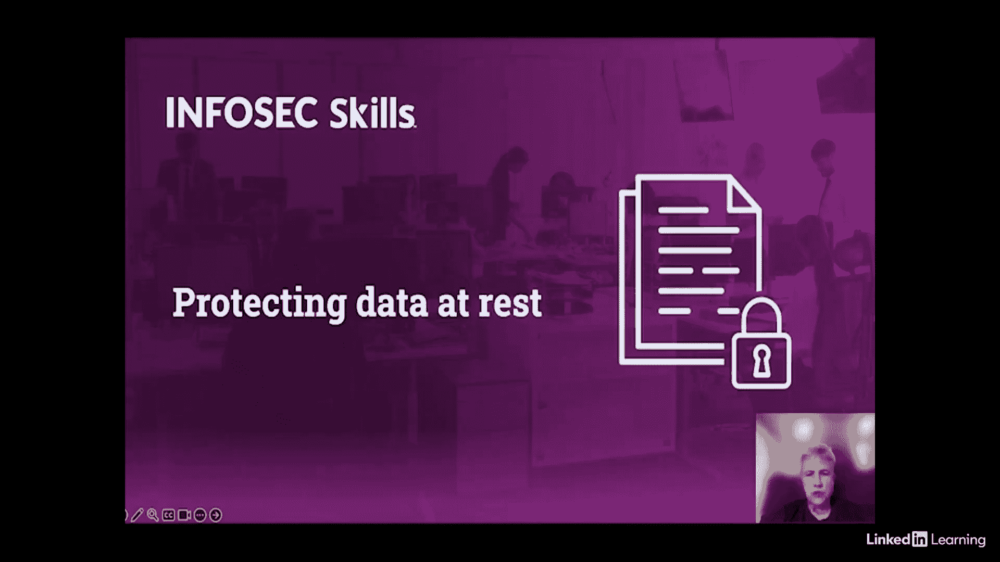
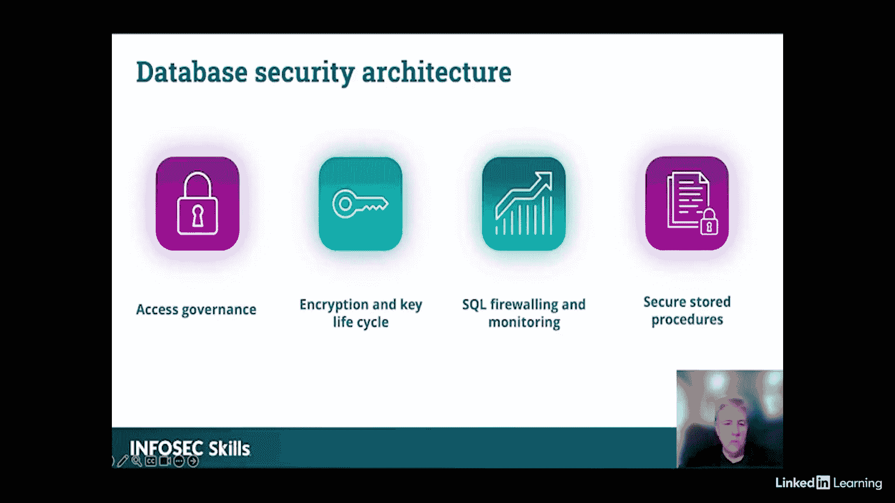

# 🔐 ISSAP信息系统安全架构专家: 第10章: 保护静态数据

在本节课中我们将要学习如何保护静态数据。静态数据指的是存储在磁盘、数据库或备份设备中、当前没有在网络上传输的数据。我们会先了解数据通常存放在哪里，然后讨论加密、密钥管理、访问控制、备份保护、数据保留策略以及数据库安全等核心内容。学完本节后，你应该能够理解如何从存储、访问和管理多个层面来保护静态数据，防止未授权访问和数据泄露。


## 静态数据保护的整体思路

首先，我们来看看保护静态数据的基本思路。保护静态数据和保护传输中的数据都是我们的首要任务。在这里我们先专注于静态数据的保护。静态数据就是不在移动、保存在存储设备里的数据。我们要确保这些数据不会被未授权的人员读取或篡改。

## 数据存储位置与网络隔离

接下来我们需要弄清楚数据到底存储在哪里，才能制定相应的保护措施。



以下是常见的数据存储位置：

- 存储区域网络（Storage Area Network, SAN）
- 网络附加存储设备（Network Attached Storage, NAS）

无论数据存在哪里，我们都要确保存储系统与网络中其他部分隔离开来。同时，必须制定严格的访问控制，明确哪些流量被允许访问这些存储系统，哪些流量被禁止。这样可以大幅降低外部攻击者或内部恶意用户接触存储数据的机会。

## 加密与密钥管理

在存储位置明确之后，保护静态数据最常用的手段就是加密。

以下是加密保护可以包含的方式：

- 文件级加密
- 全盘加密
- 其他必要的资源保护措施

加密虽然非常重要，但加密的强度完全取决于密钥的保护情况。也就是说，加密系统的安全性等于密钥保护的安全性。可以用公式表示：

```text
加密安全性 = 密钥保护强度
```

我们需要思考密钥是如何生成的，密钥存放在什么地方，以及密钥如何被用来保护数据。如果密钥泄露，再强的加密算法也无法保护数据安全。

## 备份数据的保护

除了生产环境中的数据，备份数据同样需要重点保护。

以下是备份保护应当包含的要点：

- 与生产数据同等强度的保护
- 网络分段隔离
- 加密存储

备份中的数据本质上也是静态数据，因此攻击者可能会把备份当作薄弱环节来攻击。我们不能只保护原始数据而忽略备份，必须对备份实施分段，并使用加密等关键手段，确保备份数据的安全性与主数据相当。

## 访问控制与最小权限

数据加密和物理隔离之后，还需要控制谁能够访问存储中的数据。

访问控制通常遵循以下原则和机制：

- 最小权限原则（Principle of Least Privilege）
- 基于角色的访问控制（Role-Based Access Control, RBAC）
- 日志记录与监控

最小权限原则的意思是，每个用户或程序只能获取完成工作所必需的最小权限，不能多给任何权限。可以用简单的逻辑表示：

```text
用户权限 = 完成工作所需的最小权限集合
```

基于角色的访问控制则是根据用户的工作职责来分配权限，只有真正需要访问数据的人才能获得访问权。与此同时，我们要对所有访问行为进行日志记录和实时监控，以便在出现异常时及时发现和处理。

## 数据保留策略

访问控制解决了谁能看数据的问题，接下来我们要考虑数据应该保留多长时间。

制定数据保留策略时需要考虑以下因素：

- 法律合规要求
- 内部政策规定
- 实际业务需求

数据保留的时间不应该无限期延长，而应当足够满足法律法规和公司政策的要求即可。保留时间越长，我们需要保护数据的时间就越长，相关的安全成本和泄露风险也会随之增加。因此，在满足合规的前提下，数据保留时间应尽可能短。

## 数据仓库与敏感数据保护技术

确定保留时间之后，我们需要看看数据具体存放在什么样的仓库里，以及如何保护其中的敏感信息。

常见的数据仓库和保护技术包括：

- 安全数据库
- 文件存储
- 结构化数据与非结构化数据
- 数据遮蔽（Masking）
- 令牌化（Tokenization）
- 删改（Redaction）

数据仓库中可能包含结构化数据，也可能包含非结构化数据。为了保护敏感信息，我们可以使用数据遮蔽，将敏感部分遮挡或模糊处理；使用删改，直接移除敏感内容；或者使用令牌化，用公开可用的令牌代替敏感数据。令牌化的示意如下：

```text
敏感数据 -> 令牌 -> 映射表 -> 真实数据（存放在防火墙保护后的安全环境中）
```

真实的敏感数据则存放在防火墙保护后的安全环境中。

## 元数据治理与合规

数据本身的保护之外，关于数据的数据，也就是元数据，也需要纳入保护范围。

元数据治理需要关注以下方面：

- 元数据标签（Metadata Tagging）
- 数据访问方式
- 数据挖掘依据
- 所有权与合规要求

元数据描述了数据的结构、格式、来源和用途，很多时候数据挖掘是基于元数据进行的。如果元数据泄露，也可能暴露敏感信息。因此我们要保护元数据的敏感性，明确数据的所有权，并通过治理机制确保数据存储符合合规要求。

## 数据库架构安全

说完通用的数据存储保护，我们进入更具体的数据库架构安全讨论。

保护数据库架构需要做好以下工作：

- 访问治理，明确谁可以访问数据库
- 访问粒度控制，确定访问深度
- 数据加密保护

数据库安全的基础依然是治理，要明确哪些用户或系统可以访问数据库，以及他们能访问到什么程度。除了治理，还要重点关注加密，确保数据在存储时不被泄露。当我们把数据库放到云端时，还需要思考加密是在本地完成，还是在云端完成，这直接影响数据的保护效果。

## 云端数据保护与数据库防火墙

云环境下的数据保护有一些特殊的考量因素，我们需要单独说一下。

云端和数据库层面的安全控制包括：

- 本地加密与云端加密的选择
- SQL防火墙
- 零信任架构（Zero Trust Architecture）
- 网络分段

在云端部署数据库时，我们要决定加密操作是在本地执行还是由云服务商执行。与此同时，可以部署SQL防火墙来检查数据库流量，发现并阻止恶意活动，例如代码注入攻击。零信任架构主张不默认信任任何内部或外部请求，而是将系统划分为多个隔离片段，通过防火墙检查所有流量。零信任的核心理念可以表述为：

```text
永不信任，始终验证
```

## 数据库访问控制与API安全

最后，我们要探讨应用程序如何安全地访问数据库。

安全的数据库访问可以通过以下方式实现：

- 存储过程（Stored Procedures）
- 安全API
- 限制应用程序与数据的直接交互

为了减少攻击面，我们不应该让应用程序直接随意访问数据库中的数据，而是通过存储过程来执行预定义的数据库操作。同时，提供安全的API供应用程序调用，并严格限制访问权限，确保只有授权的接口才能读取或修改数据。

## 总结



本节课中我们一起学习了保护静态数据的完整流程。我们讨论了数据存储的位置和网络隔离、加密与密钥管理、备份保护、最小权限和访问控制、数据保留策略、数据仓库与敏感数据保护技术、元数据治理、数据库架构安全、云端加密与SQL防火墙，以及数据库访问控制和API安全等内容。希望这些知识能帮助你构建更安全的静态数据保护体系。
