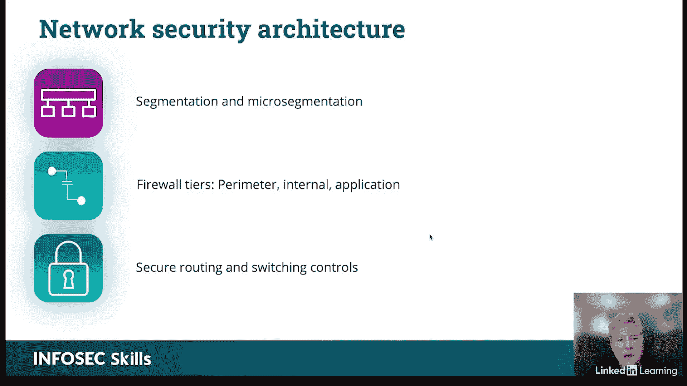
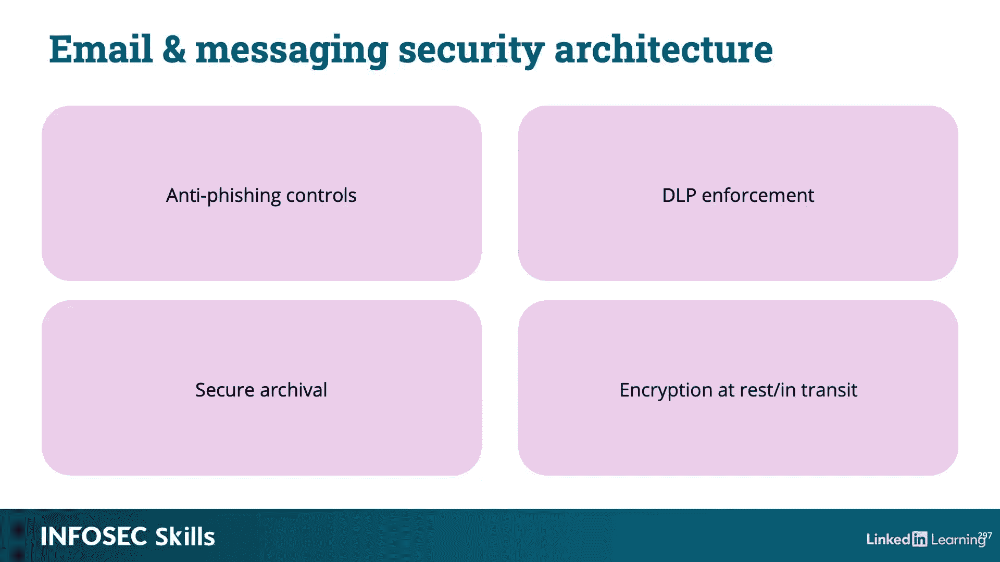

# ISSAP：第11章：保护传输中的数据 🔒

在本节课中我们将要学习如何保护数据在网络中传输时的安全。我们之前讨论过静态数据的保护方式，现在把重点放到数据在移动过程中的防护上。内容涵盖网络分段、零信任架构、防火墙分层、应用交付、云端安全、终端防护以及电子邮件安全等多个方面。通过这些知识，你可以构建一套能够抵御横向移动和未授权访问的防御体系。

### 安全网络架构是第一道防线 🛡️

上一节我们介绍了静态数据的保护方法，本节中我们来看看数据在传输过程中该如何防护。保护传输中数据的首要步骤是构建安全的网络架构。我们需要一个既能支持系统通信，又能确保通信安全的环境。为了实现这个目标，网络分段是非常关键的措施，它能够把一个庞大的网络拆分成若干个独立的区域。

以下是网络分段的核心做法：
- 根据每个区域内部的系统类型，将大型网络划分为独立的安全区域
- 在每个区域内部严格限制流量流动
- 防止攻击者在不同系统之间进行横向移动

我们一直使用网络分段，但微分段与零信任理念紧密相连。微分段的作用是把安全区域划得更小，把更小，把更小，从而把攻击影响范围控制在最低限度。影响范围可以用公式表示：`影响范围 = 被攻破区域内的资产数量`。通过减小区域规模，即使发生入侵，损失也能控制在很小范围内。现代安全架构讨论的核心思想正是限制横向移动，因为这与传统网络安全理念有很大不同。贯穿本节的始终是零信任架构。

### 防火墙分层与路由交换控制 🔥

在介绍了微分段之后，我们还需要多层防御来加固网络边界。除了微分段，我们还会部署防火墙分层。多层防火墙意味着在不同位置设置防火墙，形成纵深防御体系，确保没有单一的防护薄弱点。

以下是防火墙分层的常见位置：
- 边界防火墙，用于保护网络外围
- 内部防火墙，用于保护内部网络区域
- 应用防火墙，用于保护特定应用程序

除此之外，安全的路由和交换控制也不可忽视。我们需要确保路由器使用安全协议进行相互通信，同时采取控制措施防止未授权的流量操纵，以及防止未授权访问路由器和交换机。简单来说，我们不会仅仅因为某个系统在同一个网络里就信任它。我们将实施零信任架构，其核心原则是永不信任，始终验证。

### 零信任架构的核心理念 🚪

接着我们继续探讨零信任架构，这是整个部分的大前提。零信任架构的核心前提很简单：仅仅因为设备在网络内部，并不意味着它就是可信的。在传统架构中，一旦你进入网络，我们就默认你是可信的。但实际上，网络内部可能存在恶意设备、恶意服务、恶意软件等各种威胁，这些威胁可能来自原始网络，也可能来自我们的内部网络。

现在我们更看重身份作为新的边界，而不是网络边界。不再因为设备在内部就认为它可信，而是会提出以下问题：
- 你是谁
- 你从什么设备访问网络
- 你拥有什么角色
- 你是否已经认证

访问控制的决策将基于用户和服务账号，并结合单点登录、多因素认证、条件访问等机制。只要你在系统上的表现表明风险较低，就可以继续访问。一旦信任状态发生变化，访问权限可能会受到限制，或者你会被送到修复网络。身份驱动的访问控制公式可以表示为：`访问决策 = 身份 + 设备状态 + 风险等级 + 认证情况`。身份驱动的访问控制是非常关键的机制。

### 持续验证与遥测 📊

身份确定之后，我们还需要持续验证来确保安全状态始终符合要求。持续验证通过遥测来实现。遥测的核心思想是持续监控，类似于现代汽车时刻监测温度和错误状态，一旦异常立即发出警报。在安全架构中，SIEM系统和端点检测与响应系统会提供这种持续信息。

上下文感知策略执行同样重要，确保你始终符合策略边界才能获得访问权限。如果情况发生变化，访问权限也会相应调整。这样可以保证用户始终在策略允许的范围内操作，而不是一旦获得访问权限就一直拥有不受限制的使用权。

### 软件定义网络与动态分段 🌐

为了实现更灵活的网络控制，软件定义网络发挥了重要作用。软件定义网络，也就是SDN架构，在虚拟化环境中非常有用。我们不再需要逐个访问系统，而是可以通过集中控制器管理整个网络环境。集中控制带来的好处是更大的控制力和全网一致性，网络管理变得更加高效。

动态分段意味着网络访问可以自动变化，根据用户、设备或风险等级自动调整，网络边界不再固定不变。在底层物理基础设施之上，我们有虚拟化环境，再往上可以加入安全覆盖层。通过虚拟隧道在物理网络基础设施之上建立受保护的加密连接，就可以避免在公共互联网上未防护地传输数据。SDN架构可以用简单概念表示：`集中控制器 = 网络策略的单一管理点`。

### API访问控制与应用交付架构 🔌

网络基础设施安全之后，我们需要看看应用层如何安全交付。用户通常不会直接连接到应用服务器，而是会经过一系列安全层，每一层都会执行不同的安全或弹性功能。

以下是应用交付架构中的常见层次：
- Web应用程序防火墙，防止跨站脚本和代码注入等攻击
- 负载均衡器，将工作负载分布到多台服务器，保证服务质量
- API网关，作为后端应用的前门，确保策略执行和访问控制

API网关的作用类似于后端应用的前门，负责确保策略落地，保证访问合规，确保API通信安全。我们需要对认证和授权进行控制，还可以设置配额或限流，以保障API连接安全。我们的目标是替代需要手动修改的静态网络安全，追求敏捷性和灵活性，实现对不符合风险概况的主机进行自动隔离，并获得集中控制和可见性。

API安全包含三个要素：
- 认证：`认证 = 证明你是谁`
- 授权：`授权 = 你拥有什么权限`
- 验证：`验证 = 请求是否符合预期格式和规则`

验证要确保请求遵循预期格式和预期规则，阻止或限制不当访问。为了保障安全通信，我们会强制执行双向TLS并配合令牌，确保跨加密路径的安全通信。`mTLS = 双方证书验证 + 加密通信通道`。OAuth等令牌用于验证系统间的API访问控制。这本质上是零信任的延伸，利用云原生支持的安全机制。

### 云端与混合网络架构 ☁️

随着架构向云端倾斜，我们需要把云端环境当作内部环境来对待。我们要确保云端环境具有高度分段、策略驱动的特点，通过隔离工作负载来降低对互联网的暴露，控制横向移动，并在云端强制执行零信任。

对于虚拟私有云，不要只为组织使用一个VPC，而要将其拆分为多个隔离网络。VPC之间流动的流量也需要安全防护。终端上会安装检测和保护机制，然后使用云原生防火墙，结合安全组等云安全原则，对区域间流动的流量进行检查和过滤。

不是所有人都完全迁移到云端，所以混合网络架构需要安全地连接本地环境和云端环境。在谈论策略协调时，我们希望确保安全规则保持一致，混合网络和云端网络以及云端资源相互协调。我们需要覆盖两个环境的统一安全规则，并具备监控和可见性。这就是遥测发挥作用的地方，需要良好的系统来聚合不同环境的信息，并具备评估日志的知识。`持续验证 = 遥测数据采集 + 实时告警机制`。

继续在两个环境中构建零信任，侧重于基于身份的访问，而不是因为在网络内部就被信任。关键问题包括：你是谁，你从什么环境登录，你的风险概况是什么。

### 终端与移动端安全架构 📱

除了网络和云端，终端设备也是防护重点。端点安全架构包括端点检测与响应系统和基于主机的入侵检测系统。我们希望终端安全工具能够监控系统中任何可疑活动，及时发现潜在威胁。

比如，员工打开电子邮件附件，端点检测与响应系统发现有PowerShell活动，就会将该笔记本电脑与网络其余部分隔离，创建告警，通知事件响应团队或安全运营中心。这样在勒索软件、恶意软件或任何恶意代码扩散之前就能阻止它。

我们还需要设备加密，这样如果设备丢失或被盗，设备上的数据内容仍然受到保护。远程擦除与之配合，可以擦除设备上的内容。当然，从操作系统配置基线开始也很重要。如果操作系统不安全，就不能认为系统上的任何东西是安全的。我们需要确定操作系统的最低可接受安全配置，这是系统安全的基础。

如今，移动端安全比以往任何时候都更重要。我们不再只谈论笔记本电脑，还要考虑智能手机和平板电脑等更难以保护的设备，这些设备的安全管理面临更多挑战。

以下是移动设备管理的关键工具：
- Microsoft Intune
- VMware Workspace ONE
- 其他可对移动设备强制执行策略的工具

我们要确保移动设备按时获得更新，只运行经过批准的应用程序。如果设备被盗或丢失，就会触发远程擦除。

对于应用程序，我们需要应用沙箱。不能只因为应用被下载就信任它，必须确保应用在名为沙箱的安全空间中运行，隔离潜在的恶意行为。另外，良好的通信策略也很重要。如果移动设备从非安全网络或远程网络连接，应该强制通过VPN连接，以获得端到端安全。这和我们之前讨论的所有内容一样，是为各种连接到网络的设备以及网络架构本身提供全面安全保护。

### 证书与传输加密 🔐

设备和应用安全之后，传输过程中的加密也是基础。我们要使用TLS，摒弃HTTP或FTP等不安全协议，强制使用TLS，确保数据在传输过程中不被窃听。证书用于认证，所以需要建立适当的证书生命周期管理，包括证书颁发、续期、吊销以及一般管理。将PKI与标准认证流程集成，确保流量不会以明文形式在网络中传输。

这样可以防止嗅探、中间人攻击或数据篡改。我们使用的架构要确保流量在跨网络移动时得到保护，消除明文传输带来的风险。

### 电子邮件与消息传递保护 📧

最后一个话题是保护电子邮件和消息传递系统。电子邮件是恶意软件通过网络传播的一种方式，也是钓鱼攻击非常频繁的威胁向量，攻击者经常利用邮件诱使用户泄露信息。我们需要部署良好的垃圾邮件过滤器和各种反钓鱼控制措施。使用数据防泄漏执行来防止数据外泄。还要安全归档邮件，以便合规，同时确保超过保留期限的邮件被删除。

和往常一样，对静态数据和传输中数据进行加密，可以消除或降低流量的脆弱性水平。我们的最终目标是确保通信系统安全，防止用户被骗犯错并泄露不该提供的信息，确保受保护的信息流防止数据被窃取或泄露。

### 本节课总结 📚

本节课中我们一起学习了保护传输中数据的完整方法。我们讨论了安全网络架构、微分段与零信任、防火墙分层、身份驱动访问控制、持续验证与遥测、软件定义网络与动态分段、API访问控制与应用交付架构、云端与混合网络架构、终端与移动端安全、证书与传输加密，以及电子邮件与消息传递保护。希望这些内容能帮助你构建起全面的数据传输安全体系。
