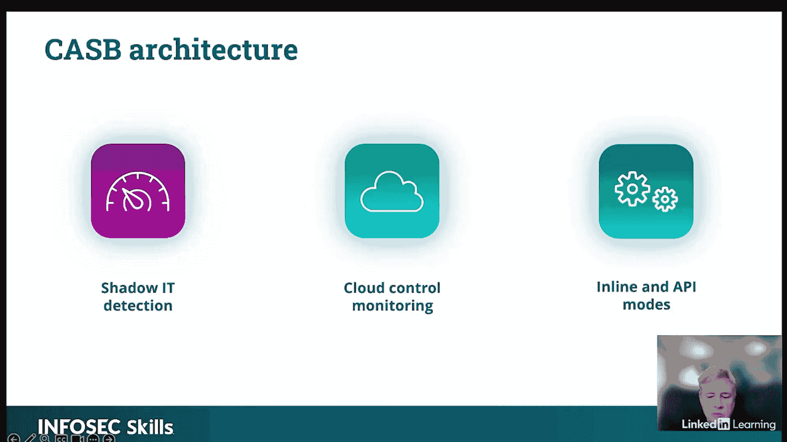
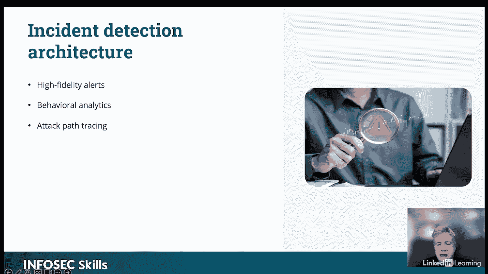
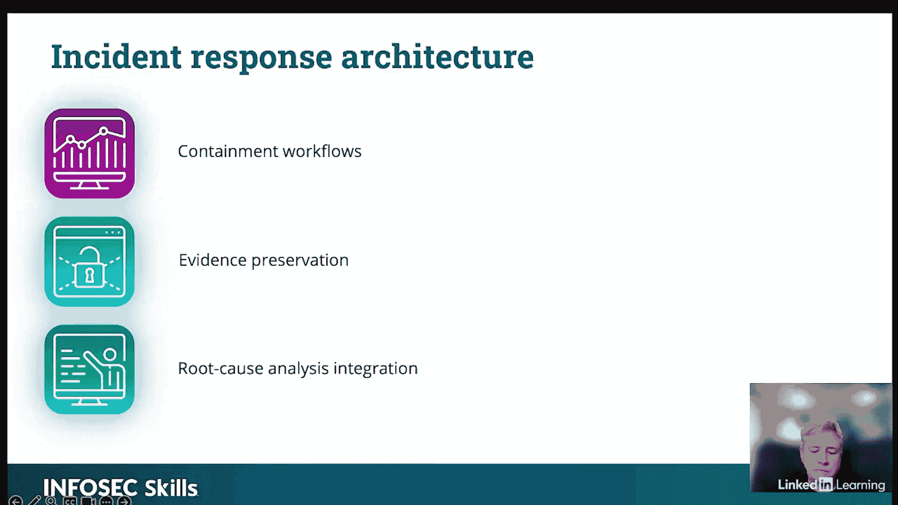

ISSAP信息系统安全架构专家：12：监控 📊


在本节课中我们将要学习监控在零信任架构中的核心作用。监控不仅仅是偶尔查看日志，而是需要持续不断地进行观察。我们会详细介绍持续监控是什么，如何收集和分析来自各种设备的遥测数据，日志如何进行聚合和标准化，日志架构应当如何设计以防止篡改，合规要求对日志保留有什么规定，可见性架构如何提供统一的安全视图，数据泄露防护系统如何阻止敏感数据外泄，云访问安全代理如何检查云端流量，以及事件检测和事件响应架构如何协同工作。通过这些内容，你将了解如何构建一套能够实时发现威胁并快速处理安全事件的完整监控体系。

持续监控与零信任架构 🔍

在零信任架构中，一个非常关键的要素就是监控。这里所说的监控不仅是普通的监控，而是持续监控。持续监控的意思是，安全系统需要不间断地观察网络中的所有活动，而不是只在特定的时间点进行检查。

为了实现持续监控，我们必须确保具备收集遥测数据的能力。遥测数据是指源源不断地从网络设备和用户实体行为分析系统中传来的大量信息。这些信息来自我们的源系统，各种组件会将这些数据拉取过来并汇总到一起。安全团队需要正确评估这些信息，从中提取出真正有价值的内容。

监控的目标是尽早发现威胁。当安全事件发生时，团队要能够立即进行调查，不仅要调查事件，还要尽可能对事件进行自动化处理。自动处理可以减少人工干预，提高响应速度，让安全团队把精力集中在最重要的问题上。

这些监控系统对整体安全架构至关重要。下面是几个核心组件：

- 安全信息和事件管理系统（SIEM）：负责集中存储并汇总日志
- 用户和实体行为分析（UEBA）：负责检测用户的异常活动，在恶意行为在网络中扩散之前发现它
- 安全编排、自动化与响应（SOAR）：负责将事件响应流程自动分配给响应团队，并根据事件自动执行相应操作

遥测数据收集与分析 📡

上一节我们介绍了零信任架构中的持续监控概念，本节中我们来看看如何具体收集和分析遥测数据。

遥测数据是安全监控的基础。我们需要不断地从各种设备中拉取日志信息。不同的设备记录错误的方式可能不同。例如，思科设备记录某种错误的方式，与Palo Alto设备记录同一错误的方式可能略有不同。日志标准化就是将这些不同格式的日志统一成一致的格式，以便安全团队能够发现趋势和模式。

可以用下面这个简单的公式来理解日志标准化：

```
原始日志 → 标准化处理 → 统一格式日志 → 趋势分析与告警
```

日志聚合和标准化的过程包括以下几个步骤：

- 从不同设备中收集原始日志
- 将日志转换为统一格式
- 对标准化后的日志进行分析
- 生成有意义的安全警报

处理完这些数据后，我们需要将其转化为可操作的安全情报。可操作的安全情报是指安全团队可以直接采取行动的信息，而不是需要进一步分析的原始数据。通过这种方式，事件响应团队可以收到警报，并优先处理最紧急的问题。

最终目标是获得更好的可见性、更好的威胁检测能力和更好的响应能力。

日志架构与完整性保护 🛡️

遥测数据收集与分析完成后，我们需要考虑如何安全地存储这些日志。本节中我们来看看日志架构的设计原则。

日志架构必须保证日志不会被篡改。为了实现这个目标，可以采取以下措施：

- 将日志写入一次性写入介质，防止日志被修改或删除
- 将日志存储在采集系统之外的不同位置，例如异地存储
- 限制管理员对日志的修改权限，即使是管理员也不应该能够随意更改日志
- 实施职责分离，确保没有单一个人拥有完全的日志修改权限

除了完整性保护，日志保留也需要符合合规要求。很多法律和法规规定日志必须保存一定的时间。组织需要在法律允许的范围内运行，并按照要求保留日志。

日志还应该记录与特定身份绑定的事件。问责制要求每个操作都能追溯到具体的用户。同时，需要监控日志文件本身的完整性，确保关键系统或日志文件没有被修改。常用的手段包括完整性监控和哈希校验。

合规保留与问责制 ⏱️

日志架构与完整性保护介绍完毕后，本节我们来看看合规保留和问责制的具体要求。

合规保留是指根据法律法规规定保存日志的时间。不同行业和地区对日志保留期限有不同要求。组织必须了解这些要求，并建立相应的保留策略。

问责制的核心是将事件绑定到特定用户。当安全事件发生时，调查人员需要知道是谁执行了什么操作。这要求系统记录用户身份信息，并确保这些信息不可篡改。

完整性监控也是问责制的一部分。我们需要知道日志文件本身是否被修改过。哈希值可以用来验证文件完整性，如果哈希值发生变化，就说明文件可能被篡改了。

可见性架构与单一控制台 🖥️

合规保留与问责制解决了日志存储和责任追溯问题，接下来我们来看看可见性架构。

可见性架构的核心仍然是遥测数据。我们需要从用户系统、防火墙、路由器、DNS服务、Active Directory、终端设备以及扩展检测与响应系统中持续收集流量数据。云环境中的容器和无服务器系统也需要提供日志并集中监控。

挑战在于如何将来自不同领域和云环境的大量信息结合起来，形成有意义的整体视图。可见性架构需要提供一个单一控制台视图，也就是通常所说的“单玻璃窗”视图。这样安全团队可以在一个界面中查看整个企业的活动情况，消除盲区。

消除盲区有助于实现有效的威胁检测和强大的事件响应。通过零信任和行为分析，我们可以减少安全事件发生的可能性，确保攻击者不会因为我们缺乏对网络的可见性而得逞。

数据泄露防护系统 🚫

可见性架构帮助我们了解网络中的活动，接下来我们需要防止敏感数据被窃取。本节中我们来看看数据泄露防护系统。

数据泄露防护系统，简称DLP，可以部署在终端工作站、网络边界以及云架构中。DLP的主要目标是根据数据分类防止数据外泄。数据分类可能包括公开、内部、机密等级别。

可以用下面这个公式来理解DLP的工作逻辑：

```
数据分类 → DLP策略匹配 → 阻止数据外泄
```

DLP系统可以监控数据在网络中的移动方式，并检测数据是否正在离开网络、被打印或被复制。在部署DLP之前，组织需要先建立良好的数据分类结构，识别数据资产并根据其价值进行分类。

从整体架构角度来看，我们要在整个信息生命周期中防止数据外泄。这不仅包括防止外部攻击者窃取数据，还包括减轻内部威胁。内部人员可能会出于恶意或非恶意目的导出有价值的信息。DLP系统需要监控对分类数据的访问，并强制执行合规要求。

云访问安全代理 ☁️

数据泄露防护系统主要关注数据本身，而当数据在云端流动时，我们还需要专门的工具来检查流量。本节中我们来看看云访问安全代理。

云访问安全代理，简称CASB，是位于用户和云应用程序之间的安全软件。随着云计算的普及，影子IT成为一个重要问题。影子IT是指内部用户使用安全团队未发现的云资源。例如，员工可能使用个人Dropbox上传公司信息，或者使用未经批准的AI工具处理公司数据。

这些行为可能是恶意的，也可能是无意的，但无论哪种情况都违反了安全策略。CASB的作用是检查并限制流向云端和来自云端的流量。

CASB支持两种主要部署模式：

- 内联模式：实时查看用户访问云应用程序时的流量
- API模式：直接连接云服务提供商，在活动发生后扫描数据和配置

这两种模式都是分层防御的一部分。CASB提供可见性，允许应用策略，并在流量从云端流出时进行实时检查。

事件检测架构 🚨

云访问安全代理解决了云流量检查问题，但如何及时发现安全事件本身呢？本节中我们来看看事件检测架构。

事件检测架构要求我们尽可能接近实时地发现事件。警报需要准确且有意义，这就是高保真警报的含义。安全团队不希望面对大量误报或低价值警报。需要对系统进行精细调整，以获得可操作的情报。

事件检测架构包括以下几个关键方法：

- 用户和系统行为分析：识别异常行为模式
- 攻击路径追踪：跟踪攻击者在环境中的移动，了解攻击者如何进入网络、使用了哪些横向移动技术，是否存在权限提升



可以用下面这个公式来表示事件检测的核心思路：

```
遥测数据 + 行为分析 → 高保真警报 → 攻击路径追踪 → 实时攻击识别
```

通过分析遥测数据和行为分析结果，安全团队可以尽可能接近实时地识别攻击，并在攻击造成严重损害之前采取行动。

事件响应架构 🆘

事件检测架构帮助我们发现攻击，接下来需要有计划地应对这些攻击。本节中我们来看看事件响应架构。

事件响应架构的目标是快速检测攻击并限制损害。安全团队通常会谈到限制爆炸半径，也就是确保能够快速遏制事件。具体措施包括：

- 隔离不符合合规要求的系统
- 阻止恶意活动
- 保留证据，确保证据以不可更改的信息形式存储
- 调查事件根本原因
- 找出需要弥补的差距，以降低未来发生类似事件的风险



可以用下面这个简单流程来理解事件响应：

```
检测攻击 → 限制损害 → 遏制事件 → 保存证据 → 调查原因 → 修复差距
```

证据保存非常重要，因为调查人员需要可靠的数据来了解事件是如何发生的。证据一旦被篡改，就可能失去法律效力或分析价值。

总结 📚

本节课中我们一起学习了监控在零信任架构中的重要作用。我们介绍了持续监控的概念，学习了如何收集和分析遥测数据，了解了日志聚合与标准化，探讨了日志架构和完整性保护，讨论了合规保留与问责制，掌握了可见性架构和单一控制台视图，认识了数据泄露防护系统和云访问安全代理，最后学习了事件检测架构和事件响应架构。



这些知识点共同构成了完整的安全监控体系，帮助组织实现实时可见性、及时威胁检测和有效事件响应。
