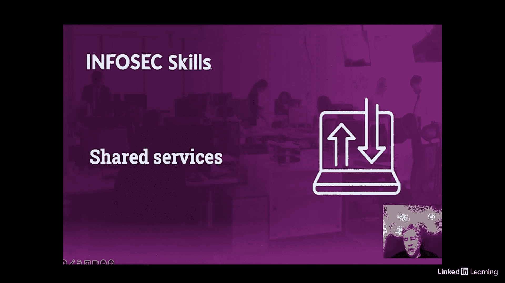
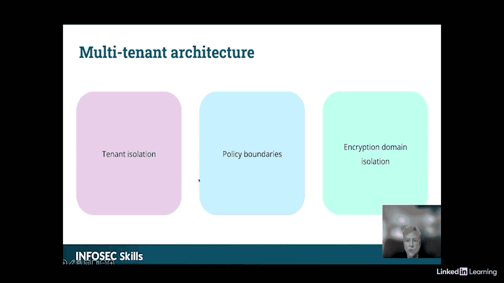

# ISC2 ISSAP：13：共享服务 🔐


在本节课中，我们将学习共享服务在信息系统安全架构中的作用。共享服务是指那些不由每个系统单独构建，而是在整个环境中统一提供的安全能力。我们会先看看共享服务架构的总体目的，接着介绍目录服务、密钥管理、日志与遥测、API 网关这些核心基础设施元素，最后讨论多租户架构在共享物理硬件场景中的重要性。学完本节，你会明白如何通过集中控制和标准化，为整个网络基础设施建立统一的安全基础，并为零信任架构提供支持。


## 共享服务架构的总体目的


在了解了安全架构的基础概念之后，本节中我们来看看共享服务架构如何运作。

部分安全能力是集中管理的。也就是说，这些能力不会在每个系统里重复构建，而是在整个环境中共享使用。这样做可以避免重复建设，也让安全管理更加统一，不同系统之间可以复用同一组安全功能。

我们会讨论目录服务、密钥管理、日志记录和 API 网关等内容。这些想法中有一些我们之前已经提到过，但这里的目的是在整个环境中强制执行并支持一致性，让所有系统都遵循同样的安全标准。

集中控制可以提升可扩展性，也让策略执行变得更容易。最终，我们会拥有一个影响整个网络基础设施的通用安全基础。共享服务架构的核心在于标准化、控制集中化、可扩展性和一致性，这些也是构建零信任架构的重要方式。

共享服务的基本逻辑可以用如下伪代码表示：

```
共享安全能力 = 集中控制 + 标准化接口 + 可扩展性 + 一致性策略
```

这个公式说明，共享服务不仅仅是把功能放在一起，而是通过集中统一的方式来支撑全环境的安全运作。


## 核心共享安全基础设施元素




讲完共享服务架构的总体思路后，接下来我们进入更具体的内容。

以下是系统和应用程序使用的核心共享安全基础设施元素：

- 目录服务：提供集中式身份管理。不管是在内部使用 Active Directory，还是使用 OCA 或 Intra ID 等云服务，或者是两者结合，目录服务都是身份信息的中心枢纽。
- 密钥管理：需要安全地生成密钥，并在密钥的整个生命周期内进行管理。这里的生命周期包括生成、存储、分发、轮换和吊销等环节。
- 日志与遥测：需要中心化的位置，也就是数据汇聚中心，将信息收集到一起并进行分析。没有集中日志，安全事件就难以及时发现。
- API 网关：作为进入后端应用程序的入口，通过网关来统一执行安全策略，例如身份验证、授权和流量控制。

以上这些元素共同构成了共享安全基础设施的骨架，各个系统和应用都可以复用这些能力，而不需要各自独立构建一套安全机制。


## 多租户架构与共享硬件


在介绍完基础设施元素之后，我们必须考虑多租户架构。

当我们与其他客户、其他组织，甚至业务单元共享物理硬件时，多租户架构是必须关注的重点。云计算平台、SaaS 平台以及各类托管服务都涉及这种场景，因此存在多租户环境的可能性，安全设计必须考虑到这一点。

多租户架构的核心挑战可以概括为：

```
多租户隔离 = 物理共享 + 逻辑隔离 + 安全边界
```

这意味着在硬件层面共享资源的同时，必须在逻辑上确保不同租户之间的数据和访问不会相互影响，并建立清晰的安全边界，防止租户之间越界访问。


## 本节总结




本节课中我们一起学习了共享服务的概念、共享服务架构的设计目标、核心共享安全基础设施元素，以及多租户架构在共享环境中的重要性。我们了解到，集中控制、标准化、可扩展性和一致性是共享服务的关键原则；目录服务、密钥管理、日志与遥测、API 网关是常见的共享安全能力；而多租户架构则要求我们在共享物理硬件时做好逻辑隔离与安全边界。希望这些内容能帮助你更好地理解如何在实际环境中构建统一的安全基础。
